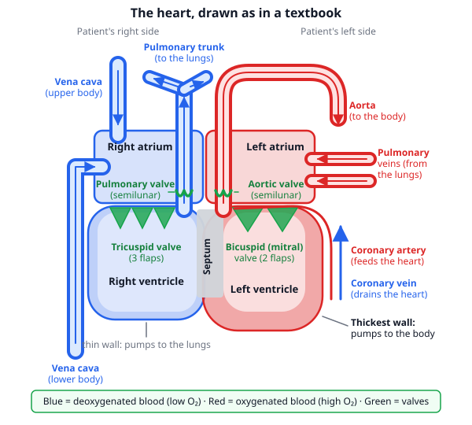
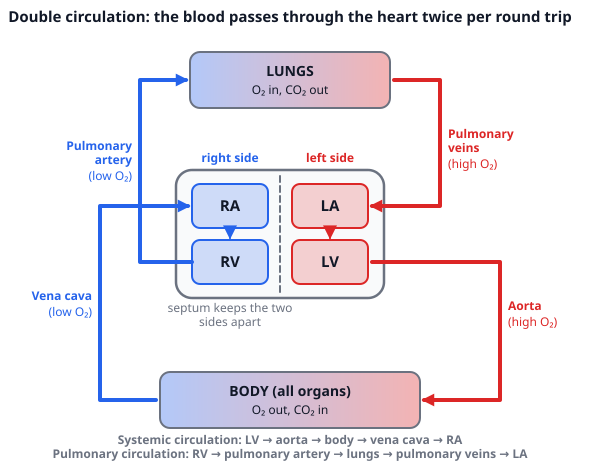
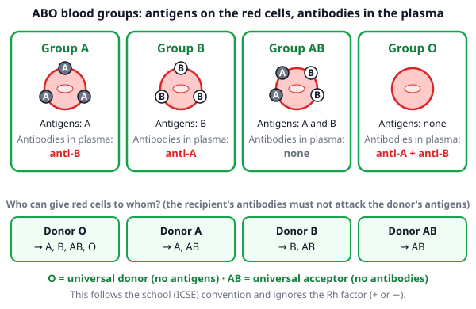
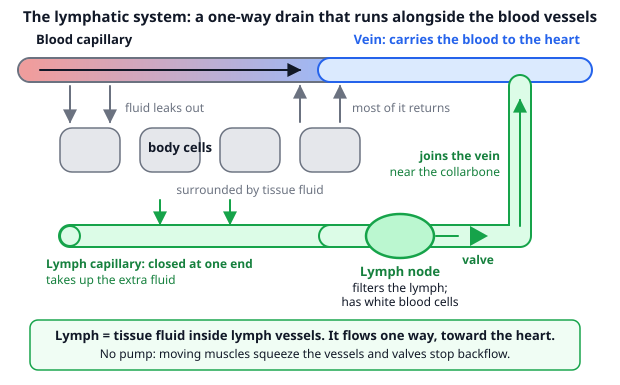

# 🟩 Circulatory System  ·  `biology.anatomy.circulatory`
> 📅 Study date: Fri 16 Oct · ⏱️ ~12 min read · 📋 Syllabus: Heart structure, valves, septum, Double circulation, Major blood vessels, ABO blood groups, Heart conditions, Lymphatic system

## 🏊 Start with your pulse after a sprint
Swim 50 meters as fast as you can, then put two fingers on your neck. You can feel your **heart racing**: maybe 160 beats in a minute instead of 70. Your muscles are screaming for oxygen, and the heart is the **pump** that sends it to them through the blood. Today you learn the pump itself (four chambers and four valves), the loop the blood travels, the blood groups, and the "drain" system that runs next to the blood vessels.

## 🖼️ Big picture

## 💡 Core ideas
1. **Heart structure.** The heart is a **muscle pump** with **four chambers**. The two upper **atria** (one is an **atrium**) **receive** blood. The two lower **ventricles** **pump** it out. A wall called the **septum** separates the **right** side from the **left** side, so oxygen-poor and oxygen-rich blood **never mix**. **Valves** let blood go one way only: the **tricuspid valve** (3 flaps) between the right atrium and right ventricle, the **bicuspid (mitral) valve** (2 flaps) between the left atrium and left ventricle, and a **semilunar valve** (half-moon shaped) at each exit: the **pulmonary valve** and the **aortic valve**. The **left ventricle has the thickest wall**, because it pushes blood all the way round the body. At rest an adult heart beats about 60–100 times a minute and pushes out about 70 mL of blood per beat.
2. **Double circulation.** In one full round trip the blood goes through the heart **twice**. **Pulmonary circulation:** right ventricle → **pulmonary trunk** → lungs → **pulmonary veins** → left atrium. **Systemic circulation:** left ventricle → **aorta** → body → **vena cava** → right atrium. The full path, with valves: vena cava → right atrium → tricuspid valve → right ventricle → pulmonary valve → pulmonary trunk → lungs → pulmonary veins → left atrium → bicuspid valve → left ventricle → aortic valve → aorta → body → vena cava.
3. **Major blood vessels.** **Arteries** carry blood **away from** the heart and **veins** carry blood **to** the heart. Do not use "oxygen" to decide, because the pulmonary vessels are the exceptions (see the table). The heart muscle has its own supply: the **coronary arteries** branch off the aorta right above the aortic valve and feed the heart muscle, and the **coronary veins** drain it back into the right atrium.
4. **ABO blood groups.** Red blood cells can carry **antigens** (markers) **A** and/or **B**. The plasma has **antibodies** against the antigens you lack. Group **A**: antigen A, antibody anti-B. **B**: antigen B, anti-A. **AB**: both antigens, no antibodies. **O**: no antigens, both antibodies. A transfusion fails if the recipient's antibodies meet an antigen they attack (the red cells **clump**). So **O is the universal donor** (its red cells have no antigens) and **AB is the universal acceptor** (it has no antibodies). This is the school (ICSE) idea and it ignores the Rh factor (+ or −).
5. **Heart conditions.** **Palpitations:** you notice your heartbeat as fast, pounding or fluttering. Often harmless (exercise, stress, caffeine), sometimes a sign of a heart problem. **Cardiac arrest:** the heart suddenly stops pumping blood. It is an emergency. (A **heart attack** is different: a blocked coronary artery cuts the blood supply to part of the heart muscle.) **Hypertension:** **high blood pressure**, when the pressure of the blood on the artery walls stays too high. Normal is below about 120/80 mm Hg. It strains the heart and the vessels, and often has no symptoms.
6. **Lymphatic system.** A **parallel** system of thin **lymph vessels** and **lymph nodes** beside the blood vessels. Some fluid always leaks out of the blood capillaries into the tissues. Most of it goes back into the blood, and the rest is picked up as **lymph**. Lymph flows **one way, toward the heart**, and joins a vein near the collarbone. It has **no pump** of its own: moving muscles squeeze the vessels, and **valves** stop backflow. **Lymph nodes** filter germs and contain white blood cells. Lymph vessels in the gut also take up digested fats.

| Vessel | From → to | Oxygen in the blood |
|---|---|---|
| **Aorta** | left ventricle → body | high (red) |
| **Pulmonary trunk** (splits into two pulmonary arteries) | right ventricle → lungs | low (blue) |
| **Pulmonary veins** | lungs → left atrium | high (red) |
| **Vena cava** (upper and lower) | body → right atrium | low (blue) |
| **Coronary artery** | aorta → heart muscle | high (red) |
| **Coronary vein** | heart muscle → right atrium | low (blue) |

> 🚚 **Analogy:** the heart is a double delivery depot: one side sends empty trucks to the lungs to load oxygen, and the other side sends the loaded trucks to the whole city. **The difference:** the blood is not "used up" like cargo: it goes round and round, and the same blood passes through the heart twice per round trip.

## 🧮 HUSO-style examples

**Example 1.** Blood leaves the **right ventricle**. Which route takes it to the **aorta**?

(A) pulmonary trunk → lungs → pulmonary veins → left atrium → left ventricle → aorta  (B) pulmonary veins → lungs → pulmonary trunk → left atrium → left ventricle → aorta  (C) pulmonary trunk → lungs → vena cava → right atrium → left ventricle → aorta  (D) pulmonary trunk → lungs → pulmonary veins → right atrium → left ventricle → aorta  (E) septum → left ventricle → aorta

Steps:
1. The right ventricle pumps blood **out** through the **pulmonary valve** into the **pulmonary trunk**, which leads to the **lungs**.
2. From the lungs the blood returns in the **pulmonary veins** and enters the **left atrium**. On the way it turned from blue (low oxygen) to red (high oxygen).
3. Through the **bicuspid valve** it drops into the **left ventricle**, which pumps it through the **aortic valve** into the **aorta**. **Answer: (A).**
4. Valves met on this route: pulmonary valve, bicuspid valve, aortic valve: **3**.
5. Traps: (B) goes **backwards**: blood leaves the heart in an artery and returns in a vein. (C) uses the vena cava, which brings blood from the **body** to the right atrium, not from the lungs. (D) puts the blood in the right atrium, but the pulmonary veins end in the **left** atrium. (E) skips the lungs: nothing crosses the septum.

**Example 2.** 🏊 A swimmer with blood group **A** needs a transfusion of red blood cells. Which donor groups are safe?

(A) A only  (B) A and O  (C) A and AB  (D) B and O  (E) O only

Steps:
1. Group A plasma contains **anti-B** antibodies. They attack red cells that carry antigen **B**.
2. Check each donor: A has antigen A only: safe. B has antigen B: **clumps**. AB has A and B: **clumps**. O has no antigens: safe.
3. Safe donors: **A and O**. **Answer: (B).**
4. Traps: (A) forgets that O is safe for everyone. (C) AB carries antigen B. (D) B carries antigen B. (E) forgets that the same group A is also safe.

## ⚠️ Common traps
- **"Arteries carry oxygen-rich blood, veins oxygen-poor."** Not always: the **pulmonary artery** carries low-oxygen blood and the **pulmonary veins** carry high-oxygen blood. Use "away from / toward the heart".
- **Left and right swapped.** In a textbook drawing the **patient's right** is on the **left of the page**. The right atrium (blue) is on the left of the picture.
- **O and AB mixed up.** O is the universal **donor**, AB is the universal **acceptor**. Think: O has "Oh, nothing" on its cells, AB accepts everything.
- **Lymph is not a loop.** It starts in the tissues, flows one way, and ends in a vein. It also has no heart-like pump.

## ✏️ Redraw from memory
Close the page and draw in 5 minutes:
- [ ] The heart with 4 chambers, the septum and 4 valves, colored blue (right side) and red (left side).
- [ ] The main vessels: vena cava, pulmonary trunk, pulmonary veins, aorta, coronary artery.
- [ ] The double circulation loop: heart, lungs and body with arrows and colors.
- [ ] A table of the four blood groups with antigens and antibodies, and who can give to whom.
- [ ] The three heart conditions (one line each) and a sketch of the lymph system with a node and a valve.

Compare with the page and mark what you missed in red.

## 🎥 Watch / try
- [Circulatory System and Pathway of Blood Through the Heart](https://www.youtube.com/watch?v=_vZ0lefPg_0) — Amoeba Sisters · 8:14 · follow the blood through every chamber and valve in order
- [Blood types | Human anatomy and physiology](https://www.youtube.com/watch?v=Nnqp_3HMlDU) — Khan Academy · 8:53 · watch how antigens and antibodies decide who can donate (it also covers Rh, which you can skip)

## ✅ Check your understanding (5 questions)
Do these without looking at the material. You are **READY** if you get at least 4 of 5 right.

**1.** Which valve lies between the left atrium and the left ventricle?

(A) Tricuspid valve  (B) Pulmonary valve  (C) Aortic valve  (D) Bicuspid valve  (E) Coronary valve

**2.** 🏊 After a 50 m sprint you count 40 heartbeats in 15 seconds. Suppose each beat pushes out 80 mL of blood. How much blood does the heart pump per minute? (Blood pumped per minute = beats per minute × mL per beat.)

(A) 12.8 L/min  (B) 3.2 L/min  (C) 1.28 L/min  (D) 160 L/min  (E) 12,800 L/min

**3.** Which of these vessels carries blood with a high oxygen content?

(A) Pulmonary artery  (B) Pulmonary vein  (C) Vena cava  (D) Pulmonary trunk  (E) Coronary vein

**4.** 🎮 Suppose a Valorant squad of five has blood groups A, B, AB, O and O. The player with group B is hurt and needs red blood cells. How many of the **other four** players can safely donate?

(A) 0  (B) 1  (C) 2  (D) 3  (E) 4

**5.** Which statement is correct?

(A) Palpitations means the heart has stopped pumping  (B) Hypertension means blood pressure that is too low  (C) Lymph is pushed around the body by the heart, like blood  (D) Cardiac arrest is a harmless fluttering feeling in the chest  (E) Lymph flows in one direction, from the tissues toward the veins near the heart

Answer key & explanations

1. **(D) Bicuspid valve.** The bicuspid (mitral) valve guards the opening from the left atrium to the left ventricle. (A) tricuspid is on the right side. (B) and (C) are the semilunar valves at the exits of the ventricles. (E) there is no such valve: the coronary vessels feed the heart muscle.
2. **(A) 12.8 L/min.** 40 beats in 15 s is 40 × 4 = 160 beats per minute. 160 × 80 mL = 12,800 mL = 12.8 L. (B) forgets to multiply by 4 (40 × 80 mL = 3.2 L). (C) puts the decimal point in the wrong place. (D) is just the number of beats per minute. (E) forgets to change mL into L.
3. **(B) Pulmonary vein.** It brings blood from the lungs, full of oxygen, to the left atrium. (A) and (D) carry blood **to** the lungs, with low oxygen. (C) brings low-oxygen blood from the body. (E) drains the heart muscle after it has used the oxygen.
4. **(C) 2.** A group B patient has anti-A antibodies, so the donor must not have antigen A: only B and O are safe. The other four players have A, AB, O, O. A and AB have antigen A, so they are out. The two O players can donate: 2. (D) 3 counts AB, which is the universal **acceptor**, not a donor. (B) 1 counts only one O. (E) 4 counts everyone. (A) 0 forgets that O is the universal donor.
5. **(E).** Lymph flows one way, from the tissues to veins near the collarbone and heart. (A) is cardiac arrest. (B) hypertension is **high** blood pressure. (C) lymph has no pump: muscles and valves move it. (D) is palpitations, not cardiac arrest.

