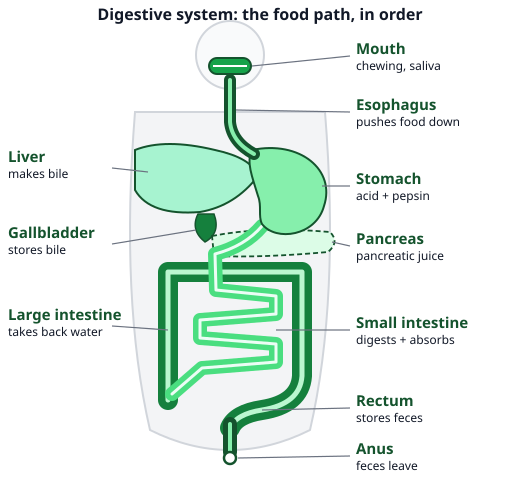
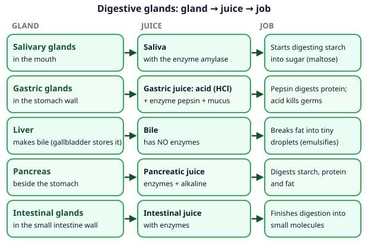
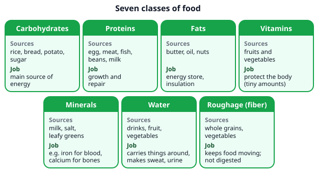
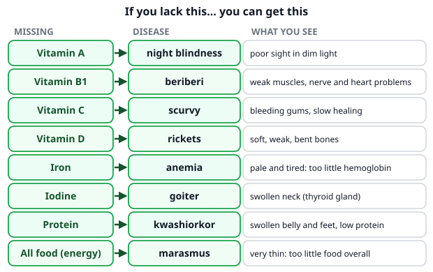

# 🟩 Digestive System  ·  `biology.anatomy.digestive`
> 📅 Study date: Fri 23 Oct · ⏱️ ~12 min read · 📋 Syllabus: Organs and glands, Classes of food, balanced diet, Deficiency diseases

## 🍳 Start with a plate of pasta
You cook creamy pasta with cheese and a spoonful of butter. A pot of boiling water softens the starch, but the real "cooking" of the meal happens **inside you** for the next hours. The pasta gets chewed, mixed with juices, and cut into tiny pieces that your blood can carry. Think of it like a kitchen where every station does one job. **The difference:** a kitchen chops food into smaller pieces. Your body also uses **enzymes** (special proteins) to cut the food into **molecules** so small that they can pass into your blood. By the end of this page you can follow one forkful from mouth to exit and say what each station does.

## 🖼️ Big picture

## 💡 Core ideas
1. **The food tube (alimentary canal), in order:** **mouth → esophagus → stomach → small intestine → large intestine → rectum → anus.** The esophagus pushes food down with waves of muscle squeezing (**peristalsis**). The **small intestine** is the longest part, and it is "small" only because it is **narrow**. The **liver, gallbladder and pancreas** are **not** part of the food tube: they sit beside it and send juices into it.
2. **Digestive glands and what they make.** A **gland** is an organ that makes a juice. **Salivary glands:** saliva with the enzyme **amylase** (starts digesting **starch**). **Gastric glands** (in the stomach wall): **hydrochloric acid (HCl)** + the enzyme **pepsin** (digests **protein**). **Liver:** **bile**, which has **no enzymes**: it breaks fat into tiny droplets so enzymes can work on it. The **gallbladder** only **stores** bile. **Pancreas:** pancreatic juice, with enzymes for **starch, protein and fat**. **Intestinal glands:** juice with enzymes that **finish** the job.
3. **Absorption.** **Digestion** breaks food into small molecules. **Absorption** moves them **into the blood**. Most absorption happens in the **small intestine**, whose inner wall is covered with **villi** (tiny finger-like folds) that give a huge surface. The **large intestine** takes back mostly **water**. What is left (undigested food) is stored in the **rectum** and leaves through the **anus** as **feces**.
4. **Classes of food (7).** **Carbohydrates** (rice, bread, potato): the main **energy** source. **Proteins** (egg, meat, beans, milk): **growth and repair**. **Fats** (butter, oil, nuts): **energy store** and insulation. **Vitamins** (fruit, vegetables): protect the body, needed in **tiny** amounts. **Minerals** (like iron and calcium): e.g. blood and bones. **Water**: carries things around, needed for sweat and urine. **Roughage (fiber)**: plant material that humans **cannot digest**; it keeps food moving through the gut. Energy per gram, roughly: carbohydrate **4 kcal**, protein **4 kcal**, fat **9 kcal**.
5. **Balanced diet.** A **balanced diet** has **all the classes** in the **right amounts** for your age and activity (a swimmer in training needs more energy than someone sitting all day). **Malnutrition** means a bad balance: too little, too much, or a missing nutrient.
6. **Deficiency diseases** happen when one nutrient is **missing** for a long time: **vitamin A** → **night blindness**; **vitamin B1** → **beriberi**; **vitamin C** → **scurvy**; **vitamin D** → **rickets**; **iron** → **anemia**; **iodine** → **goiter**; **protein** → **kwashiorkor**; too little food overall → **marasmus**.

> 🍳 **Analogy:** digestion is like a disassembly line in a kitchen: mouth chops and starts the starch, stomach stirs in acid and breaks protein, the small intestine adds the last juices and sends the nutrients through the wall into the blood. **The difference:** each station really is chemical: enzymes cut molecules into smaller ones. It is not only chopping.

## 🧮 HUSO-style examples

**Example 1.** 🍳 A snack bar label says: carbohydrate 30 g, protein 10 g, fat 8 g. Use 4 kcal per gram for carbohydrate and protein, and 9 kcal per gram for fat. About how much energy is in the bar?

(A) 48 kcal  (B) 160 kcal  (C) 192 kcal  (D) 232 kcal  (E) 432 kcal

Steps:
1. Carbohydrate: 30 × 4 = **120 kcal**. Protein: 10 × 4 = **40 kcal**. Fat: 8 × 9 = **72 kcal**.
2. Add: 120 + 40 + 72 = **232 kcal**. **Answer: (D).**
3. Traps: (A) 48 is the total grams, not energy. (B) 160 forgets the fat. (C) 192 counts fat as 4 kcal per gram (48 × 4). (E) 432 gives every gram 9 kcal (48 × 9).

**Example 2.** You eat a sandwich with bread (mostly starch) and egg (mostly protein). Where does the digestion of the starch **begin**, and where does the digestion of the protein **begin**?

(A) mouth, stomach  (B) stomach, mouth  (C) mouth, small intestine  (D) stomach, small intestine  (E) small intestine, stomach

Steps:
1. Saliva has **amylase**, so starch digestion **begins in the mouth** (as you chew).
2. The stomach juice has **pepsin** and acid, so protein digestion **begins in the stomach**. **Answer: (A).**
3. Traps: (B) swaps the two. (C) and (D) say the small intestine, which is where digestion is **finished**, not begun. (E) is the opposite of the real order.

## ⚠️ Common traps
- **"Bile contains enzymes."** No. Bile has **no enzymes**. It only breaks fat into droplets (a bit like dish soap on a greasy pan) so that **pancreatic enzymes** can digest it.
- **Liver and pancreas are part of the food tube.** No: food never goes through them. They are **glands** that send juices into the small intestine.
- **"Small intestine = short."** It is the **longest** part of the canal, and called small because it is **narrow**.
- **Roughage is a nutrient that gives energy.** No: humans cannot digest fiber. It helps move food along but gives no energy.
- **Mixing up scurvy and rickets.** Scurvy (bleeding gums) = vitamin **C**. Rickets (soft bones) = vitamin **D**.

## ✏️ Redraw from memory
Close the page and draw in 5 minutes:
- [ ] The food tube in order, with 7 labels (mouth to anus), and the liver, gallbladder and pancreas beside it.
- [ ] A table with 5 glands: gland → juice → job (remember: bile has no enzymes).
- [ ] The 7 classes of food, each with one source and one job.
- [ ] The deficiency pairs: A–night blindness, B1–beriberi, C–scurvy, D–rickets, iron–anemia, iodine–goiter.
- [ ] A villus (finger-like fold) in the small intestine, with an arrow "nutrients → blood".

Compare with the page and mark what you missed in red.

## 🎥 Watch / try
- [Digestive System](https://www.youtube.com/watch?v=1UvuBYUbFk0) — Amoeba Sisters · 8:43 · the organs in order and which enzyme works where
- [How your digestive system works](https://www.youtube.com/watch?v=Og5xAdC8EUI) — TED-Ed · 4:57 · a quick animated trip from mouth to exit

## ✅ Check your understanding (5 questions)
Do these without looking at the material. You are **READY** if you get at least 4 of 5 right.

**1.** 🍳 A forkful of pasta goes through the alimentary canal. In which order does it pass these organs?

(A) mouth → stomach → esophagus → small intestine → large intestine → rectum  (B) mouth → esophagus → stomach → large intestine → small intestine → rectum  (C) mouth → esophagus → stomach → small intestine → large intestine → rectum  (D) mouth → esophagus → small intestine → stomach → large intestine → rectum  (E) mouth → esophagus → stomach → liver → small intestine → large intestine

**2.** Which row names the organ that makes bile and says correctly what bile does?

(A) pancreas; makes enzymes that digest starch  (B) gallbladder; makes bile that digests protein  (C) liver; makes bile that contains the enzyme lipase  (D) liver; makes bile that breaks fat into tiny droplets  (E) stomach; makes bile that kills germs

**3.** 🏊 A swimmer feels very tired and looks pale. A blood test shows too little hemoglobin. Which missing nutrient is the most likely cause?

(A) iron  (B) iodine  (C) calcium  (D) vitamin D  (E) vitamin A

**4.** 🍳 Suppose a recipe uses 10 g of butter (pure fat) and another uses 20 g of sugar (pure carbohydrate). Using 9 kcal per gram for fat and 4 kcal per gram for carbohydrate, how many more kcal are in the butter?

(A) 0 kcal  (B) 10 kcal  (C) 50 kcal  (D) 80 kcal  (E) 170 kcal

**5.** Where does most absorption of digested food into the blood happen, and what feature helps?

(A) the stomach, because of its strong acid  (B) the large intestine, because of its width  (C) the esophagus, because of peristalsis  (D) the rectum, because it stores feces  (E) the small intestine, because villi give a large surface area

Answer key & explanations

1. **(C) mouth → esophagus → stomach → small intestine → large intestine → rectum.** The pasta travels down the tube in this order. (A) puts the stomach before the esophagus. (B) swaps the two intestines. (D) puts the small intestine before the stomach. (E) puts the liver on the path, but food never enters the liver.
2. **(D) liver; makes bile that breaks fat into tiny droplets.** The liver makes bile and the gallbladder only stores it. Bile has no enzymes. (A) names the pancreas, which makes pancreatic juice, not bile. (B) the gallbladder stores bile and bile does not digest protein. (C) bile has no enzymes. (E) bile is not made in the stomach.
3. **(A) iron.** Iron is needed to make hemoglobin, and too little causes anemia (pale, tired). (B) iodine lack causes goiter. (C) calcium is for bones and teeth. (D) vitamin D lack causes rickets. (E) vitamin A lack causes night blindness.
4. **(B) 10 kcal.** Butter: 10 × 9 = 90 kcal. Sugar: 20 × 4 = 80 kcal. 90 − 80 = **10 kcal**. (A) 0 assumes they have the same energy. (C) 50 uses 10 g of sugar (90 − 40). (D) 80 is the energy of the sugar alone. (E) 170 adds the two (90 + 80).
5. **(E).** Most absorption happens in the small intestine, which has villi that make the surface huge. (A) the stomach mostly digests protein. (B) the large intestine takes back mainly water. (C) the esophagus only moves food down. (D) the rectum only stores feces.

