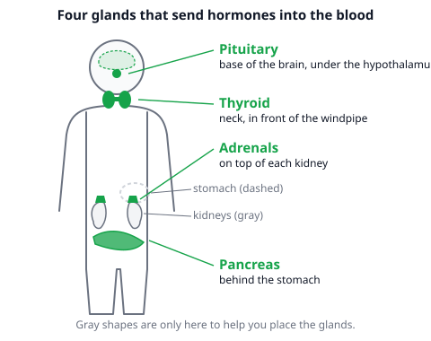
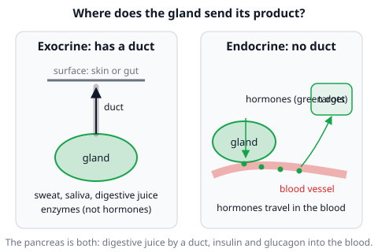
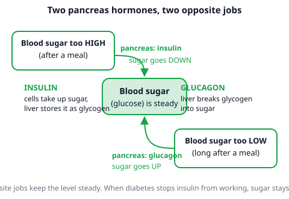

# 🟩 Endocrine System  ·  `biology.anatomy.endocrine`
> 📅 Study date: Thu 29 Oct · ⏱️ ~12 min read · 📋 Syllabus: Exocrine vs endocrine, Thyroid, Adrenal, Pancreas, Pituitary

## 🏊 Start with the starting block
You stand on the block, waiting for the whistle. Your heart is pounding, your hands are shaking and you feel wide awake, even though you did not tell your heart to speed up. A chemical message did it. That message is a **hormone** called **adrenaline**, and it travels through your blood from a small gland on top of your kidneys. By the end of this page you will know four glands, where they sit and what they send.

## 🖼️ Big picture

## 💡 Core ideas
1. **Two kinds of glands.** A **gland** is an organ that makes a substance and releases it. **Exocrine** glands send their product along a **duct** (a small tube) to a surface, for example sweat, saliva or digestive juice. **Endocrine** glands have **no ducts**: they release **hormones** straight into the blood.
2. **Hormone = chemical messenger.** A hormone is made in an endocrine gland, travels in the **blood** and changes how a **target** organ works, even in tiny amounts. Hormones are slower than nerve signals, but their effects last longer.
3. **The four glands in one table.** The syllabus asks for this table. Learn it row by row.

| Gland | Location | Secretion | Function |
|---|---|---|---|
| **Thyroid** | neck, in front of the windpipe | thyroxine | controls how fast the body uses energy (metabolic rate); needs iodine |
| **Adrenal** | on top of each kidney | adrenaline | prepares the body for danger ("fight or flight") |
| **Pancreas** | behind the stomach | insulin and glucagon | insulin lowers blood sugar; glucagon raises it |
| **Pituitary** | base of the brain, hanging below the hypothalamus | growth hormone and others | controls growth and controls other glands ("master gland") |

4. **Adrenal: the emergency gland.** The name helps: *ad-renal* means "next to the **kidney**". Adrenaline makes the heart beat faster, makes you breathe faster and makes the liver release sugar for the muscles. (The outer part of the adrenal gland also makes other hormones, but the exam focus is adrenaline.) **Thyroid:** thyroxine sets your energy-use speed. The thyroid needs **iodine** to make it. Without iodine the thyroid swells in the neck, a **goiter**.
5. **Pancreas: two jobs.** It is **exocrine** (digestive juice through a duct into the small intestine) and **endocrine** (insulin and glucagon into the blood). **Insulin** helps sugar go **in**to cells and be stored, so blood sugar falls. **Glucagon** tells the liver to release sugar, so blood sugar rises. Together they keep blood sugar steady.
6. **Pituitary: the master gland.** A pea-sized gland at the base of the brain. It makes **growth hormone** and hormones that tell other glands what to do, so it is called the master gland. 🎮 *Analogy:* it is like the in-game leader who calls the plays for the rest of the team. **The difference:** the pituitary itself takes orders from the brain's hypothalamus, and its "calls" are chemicals in the blood, not voice chat.

## 🧮 HUSO-style examples

**Example 1.** 🏊 A swimmer is waiting on the starting block and her heart starts to beat faster. A hormone causes this. Which statement is correct?

(A) It is thyroxine, made in the neck and sent along a duct to the heart.
(B) It is adrenaline, made on top of the kidneys and carried to the heart by the blood.
(C) It is insulin, made behind the stomach and carried to the heart by the blood.
(D) It is growth hormone, made at the base of the brain and sent along a duct to the heart.
(E) It is adrenaline, made on top of the kidneys and sent along a duct to the heart.

Steps:
1. A faster heartbeat before a race is the "fight or flight" reaction, and that is the job of **adrenaline**. This removes (A), (C) and (D): thyroxine sets energy use slowly, insulin handles sugar, growth hormone handles growth.
2. Adrenaline is made by the **adrenal** glands, which sit **on top of the kidneys**.
3. Endocrine glands have **no ducts**, so adrenaline must travel in the **blood**. This removes (E). **Answer: (B).**
4. Traps: (E) gets the hormone and gland right but uses a duct, which is exocrine behavior.

**Example 2.** 🍳 After a big dessert, the sugar in your blood goes up. Which pair of statements is correct?

(A) The pancreas releases glucagon, and blood sugar falls.
(B) The pancreas releases insulin, and blood sugar falls.
(C) The pancreas releases insulin, and blood sugar rises even more.
(D) The thyroid releases insulin, and blood sugar falls.
(E) The adrenal glands release glucagon, and blood sugar rises.

Steps:
1. Sugar is **too high**, so the body needs to bring it **down**.
2. The hormone that lowers blood sugar is **insulin** (it moves sugar **in**to cells and into storage). Glucagon does the opposite. This removes (A) and (E).
3. Insulin is made in the **pancreas**, not the thyroid. This removes (D). Insulin lowers blood sugar, so (C) is wrong too. **Answer: (B).**

## ⚠️ Common traps
- **"Endocrine glands use ducts."** No: **exocrine = duct**, **endocrine = no duct, hormones into blood**. The pancreas does both.
- **Swapping insulin and glucagon.** Insulin puts sugar **in**. Glucagon lets sugar out of storage so blood sugar goes **up**.
- **Mixing up the thyroid and the adrenal glands.** *Ad-renal* = by the kidney, the **adrenaline** gland. The thyroid is in the **neck** and makes **thyroxine**.
- **Thinking hormones are fast like nerves.** Hormones go through the blood, so they are slower but last longer.

## ✏️ Redraw from memory
Close the page and draw a simple body outline in 5 minutes, then add the four glands:
- [ ] Pituitary at the base of the brain, with the label "master gland".
- [ ] Thyroid in the neck (a butterfly shape) with "thyroxine".
- [ ] Two adrenal glands sitting on top of two kidneys with "adrenaline".
- [ ] Pancreas behind the stomach with "insulin and glucagon".
- [ ] A small box: exocrine = duct, endocrine = no duct, hormones into blood.

Compare with the page and mark what you missed in red.

## 🎥 Watch / try
- [Endocrine System](https://www.youtube.com/watch?v=emvHaBiRY8Q) — Amoeba Sisters · 9:24 · look for how hormones travel in the blood to target cells
- [Great Glands - Your Endocrine System](https://www.youtube.com/watch?v=WVrlHH14q3o) — CrashCourse · 11:21 · look for the glands and what each one makes

## ✅ Check your understanding (5 questions)
Do these without looking at the material. You are **READY** if you get at least 4 of 5 right.

**1.** Which of these glands works as **both** an exocrine and an endocrine gland?

(A) Thyroid  (B) Pituitary  (C) Pancreas  (D) Adrenal  (E) Salivary gland

**2.** A person lives for years on a diet with almost no iodine. Which gland is most likely to swell, and which hormone does it fail to make?

(A) Pituitary, growth hormone  (B) Pancreas, insulin  (C) Adrenal, adrenaline  (D) Thyroid, insulin  (E) Thyroid, thyroxine

**3.** 🎮 Suppose a team has an in-game leader who calls the plays, and the other players follow. Which gland plays that part in the endocrine system, because its hormones control several other glands?

(A) Pituitary  (B) Thyroid  (C) Adrenal  (D) Pancreas  (E) Salivary gland

**4.** 🍳 A student skips lunch, and the sugar level in the blood starts to drop too low. Which response is correct?

(A) Insulin is released, and the liver stores more sugar.
(B) Insulin is released, and the liver sends sugar into the blood.
(C) Glucagon is released, and the liver stores more sugar.
(D) Glucagon is released, and the liver breaks down stored sugar so blood sugar rises.
(E) Adrenaline is released by the pancreas, and blood sugar falls.

**5.** Which row matches the gland with the correct location and hormone?

(A) Thyroid, on top of the kidneys, adrenaline
(B) Adrenal, on top of the kidneys, adrenaline
(C) Pancreas, in the neck, thyroxine
(D) Pituitary, behind the stomach, insulin
(E) Thyroid, at the base of the brain, growth hormone

Answer key & explanations

1. **(C) Pancreas.** It makes digestive juice that goes through a duct to the small intestine (exocrine) and insulin and glucagon that go into the blood (endocrine). (E) The salivary gland is exocrine only: saliva goes through a duct into the mouth. (A), (B) and (D) are endocrine only.
2. **(E) Thyroid, thyroxine.** The thyroid needs iodine to build thyroxine. Without iodine it swells (a goiter). (D) is the right gland but insulin is made in the pancreas. (A), (B) and (C) name other glands that do not need iodine for their hormones.
3. **(A) Pituitary.** It is called the master gland because its hormones control other glands. **The difference:** a game leader decides alone, while the pituitary itself is directed by the hypothalamus. (B), (C) and (D) are endocrine glands with their own jobs. (E) is not an endocrine gland.
4. **(D) Glucagon, liver breaks down stored sugar.** Low blood sugar triggers glucagon from the pancreas, and the liver turns stored glycogen back into sugar, so blood sugar **rises**. (A) and (B) use insulin, which is for **high** sugar. (C) has the right hormone but the liver would then store sugar, which lowers it. (E) adrenaline comes from the adrenal glands, not from the pancreas.
5. **(B) Adrenal, on top of the kidneys, adrenaline.** (A) swaps the thyroid and adrenal glands. (C) the pancreas is behind the stomach and makes insulin and glucagon; thyroxine comes from the neck. (D) the pituitary is at the base of the brain and does not make insulin. (E) the thyroid is in the neck, not at the base of the brain.

