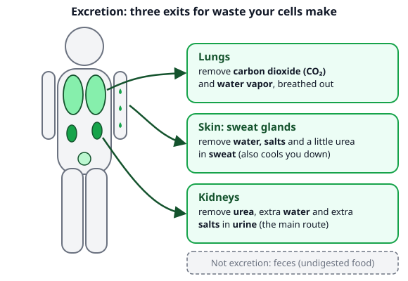
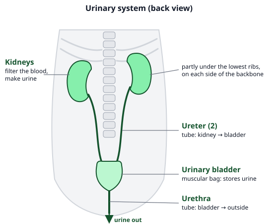
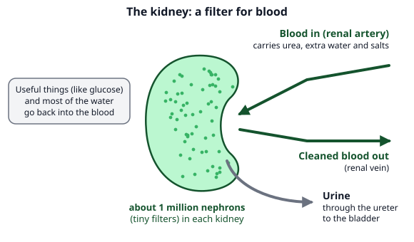

# 🟩 Excretory System  ·  `biology.anatomy.excretory`
> 📅 Study date: Wed 21 Oct · ⏱️ ~12 min read · 📋 Syllabus: Kidneys, ureter, bladder, urethra, Sweat glands, lungs, Filtration by nephrons

## 🏊 Start with a wet swimmer
After 40 laps you climb out of the pool, dripping wet. You feel thirsty even though you were in water all the time. The reason: you were **sweating** in the pool too, and the water hid it. Your body also lost water in every breath you breathed out. Your body is always losing water and making waste, and it has three exits to get rid of it. This page shows you the three exits and how the **kidneys** clean your blood.

## 🖼️ Big picture

## 💡 Core ideas
1. **What excretion is.** **Excretion** means removing the **waste that your own cells make** (called metabolic waste). The main wastes are **carbon dioxide** (CO₂), **water**, extra **salts** and **urea**. Urea is a waste made in the **liver** when the body breaks down **protein**. **Feces** are **not** excretion: they are undigested food that never became part of your cells (that is called **egestion**).
2. **Three organs, three products.** **Kidneys:** urea, extra water and extra salts, in **urine** (the main route for urea). **Sweat glands in the skin:** water, salts and a little urea, in **sweat** (sweat also cools you down). **Lungs:** carbon dioxide and water vapor, in the air you **breathe out**.
3. **The urinary system.** Two **kidneys** sit at the back of the belly, one on each side of the backbone, partly tucked under the lowest ribs. They make **urine**. A long thin tube, the **ureter**, carries urine from each kidney down to the **urinary bladder**. The bladder is a stretchy muscular bag that **stores** the urine. The **urethra** is the tube that carries urine from the bladder **out of the body**.
4. **Kidneys filter blood.** Blood reaches each kidney through the **renal artery**. Inside the kidney, about **a million tiny filters called nephrons** (so about 2 million in the two kidneys) clean the blood. They take out the waste and the extra water and salts, and they send the useful things, such as glucose and most of the water, **back** to the blood. The cleaned blood leaves through the **renal vein**. What is left over is **urine**. (You do not need the inside structure of a nephron.)
5. **What is in urine.** Urine is **mostly water** (about 91–96 %) with **urea** and salts dissolved in it. An adult makes about **1.4 liters a day**. The amount depends on how much you drink and sweat: if you lose a lot of water as sweat, your kidneys **save** water and you make **less, darker, more concentrated** urine.
6. **Sweat and lungs.** The main job of **sweating** is **cooling**: sweat evaporates and takes heat from your skin. Sweat is mostly water with some salts and a little urea. The **lungs** remove the CO₂ that your cells make when they release energy, plus some water vapor (you can see it as fog on a cold day).

> 🏊 **Analogy:** the kidney is like a pool filter. Dirty water goes in, the filter takes the dirt out, and clean water goes back to the pool. **The difference:** a pool filter just traps dirt. A kidney is choosy: it lets useful things like glucose go back to the blood and sends only the waste and the extras out.

## 🧮 HUSO-style examples

**Example 1.** 🏊 A swimmer trains for two hours in a hot, humid pool hall, sweating a lot and drinking very little. Which change in her urine is most likely?

(A) a large amount of pale urine  (B) a small amount of dark, concentrated urine  (C) no urine at all, because her kidneys stop working  (D) urine that contains no urea  (E) urine that is mostly sweat

Steps:
1. Sweating removes water from her body, so her blood becomes more concentrated (less water).
2. The kidneys **save water** when the body is short of it. Less water goes into the urine, but the **urea still has to leave**.
3. So there is **less** urine and it is **more concentrated** (darker). **Answer: (B).**
4. Traps: (A) is what happens after drinking a lot. (C) the kidneys keep working. (D) urea is always removed. (E) urine is made by the kidneys, not by the sweat glands.

**Example 2.** Which of the following is **NOT** an example of excretion?

(A) breathing out CO₂  (B) sweating  (C) forming urine in the kidneys  (D) passing undigested fiber out of the body as feces  (E) breathing out water vapor

Steps:
1. Excretion removes **waste made by the body's cells**. CO₂ (A and E), sweat (B) and urine (C) all come from cell activity.
2. Fiber in food is **never digested or absorbed**, so it was never part of the body's cells. Passing it out is **egestion**, not excretion. **Answer: (D).**

## ⚠️ Common traps
- **Feces = excretion.** No: feces are undigested food (egestion). Only wastes made **by cells** count: CO₂, urea, extra water and salts.
- **Ureter vs urethra.** **Ureter**: kidney → bladder (there are **two**, one per kidney). **Urethra**: bladder → outside (there is only **one**).
- **Kidneys make urea.** No. Urea is made in the **liver**. The kidneys only **filter it out** of the blood.
- **The bladder makes urine.** No. The kidneys make it; the bladder only **stores** it.

## ✏️ Redraw from memory
Close the page and draw in 5 minutes:
- [ ] The urinary system with 4 labels: **kidney, ureter, bladder, urethra**, and arrows for the way urine moves.
- [ ] A body outline with three arrows to the three exits (lungs, skin, kidneys) and what each removes.
- [ ] A kidney with "blood in" (renal artery), "cleaned blood out" (renal vein) and "urine out" (ureter).
- [ ] The words **"about 1 million nephrons in each kidney"**.
- [ ] One sentence: why feces are not excretion.

Compare with the page and mark what you missed in red.

## 🎥 Watch / try
- [Urinary System, Part 1: Crash Course Anatomy & Physiology #38](https://www.youtube.com/watch?v=l128tW1H5a8) — CrashCourse · 10:18 · the organs and what the kidneys do; the detailed nephron parts are extra
- [Excretory System and the Nephron](https://www.youtube.com/watch?v=q5qaGHfdmYM) — Amoeba Sisters · 9:50 · watch the first part about waste and the organs; skip the nephron details

## ✅ Check your understanding (5 questions)
Do these without looking at the material. You are **READY** if you get at least 4 of 5 right.

**1.** Which list shows the path of urine in the correct order?

(A) kidney → bladder → ureter → urethra  (B) kidney → urethra → bladder → ureter  (C) kidney → ureter → urethra → bladder  (D) kidney → ureter → bladder → urethra  (E) bladder → kidney → ureter → urethra

**2.** 🏊 During a hard sprint a swimmer's muscle cells make a lot of CO₂. By which route does most of this CO₂ leave her body?

(A) the lungs, as exhaled air  (B) the kidneys, as urine  (C) the sweat glands, as sweat  (D) the large intestine, as feces  (E) the bladder, as urine

**3.** 🍳 A steak is rich in protein. After the protein is digested, the body uses its amino acids and makes a nitrogen-containing waste in the liver. What is this waste?

(A) glucose  (B) bile  (C) carbon dioxide  (D) fatty acids  (E) urea

**4.** 🏊 Suppose that in one day a swimmer drinks 2.0 L of water. She loses 0.9 L through sweat and her breath and 0.1 L in feces. Ignore water in food. If her body's total water stays the same, how much urine does she make?

(A) 0.9 L  (B) 1.0 L  (C) 1.1 L  (D) 1.9 L  (E) 3.0 L

**5.** Which statement about the kidneys is correct?

(A) They make urea from protein.  (B) They store urine until it leaves the body.  (C) Each one filters blood through about a million nephrons.  (D) They remove undigested food from the body.  (E) They are in the chest, above the lungs.

Answer key & explanations

1. **(D) kidney → ureter → bladder → urethra.** The kidney makes urine, the ureter carries it, the bladder stores it, the urethra lets it out. (A) puts the bladder before the ureter. (B) and (C) skip the ureter or the bladder in the wrong place. (E) starts at the bladder.
2. **(A) the lungs, as exhaled air.** CO₂ goes from the muscles into the blood and is breathed out at the lungs. Only tiny amounts leave in other ways. (B) and (E) urine mainly holds urea, water and salts. (C) sweat is mostly water and salts. (D) feces are not excretion.
3. **(E) urea.** When the body breaks down amino acids, the nitrogen ends up in urea (made in the liver). The kidneys then remove it in urine. (A) glucose is a sugar with no nitrogen. (B) bile is a digestive juice. (C) CO₂ has no nitrogen. (D) fatty acids come from fats and have no nitrogen.
4. **(B) 1.0 L.** Water in = water out: 2.0 = 0.9 + 0.1 + urine, so urine = 2.0 − 0.9 − 0.1 = **1.0 L**. (A) 0.9 L is only the sweat and breath loss. (C) 1.1 L forgets the 0.1 L in feces (2.0 − 0.9). (D) 1.9 L forgets the sweat and breath (2.0 − 0.1). (E) 3.0 L adds the losses instead of subtracting.
5. **(C).** Each kidney has about a million nephrons, the tiny filters. (A) urea is made in the liver. (B) the bladder stores urine. (D) undigested food leaves as feces from the large intestine. (E) the kidneys are at the back of the belly, not in the chest above the lungs.

