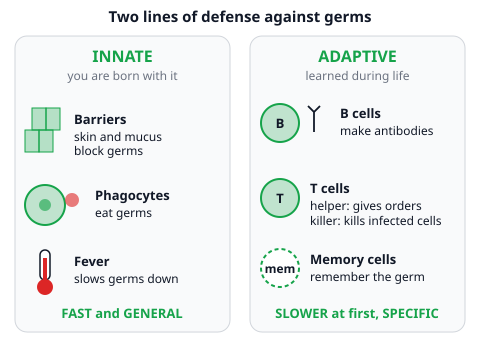
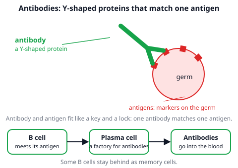
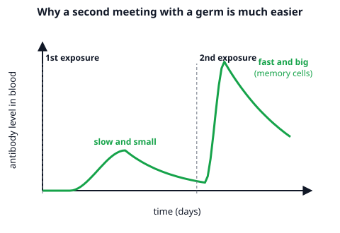

# 🟩 Immune System  ·  `biology.anatomy.immune`
> 📅 Study date: Mon 2 Nov · ⏱️ ~12 min read · 📋 Syllabus: Innate vs adaptive, B and T cells, Antibodies, Allergy

## 🍳 Start with a kitchen and a cookie
You wash your hands and wipe the board after cutting raw chicken. Why? Germs are everywhere, and your body is already fighting them all day. But picture a classmate who takes one bite of a peanut cookie and gets hives and a swollen lip. The same defense team that protects you is **overreacting** to something harmless. This page shows how the team works, and what happens when it makes a mistake.

## 🖼️ Big picture

## 💡 Core ideas
1. **Two lines of defense.** **Innate** immunity is what you are born with. It is **fast** (minutes to hours) and **general**: it treats many different germs the same way. **Adaptive** immunity is learned during life. It is **slower the first time** (days), but it is **specific** (aimed at one germ) and it has **memory**.
2. **Innate tools.** **Skin** is a wall. **Mucus** (in the nose and airways) traps germs so they can be swept out. **Phagocytes** are white blood cells that **eat** germs. **Fever** (a higher body temperature) slows many germs down.
3. **B cells and T cells.** Both are white blood cells called **lymphocytes**, and they are the stars of adaptive immunity. **B cells** make **antibodies**. **T cells** come in two main kinds: **helper T cells** give orders and switch on other immune cells, and **killer T cells** destroy body cells that are already infected.
4. **Antibodies.** An **antigen** is a marker on a germ (or any foreign substance) that the immune system can recognize. An **antibody** is a **Y-shaped protein** whose tips fit **one** antigen, like a key fits one lock. Antibodies stick to the germ and help get rid of it. They are made by **plasma cells**, which are activated B cells.
5. **Memory and vaccines.** Some B and T cells stay behind as **memory cells**. The next time the same germ shows up, they respond **faster and stronger**. A **vaccine** shows the body a harmless piece or weak form of a germ, so you build memory **without** being ill.
6. **Allergy.** An **allergy** is an over-reaction of the immune system to a **harmless** substance called an **allergen**. Common allergens: **dust, pollen grains, mites, strong sunlight** (for some people) and **particular foods**. Allergens get in by being **inhaled**, **swallowed**, touching the **skin**, or by **injection** (for example an insect sting). Symptoms: sneezing, watery eyes, itching, a rash, swelling and, in serious cases, **difficulty breathing**.

> 🎮 **Analogy:** a scout tags an enemy so the whole team knows whom to target. An antigen is like the tag, and an antibody is like the teammate that locks onto it. **The difference:** the scout's tag is placed by a friend, but an antigen is part of the germ itself.

## 🧮 HUSO-style examples

**Example 1.** 🍳 A girl eats a cookie with peanuts and a few minutes later she gets itchy hives and her lips swell. Peanut protein is harmless to most people. Which statement explains her reaction best?

(A) The peanut carries a germ that her innate immune system could not stop.
(B) Her immune system treated a harmless substance as a threat. This is an allergic reaction to an allergen.
(C) Her killer T cells made antibodies against the peanut.
(D) A vaccine has given her memory cells against the cookie.
(E) The peanut is an antibody that attacked her cells.

Steps:
1. The substance is **harmless** to most people, so there is no germ to fight. This removes (A).
2. A harmless substance that triggers an immune reaction is an **allergen**, and the over-reaction is an **allergy**. Hives and swelling are typical symptoms. **Answer: (B).**
3. Check the others: killer T cells destroy infected cells, they do not make antibodies (C). Nobody vaccinated her against cookies (D). A peanut is food, not an antibody (E).
4. Traps: do not confuse an **allergen** (the harmless trigger) with an **antibody** (the immune system's protein).

**Example 2.** Suppose a child is vaccinated (first exposure) and her antibody level peaks at 20 units after 14 days. Months later she meets the real germ. This time her antibody level reaches 200 units after 4 days. Which statement is correct?

(A) The second response is 10 times stronger and 10 days faster, because of memory cells.
(B) The second response is 10 times stronger and 4 days faster, because of memory cells.
(C) The second response is 10 times stronger and 10 days faster, because of innate immunity.
(D) The second response is the same size but faster, because of memory cells.
(E) The second response is 4 times stronger and 10 days faster, because of memory cells.

Steps:
1. **Strength:** 200 ÷ 20 = **10 times** higher. This removes (D) and (E).
2. **Speed:** the peak came after 14 days the first time and after 4 days the second time, so it is **14 − 4 = 10 days faster**. (4 days is the time of the second peak, not the difference.) This removes (B).
3. A fast, strong second response is the signature of **memory cells**, which belong to **adaptive** immunity. This removes (C). **Answer: (A).**

## ⚠️ Common traps
- **Calling innate immunity "weak".** It is not weak. It is **fast and general**, and it works in everyone from birth. Adaptive immunity is **slow the first time** but specific.
- **Mixing up B and T cells.** **B = antibodies** (B cells make the Y-shaped proteins). **T = helpers and killers** of infected cells.
- **Antigen vs antibody.** The **antigen** is on the germ. The **antibody** is made by you and fits it.
- **Thinking an allergy is an infection.** An allergen is **harmless**. The trouble is the **over-reaction** of your own immune system.

## ✏️ Redraw from memory
Close the page and draw in 5 minutes:
- [ ] Two columns: innate (barriers, phagocytes, fever) and adaptive (B cells, T cells, memory cells), each with "fast/general" or "slow first time/specific".
- [ ] A germ with antigens and a Y-shaped antibody whose tips fit them.
- [ ] The path B cell → plasma cell → antibodies.
- [ ] A simple graph: a small slow first response and a big fast second response.
- [ ] A list of allergens, four entry routes and four symptoms.

Compare with the page and mark what you missed in red.

## 🎥 Watch / try
- [Immune System](https://www.youtube.com/watch?v=fSEFXl2XQpc) — Amoeba Sisters · 8:56 · look for the first and second lines of defense, B cells and T cells
- [Types of immune responses: Innate and adaptive, humoral vs. cell-mediated](https://www.youtube.com/watch?v=rp7T4IItbtM) — Khan Academy · 8:07 · look for how innate and adaptive differ in speed and aim

## ✅ Check your understanding (5 questions)
Do these without looking at the material. You are **READY** if you get at least 4 of 5 right.

**1.** Which feature belongs to innate immunity?

(A) It produces memory cells.
(B) It targets one specific antigen.
(C) It is carried out by B cells.
(D) It acts in the same general way against many different germs, right away.
(E) It needs days to reach full strength.

**2.** 🎮 Suppose a scout tags an enemy with a marker so that teammates know exactly whom to target. In the immune system, which pair is closest to "the marker" and "the teammate that locks onto it"?

(A) Antibody, antigen
(B) Antigen, antibody
(C) Antigen, phagocyte
(D) Allergen, memory cell
(E) Hormone, antibody

**3.** Which statement about B cells and T cells is correct?

(A) B cells kill infected cells, and T cells make antibodies.
(B) Both B cells and T cells make antibodies.
(C) Helper T cells make antibodies.
(D) B cells are phagocytes.
(E) B cells become plasma cells that make antibodies, and killer T cells destroy infected body cells.

**4.** 🍳 Pollen grains blow through an open kitchen window and a cook starts to sneeze and has watery eyes. What is the entry route of the pollen, and what is pollen in this case called?

(A) Inhaled; an allergen
(B) Inhaled; an antibody
(C) Swallowed; an allergen
(D) Through the skin; a memory cell
(E) By injection; an allergen

**5.** A person who has recovered from chickenpox almost never gets it a second time. Which statement explains this best?

(A) Phagocytes have learned to recognize that one germ.
(B) The fever during the first illness destroyed all later germs of that kind.
(C) Memory cells recognize the antigen and quickly make antibodies.
(D) The mucus in the nose has become thicker.
(E) The person has developed an allergy to the germ.

Answer key & explanations

1. **(D)** Innate immunity is fast and general. (A), (B) and (C) describe adaptive immunity: memory, specific targets, B cells. (E) is a trait of the first adaptive response, which needs days.
2. **(B) Antigen, antibody.** The antigen is the marker on the germ. The antibody finds and locks onto it. (A) swaps them. (C) a phagocyte eats germs and does not match one marker. (D) and (E) pick things from other topics. **The difference:** a scout's tag comes from a friend, but an antigen is part of the germ.
3. **(E)** B cells turn into plasma cells that release antibodies, and killer T cells destroy infected cells. (A) swaps the two. (B) and (C) wrongly give antibody production to T cells. (D) a phagocyte is a different white blood cell; B cells are lymphocytes.
4. **(A) Inhaled; an allergen.** Pollen is breathed in and it is harmless, so it is an allergen. (B) an antibody is a protein made by your body. (C) nothing was swallowed. (D) a memory cell is a cell of your own, not a substance from outside. (E) no insect sting or injection was involved.
5. **(C)** Memory cells from the first infection remember the antigen, so a second infection is stopped quickly. (A) Phagocytes are innate cells and do not remember one germ. (B) Fever slows germs but does not destroy future ones. (D) Mucus does not change like this. (E) An allergy is an over-reaction to a harmless substance, and it would not protect you from the germ.

