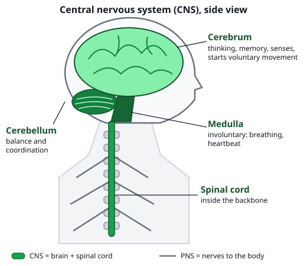
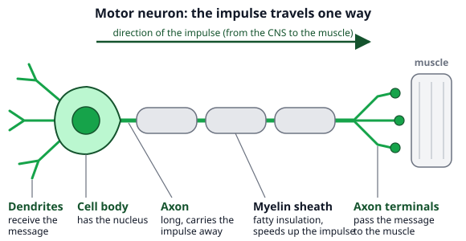
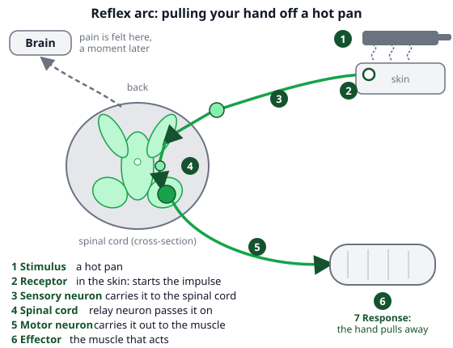

# 🟩 Nervous System  ·  `biology.anatomy.nervous`
> 📅 Study date: Mon 19 Oct · ⏱️ ~12 min read · 📋 Syllabus: Brain: cerebrum, cerebellum, medulla, Spinal cord, Sensory, motor, mixed nerves, Motor neuron, Reflex arc

## 🎮 Start with a flick and a flash
In a Valorant round you spot an enemy, decide to shoot and flick your mouse. That takes a thought, so it is a **voluntary** action. Now a flash goes off in your face and you squeeze your eyes shut before you decide anything. That one is **automatic**, and your body does it to protect you. Your nervous system runs both kinds of action. By the end of this page you can say which parts of the body do what, and draw the path a message takes. **The difference:** a trained flick feels instant, but it is still a decision started by your brain. A real **reflex** skips the decision.

## 🖼️ Big picture

## 💡 Core ideas
1. **Two parts.** The **central nervous system (CNS)** is the **brain + spinal cord**: the control center. The **peripheral nervous system (PNS)** is all the **nerves** that run between the CNS and the rest of the body. A message travelling along a nerve cell is an **impulse** (a tiny electrical signal).
2. **Three brain parts.** The **cerebrum** is the big, folded top part: **thinking, memory, senses** and starting **voluntary** movements (actions you choose). The **cerebellum** sits at the back, under the cerebrum: **balance and coordination**, so your movements are smooth. The **medulla oblongata** is the lowest part of the brain, where it joins the spinal cord: it runs **involuntary** jobs such as **breathing and heartbeat** (jobs you do not have to think about).
3. **Spinal cord.** A thick cord of nerve tissue that runs **down inside the backbone**, from the medulla to the lower back. It carries messages **between the brain and the body**, and it is the control center for **reflexes**.
4. **Three kinds of nerves** (a nerve is a bundle of long nerve cells). **Sensory nerves** carry impulses **to** the CNS (from eyes, skin, ears…). **Motor nerves** carry impulses **from** the CNS to muscles and glands. **Mixed nerves** hold **both** kinds of fibers, so they carry messages both ways. Tip: **S**ensory = **S**ense, **M**otor = **M**ove.
5. **Motor neuron.** A neuron is a nerve cell. A motor neuron has: **dendrites** (short branches that receive the message), a **cell body** (holds the nucleus), a long **axon** that carries the impulse away, a **myelin sheath** (a fatty wrapping that insulates the axon and speeds the impulse up) and **axon terminals** (the ends that pass the message to a muscle). The impulse only goes **one way**: dendrites → cell body → axon → terminals.
6. **Reflex action and the reflex arc.** A **reflex** is a **fast, automatic, protective** response to a **stimulus** (a change that your body notices). The path it follows is the **reflex arc**: **stimulus → receptor → sensory neuron → spinal cord → motor neuron → effector → response**. The **receptor** senses the stimulus, the **effector** (a muscle or gland) does the **response**. For the reflexes in your limbs, the spinal cord handles it **without waiting for the brain**, which is why it is so fast. Examples: pulling your hand from a hot pan, the knee-jerk, blinking, coughing. (Blinking and coughing are handled lower in the brain, but they are just as automatic.)

## 🧮 HUSO-style examples

**Example 1.** 🍳 You touch a hot pan handle and pull your hand away before you feel any pain. Which list shows the path of the impulse in the correct order?

(A) receptor → motor neuron → spinal cord → sensory neuron → muscle  (B) receptor → sensory neuron → spinal cord → motor neuron → muscle  (C) receptor → sensory neuron → brain → motor neuron → muscle  (D) muscle → motor neuron → spinal cord → sensory neuron → receptor  (E) sensory neuron → receptor → spinal cord → muscle → motor neuron

Steps:
1. The hot pan is the **stimulus**. The first part of the arc is always the **receptor** in the skin that senses it.
2. Impulses go **into** the CNS along a **sensory** neuron, the spinal cord passes them on, and a **motor** neuron carries them **out** to the **effector**, a muscle.
3. So the order is receptor → sensory neuron → spinal cord → motor neuron → muscle. **Answer: (B).**
4. Traps: (A) swaps the two neurons. (C) sends the message through the brain: the brain gets the news too, but the quick pull-away does not wait for it. (D) runs the arc backwards. (E) puts the receptor in the middle.

**Example 2.** A patient has a head injury. Her memory, speech and breathing are normal, but she staggers and cannot touch her nose smoothly with a finger. Which part of the brain is most likely damaged?

(A) cerebrum  (B) medulla oblongata  (C) spinal cord  (D) cerebellum  (E) a motor neuron

Steps:
1. Normal memory and speech means the **cerebrum** (thinking) works. Normal breathing means the **medulla** works.
2. The problem is **balance and smooth, coordinated movement**. That is the job of the **cerebellum**. **Answer: (D).**
3. Traps: (A) cerebrum would change thinking, not just coordination. (B) medulla damage would hit breathing and heartbeat. (C) the spinal cord is not part of the brain. (E) a single motor neuron is not a brain part.

## ⚠️ Common traps
- **"A reflex goes through the brain."** The message that pulls your hand away is handled in the **spinal cord**. A second message goes up to the brain, and that one makes you **feel** the pain a moment later.
- **Mixing up breathing and the brain parts.** Breathing is **involuntary**, so it is run by the **medulla**, not the cerebrum. You can hold your breath on purpose (cerebrum), but the medulla takes over again.
- **Sensory vs motor.** Sensory = into the CNS. Motor = out of the CNS to the effector. A **mixed** nerve is not a third kind of cell: it is a bundle with both.
- **Reading the neuron backwards.** The dendrites **receive**, the axon **sends**. The myelin sheath **speeds up** the impulse; it does not make the impulse.

## ✏️ Redraw from memory
Close the page and draw in 5 minutes:
- [ ] A side view of the head with the **cerebrum**, **cerebellum** and **medulla**, and the spinal cord going down.
- [ ] A motor neuron with 5 labels (dendrites, cell body, axon, myelin sheath, axon terminals) and an arrow for the direction.
- [ ] The reflex arc as 7 boxes with arrows: stimulus → receptor → sensory neuron → spinal cord → motor neuron → effector → response.
- [ ] A small table: cerebrum, cerebellum, medulla, spinal cord, each with its job in 3 words.
- [ ] One reflex example and one voluntary example.

Compare with the page and mark what you missed in red.

## 🎥 Watch / try
- [Nervous System](https://www.youtube.com/watch?v=RNLceVI8jcc) — Amoeba Sisters · 11:32 · the CNS and PNS, the neuron parts and the brain; the part about action potentials is extra
- [Spinal Reflex (Simple Reflex Arc)](https://www.youtube.com/watch?v=EqsNHbbJQJ4) — Dr Matt & Dr Mike · 3:57 · follow the impulse from receptor to effector

## ✅ Check your understanding (5 questions)
Do these without looking at the material. You are **READY** if you get at least 4 of 5 right.

**1.** Which part of a motor neuron carries the impulse away from the cell body toward the muscle?

(A) dendrite  (B) axon  (C) nucleus  (D) myelin sheath  (E) axon terminal

**2.** 🎮 Suppose a player sees an enemy, decides to fire and flicks the mouse in a perfect, smooth shot. Compared with pulling your hand off a hot pan, this shot is:

(A) a reflex, because it is fast  (B) a reflex, because a motor neuron is used  (C) voluntary, controlled only by the medulla  (D) voluntary: the cerebrum starts it and the cerebellum helps coordinate it  (E) voluntary, controlled only by the spinal cord

**3.** 🏊 A nerve in a swimmer's arm lets her feel the temperature of the water and also move her fingers. What kind of nerve is it?

(A) a mixed nerve  (B) a sensory nerve  (C) a motor nerve  (D) a dendrite  (E) a myelin sheath

**4.** A doctor taps just below your kneecap and your lower leg kicks out. The thigh muscle that makes the leg kick is the:

(A) stimulus  (B) receptor  (C) sensory neuron  (D) response  (E) effector

**5.** 🍳 You pull your hand off a hot pan and feel the pain only a moment later. Which explanation is correct?

(A) The motor neuron is slower than the sensory neuron.  (B) The pain is felt in the hand first, then travels to the brain.  (C) The spinal cord triggers the pull-away at once, while another message goes up to the cerebrum, which gives the feeling of pain.  (D) The cerebellum holds the message back on purpose.  (E) The medulla makes the decision to pull away.

Answer key & explanations

1. **(B) axon.** The axon is the long part that carries the impulse **away** from the cell body. (A) dendrites bring messages **in**. (C) the nucleus is inside the cell body and is not a path. (D) the myelin sheath is a wrapping around the axon that speeds things up; it is not the path itself. (E) the axon terminals are the ends, where the message is passed on.
2. **(D) voluntary: the cerebrum starts it and the cerebellum helps coordinate it.** You decided to shoot, so it is voluntary, and a smooth movement needs the cerebellum. (A) fast does not mean reflex. (B) all movements use motor neurons. (C) the medulla runs involuntary jobs like breathing. (E) the spinal cord alone handles reflexes, not decisions.
3. **(A) a mixed nerve.** It has sensory fibers (feel the water) and motor fibers (move the fingers). (B) and (C) have only one kind. (D) and (E) are parts of one neuron, not nerves.
4. **(E) effector.** The effector is the muscle (or gland) that acts. (A) the stimulus is the tap. (B) the receptor is the stretch sensor in the muscle. (C) the sensory neuron carries the message in. (D) the response is the kick itself, not the muscle that does it.
5. **(C).** The reflex only needs the spinal cord, so the pull-away is very fast. A second message travels up to the cerebrum, where you feel pain a bit later. (A) is false. (B) pain is not felt in the hand; the brain makes the feeling. (D) the cerebellum does not hold back messages: it coordinates movement. (E) the medulla runs breathing and heartbeat, and a reflex does not need a decision.

