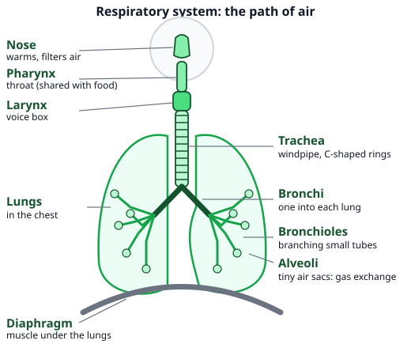
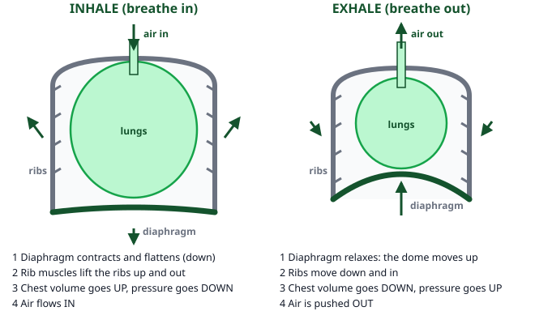
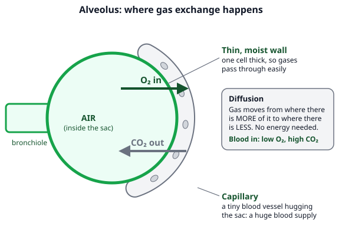
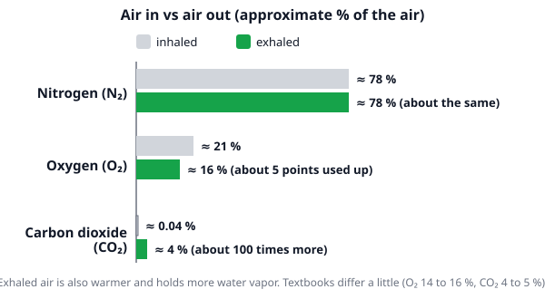
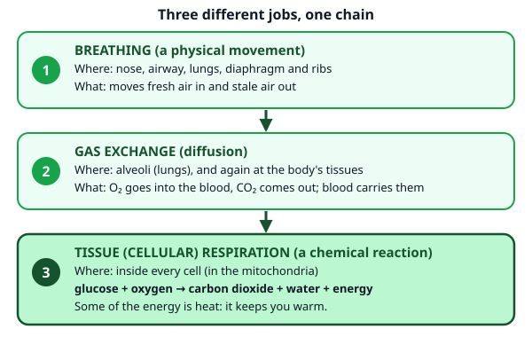

# 🟩 Respiratory System  ·  `biology.anatomy.respiratory`
> 📅 Study date: Tue 27 Oct · ⏱️ ~12 min read · 📋 Syllabus: Organs, Mechanism of breathing, Tissue respiration

## 🏊 Start with a breath at the bottom of the pool
You dive to the bottom of the pool and hold your breath. At first it feels fine. Then comes a stronger and stronger urge to come up and breathe. Most people think "I am running out of oxygen". But the urge is mostly caused by something else: **carbon dioxide (CO₂) building up** in your blood. This page shows how air gets in and out, what happens in the lungs, and why your cells make that CO₂ in the first place.

## 🖼️ Big picture

## 💡 Core ideas
1. **The path of air.** **Nose → pharynx (throat) → larynx (voice box) → trachea (windpipe) → two bronchi → bronchioles → alveoli.** The nose warms and filters the air. The trachea is kept open by **C-shaped rings of cartilage**. Food and air share the pharynx, so a small flap, the **epiglottis**, closes over the larynx when you swallow. The lungs sit in the chest, inside the **rib cage**, with the **diaphragm** (a dome-shaped muscle) below them.
2. **Gas exchange in the alveoli.** The bronchioles end in tiny air sacs called **alveoli**: hundreds of millions of them, each with a **very thin, moist wall** wrapped in tiny blood vessels (**capillaries**). **Oxygen (O₂)** moves from the air into the blood and **CO₂** moves from the blood into the air. This is **diffusion**: gas moves from where there is **more** of it to where there is **less**. It needs no energy.
3. **Mechanism of breathing.** The lungs have **no muscles**, so they cannot pull in air by themselves. **Inhaling:** the **diaphragm contracts and flattens** (moves down) and the rib muscles lift the **ribs up and out**. The **chest volume goes up**, so the **pressure inside goes down** below the air pressure outside, and air flows **in**. **Exhaling (at rest):** the diaphragm **relaxes and domes upward**, the ribs move **down and in**, the volume goes **down**, the pressure goes **up**, and air is pushed **out**.
4. **Air in vs air out (approximate).** Inhaled air: about **78 % nitrogen, 21 % oxygen, 0.04 % CO₂**. Exhaled air: nitrogen about the same, **oxygen about 16 %**, **CO₂ about 4 %** (roughly **100 times more** than before), and **more water vapor**. So you only use about **5 points** of the oxygen in each breath. Textbooks give slightly different numbers, so learn the pattern: O₂ down a bit, CO₂ up a lot.
5. **Three different things (do not mix them up).** **Breathing** moves air in and out (movement). **Gas exchange** swaps O₂ and CO₂ between air and blood (at the alveoli) and between blood and cells. **Tissue (cellular) respiration** is a **chemical reaction inside every cell** (in the mitochondria): **glucose + oxygen → carbon dioxide + water + energy**. Part of that energy is released as **heat**, which keeps your body warm.
6. **Why CO₂ makes you breathe.** Cells make CO₂ all the time. When CO₂ rises in the blood, sensors tell the **medulla** (the brain part that runs breathing) to breathe faster or deeper. That is why you breathe harder when you swim fast. **Safety:** never breathe hard (hyperventilate) before a breath-hold dive. It lowers CO₂ so you feel no urge, but the oxygen keeps falling and you can **black out** underwater.

> 🏊 **Analogy:** the diaphragm works like pulling back the plunger of a syringe: the space gets bigger, the pressure inside drops, and air rushes in. **The difference:** a syringe is one rigid tube. Your chest is a flexible cage, and your lungs are soft sacs with no muscles that are stretched by the cage.

## 🧮 HUSO-style examples

**Example 1.** Which row correctly describes **inhalation** (diaphragm; ribs; chest volume; pressure in the lungs)?

(A) relaxes; down and in; decreases; increases  (B) contracts; up and out; increases; decreases  (C) contracts; up and out; increases; increases  (D) relaxes; up and out; increases; decreases  (E) contracts; down and in; decreases; decreases

Steps:
1. To breathe in, the chest must get **bigger**. The diaphragm **contracts** (flattens) and the ribs move **up and out**. So the volume **increases**.
2. In a closed space, bigger volume means **lower pressure**. Air flows from the higher outside pressure into the lower pressure inside. **Answer: (B).**
3. Traps: (A) is exhalation. (C) cannot happen: more volume does not raise pressure. (D) the diaphragm must contract to make the chest bigger. (E) is all backwards.

**Example 2.** 🏊 A swimmer holds her breath underwater. After about a minute she feels a strong urge to breathe. Which change in her blood is the main trigger?

(A) the oxygen level drops to zero  (B) the carbon dioxide level rises  (C) the nitrogen level rises  (D) the water vapor level rises  (E) the glucose level drops to zero

Steps:
1. Her cells keep doing tissue respiration, so they keep **making CO₂** and using O₂. Holding her breath stops the CO₂ from leaving.
2. The CO₂ level in the blood rises. Sensors tell the **medulla**, and she feels the urge to breathe. **Answer: (B).**
3. Traps: (A) the oxygen has dropped, but it is far from zero when the urge starts. (C) nitrogen is not used or made by the body. (D) water vapor is not what the brain measures. (E) glucose is not what triggers breathing.

## ⚠️ Common traps
- **"Lungs pull air in."** The lungs have no muscles. The **diaphragm and rib muscles** change the chest volume, and the pressure change moves the air.
- **Breathing = respiration.** Breathing only moves air. **Respiration** (tissue respiration) is the reaction in cells that releases energy. Different jobs, different places.
- **"We breathe out only CO₂."** Exhaled air is still about **16 % oxygen** and mostly nitrogen. CO₂ is only about 4 %.
- **Gas exchange in the trachea or bronchi.** It happens only in the **alveoli** (thin wall, many capillaries). The other tubes only carry air.
- **Pressure direction.** When the chest gets bigger, the pressure inside goes **down**. Air is not "pushed in".

## ✏️ Redraw from memory
Close the page and draw in 5 minutes:
- [ ] The airway in order: nose, pharynx, larynx, trachea, 2 bronchi, bronchioles, alveoli, and the diaphragm.
- [ ] Two small chests side by side: inhale (diaphragm flat, ribs up and out) and exhale (diaphragm dome up, ribs down and in), with "volume" and "pressure" arrows.
- [ ] One alveolus with a capillary and two arrows: O₂ in, CO₂ out.
- [ ] The three bars: O₂ 21 → 16 %, CO₂ 0.04 → 4 %, N₂ about 78 % for both.
- [ ] The equation: glucose + oxygen → carbon dioxide + water + energy.

Compare with the page and mark what you missed in red.

## 🎥 Watch / try
- [Respiratory System](https://www.youtube.com/watch?v=v_j-LD2YEqg) — Amoeba Sisters · 7:35 · the airway, the alveoli and the breathing movements
- [How do lungs work?](https://www.youtube.com/watch?v=8NUxvJS-_0k) — TED-Ed · 3:22 · a short animation of air and blood at the alveoli

## ✅ Check your understanding (5 questions)
Do these without looking at the material. You are **READY** if you get at least 4 of 5 right.

**1.** Which list shows the path of air during inhalation in the correct order?

(A) nose → larynx → pharynx → trachea → bronchi → bronchioles → alveoli  (B) nose → pharynx → larynx → trachea → bronchi → bronchioles → alveoli  (C) nose → pharynx → larynx → trachea → bronchioles → bronchi → alveoli  (D) nose → pharynx → larynx → bronchi → trachea → bronchioles → alveoli  (E) nose → pharynx → larynx → trachea → bronchi → alveoli → bronchioles

**2.** What happens during normal, quiet exhalation?

(A) The diaphragm contracts and the chest gets smaller.  (B) The diaphragm relaxes and the chest gets larger.  (C) The ribs move up and out and the diaphragm flattens.  (D) The lungs squeeze themselves with their own muscles.  (E) The diaphragm relaxes and moves up, and the chest gets smaller.

**3.** 🏊 A swimmer breathes out bubbles underwater. Compared with the air she breathed in, the air in the bubbles has:

(A) more oxygen and less carbon dioxide  (B) the same amount of every gas  (C) less oxygen, about 100 times more carbon dioxide, and more water vapor  (D) no oxygen left, and mostly carbon dioxide  (E) less nitrogen than before, because nitrogen is used up

**4.** 🎮 Suppose a player sits calmly and takes in 0.5 L of air with each breath. Inhaled air has about 21 % oxygen and exhaled air about 16 %. Assume the exhaled volume equals the inhaled volume. About how much oxygen does the body keep from one breath?

(A) 25 mL  (B) 80 mL  (C) 105 mL  (D) 250 mL  (E) 500 mL

**5.** Which statement describes tissue (cellular) respiration?

(A) the movement of air into the lungs  (B) the diffusion of oxygen from the alveoli into the blood  (C) a reaction that happens only in the lungs  (D) a reaction in the mitochondria of cells that uses oxygen to release energy from glucose and gives carbon dioxide and water  (E) the removal of carbon dioxide from the body by the lungs

Answer key & explanations

1. **(B).** Air goes nose → pharynx → larynx → trachea → bronchi → bronchioles → alveoli. (A) swaps the pharynx and larynx. (C) puts the small bronchioles before the bronchi. (D) puts the bronchi before the trachea. (E) puts the alveoli before the bronchioles, but the alveoli are the very end of the path.
2. **(E).** At rest, the diaphragm and rib muscles relax, the diaphragm domes upward, the chest volume gets smaller, the pressure rises and air flows out. (A) a contracting diaphragm means inhaling. (B) is backwards. (C) describes inhaling. (D) the lungs have no muscles.
3. **(C).** Oxygen drops from about 21 % to about 16 %, CO₂ rises from about 0.04 % to about 4 % (100 times more), and exhaled air carries more water vapor. (A) is reversed. (B) the air changes. (D) about 16 % oxygen is left. (E) nitrogen is not used by the body, so its share stays about the same.
4. **(A) 25 mL.** The body keeps (21 % − 16 %) = 5 % of the air as oxygen. 5 % of 500 mL = 0.05 × 500 = **25 mL**. (B) 80 mL is the oxygen still in the exhaled air (16 % of 500 mL). (C) 105 mL is all the oxygen that came in (21 % of 500 mL). (D) 250 mL is half of the breath. (E) 500 mL is the whole breath.
5. **(D).** Tissue respiration is the chemical reaction in cells that releases energy from glucose using oxygen. (A) describes breathing in. (B) describes gas exchange. (C) it happens in all cells, not only in the lungs. (E) is gas exchange plus breathing out.

