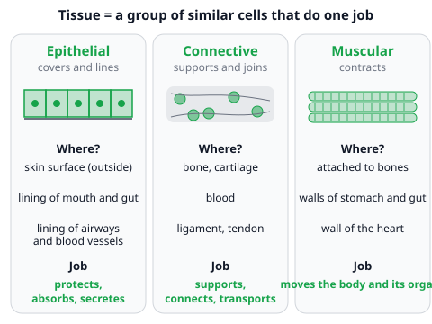
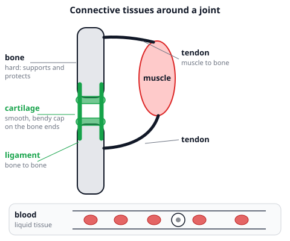
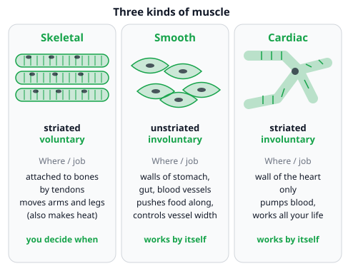

# 🟩 Animal Tissues  ·  `biology.anatomy.tissues`
> 📅 Study date: Sat 7 Nov · ⏱️ ~12 min read · 📋 Syllabus: Epithelial, Connective (bone, cartilage, blood, ligament, tendon), Muscular (striated, smooth, cardiac)

## 🍳 Start with a chicken drumstick
Look at a drumstick on your plate. The red-brown meat you chew is **muscle**. The shiny white cord at the thin end is a **tendon**, it ties the muscle to the bone. The crunchy, bendy white tip at the end of a rib is **cartilage**, and the hard stick inside is **bone**. Even the skin on top is a tissue. Your own body is built from the same few kinds of **tissue**, and this page teaches you to spot them.

## 🖼️ Big picture

## 💡 Core ideas
1. **Tissue = a team of similar cells.** A **tissue** is a group of **similar cells** that work together to do **one job**. Several tissues together make an **organ** (for example the heart).
2. **Epithelial tissue: the covering.** Its cells fit tightly together like floor tiles. **Where:** the outer layer of the skin, and the lining of the mouth, gut, airways, blood vessels and glands. **Function:** it **protects**, and it can **absorb** (in the gut) and **secrete** (in glands). (The syllabus only asks for location and function, not the types.)
3. **Connective tissue: the supporter and connector.** Its cells sit in a "matrix" (the material between the cells). It supports the body, joins parts together and carries things around. The syllabus names five kinds, learned from the table below.
4. **Muscular tissue: the mover.** Muscle cells can **contract** (get shorter) and then relax. That is how you move and how your heart beats.
5. **Three kinds of muscle.** **Striated** (striped) muscle is **skeletal** muscle: it is attached to bones, and it is **voluntary** (you decide). **Unstriated** (smooth) muscle is **involuntary** (it works by itself) and lines the walls of the stomach, gut and blood vessels. **Cardiac** muscle is a **specialized** involuntary muscle that makes the wall of the heart and pumps blood your whole life without resting.
6. **Quick sort.** Is it a **covering or lining**? Epithelial. Does it **join, support or carry**? Connective. Does it **contract**? Muscular.

| Connective tissue | Location | Function |
|---|---|---|
| **Bone** | the skeleton | supports the body and protects organs (brain, lungs) |
| **Cartilage** | ends of bones at joints, nose, ear, ribs | flexible support; cushions and smooths the joints |
| **Blood** | inside blood vessels | carries oxygen, food and wastes; fights germs; clots |
| **Ligament** | across a joint | connects **bone to bone** |
| **Tendon** | at the end of a muscle | connects **muscle to bone** |

| Muscle | Location | Control | One function |
|---|---|---|---|
| **Striated** (skeletal) | attached to bones | voluntary | moves the limbs |
| **Unstriated** (smooth) | walls of stomach, gut, blood vessels | involuntary | pushes food along the gut |
| **Cardiac** (specialized) | wall of the heart | involuntary | pumps blood |

## 🧮 HUSO-style examples

**Example 1.** 🍳 At the butcher you see three things: (1) the red steak, (2) the strong white cord that attaches the meat of a drumstick to its bone, (3) the white, bendy tip at the end of a rib. Which row names them in order?

(A) Muscle, tendon, cartilage
(B) Muscle, ligament, cartilage
(C) Muscle, tendon, bone
(D) Epithelial tissue, tendon, cartilage
(E) Muscle, cartilage, tendon

Steps:
1. The red steak is **muscle**.
2. A cord from **muscle to bone** is a **tendon**. A ligament would join **bone to bone**, so (B) is wrong.
3. The bendy white tip is **cartilage**: it is flexible. Bone is hard, so (C) is wrong. **Answer: (A).**
4. Traps: (D) the steak is not a covering. (E) puts cartilage and tendon in the wrong order.

**Example 2.** 🏊 During a 200 m swim three muscle tissues are at work: X pulls her arm through the water, Y makes her heart beat faster, Z in her stomach wall keeps digesting breakfast. Which row names X, Y and Z correctly, and says how many of the three are striated?

(A) X skeletal, Y cardiac, Z smooth; 2 striated
(B) X skeletal, Y cardiac, Z smooth; 1 striated
(C) X skeletal, Y cardiac, Z smooth; 3 striated
(D) X skeletal, Y smooth, Z cardiac; 2 striated
(E) X cardiac, Y skeletal, Z smooth; 2 striated

Steps:
1. X is attached to the bones and she decides to move it: **skeletal** (striated, voluntary).
2. Y is the heart wall: **cardiac** (striated, involuntary). Z is the stomach wall: **smooth** (unstriated, involuntary). That removes (D) and (E).
3. Striated means striped: skeletal and cardiac are striped, smooth is not. So **2** of the three are striated. **Answer: (A).**
4. Traps: (B) forgets that cardiac muscle is striped, even though it is involuntary. (C) counts the smooth muscle as striped.

## ⚠️ Common traps
- **Ligament vs tendon.** **Ligament = bone to bone**, **tendon = muscle to bone**. Memory trick: a **t**endon **t**ies a muscle to a bone, a **l**igament **l**inks two bones.
- **"Involuntary" does not mean "smooth".** Cardiac muscle is involuntary **and** striated. Only skeletal muscle is voluntary.
- **Blood is a tissue.** It is a **liquid connective tissue**, even though it does not hold anything together like a ligament does.
- **Cartilage is not bone.** Cartilage is flexible (nose and ear tip). Bone is hard.

## ✏️ Redraw from memory
Close the page and draw in 5 minutes:
- [ ] A joint with two bones, a cartilage cap on each bone end and a **ligament** linking the bones.
- [ ] A muscle joined to a bone by a **tendon**, labeled "muscle to bone".
- [ ] Three small muscle drawings: striped long fibre (skeletal), spindle cells without stripes (smooth), branched striped cell (cardiac), each with "voluntary" or "involuntary".
- [ ] A row of tightly packed cells for epithelial tissue with "covers and lines: protects".
- [ ] A one-line location for bone, cartilage, blood, ligament and tendon.

Compare with the page and mark what you missed in red.

## 🎥 Watch / try
- [Types of Human Body Tissue](https://www.youtube.com/watch?v=O0ZvbPak4ck) — MooMooMath and Science · 9:12 · look for the groups epithelial, connective and muscle
- [Muscle Tissues and Sliding Filament Model](https://www.youtube.com/watch?v=dpxalWACO7k) — Amoeba Sisters · 8:21 · watch the first part about skeletal, smooth and cardiac muscle (skip the sliding filament part)
- [Tissues, Part 4 - Types of Connective Tissues](https://www.youtube.com/watch?v=Jvtb0a2RXaY) — CrashCourse · 9:43 · look for bone, cartilage and blood as connective tissues

## ✅ Check your understanding (5 questions)
Do these without looking at the material. You are **READY** if you get at least 4 of 5 right.

**1.** Which tissue joins one bone to another bone at a joint?

(A) Tendon  (B) Ligament  (C) Cartilage  (D) Epithelial tissue  (E) Smooth muscle

**2.** 🍳 While trimming a drumstick, a cook cuts the strong white cord that ties the meat to the bone. What is the cord, and which group of tissue does it belong to?

(A) Ligament; muscular tissue
(B) Ligament; epithelial tissue
(C) Cartilage; connective tissue
(D) Tendon; connective tissue
(E) Tendon; muscular tissue

**3.** 🏊 A swimmer's heart beats faster during a race without her thinking about it. Which statement about the tissue in the heart wall is correct?

(A) It is cardiac muscle, a specialized involuntary muscle found only in the heart.
(B) It is smooth muscle, and it is voluntary.
(C) It is skeletal muscle, and it is voluntary.
(D) It is cardiac muscle, and it is voluntary.
(E) It is smooth muscle, and it is attached to bones by tendons.

**4.** Which statement describes epithelial tissue?

(A) It joins muscle to bone.
(B) It contracts to move the skeleton.
(C) It carries oxygen inside vessels.
(D) It is hard and supports the body.
(E) It covers the body surface and lines organs, and it protects.

**5.** Which row correctly matches a connective tissue with its location and function?

(A) Blood: inside the skeleton; supports the body
(B) Bone: flows in vessels; carries oxygen
(C) Cartilage: ends of bones at joints, nose, ear; flexible support that cushions
(D) Ligament: at the end of a muscle; attaches muscle to bone
(E) Tendon: across a joint; joins bone to bone

Answer key & explanations

1. **(B) Ligament.** Ligaments connect bone to bone. (A) A tendon connects muscle to bone. (C) Cartilage is a flexible cap or cushion. (D) Epithelial tissue covers surfaces. (E) Smooth muscle is in organ walls.
2. **(D) Tendon; connective tissue.** The cord goes from muscle to bone, so it is a tendon, and tendons are connective tissue. (A) and (B) A ligament joins bone to bone. (C) Cartilage is bendy and is not a cord. (E) The tendon is connective tissue; only the meat itself is muscular tissue.
3. **(A)** The heart wall is made of cardiac muscle, which is specialized, striated and involuntary. (B) and (E) Smooth muscle is not in the heart wall, and smooth muscle is not voluntary. (C) Skeletal muscle is attached to bones and is voluntary. (D) Cardiac muscle is involuntary, not voluntary.
4. **(E)** Epithelial tissue covers the outside and lines the inside of organs, so it protects (and can absorb or secrete). (A) is a tendon. (B) is skeletal muscle. (C) is blood. (D) is bone.
5. **(C)** Cartilage is at the ends of bones in joints, in the nose and in the ear, and it gives flexible support. (A) Blood is in vessels. (B) Bone is in the skeleton and supports the body. (D) and (E) have ligament and tendon swapped: ligament joins bone to bone, tendon joins muscle to bone.

