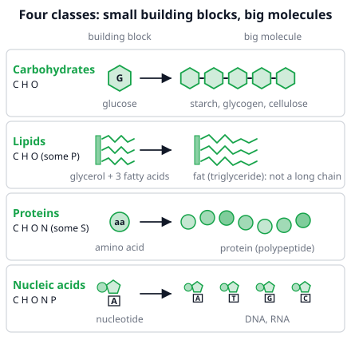
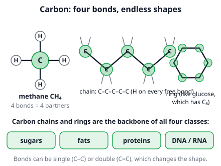
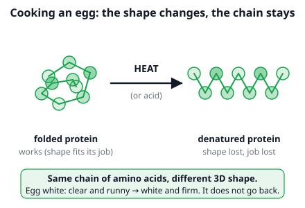

# 🟩 Biomolecules  ·  `biology.biochem.molecules`
> 📅 Study date: Fri 16 Oct · ⏱️ ~12 min read · 📋 Syllabus: Carbon as the basis of life, Nucleic acids, Lipids, Proteins, Carbohydrates

## 🍳 Start with the food label and a frying egg
Pick up a box of pasta or a carton of eggs and read the label: **carbohydrates, fat, protein**. Those words name three of the four big families of molecules that build every living thing, including you. Now crack an egg into a hot pan. The clear, runny egg white turns white and firm in seconds. Nothing was added. The **protein** in it just changed its shape. By the end of this page you can explain exactly what happened.

## 🖼️ Big picture

## 💡 Core ideas
1. **Carbon is the basis of life.** A carbon atom makes **four bonds**, so it can join to other carbons in **chains** and **rings**, and also to hydrogen, oxygen, nitrogen, phosphorus and sulfur. That gives an almost endless number of shapes. Small building blocks (**monomers**) join into big molecules (**polymers**) when a water molecule is removed at each joint. Digestion does the reverse: it adds water and cuts the chain.

2. **Carbohydrates** (elements **C, H, O**) are the quick-energy fuel. The building block is a **monosaccharide**, a simple sugar such as **glucose (C₆H₁₂O₆)**. Two sugars joined make a **disaccharide**: sucrose (table sugar), lactose (milk sugar), maltose (malt sugar). Many sugars joined make a **polysaccharide**: **starch** (energy store in plants), **glycogen** (energy store in animals, mainly in liver and muscles) and **cellulose** (stiff plant cell walls; you cannot digest it, so it is fiber).
3. **Lipids** (fats, oils, waxes; elements **C, H, O**, and **P** in phospholipids) do **not** mix with water. A **fat** is built from **one glycerol + three fatty acids**. It stores energy for the long term. **Saturated** fatty acids are straight, so animal fats like butter are **solid**. **Unsaturated** fatty acids have kinks, so plant oils stay **liquid**. **Phospholipids** form the cell membrane, and **cholesterol** is a lipid too (it is used to make some hormones).
4. **Proteins** (**C, H, O, N**, and **S** in some) are chains of **amino acids**. There are **20** different amino acids. Each joint is a **peptide bond**, and a long chain is a **polypeptide**. The **order** of the amino acids decides how the chain folds, and the **shape** decides the job: **enzymes**, structure (muscle, hair), transport (hemoglobin), defense (antibodies), hormones (insulin). **Heat or acid** unfolds the chain (**denaturation**) and the protein stops working. The order of amino acids stays the same.

5. **Nucleic acids** (**C, H, O, N, P**) store and use the instructions for making proteins. The building block is a **nucleotide** = **sugar + phosphate + base**. **DNA** has the sugar deoxyribose, the bases **A, T, G, C**, and is a double helix. **RNA** has the sugar ribose, the bases **A, U, G, C**, and is usually one strand.
6. **Element clue for the exam.** Only C, H, O → carbohydrate or lipid. **N** shows up → protein or nucleic acid. **P** shows up → nucleic acid (or a phospholipid).

> 🧱 **Analogy:** monomers are like Lego bricks, and a polymer is the finished model. **The difference:** bricks just click together, but cells need enzymes to join monomers, and each joint loses a water molecule.

## 🧮 HUSO-style examples

**Example 1.** A protein is one straight chain of 120 amino acids. How many peptide bonds hold it together?

(A) 118  (B) 119  (C) 120  (D) 121  (E) 240

Steps:
1. A peptide bond sits **between** two neighbor amino acids.
2. Draw 3 beads in a row: there are only **2** gaps. So bonds = beads − 1.
3. For 120 amino acids: 120 − 1 = **119** peptide bonds. **Answer: (B).**
4. Each bond released one water molecule, so 119 waters were released too.
5. Traps: (C) 120 counts the beads, not the gaps. (E) 240 gives two bonds to every amino acid.

**Example 2.** 🍳 You fry an egg white. It changes from clear and runny to white and firm. What best explains this?

(A) The amino acids turn into fat.  (B) The heat cuts the chain into single amino acids.  (C) The heat changes the 3D shape of the protein, but not the order of its amino acids.  (D) The heat adds new amino acids to the chain.  (E) The protein turns into starch.

Steps:
1. Egg white is mostly protein.
2. Heat gives the chain energy to wiggle, and the folded shape comes apart: this is **denaturation**.
3. The amino acids are still in the same order and still joined, so (B) and (D) are out. A protein never turns into a fat or a starch just by heating, so (A) and (E) are out.
4. The new tangled shape sticks together as a firm solid. **Answer: (C).** It does not go back when it cools.

## ⚠️ Common traps
- **Calling every lipid a fat.** A fat is glycerol + 3 fatty acids. Phospholipids, waxes and cholesterol are lipids but not fats. Lipids are also **not true polymers**: no long chain of repeating units.
- **Mixing up the three polysaccharides.** Plants **store** starch, animals **store** glycogen, and cellulose is **structure** (cell walls), not storage.
- **DNA vs RNA.** DNA: deoxyribose and **T**. RNA: ribose and **U**. A quick memory trick: **U**racil is in **RNA**, and **T**hymine is in DNA.
- **Thinking "denatured" means "chopped up".** The chain stays whole. Only the **shape** is lost, and the shape is what did the job.

## ✏️ Redraw from memory
Close the page and draw in 5 minutes:
- [ ] The four families as four rows: building block → big molecule, with the elements of each.
- [ ] Carbon with four bonds, one short chain and one ring.
- [ ] A glucose unit, a chain of them, and the names starch, glycogen, cellulose with where each is found.
- [ ] A fat: one glycerol bar with three fatty-acid tails (one straight, one with a kink).
- [ ] An egg: folded protein → heat → unfolded protein, with the words "same order of amino acids".

Compare with the page and mark what you missed in red.

## 🎥 Watch / try
- [Biomolecules (Updated 2023)](https://www.youtube.com/watch?v=1Dx7LDwINLU) — Amoeba Sisters · 7:49 · watch for the monomer and polymer of each of the four families
- [Protein Structure and Folding](https://www.youtube.com/watch?v=hok2hyED9go) — Amoeba Sisters · 7:46 · see how the order of amino acids turns into a 3D shape

## ✅ Check your understanding (5 questions)
Do these without looking at the material. You are **READY** if you get at least 4 of 5 right.

**1.** In a long chain of carbon atoms joined by single bonds, one carbon in the middle is bonded to two other carbon atoms. How many hydrogen atoms are bonded to it?

(A) 0  (B) 1  (C) 2  (D) 3  (E) 4

**2.** Which pair of building block and large molecule is correct?

(A) fatty acids → protein  (B) nucleotides → starch  (C) amino acids → cellulose  (D) glucose → glycogen  (E) glycerol → DNA

**3.** 🍳 Butter is solid in the fridge, but olive oil is liquid. What explains the difference?

(A) Butter is a carbohydrate and olive oil is a lipid.  (B) Olive oil has more unsaturated fatty acids, whose kinks keep the tails from packing tightly.  (C) Butter contains no fatty acids.  (D) Olive oil is made of amino acids.  (E) Olive oil has more saturated fatty acids, which are straight.

**4.** A large molecule from a cell contains the elements C, H, O, N and P. Which is it most likely to be?

(A) starch  (B) a fat (triglyceride)  (C) cellulose  (D) an enzyme made only of amino acids  (E) DNA

**5.** A short protein is one chain of 8 amino acids. How many water molecules were released when it was built?

(A) 7  (B) 8  (C) 9  (D) 14  (E) 16

Answer key & explanations

1. **(C) 2.** Carbon always makes four bonds. Two are used for the carbon neighbors, so two are left for hydrogen. (A) 0 forgets that carbon has four bonds. (B) 1 and (D) 3 would be an end carbon (3 H) or a branched one (1 H). (E) 4 is methane, with no carbon neighbors.
2. **(D) glucose → glycogen.** Glycogen is a polysaccharide made of glucose units. Wrong rows: (A) proteins are made of amino acids. (B) starch is made of glucose. (C) cellulose is made of glucose, not amino acids. (E) DNA is made of nucleotides, and glycerol belongs to fats.
3. **(B).** Kinks come from double bonds in unsaturated fatty acids. Kinked tails cannot pack tightly, so the oil stays liquid. Straight saturated tails (more common in butter) pack tightly and make a solid. (E) swaps the two. (A), (C) and (D) name the wrong kind of molecule: both are fats.
4. **(E) DNA.** Phosphorus plus nitrogen points to a nucleic acid. (A) and (C) are carbohydrates (C, H, O only). (B) a fat is C, H, O only. (D) a protein has N but, as an amino-acid chain, no P.
5. **(A) 7.** 8 amino acids in one chain have 8 − 1 = 7 peptide bonds, and each bond releases one water. (B) 8 counts the amino acids. (C) 9 adds one. (D) 14 and (E) 16 give two waters per amino acid.

