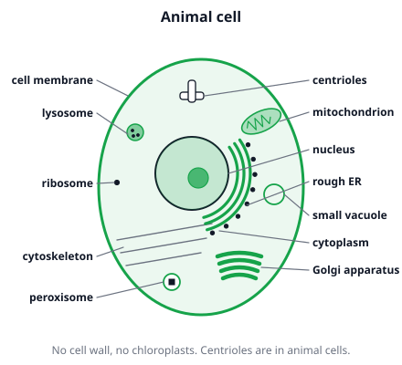
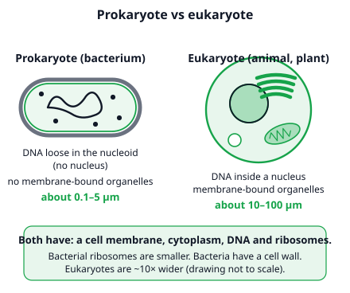
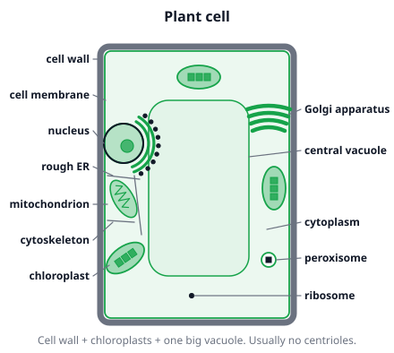
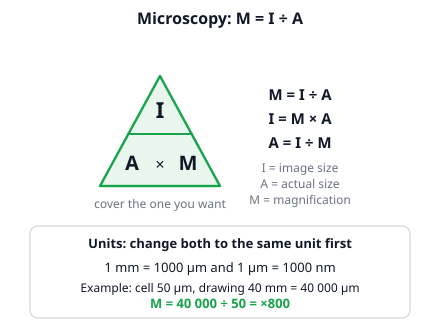

# 🟩 Cell Structure  ·  `biology.cell.cell-structure`
> 📅 Study date: Fri 16 Oct · ⏱️ ~12 min read · 📋 Syllabus: Cell theory, Organelles (nucleus, ribosome, chloroplast, mitochondria, ER, golgi, lysosome, membrane, vacuole, cell wall, peroxisome, centriole, cytoskeleton), Prokaryotic vs eukaryotic, Animal vs plant cell, Microscopy

## 🎮 Start with a team of five
Think of a Valorant team. Nobody does everything: one agent makes the plan, one earns and spends the credits, one holds the entrance, one cleans up. The team wins because every role is **different** and they **cooperate**. A cell is a team too, and its roles are called **organelles** (tiny "organs" inside a cell). The **nucleus** is the shot-caller, the **mitochondria** are the energy suppliers, and the **membrane** guards the entrance. **The difference:** agents can walk anywhere and swap roles, but organelles are fixed structures, each with one job, and a cell can have hundreds or thousands of the same kind (mitochondria, for example).

## 🖼️ Big picture

## 💡 Core ideas
1. **Cell theory.** (1) All living things are made of **one or more cells**. (2) The **cell is the basic unit** of life. (3) New cells come only from **existing cells** (they divide). A bacterium is one cell. You are made of trillions of cells.
2. **Organelles and compartments.** Inside a **eukaryotic** cell, most organelles are wrapped in their own membrane. This **compartmentalization** is like rooms in a kitchen: chemicals that could harm each other are kept apart and each room is set up for its job. Learn the job of each (the picture shows them):

| Organelle | One-line job |
|---|---|
| **Cell membrane** | thin skin that controls what goes in and out |
| **Cytoplasm** | the jelly-like fluid that fills the cell; the organelles float in it |
| **Nucleus** | holds the DNA; the control center |
| **Ribosome** | builds proteins (free in the cytoplasm or sitting on the rough ER) |
| **ER** (endoplasmic reticulum) | a network of tubes; **rough ER** has ribosomes and makes proteins; **smooth ER** has none and makes lipids |
| **Golgi apparatus** | modifies, sorts and packs proteins into little bubbles (vesicles) to ship |
| **Mitochondria** | release energy from food (cellular respiration) as ATP |
| **Chloroplast** | photosynthesis: light energy → sugar (has green chlorophyll) |
| **Lysosome** | digests worn-out parts and swallowed germs |
| **Vacuole** | storage bag for water, sugars and wastes |
| **Cell wall** | stiff outer layer for support and protection |
| **Peroxisome** | breaks down fats and harmful hydrogen peroxide |
| **Centriole** | helps build the spindle fibers when an animal cell divides |
| **Cytoskeleton** | protein threads that give shape and move things around |

3. **Prokaryotic vs eukaryotic.** **Prokaryotes** (bacteria) are small (about 0.1–5 µm), have **no nucleus** (the DNA floats in a region called the **nucleoid**) and **no membrane-bound organelles**. **Eukaryotes** (animals, plants, fungi, protists) are bigger (about 10–100 µm) and have a **nucleus** and membrane-bound organelles. Both have a membrane, cytoplasm, DNA and ribosomes, and a bacterium has a cell wall too.

4. **Animal vs plant cell.** Plant cells have **three extras**: a **cell wall** (made of cellulose, outside the membrane), **chloroplasts**, and one **large central vacuole** that keeps the cell firm. **Centrioles** and **lysosomes** are typical for **animal** cells. Both kinds have a nucleus, mitochondria, ER, Golgi, ribosomes and a membrane. Plants have mitochondria too, because they also need to release energy from food.

5. **Microscopy.** A **light microscope** uses light and glass lenses, shows cells (even living ones) and magnifies up to about 1000×. An **electron microscope** uses electrons, shows far smaller details (such as organelle structure), but the sample is dead. **Total magnification = eyepiece × objective** (for example 10 × 40 = ×400). To measure, use **M = I ÷ A** (magnification = image size ÷ actual size). Put both sizes in the **same unit** first: **1 mm = 1000 µm**.

> 🎮 **Analogy:** the cell is a team and organelles are the agents. It helps you remember jobs, but it is only a door in. Check every job against the table above.

## 🧮 HUSO-style examples

**Example 1.** A drawing of a cell is 40 mm wide. The real cell is 50 µm wide. What is the magnification?

(A) ×0.8  (B) ×80  (C) ×800  (D) ×2000  (E) ×8000

Steps:
1. Use **M = I ÷ A**, but first make the units equal. 40 mm = 40 × 1000 µm = **40 000 µm**.
2. M = 40 000 ÷ 50 = **×800**. **Answer: (C).**
3. Check: a cell of 50 µm blown up 800 times is 50 × 800 = 40 000 µm = 40 mm. ✓
4. Traps: (A) 0.8 divides 40 by 50 without changing units. (D) 2000 multiplies 40 × 50. (B) 80 and (E) 8000 use the wrong number of µm in a mm (100 and 10 000).

**Example 2.** A photo taken at a total magnification of ×400 shows a cell that is 20 mm wide. How wide is the real cell?

(A) 0.05 µm  (B) 5 µm  (C) 50 µm  (D) 500 µm  (E) 8000 mm

Steps:
1. Use **A = I ÷ M** (actual = image ÷ magnification).
2. Put the image in µm: 20 mm = **20 000 µm**.
3. A = 20 000 ÷ 400 = **50 µm**. **Answer: (C).** That fits a typical eukaryotic cell (10–100 µm).
4. Traps: (E) 8000 mm multiplies 20 × 400 instead of dividing. (A), (B) and (D) slip a power of 10 in the unit change.

## ⚠️ Common traps
- **"Plants don't have mitochondria."** They do. Chloroplasts make sugar; mitochondria release the energy from it. Plant cells have **both**.
- **Cell wall vs cell membrane.** The **membrane** is thin and in **every** cell. The **wall** is a stiff layer **outside** the membrane in plants, fungi and bacteria. Animal cells have no wall.
- **"Bacteria have no organelles at all."** They have ribosomes, DNA and a membrane. What they lack is a **nucleus** and **membrane-bound** organelles such as mitochondria.
- **Unit slips in microscopy.** Always change mm to µm (× 1000) before you divide. A magnification has **no unit** (×800), but the sizes do.

## ✏️ Redraw from memory
Close the page and draw in 5 minutes:
- [ ] An animal cell with 10 labels: membrane, cytoplasm, nucleus, rough ER, Golgi, mitochondrion, lysosome, ribosome, centriole, vacuole.
- [ ] A plant cell: add the three extras (cell wall, chloroplast, large vacuole) and mark what it lacks.
- [ ] A two-column table: prokaryote vs eukaryote (nucleus? organelles? size?).
- [ ] The formula triangle for M, I and A, and 1 mm = 1000 µm.
- [ ] The three parts of the cell theory.

Compare with the page and mark what you missed in red.

## 🎥 Watch / try
- [Introduction to Cells: The Grand Cell Tour](https://www.youtube.com/watch?v=8IlzKri08kk) — Amoeba Sisters · 9:27 · follow each organelle and its job
- [Prokaryotic vs. Eukaryotic Cells (Updated)](https://www.youtube.com/watch?v=Pxujitlv8wc) — Amoeba Sisters · 5:28 · list what bacteria have and what they lack
- [Microscopes and How to Use a Light Microscope](https://www.youtube.com/watch?v=tVcEEw6qbBQ) — Amoeba Sisters · 9:16 · see how eyepiece and objective lenses add up to the total magnification

## ✅ Check your understanding (5 questions)
Do these without looking at the material. You are **READY** if you get at least 4 of 5 right.

**1.** A student looks through a light microscope with a ×10 eyepiece and a ×40 objective lens. What is the total magnification?

(A) ×4  (B) ×50  (C) ×400  (D) ×4000  (E) ×10 000

**2.** A cell is 25 µm wide. About how many of these cells, side by side, fit across 1 mm?

(A) 40  (B) 25  (C) 4  (D) 400  (E) 1000

**3.** Which of these is **absent** from a bacterial cell?

(A) ribosomes  (B) cytoplasm  (C) DNA  (D) a cell membrane  (E) a nucleus

**4.** 🎮 Suppose a cell is a 5-agent team in an animal cell. One agent's job is to clean up: break down broken gear and swallowed invaders. Which organelle does this job?

(A) ribosome  (B) centriole  (C) chloroplast  (D) lysosome  (E) cell wall

**5.** Which of these is found in an animal cell but **not** in a typical plant cell?

(A) cell wall  (B) centrioles  (C) chloroplasts  (D) a large central vacuole  (E) ribosomes

Answer key & explanations

1. **(C) ×400.** Total magnification = eyepiece × objective = 10 × 40 = 400. (A) ×4 divides 40 by 10. (B) ×50 adds the lenses. (D) ×4000 and (E) ×10 000 add extra zeros.
2. **(A) 40.** 1 mm = 1000 µm, and 1000 ÷ 25 = 40. (B) 25 is the cell width itself. (C) 4 divides 100 by 25 (1 mm is not 100 µm). (D) 400 divides 10 000 by 25. (E) 1000 forgets to divide.
3. **(E) a nucleus.** Bacteria are prokaryotes: their DNA lies loose in the nucleoid. They do have ribosomes, cytoplasm, DNA and a cell membrane.
4. **(D) lysosome.** Lysosomes digest worn-out parts and swallowed germs. (A) ribosomes build proteins. (B) centrioles help with cell division. (C) chloroplasts do photosynthesis and are not in animal cells. (E) a cell wall is not in animal cells and gives support.
5. **(B) centrioles.** Centrioles are typical for animal cells. (A) cell wall, (C) chloroplasts and (D) the large central vacuole are plant features. (E) ribosomes are in every cell.

