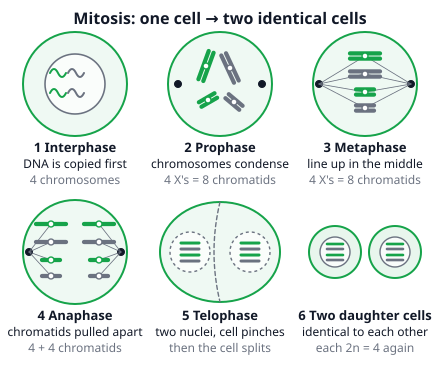
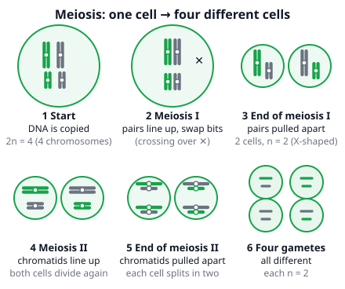
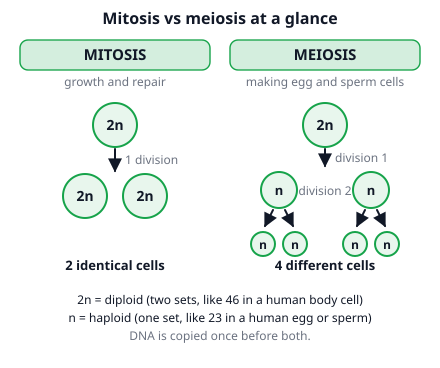

# 🟩 Cell Division  ·  `biology.cell.division`
> 📅 Study date: Fri 16 Oct · ⏱️ ~12 min read · 📋 Syllabus: Mitosis, Meiosis

## 🏊 Start with a swim club and its training partners
Picture a swim club with **23 pairs of training partners**, so 46 swimmers. When the club opens an exact second branch, it **copies everyone**, and each branch has all 46. That is **mitosis**: two identical clubs. Now the club must send a relay team to a meet, and the rule is "take **one swimmer from each pair**". That is 23 swimmers, and who you pick is random, so every team is different. That is **meiosis**. **The difference:** real chromosome pairs are not people. The two chromosomes of a pair carry the same genes (maybe different versions), and during meiosis they **swap pieces** with each other, which swimmers cannot do.

## 🖼️ Big picture

## 💡 Core ideas
1. **Copy first, then divide.** Before a cell divides, it **copies its DNA** (in interphase, in the **S phase**). Each chromosome now has **two identical halves** called **sister chromatids**, joined at the **centromere** (an X shape). Human **body cells** have **46 chromosomes** = **23 pairs**; in each pair one chromosome came from each parent (a **homologous pair**). Having two sets is called **diploid (2n)**. Egg and sperm cells have one set: **23**, called **haploid (n)**.
2. **Mitosis** makes **two identical diploid cells** from one. It is used for **growth** and to **repair and replace** cells. The four phases (**PMAT**; some books add a "prometaphase" in between, you can skip it):
   - **P**rophase: chromosomes **condense** and become visible (X shapes); the nuclear envelope breaks down and **spindle fibers** form (in animal cells, centrioles help organize them).
   - **M**etaphase: chromosomes **line up in the middle** of the cell.
   - **A**naphase: the **sister chromatids split** and are pulled to **opposite ends**.
   - **T**elophase: two new **nuclei** form and the chromosomes unwind.
   - **Cytokinesis** then splits the cytoplasm: an animal cell **pinches** in two; a plant cell builds a **cell plate** (a new wall) in the middle.
3. **Chromosome counts in mitosis.** The number of chromosomes (counted by centromeres) stays the same: a human body cell has **46** at the start, **46** after the DNA is copied (but now **92 chromatids**), and each daughter cell has **46**. In anaphase each separated chromatid counts as a chromosome of its own, so for a moment the cell holds 92, and each end gets 46.
4. **Meiosis** makes **four different haploid cells** from one diploid cell, using **two divisions** after only **one** copying of the DNA. **Meiosis I:** homologous chromosomes **pair up**, **swap pieces** (**crossing over**), and then the **pairs are pulled apart**: 46 → 23 per cell (2 cells). **Meiosis II:** like mitosis, the **sister chromatids separate**: 4 cells, each with 23. In humans meiosis happens only in the **testes and ovaries** to make sperm and eggs (**gametes**).

5. **Mitosis vs meiosis at a glance.**

| | **Mitosis** | **Meiosis** |
|---|---|---|
| Where (human) | body cells | testes and ovaries |
| Purpose | growth, repair | making gametes |
| DNA copied | once | once |
| Divisions | **1** | **2** |
| Cells made | **2** | **4** |
| Chromosomes per cell | same as parent (2n) | half (n) |
| Daughter cells | **identical** | **different** |

6. **Why meiosis matters.** (a) Gametes must be **haploid**: when an egg (23) and a sperm (23) fuse in **fertilization**, the baby gets 46. Without halving, the number would double every generation. (b) It creates **variation**: **crossing over** and the **random lineup** of the pairs. With 2 chromosome pairs there are 2² = 4 combinations, with 3 pairs 2³ = 8, and with 23 pairs 2²³ = **more than 8 million** different gametes, before counting crossing over.

> 🏊 **Analogy:** a swim club copying everybody (mitosis) versus picking one swimmer from each pair for a relay (meiosis). It is only a door in: remember the **difference** note in the hook.

## 🧮 HUSO-style examples

**Example 1.** A fruit fly body cell has 2n = 8 chromosomes. How many chromosomes and how many chromatids does the cell have at **metaphase of mitosis**?

(A) 4 chromosomes, 8 chromatids  (B) 8 chromosomes, 8 chromatids  (C) 8 chromosomes, 16 chromatids  (D) 16 chromosomes, 16 chromatids  (E) 16 chromosomes, 32 chromatids

Steps:
1. Count chromosomes by their **centromeres**. Mitosis does not change the number: the cell still has **8** chromosomes.
2. At metaphase the DNA was already copied in interphase, so every chromosome is an **X** made of **2 sister chromatids**.
3. Chromatids = 8 × 2 = **16**. **Answer: (C).**
4. Traps: (B) forgets the DNA copy. (A) halves the number as if it were meiosis. (D) and (E) double the chromosomes as well.

**Example 2.** The same fruit fly has one body cell dividing by mitosis and one germ cell dividing by meiosis. Which row shows the **final cells** correctly?

(A) mitosis: 2 cells with 4; meiosis: 2 cells with 8  (B) mitosis: 2 cells with 4; meiosis: 4 cells with 8  (C) mitosis: 2 cells with 8; meiosis: 4 cells with 4  (D) mitosis: 4 cells with 8; meiosis: 4 cells with 4  (E) mitosis: 2 cells with 8; meiosis: 4 cells with 8

Steps:
1. **Mitosis:** 1 division, **2 cells**, same number as the parent: **2 cells with 8**.
2. **Meiosis:** 2 divisions, **4 cells**, half the number: 8 ÷ 2 = **4 chromosomes** each.
3. Match: mitosis 2 × 8, meiosis 4 × 4. **Answer: (C).**
4. Traps: (E) forgets that meiosis halves the number. (D) gives mitosis four cells. (A) and (B) swap or invert the halving.

## ⚠️ Common traps
- **Chromosome vs chromatid.** After the DNA is copied, a chromosome has **two chromatids** but it is still **one** chromosome. Count centromeres.
- **Meiosis I vs II.** In meiosis **I** the **homologous pairs** separate (the number halves). In meiosis **II** the **sister chromatids** separate (like mitosis).
- **"Mitosis makes gametes."** No. Gametes come from meiosis. Mitosis makes body cells.
- **Daughter cells.** Mitosis: **identical** to the parent. Meiosis: **different** from the parent and from each other.
- **Copying twice?** DNA is copied **once**, even in meiosis, which divides twice.

## ✏️ Redraw from memory
Close the page and draw in 5 minutes:
- [ ] A cell with 4 chromosomes (2 long, 2 short, in two colors) going through the 4 phases of mitosis, with the name under each picture.
- [ ] One X-shaped chromosome with the words **centromere** and **sister chromatids**.
- [ ] Meiosis: one cell → 2 cells → 4 cells, and write 2n or n in each.
- [ ] The table mitosis vs meiosis (divisions, cells made, chromosomes per cell, identical or different).
- [ ] The human numbers: 46 in body cells, 23 in egg and sperm, 46 again after fertilization.

Compare with the page and mark what you missed in red.

## 🎥 Watch / try
- [Mitosis (UPDATED 2026)](https://www.youtube.com/watch?v=ShEzlXZPpPM) — Amoeba Sisters · 8:42 · follow the chromosomes through each phase
- [Meiosis (UPDATED 2026)](https://www.youtube.com/watch?v=I-sucvMV0Ng) — Amoeba Sisters · 9:52 · watch the pairs separate in meiosis I and the chromatids in meiosis II
- [Mitosis vs. Meiosis: Side by Side Comparison](https://www.youtube.com/watch?v=zrKdz93WlVk) — Amoeba Sisters · 6:22 · tick off the table from this page

## ✅ Check your understanding (5 questions)
Do these without looking at the material. You are **READY** if you get at least 4 of 5 right.

**1.** How many chromosomes are in a human egg cell?

(A) 2  (B) 23  (C) 46  (D) 69  (E) 92

**2.** In which phase of mitosis do the sister chromatids separate and move to opposite ends of the cell?

(A) prophase  (B) metaphase  (C) anaphase  (D) telophase  (E) interphase

**3.** 🏊 A swim club picks a 3-person relay team by taking exactly one swimmer from each of 3 pairs of training partners. The same idea tells you how many different chromosome combinations the gametes of an organism with 2n = 6 can have (ignoring crossing over). How many?

(A) 8  (B) 3  (C) 6  (D) 9  (E) 64

**4.** A cell with 14 chromosomes divides by mitosis. What is made?

(A) 4 cells with 7 chromosomes  (B) 2 cells with 7 chromosomes  (C) 2 cells with 28 chromosomes  (D) 4 cells with 14 chromosomes  (E) 2 cells with 14 chromosomes

**5.** 🍳 A cookie cutter presses identical cookies out of one sheet of dough. Which process is most like the cookie cutter, and why?

(A) Meiosis, because it makes four identical cells  (B) Meiosis, because it halves the chromosome number  (C) Mitosis, because it makes gametes  (D) Mitosis, because the two new cells are identical to the parent cell  (E) Fertilization, because it joins two cells

Answer key & explanations

1. **(B) 23.** Egg and sperm cells are haploid (n): half of the 46 in a body cell. (C) 46 is a body cell. (A) 2 is the number of sets in a body cell. (D) 69 and (E) 92 are 1.5 and 2 times 46.
2. **(C) anaphase.** In anaphase the sister chromatids split and are pulled to opposite poles. (A) in prophase the chromosomes only condense. (B) in metaphase they line up in the middle. (D) in telophase two nuclei form around the separated chromosomes. (E) interphase is when the DNA is copied.
3. **(A) 8.** From each of 3 pairs there are 2 choices, so 2 × 2 × 2 = 2³ = 8 combinations. (B) 3 and (C) 6 count the pairs or the chromosomes. (D) 9 is 3². (E) 64 is 2⁶ (it treats each of the 6 chromosomes as an independent choice).
4. **(E) 2 cells with 14 chromosomes.** Mitosis makes two cells that are identical to the parent. (A) and (B) describe halving, which is meiosis. (C) doubles the number. (D) gives four cells, which is the number from meiosis.
5. **(D).** Mitosis makes two daughter cells identical to the parent cell, like cookies from one cutter. (A) meiosis makes four cells that are different from each other. (B) halving is true for meiosis, but it is not what a cookie cutter shows. (C) gametes come from meiosis. (E) fertilization joins two cells, the opposite of cutting.

