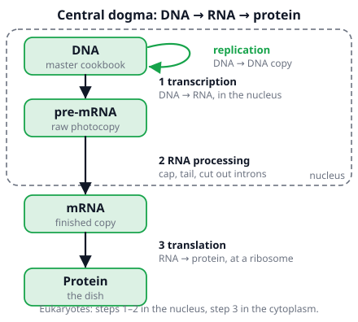
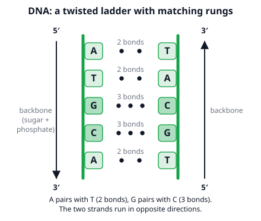
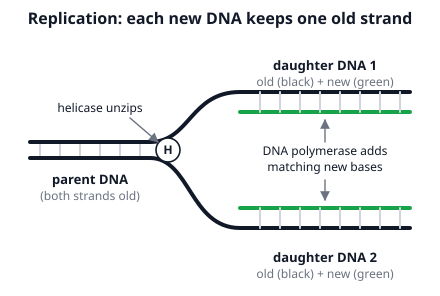
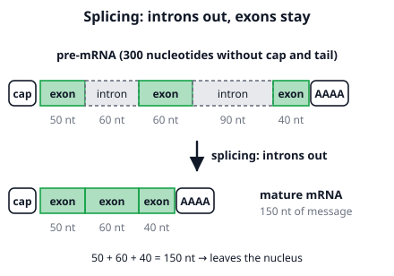
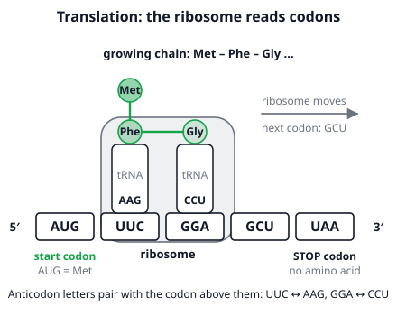

# 🟩 Molecular Biology  ·  `biology.cell.molecular`
> 📅 Study date: Fri 16 Oct · ⏱️ ~12 min read · 📋 Syllabus: Central dogma, DNA replication, Transcription, RNA processing, Translation

## 🍳 Start with a restaurant's master cookbook
A restaurant keeps its one **master cookbook** safe in the manager's office. The chef never carries it into the busy kitchen. Instead, someone **photocopies one recipe**, and the chef cooks the dish from the copy. Your cells work the same way. The **DNA** is the master cookbook (it stays in the nucleus), the **RNA** is the photocopy of one recipe, and the **protein** is the finished dish. **The difference:** a real photocopy is the same letters on paper, but an RNA copy uses a slightly different alphabet (**U instead of T**) and is broken down after it has been used a few times.

## 🖼️ Big picture

## 💡 Core ideas
1. **Central dogma: DNA → RNA → protein.** A **gene** is a piece of DNA that holds the instructions for one protein. Copying DNA into RNA is **transcription**. Using the RNA to build a protein is **translation**. DNA can also copy itself: **replication**. In cells with a nucleus (eukaryotes) transcription and RNA processing happen in the **nucleus**, and translation happens at **ribosomes** in the cytoplasm.
2. **DNA structure.** Two strands twist into a **double helix**. The sides are a **sugar–phosphate backbone**, and the rungs are pairs of **bases**: **A pairs with T** (2 hydrogen bonds), **G pairs with C** (3 hydrogen bonds). So if you know one strand, you know the other. The two strands run in **opposite directions** (**antiparallel**): one is read 5′ → 3′, the other 3′ → 5′.

3. **DNA replication** happens before a cell divides. **Helicase** unzips the two strands. **DNA polymerase** then adds matching nucleotides along each old strand. The result is **two identical DNA molecules**, and each has **one old strand and one new strand**. This is called **semiconservative** replication.

4. **Transcription** (in the nucleus). **RNA polymerase** reads one strand of the gene (the **template strand**) and builds a single-stranded **mRNA** (messenger RNA) by pairing bases: **A → U, T → A, G → C, C → G**. RNA has **U** (uracil), never T.
5. **RNA processing** (in the nucleus, eukaryotes only). The first copy (**pre-mRNA**) is edited: a **5′ cap** is added at the front, a **poly-A tail** (a string of A's) at the end, and **splicing** cuts out the **introns** (the parts that are not used) and joins the **exons** (the parts that are expressed). The mature mRNA then leaves through the nuclear pore.

6. **Translation** (at a ribosome). The ribosome reads the mRNA **three letters at a time**; each triplet is a **codon**. Translation starts at the first **AUG** (it codes for methionine, Met). Each codon calls a **tRNA** (transfer RNA) whose **anticodon** pairs with it. The tRNA carries one **amino acid**, and the ribosome joins the amino acids into a chain with peptide bonds. It stops at a **stop codon** (UAA, UAG, UGA), which codes for **no** amino acid. There are 4³ = **64 codons**: 61 code for the 20 amino acids (so several codons can mean the same amino acid) and 3 are stop codons. In an exam the codon table is **given**.

> 🔎 **Codon-reading skill:** (1) find the first **AUG**, (2) cut the letters into **groups of three** from there, (3) look up each codon in the table, (4) **stop** at a stop codon.

## 🧮 HUSO-style examples

**Example 1.** The template strand of a gene reads 3′-TACGGATTCATT-5′. Which is the mRNA made from it, written 5′ → 3′?

(A) 5′-AUGCCUAAGUAA-3′  (B) 5′-ATGCCTAAGTAA-3′  (C) 5′-UACGGAUUCAUU-3′  (D) 5′-AAUGAAUCCGUA-3′  (E) 5′-TACGGATTCATT-3′

Steps:
1. mRNA is built by pairing with the template: T → A, A → U, C → G, G → C, G → C, A → U, T → A, T → A, C → G, A → U, T → A, T → A.
2. That gives **AUGCCUAAGUAA**. The two strands run in opposite directions, so the new mRNA starts at its 5′ end where the template has its 3′ end: **5′-AUGCCUAAGUAA-3′**. **Answer: (A).**
3. Split into codons: **AUG | CCU | AAG | UAA**. With AUG = Met, CCU = Pro, AAG = Lys, UAA = stop, the protein is **Met–Pro–Lys**, only 3 amino acids.
4. Traps: (B) uses T, but RNA has U. (C) is a copy of the template with U, not the pairing partner. (D) is the right letters read backward. (E) is just the DNA.

**Example 2.** 🍳 The chef (the ribosome) gets this mRNA card: 5′-GCAUGUUCGGAGCUUAAGC-3′. The codon table says: AUG = Met, UUC = Phe, GGA = Gly, GCU = Ala, UAA = stop. Which chain is made?

(A) Met–Phe–Gly–Ala  (B) Met–Phe–Gly  (C) Phe–Gly–Ala  (D) Met–Phe–Gly–Ala–Lys  (E) No protein, because the card does not start with AUG

Steps:
1. Do **not** start at the first letter. Find the first **AUG**: G C **AUG** UUC GGA GCU UAA GC.
2. Cut in threes from there: AUG | UUC | GGA | GCU | UAA | GC.
3. Look up: Met, Phe, Gly, Ala, **stop**. The two letters GC at the end are never read.
4. The chain is **Met–Phe–Gly–Ala**. **Answer: (A).**
5. Traps: (B) stops one codon early. (C) starts one codon late and loses Met. (D) invents an amino acid after the stop. (E) forgets that the start codon can be in the middle of the card.

## ⚠️ Common traps
- **Mixing up the two big steps.** **Transcription**: DNA → RNA, same "language" of bases, in the nucleus. **Translation**: RNA → protein, a change of language (bases → amino acids), at the ribosome.
- **Writing T in RNA.** RNA pairs A with **U**. DNA pairs A with T.
- **Thinking replication makes "one old DNA and one new DNA".** Both new DNA molecules are **half old, half new** (semiconservative).
- **Reading from the first letter.** Translation starts at the first **AUG**. Stop codons are not amino acids.
- **Introns vs exons.** Introns are removed. The **ex**ons are **ex**pressed. Splicing happens **before** the mRNA leaves the nucleus.

## ✏️ Redraw from memory
Close the page and draw in 5 minutes:
- [ ] The chain DNA → pre-mRNA → mRNA → protein with the names transcription, RNA processing and translation, and where each happens.
- [ ] A short DNA ladder with 4 rungs: A–T (2 bonds), G–C (3 bonds), and the arrows 5′ → 3′ and 3′ → 5′.
- [ ] Replication: a parent DNA unzipping into two daughters, old strands in black and new strands in green.
- [ ] A pre-mRNA with cap, 3 exons, 2 introns and a tail, and the shorter mature mRNA below it.
- [ ] A ribosome on an mRNA with two tRNAs, their amino acids, and a start and a stop codon.

Compare with the page and mark what you missed in red.

## 🎥 Watch / try
- [DNA Replication (Updated)](https://www.youtube.com/watch?v=Qqe4thU-os8) — Amoeba Sisters · 8:12 · watch what helicase and polymerase each do
- [Protein Synthesis: Transcription and Translation (Updated)](https://www.youtube.com/watch?v=oefAI2x2CQM) — Amoeba Sisters · 8:47 · follow the mRNA from the nucleus to the ribosome

## ✅ Check your understanding (5 questions)
Do these without looking at the material. You are **READY** if you get at least 4 of 5 right.

**1.** The template strand of a short gene reads 3′-TTAGCC-5′. Which mRNA is made, written 5′ → 3′?

(A) 5′-AAUCGG-3′  (B) 5′-AATCGG-3′  (C) 5′-UUAGCC-3′  (D) 5′-GGCUAA-3′  (E) 5′-GGCTAA-3′

**2.** A piece of double-stranded DNA is 10 base pairs long. It has 4 A–T pairs and 6 G–C pairs. How many hydrogen bonds hold the two strands together?

(A) 20  (B) 24  (C) 26  (D) 30  (E) 52

**3.** A eukaryotic pre-mRNA is 300 nucleotides long (not counting the cap and the tail) and has two introns, of 60 and 90 nucleotides. After splicing, the whole remaining message is read from an AUG at its first nucleotide to a stop codon at its last three. How many amino acids are in the protein?

(A) 50  (B) 70  (C) 100  (D) 49  (E) 99

**4.** 🍳 In the cookbook story, "photocopying one recipe from the master cookbook" matches which step in the cell?

(A) replication  (B) transcription  (C) translation  (D) splicing  (E) DNA repair

**5.** All the DNA of a bacterium is labeled with heavy nitrogen (¹⁵N) in both strands. The cells then grow in normal nitrogen (¹⁴N) while the DNA is replicated twice, giving 4 DNA molecules. How many of the 4 molecules still contain some ¹⁵N?

(A) 4  (B) 3  (C) 2  (D) 1  (E) 0

Answer key & explanations

1. **(A) 5′-AAUCGG-3′.** Pair letter by letter with the template: T → A, T → A, A → U, G → C, C → G, C → G, giving AAUCGG (with the 5′ end where the template has its 3′ end). (B) uses T instead of U. (D) is the correct letters written backward (GGCUAA). (E) is that backward version with T. (C) copies the template with U instead of pairing.
2. **(C) 26.** A–T has 2 bonds, G–C has 3 bonds: 4 × 2 + 6 × 3 = 8 + 18 = 26. (A) 20 treats all 10 pairs as A–T. (B) 24 swaps the bond numbers (4 × 3 + 6 × 2). (D) 30 treats all 10 pairs as G–C. (E) 52 counts each pair twice (26 × 2).
3. **(D) 49.** The introns remove 60 + 90 = 150 nucleotides, leaving 300 − 150 = 150. That is 150 ÷ 3 = 50 codons, and the last one is the stop codon, which codes for no amino acid: 50 − 1 = 49 amino acids. (A) 50 counts the stop codon. (C) 100 forgets the introns (300 ÷ 3). (E) 99 forgets the introns and then removes the stop. (B) 70 removes only the 90-nucleotide intron (210 ÷ 3).
4. **(B) transcription.** Making an RNA copy of one gene from the DNA is transcription. (A) replication copies the whole DNA for a new cell (the whole cookbook). (C) translation is the chef cooking from the copy. (D) splicing is the editing of the copy afterward. (E) DNA repair is not a copying step.
5. **(C) 2.** After the first round there are 2 molecules, each with one old ¹⁵N strand and one new ¹⁴N strand. In the second round each old strand ends up in a different molecule: 2 hybrid molecules (¹⁵N + ¹⁴N) and 2 molecules with only ¹⁴N. The two old strands never disappear, and never end up together. (A) and (B) forget that new strands are built from ¹⁴N. (D) 1 forgets that there are two old strands. (E) 0 treats the old DNA as lost.

