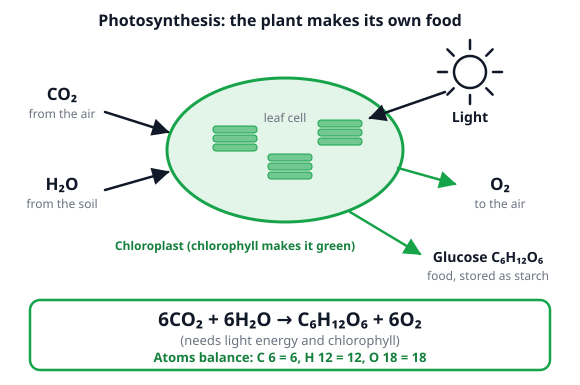
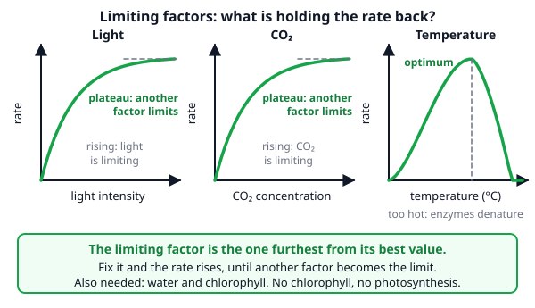
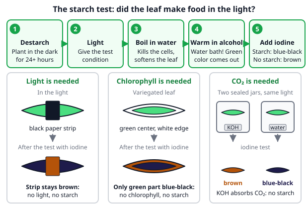
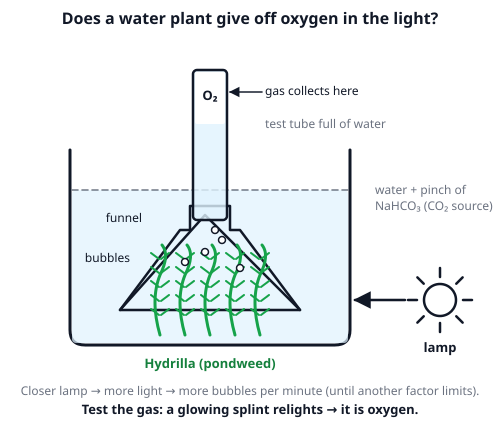

# 🟩 Photosynthesis  ·  `biology.cell.photosynthesis`
> 📅 Study date: Fri 16 Oct · ⏱️ ~12 min read · 📋 Syllabus: Overall reaction, Limiting factors, Experiments

## 🍳 Start with a basil plant in a cupboard
You keep one pot of basil on the sunny windowsill and forget another in a dark cupboard. After a week the windowsill basil is green and perky, and the cupboard one is pale and floppy. Why does a plant need light when it never "eats"? Because a green leaf is a tiny **food factory**: it uses light to turn air and water into sugar. That process is called **photosynthesis** (photo = light, synthesis = making). Today you learn the recipe, what speeds it up, and how to prove it in an experiment.

## 🖼️ Big picture

## 💡 Core ideas
1. **What and where.** **Photosynthesis** is how green plants (and algae) make **glucose**, a sugar, from **carbon dioxide** and **water**, using **light energy**. The light energy is stored as **chemical energy** in the glucose. It happens inside **chloroplasts**, small green parts of leaf cells. Chloroplasts are green because they contain **chlorophyll**, the pigment (a colored substance) that catches the light.
2. **The equation.** In words: carbon dioxide + water → glucose + oxygen (in light, with chlorophyll). In symbols: **6CO₂ + 6H₂O → C₆H₁₂O₆ + 6O₂**. It is balanced: both sides have 6 C, 12 H and 18 O atoms. CO₂ enters through tiny holes in the leaf called **stomata**, water comes up from the **roots**, and the **O₂** leaves through the stomata. The plant stores spare glucose as **starch** (that is why the starch test works).
3. **Five things it needs.** **Light**, **carbon dioxide**, **water**, **chlorophyll** and a suitable **temperature**. Take away light, CO₂ or chlorophyll and no starch is made. With very little water the stomata close, so less CO₂ gets in.
4. **Limiting factors.** The rate of photosynthesis is held back by the factor that is **furthest from its best value**, the **limiting factor**. On a graph, a **rising** line means that factor is limiting. A **flat plateau** means something **else** is limiting now. **Temperature** is different: the rate rises to an **optimum**, then falls fast because the **enzymes** (the cell's helper molecules) **denature**, which means they lose their shape and stop working.
5. **Experiments.** The **starch test** shows food was made. First **destarch** the plant (keep it in the dark for a day or two, so it uses up its old starch). Then give it the test condition. Then **boil the leaf in water** (kills cells and softens it), **warm it in alcohol in a water bath** (removes the green color) and add **iodine**: **blue-black = starch**, **brown = no starch**. A **black paper strip** tests light, a **variegated leaf** (green and white) tests chlorophyll, and a jar with **KOH** (it absorbs CO₂) tests CO₂. To see oxygen, put **Hydrilla** (a pondweed) in water under an upside-down funnel: bubbles of **oxygen** collect in a test tube, and the gas **relights a glowing splint**.
6. **Why it matters.** Photosynthesis is the start of almost every **food chain**: it feeds the plant and, through it, animals. It **releases the oxygen** we breathe and **removes CO₂** from the air.

> 🏭 **Analogy:** a leaf is like a solar-powered kitchen: light is the electricity, CO₂ and water are the ingredients, glucose is the meal. **The difference:** a kitchen needs a cook, but a leaf does it with chlorophyll and enzymes, and the "meal" is food for the plant itself, which animals can then eat.

## 🧮 HUSO-style examples

**Example 1.** A student moves a lamp and counts the oxygen bubbles from pondweed each minute. The water is warm (25 °C) and has plenty of CO₂.

| Light intensity (units) | 1 | 2 | 3 | 4 | 5 | 6 |
|---|---|---|---|---|---|---|
| Bubbles per minute | 6 | 12 | 18 | 24 | 24 | 24 |

At which light intensity does the plateau start, and what could the student change to get more bubbles?

(A) At 2; raise the light  (B) At 4; raise the CO₂ or the temperature  (C) At 4; raise the light more  (D) At 6; raise the CO₂ or the temperature  (E) At 5; lower the light

Steps:
1. Read the rate going up: 6, 12, 18, 24. Each step of 1 unit adds 6 bubbles. So **light is limiting** up to 4.
2. At 5 and 6 the rate stays at **24**. The first intensity with the top rate is **4**: the plateau starts there.
3. On a plateau, **more light does nothing**, so another factor is limiting. The water already has plenty of CO₂ and is warm, so the realistic choices are **more CO₂ or a better temperature**. **Answer: (B).**
4. Traps: (A) 2 is just the second reading, the rate is still rising there. (C) says more light helps on a plateau. (D) 6 is the last reading, not the first plateau point. (E) 5 is the second plateau point, and lowering the light cannot raise the rate.

**Example 2.** 🍳 A cook sets up two destarched basil plants in sealed jars, both in the same bright light for 6 hours. Jar A has a dish of water, jar B has a dish of **KOH** solution (KOH absorbs CO₂). Then a leaf from each plant gets the starch test. What happens, and what does it show?

(A) Both leaves blue-black, so CO₂ is not needed  (B) Leaf A blue-black and leaf B brown, so CO₂ is needed to make starch  (C) Leaf A brown and leaf B blue-black, so KOH helps photosynthesis  (D) Both leaves brown, so light is needed  (E) Leaf A blue-black and leaf B brown, so light is needed

Steps:
1. Both jars have the same light and the plants were destarched, so the **only difference is CO₂**. Jar A (water) still has CO₂. Jar B has none, because KOH absorbed it.
2. With light **and** CO₂, leaf A makes glucose and stores starch: **blue-black** with iodine. Without CO₂, leaf B makes no new starch: **brown**.
3. Same light in both jars, so the difference must come from CO₂. **Answer: (B).** Jar A is the **control**, the comparison that has everything.
4. Traps: (E) has the right colors but the wrong reason, because light was the same in both jars. (A) and (D) ignore the KOH. (C) swaps the colors.

## ⚠️ Common traps
- **"Plants breathe in CO₂ and breathe out O₂, so that is their breathing."** Photosynthesis is **making food**. Plants also **respire** (use food for energy) all the time and give out CO₂ then. You meet this on the next page.
- **Plateau means "finished".** A flat graph means the factor on the x-axis is **no longer limiting**, not that photosynthesis stopped.
- **Iodine colors swapped.** Starch gives **blue-black**. Brown or orange (the iodine's own color) means **no starch**.
- **Skipping the destarching.** A leaf that was not destarched may already hold starch, which spoils the result. Always destarch first.

## ✏️ Redraw from memory
Close the page and draw in 5 minutes:
- [ ] A leaf cell with a chloroplast, arrows for CO₂, H₂O and light in, and glucose and O₂ out.
- [ ] The balanced equation 6CO₂ + 6H₂O → C₆H₁₂O₆ + 6O₂.
- [ ] Three small graphs: light (rise then plateau), CO₂ (rise then plateau), temperature (rise, optimum, fall).
- [ ] The five steps of the starch test, with the blue-black and brown colors.
- [ ] The Hydrilla set-up: beaker, funnel, test tube, lamp, bubbles.

Compare with the page and mark what you missed in red.

## 🎥 Watch / try
- [Photosynthesis (UPDATED)](https://www.youtube.com/watch?v=CMiPYHNNg28) — Amoeba Sisters · 7:59 · watch the inputs and outputs of the chloroplast; the page needs only the overall idea
- [GCSE Biology: Factors Affecting the Rate of Photosynthesis | Limiting Factor Graphs](https://www.youtube.com/watch?v=6sLrh-SDv_Y) — Cognito · 5:27 · practice telling "still rising" from "plateau"

## ✅ Check your understanding (5 questions)
Do these without looking at the material. You are **READY** if you get at least 4 of 5 right.

**1.** Which is the correctly balanced equation for photosynthesis?

(A) CO₂ + H₂O → C₆H₁₂O₆ + O₂  (B) 6CO₂ + 12H₂O → C₆H₁₂O₆ + 6O₂  (C) C₆H₁₂O₆ + 6O₂ → 6CO₂ + 6H₂O  (D) 6CO₂ + 6H₂O → C₆H₁₂O₆ + 6O₂  (E) 6CO₂ + 6H₂O → C₆H₁₂O₆ + 12O₂

**2.** 🍳 A cook keeps one basil plant on a sunny windowsill and another in a dark cupboard for a week, watering both. She tests one leaf from each with iodine (after boiling it in water and then in alcohol). What does she see, and why?

(A) Windowsill leaf blue-black, cupboard leaf brown: in the dark there is no photosynthesis, and any old starch has been used up  (B) Both blue-black, because plants take their food from the soil  (C) Windowsill leaf brown, cupboard leaf blue-black, because plants make starch in the dark  (D) Both brown, because iodine only detects glucose  (E) Both brown, because the windowsill plant uses up all its starch

**3.** A greenhouse plant is in bright light. The table shows the rate of photosynthesis (units per minute) for different conditions.

| Temperature | CO₂ | Rate |
|---|---|---|
| 20 °C | 0.04 % | 12 |
| 20 °C | 0.08 % | 12 |
| 30 °C | 0.08 % | 18 |

At 20 °C and 0.04 % CO₂, which factor was limiting the rate?

(A) Light intensity  (B) CO₂ concentration  (C) Temperature  (D) Chlorophyll  (E) Oxygen concentration

**4.** A student puts pondweed under a funnel with a lamp 10 cm away and counts 36 bubbles in 3 minutes. With the lamp 20 cm away she counts 12 bubbles in 3 minutes. What is the rate with the lamp at 10 cm?

(A) 3 bubbles per minute  (B) 12 bubbles per minute  (C) 24 bubbles per minute  (D) 36 bubbles per minute  (E) 108 bubbles per minute

**5.** 🏊 Green algae in an outdoor pool photosynthesize in the sun. In one hour a clump of algae makes 4 molecules of glucose. How many molecules of CO₂ does it take in and how many molecules of O₂ does it release?

(A) 4 CO₂ and 4 O₂  (B) 6 CO₂ and 6 O₂  (C) 24 CO₂ and 12 O₂  (D) 24 CO₂ and 4 O₂  (E) 24 CO₂ and 24 O₂

Answer key & explanations

1. **(D) 6CO₂ + 6H₂O → C₆H₁₂O₆ + 6O₂.** Count atoms: left C 6, H 12, O 12 + 6 = 18; right C 6, H 12, O 6 + 12 = 18. (A) is not balanced (1 C on the left, 6 on the right). (B) has 24 H on the left but 12 on the right. (C) is balanced but it is **respiration**, the reverse direction. (E) has 18 O atoms on the left but 6 + 24 = 30 on the right.
2. **(A).** In the dark there is no photosynthesis, so no new starch, and the plant's old starch is used for respiration. The windowsill leaf makes and stores starch: blue-black. (B) is wrong: plants make their own food, they do not take it from the soil. (C) swaps the colors. (D) is wrong: iodine detects **starch**, not glucose. (E) is wrong: in the light the leaf makes starch faster than it uses it.
3. **(C) Temperature.** Doubling CO₂ from 0.04 % to 0.08 % at 20 °C changed nothing (12 and 12), so CO₂ was not limiting. Raising the temperature to 30 °C raised the rate to 18, so temperature was the limit. The light was already bright and the plant was the same, so (A) and (D) do not fit. (E) oxygen is a product, not an ingredient.
4. **(B) 12 bubbles per minute.** 36 ÷ 3 = 12 per minute. (A) 3 is the number of minutes. (C) 24 is the difference, 36 − 12. (D) 36 is the total, not divided by the time. (E) 108 multiplies 36 × 3. (The 20 cm rate is 12 ÷ 3 = 4 per minute: a farther lamp gives less light and fewer bubbles.)
5. **(E) 24 CO₂ and 24 O₂.** One glucose needs 6 CO₂ and gives 6 O₂, so 4 glucose need 4 × 6 = 24 CO₂ and give 24 O₂. (A) forgets the 6. (B) is the amount for 1 glucose. (C) halves the oxygen by mixing up the coefficients. (D) says the oxygen count equals the glucose count.

