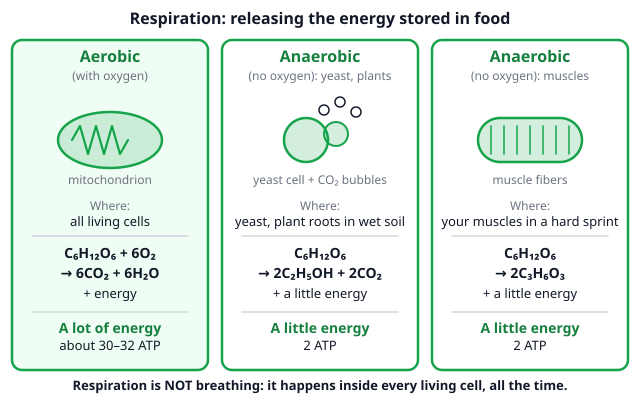
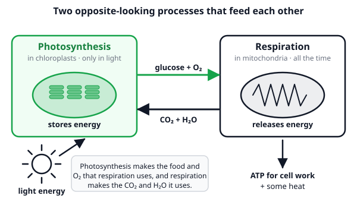

# 🟩 Cellular Respiration  ·  `biology.cell.respiration`
> 📅 Study date: Fri 16 Oct · ⏱️ ~12 min read · 📋 Syllabus: Aerobic respiration, Anaerobic respiration, Photosynthesis vs respiration

## 🏊 Start with the last 25 meters
You race the last 25 meters of a 100 m sprint. Your arms burn, you gasp, and your muscles feel heavy. They need energy faster than your blood can bring oxygen. The cells do not stop: they switch to a **quick emergency way** of getting energy that works **without oxygen**. This page is about how every cell gets energy out of food, with oxygen and without it. It is called **respiration**, and it is **not the same as breathing**.

## 🖼️ Big picture

## 💡 Core ideas
1. **Respiration releases energy from food.** Every living cell (plant or animal) breaks down food, mainly **glucose**, to release the energy stored in it. **Breathing** only moves air in and out of the lungs. The energy is captured in a small molecule called **ATP**, the cell's **energy currency**: the cell "spends" ATP (ATP → ADP + a phosphate) to do work such as contracting a muscle.
2. **Aerobic respiration (with oxygen).** **Glucose + oxygen → carbon dioxide + water + energy**, or **C₆H₁₂O₆ + 6O₂ → 6CO₂ + 6H₂O + energy**. Most of it happens in the **mitochondria**, the cell's "power stations". It gives **a lot** of energy: about **30–32 ATP** per glucose in current textbooks (older books say 36 or 38; the exam only asks "a lot" against "a little").
3. **Anaerobic respiration (without oxygen).** The glucose is only **partly** broken down, in the **cytoplasm**, so it gives only **2 ATP**. In **yeast and plants** the products are **ethanol (alcohol) + CO₂**: **C₆H₁₂O₆ → 2C₂H₅OH + 2CO₂ + a little energy**. In **muscles** the product is **lactic acid** and no CO₂: **C₆H₁₂O₆ → 2C₃H₆O₃ + a little energy**.
4. **Where you meet it.** 🍳 **Bread:** yeast ferments the sugar in dough; the CO₂ bubbles make the dough **rise**, and most of the ethanol **evaporates** in the oven. **Drinks:** yeast makes the ethanol in beer and wine. **Plants:** roots in waterlogged soil get little oxygen and respire anaerobically. 🏊 **Muscles:** in a hard sprint they make lactic acid, and your muscles get tired.
5. **Photosynthesis vs respiration.** They look like opposites, but they are **different processes with different steps**, not one reaction run backwards. Respiration happens in **all living cells all the time**, **including plant cells at night**. Photosynthesis happens only in cells with **chlorophyll** and only **in light**.
6. **The table to learn.**

| | Photosynthesis | Respiration |
|---|---|---|
| **Where** | Cells with chloroplasts (chlorophyll) | All living cells (mitochondria and cytoplasm) |
| **When** | Only in light | Day and night |
| **Takes in** | CO₂, H₂O, light energy | Glucose, O₂ (aerobic) |
| **Gives out** | Glucose, O₂ | CO₂, H₂O, energy (aerobic) |
| **Energy** | Stored in glucose | Released from glucose |
| **Food (dry mass)** | Builds food up | Breaks food down |

> 🔋 **Analogy:** glucose is like a charged power bank and ATP is like cash in your pocket: respiration turns the stored energy into something the cell can spend right now. **The difference:** a power bank does not need oxygen or give out CO₂ and water, and the cell cannot save much ATP, so it keeps making it.

## 🧮 HUSO-style examples

**Example 1.** 🏊 A muscle cell breaks down 5 glucose molecules. First there is plenty of oxygen (aerobic). Later, in a hard sprint, there is not enough oxygen (anaerobic, muscle type). How many CO₂ molecules are released in the first case, and how many lactic acid molecules are made in the second?

(A) 5 CO₂ and 5 lactic acid  (B) 30 CO₂ and 10 lactic acid  (C) 30 CO₂ and 5 lactic acid  (D) 10 CO₂ and 10 lactic acid  (E) 30 CO₂ and 30 lactic acid

Steps:
1. Aerobic: 1 glucose → **6 CO₂**, so 5 glucose → 5 × 6 = **30 CO₂**.
2. Anaerobic in muscle: 1 glucose → **2 lactic acid**, so 5 glucose → 5 × 2 = **10 lactic acid**. **Answer: (B).**
3. Bonus: with about 30 ATP per glucose aerobic and 2 ATP anaerobic, 5 glucose give about 150 ATP or only 10 ATP. That is why the sprint feels like running out of fuel.
4. Traps: (A) uses 1 CO₂ and 1 lactic acid per glucose. (C) forgets that 1 glucose gives 2 lactic acid. (D) uses the anaerobic ratio (2 per glucose) for the aerobic case. (E) uses 6 per glucose for lactic acid too.

**Example 2.** 🍳 In a bowl of bread dough, yeast breaks down 3 glucose molecules without oxygen. How many ethanol and CO₂ molecules are made?

(A) 3 ethanol and 3 CO₂  (B) 6 ethanol and 3 CO₂  (C) 3 ethanol and 6 CO₂  (D) 6 ethanol and 6 CO₂  (E) 12 ethanol and 12 CO₂

Steps:
1. One glucose → **2 ethanol + 2 CO₂**.
2. Three glucose → 3 × 2 = **6 ethanol** and 3 × 2 = **6 CO₂**. **Answer: (D).**
3. Check the atoms for one glucose: left C 6, H 12, O 6; right 2 × (C₂H₆O) + 2 × CO₂ = C 6, H 12, O 2 + 4 = 6. ✓
4. Traps: (A) forgets the 2. (B) and (C) double only one product. (E) multiplies by 4 instead of 2.

## ⚠️ Common traps
- **Respiration = breathing.** Breathing is moving air. Respiration is the chemical release of energy **inside cells**. Plants respire too, even though they do not breathe with lungs.
- **"Plants respire only at night."** They respire **all the time**. In the day, photosynthesis is hidden next to it.
- **Anaerobic means "no energy".** It gives energy, only **much less** (2 ATP against about 30–32).
- **Mixing the two anaerobic types.** **Yeast and plants** make **ethanol + CO₂**. **Muscles** make **lactic acid and no CO₂**.

## ✏️ Redraw from memory
Close the page and draw in 5 minutes:
- [ ] The word and symbol equation for aerobic respiration.
- [ ] The two anaerobic equations (yeast and plants; muscles) with the products circled.
- [ ] A small table: aerobic against anaerobic (oxygen? energy? where?).
- [ ] The comparison table photosynthesis vs respiration (where, when, takes in, gives out, energy).
- [ ] A picture of a dough bubbling and a sprinting swimmer, each labeled with the product.

Compare with the page and mark what you missed in red.

## 🎥 Watch / try
- [Cellular Respiration (UPDATED)](https://www.youtube.com/watch?v=eJ9Zjc-jdys) — Amoeba Sisters · 8:47 · follow the glucose and the oxygen; you only need the big idea and the ATP count
- [Fermentation](https://www.youtube.com/watch?v=YbdkbCU20_M) — Amoeba Sisters · 8:34 · see the two types (lactic acid and alcohol) and where each one happens

## ✅ Check your understanding (5 questions)
Do these without looking at the material. You are **READY** if you get at least 4 of 5 right.

**1.** Which statement about respiration is correct?

(A) It is the same as breathing  (B) It happens only at night in plants  (C) It releases energy from food in every living cell  (D) It only happens in animals  (E) It makes glucose using light

**2.** Which is the correctly balanced equation for aerobic respiration?

(A) C₆H₁₂O₆ + 6O₂ → 6CO₂ + 6H₂O  (B) C₆H₁₂O₆ + O₂ → CO₂ + H₂O  (C) 6CO₂ + 6H₂O → C₆H₁₂O₆ + 6O₂  (D) C₆H₁₂O₆ → 2C₂H₅OH + 2CO₂  (E) C₆H₁₂O₆ + 6O₂ → 6CO₂ + 12H₂O

**3.** 🏊 In a hard sprint, your muscle cells run short of oxygen. What do they make from glucose?

(A) Ethanol and CO₂  (B) Lactic acid, and no CO₂  (C) Lactic acid and CO₂  (D) Glucose and O₂  (E) Ethanol, and no CO₂

**4.** 🍳 Bread dough rises in a warm kitchen. Which gas makes the bubbles, and what happens to the ethanol that the yeast made?

(A) Oxygen; the ethanol turns into sugar  (B) CO₂; the ethanol turns into lactic acid  (C) Ethanol; the CO₂ is used up by the yeast  (D) CO₂; most of the ethanol evaporates in the oven  (E) Water vapor; the CO₂ turns into starch

**5.** Which statement is true of respiration but NOT of photosynthesis?

(A) It needs light  (B) It releases oxygen  (C) It takes in carbon dioxide  (D) It stores light energy as chemical energy  (E) It happens in every living cell, day and night

Answer key & explanations

1. **(C) It releases energy from food in every living cell.** (A) mixes it up with breathing. (B) plants respire all the time. (D) plants, fungi and bacteria respire too. (E) describes photosynthesis.
2. **(A) C₆H₁₂O₆ + 6O₂ → 6CO₂ + 6H₂O.** Both sides have 6 C, 12 H and 18 O. (B) is not balanced. (C) is balanced but it is **photosynthesis**. (D) is balanced but it is **anaerobic** respiration in yeast. (E) has 24 H on the right but 12 on the left.
3. **(B) Lactic acid, and no CO₂.** Muscles do lactic acid fermentation: C₆H₁₂O₆ → 2C₃H₆O₃, so all 6 carbon atoms stay in the lactic acid and none is left for CO₂. (A) and (E) are the yeast and plant products. (C) adds a CO₂ that is not made. (D) is photosynthesis.
4. **(D) CO₂; most of the ethanol evaporates in the oven.** Yeast makes ethanol and CO₂ (C₆H₁₂O₆ → 2C₂H₅OH + 2CO₂); the CO₂ bubbles stretch the dough, and most of the ethanol evaporates when the bread bakes. (A) and (E) name the wrong gas or product. (B) yeast does not make lactic acid in this process. (C) ethanol is a liquid, not the gas that makes bubbles.
5. **(E) It happens in every living cell, day and night.** (A), (C) and (D) are true of photosynthesis only. (B) is also photosynthesis: respiration **takes in** O₂ and **gives out** CO₂.

