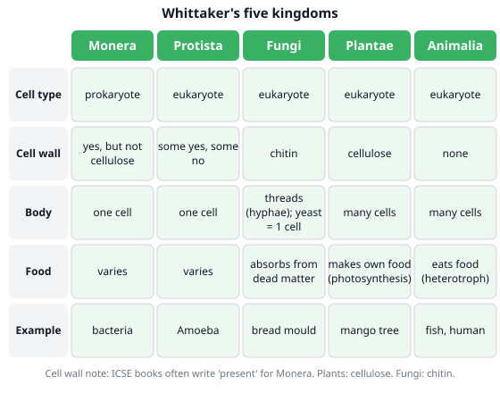
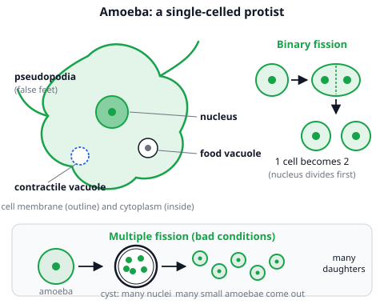
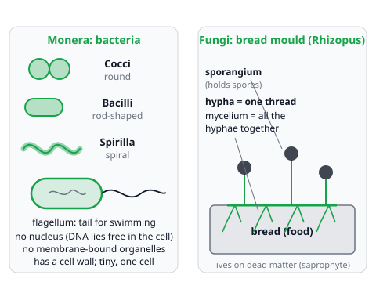
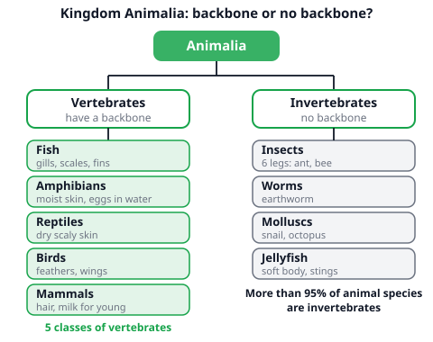

# 🟩 Five Kingdoms  ·  `biology.classification.kingdoms`
> 📅 Study date: Fri 6 Nov · ⏱️ ~12 min read · 📋 Syllabus: Need for classification, Monera, Protista (Amoeba), Fungi (mould), Plantae, Animalia: vertebrates and invertebrates

## 🍳 Start with a kitchen cupboard
Imagine a kitchen where everything is thrown into one big drawer: spoons, spices, pans and knives. Cooking would take forever. A good cook groups things: pans together, spices together, knives together. Scientists do the same with living things. In your kitchen alone you can find **mould** on old bread, **yeast** in a packet, a **mushroom**, **bacteria** in yogurt and a **rice** plant. They go into different groups, called **kingdoms**.

## 🖼️ Big picture

## 💡 Core ideas
1. **Why classify?** There are millions of kinds of living things. **Classification** means sorting them into groups by shared features. It makes them **easier to study and remember**, shows how organisms are **related**, and lets scientists **name and place a new organism** quickly.
2. **Five kingdoms (Whittaker).** The biggest groups are: **Monera, Protista, Fungi, Plantae, Animalia**. They are sorted by cell type (does it have a nucleus?), cell wall, one cell or many cells, and how it gets food.

| Kingdom | Cell type | Body | Food | Example |
|---|---|---|---|---|
| **Monera** | prokaryote | one cell | varies | bacteria |
| **Protista** | eukaryote | one cell | varies | Amoeba |
| **Fungi** | eukaryote | threads (hyphae) | absorbs from dead matter | bread mould |
| **Plantae** | eukaryote | many cells | makes its own (photosynthesis) | mango tree |
| **Animalia** | eukaryote | many cells | eats food | fish, human |

3. **Monera: bacteria.** **Prokaryotes**: **no nucleus** and **no membrane-bound organelles** (they do have ribosomes). **Shape:** round (**cocci**), rod (**bacilli**) or spiral (**spirilla**). **Movement:** some swim with a **flagellum** (a whip-like tail); others do not move.
4. **Protista: Amoeba.** One cell with a nucleus. **Locomotion:** it pushes out **pseudopodia** ("false feet"). **Nutrition:** it **engulfs** food with pseudopodia, which makes a **food vacuole** where the food is digested. **Respiration:** oxygen goes in and carbon dioxide goes out by **diffusion** through the cell membrane. **Excretion:** a **contractile vacuole** pumps out extra water and some waste. **Reproduction:** **binary fission** (one cell splits into two); in bad conditions, **multiple fission** inside a **cyst** (many small amoebae).
5. **Fungi: mould.** A mould (such as bread mould) is made of thread-like **hyphae**. All the hyphae together are the **mycelium**. It has **no chlorophyll**, so it feeds on dead food (**saprophytic** nutrition): it releases **enzymes** onto the food and **absorbs** the digested food. It **respires** using oxygen (aerobic respiration) to release energy. Its spores are made in **sporangia**.
6. **Plantae and Animalia.** **Plantae:** many cells, a **cellulose** cell wall, **chlorophyll**, they make food by photosynthesis (examples: moss, fern, mango; you do not need to classify plants). **Animalia:** many cells, **no cell wall**, they eat food. Animals are split into **vertebrates** (have a **backbone**) in **5 classes**: fish, amphibians, reptiles, birds, mammals; and **invertebrates** (no backbone: insects, worms, snails, jellyfish). Over 95 % of animal species are invertebrates.

## 🧮 HUSO-style examples

**Example 1.** 🍳 A kitchen has: (1) green mould on an old slice of bread, (2) a mushroom, (3) dry yeast in a packet, (4) bacteria that turn milk into yogurt, (5) a rice plant. How many of these belong to the kingdom **Fungi**?

(A) 1  (B) 2  (C) 3  (D) 4  (E) 5

Steps:
1. Sort each one into a kingdom: mould = **Fungi**, mushroom = **Fungi**, yeast = **Fungi**, yogurt bacteria = **Monera**, rice = **Plantae**.
2. Count the Fungi: mould, mushroom and yeast: **3**. **Answer: (C).**
3. Traps: yeast is **one cell**, but it still has a nucleus and a chitin wall, so it is a fungus. The bacteria are in Monera, because they have no nucleus. (B) 2 forgets the yeast; (D) 4 adds the bacteria.

**Example 2.** Which statement about *Amoeba* is correct?

(A) It moves with flagella and makes food by photosynthesis.
(B) It engulfs food with pseudopodia, digests it in a food vacuole and pumps out extra water with a contractile vacuole.
(C) It has no nucleus, so it is classified in Monera.
(D) It reproduces by making spores.
(E) It breathes with gills.

Steps:
1. *Amoeba* is a single-celled **protist** with a **nucleus**. This removes (C).
2. It has no chlorophyll and no flagella: it moves with **pseudopodia** and **eats** other tiny things. This removes (A).
3. It reproduces by **fission** (binary, or multiple in a cyst), not by spores. This removes (D). It has no gills: gases go in and out by **diffusion** through the cell membrane. This removes (E).
4. That leaves (B): it **engulfs** food (food vacuole) and the **contractile vacuole** removes extra water. **Answer: (B).**

## ⚠️ Common traps
- **Yeast and mould are fungi, not plants and not bacteria.** Their walls are **chitin**, not cellulose, and they cannot make their own food.
- **Bacteria have no nucleus.** If an organism has a nucleus, it cannot be Monera. *Amoeba* has a nucleus.
- **Binary vs multiple fission.** Binary: **1 → 2**, in normal conditions. Multiple: **1 → many** inside a **cyst**, in bad conditions. (Some books describe the cyst mainly as protection. The syllabus asks for both fissions, so learn both.)
- **Backbone is the test for vertebrates.** A worm, a snail and a spider have no backbone, so they are invertebrates. Do not mix up **vertebrates** (5 classes) with **invertebrates** (most animals).

## ✏️ Redraw from memory
Close the page and draw in 5 minutes:
- [ ] A five-column table: Monera, Protista, Fungi, Plantae, Animalia, with cell type, body, food and an example.
- [ ] An *Amoeba* with nucleus, food vacuole, contractile vacuole and pseudopodia, plus binary fission (1 → 2).
- [ ] Three bacteria shapes (round, rod, spiral) and one with a flagellum.
- [ ] A bread mould with hyphae, mycelium and sporangia.
- [ ] A small tree: Animalia → vertebrates (5 classes) and invertebrates.

Compare with the page and mark what you missed in red.

## 🎥 Watch / try
- [Classification](https://www.youtube.com/watch?v=DVouQRAKxYo) — Amoeba Sisters · 7:42 · look for why we classify and how groups are built
- [Protists and Fungi](https://www.youtube.com/watch?v=zK7Ckmxxqds) — Amoeba Sisters · 8:50 · look for *Amoeba*, how fungi feed and what hyphae are

## ✅ Check your understanding (5 questions)
Do these without looking at the material. You are **READY** if you get at least 4 of 5 right.

**1.** Which description of bacteria is correct?

(A) Prokaryotic cells with no nucleus, which may be round, rod-shaped or spiral.
(B) Eukaryotic cells with a nucleus and a cellulose cell wall.
(C) Multicellular organisms made of hyphae.
(D) Cells that always move using pseudopodia.
(E) Cells that have mitochondria and chloroplasts like plants.

**2.** 🍳 A cook finds a fuzzy growth on a slice of bread. Which statement is correct?

(A) It is bacteria, and each fuzzy thread is a single cell with a flagellum.
(B) It is a plant, and its threads make food by photosynthesis.
(C) It is a protist, and its threads are pseudopodia.
(D) It is a fungus, and its threads (hyphae) release enzymes and absorb the digested food from the bread.
(E) It is a fungus, and its threads make food by photosynthesis, like leaves.

**3.** Suppose an *Amoeba* in a pond divides by binary fission once every hour, and no cell dies. Starting with 1 amoeba, how many are there after 5 hours?

(A) 5  (B) 32  (C) 16  (D) 10  (E) 64

**4.** Which list contains one animal from **each** of the five classes of vertebrates (fish, amphibians, reptiles, birds, mammals)?

(A) Shark, frog, lizard, bat, dolphin
(B) Trout, newt, snake, penguin, octopus
(C) Tuna, toad, crocodile, eagle, lion
(D) Salmon, frog, turtle, sparrow, spider
(E) Eel, salamander, tortoise, ostrich, shark

**5.** Organism X is a single cell with no nucleus and lives in yogurt. Organism Y has many cells, no cell wall and eats food. Which pair of kingdoms is correct for X and Y?

(A) Protista, Plantae
(B) Monera, Plantae
(C) Protista, Fungi
(D) Fungi, Animalia
(E) Monera, Animalia

Answer key & explanations

1. **(A)** Bacteria are prokaryotes: no nucleus, and round (cocci), rod (bacilli) or spiral (spirilla). (B) describes a plant cell. (C) describes a mould. (D) pseudopodia belong to *Amoeba*. (E) bacteria have no mitochondria or chloroplasts.
2. **(D)** Mould is a fungus. Its hyphae release enzymes and absorb the digested food. (A) bacteria are single cells without hyphae. (B) and (E) a fungus has no chlorophyll, so it cannot do photosynthesis. (C) a protist moves with pseudopodia and is not a thread-like mould.
3. **(B) 32.** Each hour the number doubles: 1 → 2 → 4 → 8 → 16 → 32, so after 5 hours it is 2⁵ = 32. (A) adds 1 each hour. (C) 16 is the number after only 4 hours. (D) adds 2 each hour. (E) 64 is the number after 6 hours.
4. **(C)** Tuna = fish, toad = amphibian, crocodile = reptile, eagle = bird, lion = mammal. (A) has no bird (a bat and a dolphin are both mammals). (B) an octopus is an invertebrate. (D) a spider is an invertebrate. (E) has no mammal (an eel and a shark are both fish).
5. **(E)** X has no nucleus: Monera. Y has many cells, no wall, and eats food: Animalia. (A), (B) and (C) wrongly place the nucleus-less cell in Protista. (D) a fungus has a chitin wall, and a bacterium is not a fungus.

