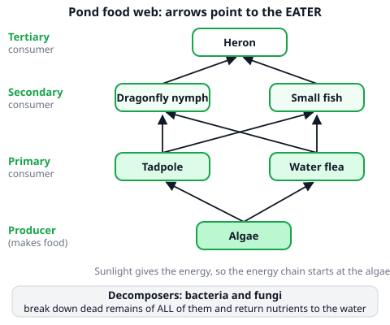
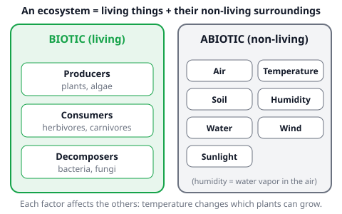
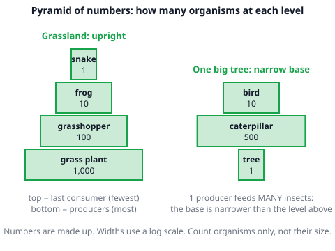
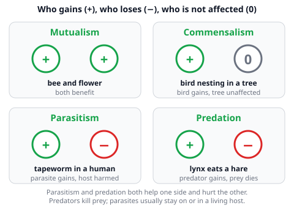

# 🟩 Ecosystems  ·  `biology.ecology.ecosystems`
> 📅 Study date: Wed 4 Nov · ⏱️ ~12 min read · 📋 Syllabus: Biotic and abiotic factors, Producers, consumers, decomposers, Food chain, food web, pyramid of numbers, Symbiosis, parasitism, predation

## 🏊 Start with the green water
You swim in a lake and the water looks green. That green is billions of tiny **algae**, soaking up sunlight. Little animals eat the algae, small fish eat the little animals, and a heron on the shore eats the fish. Nobody planned it: it is a **food web**, and every living thing in it also depends on the water, the sunlight and the temperature. That whole system is an **ecosystem**.

## 🖼️ Big picture

## 💡 Core ideas
1. **Ecosystem = living + non-living.** An **ecosystem** is a community of living things and their non-living surroundings, interacting. **Biotic** factors are the **living** parts (plants, animals, fungi, bacteria). **Abiotic** factors are the **non-living** parts: **air, soil, water**, and the climate factors **sunlight, temperature, humidity** (water vapor in the air) and **wind**.
2. **Three jobs: producers, consumers, decomposers.** **Producers** (green plants, algae) make their own food using sunlight. **Consumers** cannot make food: **primary** consumers eat producers (herbivores), **secondary** consumers eat primary consumers, **tertiary** consumers eat secondary consumers. **Decomposers** (bacteria and fungi) break down dead remains and return nutrients to the soil or water.
3. **Food chain and food web.** A **food chain** is one path of "who eats whom". The **arrow points to the eater**, the direction the food and energy move. Energy flows **one way**: it comes from the **sun**, goes up the chain, and is lost as heat on the way (it is not recycled). A **food web** is many food chains joined together, because most animals eat more than one thing.
4. **Pyramid of numbers.** Count the organisms at each level and stack them: producers at the bottom. In a grassland the pyramid is **upright** (many grass plants, fewer grasshoppers, fewer frogs, one snake). But **one big tree** can feed hundreds of insects, so the base is **narrow**: the shape can be **inverted** or spindle-like. It counts organisms only, not their size.
5. **Living together: symbiosis.** Different species can live close together in different ways. **Mutualism (+ +):** both benefit, such as a bee and a flower. **Commensalism (+ 0):** one benefits and the other is not affected, such as a bird nesting in a tree. (Many school books use the word "symbiosis" mainly for the partnerships where at least one partner gains. Know all four words.)
6. **Parasitism and predation.** **Parasitism (+ −):** the **parasite** lives on or in a **host**, feeds on it and harms it, usually without killing it quickly (a tapeworm in the gut, a tick on a dog). **Predation (+ −):** a **predator** kills and eats its **prey** (a lynx and a hare). Rule of thumb: a **predator kills**, a **parasite stays**.

> 📝 *Extra, not required:* a rule of thumb says about **10 %** of the energy passes from one level to the next, so food chains are short (usually 4 or 5 levels). Real values vary.

## 🧮 HUSO-style examples

**Example 1.** 🏊 Look at the pond food web in the big picture. Each arrow points to the eater. How many different food chains lead from the algae to the heron, and what is the heron in each of them?

(A) 2 chains; a tertiary consumer
(B) 4 chains; a tertiary consumer
(C) 4 chains; a secondary consumer
(D) 8 chains; a tertiary consumer
(E) 6 chains; a primary consumer

Steps:
1. Start at the algae. Two primary consumers eat algae: the tadpole and the water flea. That is **2 choices**.
2. Each of them is eaten by both secondary consumers (dragonfly nymph and small fish). That is **2 choices** again.
3. Each secondary consumer is eaten by the heron (1 choice). So the number of chains is 2 × 2 × 1 = **4**.
4. In every chain the order is algae (producer) → primary → secondary → heron. The heron is the **third** consumer, so it is a **tertiary consumer**. **Answer: (B).**
5. Traps: (D) 8 is the number of **arrows** in the picture, not the number of chains. (A) 2 counts only the straight-up chains and forgets the cross arrows.

**Example 2.** A scientist counts the organisms in a forest patch (suppose these numbers): 1 oak tree, 800 caterpillars, 40 small birds, 2 hawks. Which statement about the pyramid of numbers is correct?

(A) It is upright, because the oak is the biggest organism.
(B) It is upright, because producers are always the most numerous.
(C) It is not an upright pyramid, because the base (1 oak) is narrower than the caterpillar level.
(D) It is a rectangle, because every level has the same energy.
(E) It starts with the caterpillars, because the oak is a consumer.

Steps:
1. Write the levels from bottom to top: producer **1**, primary consumer **800**, secondary **40**, tertiary **2**.
2. A pyramid is upright only if every level is **smaller** than the one below. Here 1 < 800, so the bottom level is **narrower** than the next. The shape is widest in the middle (800), like a spindle. **Answer: (C).**
3. Size does not matter: a pyramid of numbers counts **organisms**, so one huge oak is still "1". This removes (A).
4. (B) is false: one tree feeds many insects. (D) and (E) are wrong because the oak is a producer and the pyramid counts numbers, not energy.

## ⚠️ Common traps
- **Arrows backwards.** In a food chain the arrow points **to the eater**: grass → rabbit → fox. It is not "who is afraid of whom".
- **Calling decomposers a level of the chain.** They break down the dead remains of **every** level. They are not "the last animal".
- **Saying a pyramid of numbers is always upright.** It can be inverted or spindle-shaped, for example one tree with many insects. (A pyramid of **energy** is always upright, because energy is lost at every step.)
- **Mixing predation and parasitism.** The predator **kills and eats** the prey. The parasite lives **on or in** its host and usually keeps it alive for a long time.

## ✏️ Redraw from memory
Close the page and draw in 5 minutes:
- [ ] A food web with at least 1 producer, 2 primary consumers, 2 secondary consumers and 1 tertiary consumer, and **arrows pointing to the eater**.
- [ ] The sun feeding the producer, and a decomposer box for dead remains.
- [ ] Two pyramids of numbers: one upright (grassland) and one with a narrow base (one tree).
- [ ] Four small boxes with signs: mutualism + +, commensalism + 0, parasitism + −, predation + −, each with one example.
- [ ] Two lists: biotic and abiotic factors (7 abiotic).

Compare with the page and mark what you missed in red.

## 🎥 Watch / try
- [Food Webs and Energy Pyramids: Bedrocks of Biodiversity](https://www.youtube.com/watch?v=-oVavgmveyY) — Amoeba Sisters · 5:49 · look for how the arrows show who eats whom and how a pyramid is built
- [Ecological Relationships](https://www.youtube.com/watch?v=rNjPI84sApQ) — Amoeba Sisters · 6:50 · look for the examples of mutualism, commensalism and parasitism

## ✅ Check your understanding (5 questions)
Do these without looking at the material. You are **READY** if you get at least 4 of 5 right.

**1.** Which list contains **only** abiotic factors?

(A) Soil, algae, wind
(B) Sunlight, bacteria, water
(C) Air, temperature, humidity
(D) Humidity, mushrooms, soil
(E) Wind, tadpoles, sunlight

**2.** 🏊 In the pond chain algae → water flea → small fish → heron, which statement is correct?

(A) The small fish is a secondary consumer, and the arrows show the direction of food and energy.
(B) The water flea is a secondary consumer.
(C) The heron is a primary consumer because it is at the top.
(D) The arrows point from the eater to its food, so the heron is eaten by the fish.
(E) Algae are decomposers because they live in water.

**3.** 🍳 On a farm the chain is wheat → chicken → fox. A disease kills most of the wheat. Which change is most likely in the short term?

(A) The chickens increase, because there is less competition.
(B) The chickens and the foxes both increase.
(C) Only the foxes decrease, and the chickens are not affected.
(D) The chickens decrease first, and then the foxes decrease.
(E) Nothing changes, because decomposers replace the wheat.

**4.** Which pair is matched correctly?

(A) A tapeworm in the human gut: commensalism
(B) A lynx and a hare: mutualism
(C) A bird nesting in a tree that is not harmed: parasitism
(D) A tick feeding on a dog: predation
(E) A bee feeding on nectar and carrying pollen between flowers: mutualism

**5.** Suppose a scientist counts 1 rose bush, 5,000 aphids, 50 ladybugs and 2 sparrows. Which statement about the pyramid of numbers is correct?

(A) It is upright, because aphids are small.
(B) The base (1 rose bush) is narrower than the aphid level, so it is not an upright pyramid.
(C) The sparrows are producers because they are at the top.
(D) Every level is bigger than the one below it, so the pyramid is inverted.
(E) A pyramid of numbers is always upright in every ecosystem.

Answer key & explanations

1. **(C) Air, temperature, humidity.** All three are non-living. (A) has algae (living). (B) has bacteria. (D) has mushrooms. (E) has tadpoles.
2. **(A)** The flea eats algae (primary), the fish eats the flea (secondary), the heron eats the fish (tertiary). The arrow points to the eater and shows the direction of food and energy. (B) the flea is primary. (C) the heron is tertiary, and the top position does not make it "primary". (D) has the arrows backwards. (E) algae make their own food, so they are producers.
3. **(D)** Less wheat means less food for chickens, so their number goes down, then there is less food for foxes. (A) and (B) ignore the food link. (C) forgets that the chickens depend on wheat. (E) decomposers recycle nutrients from dead remains, but they do not make new wheat appear.
4. **(E)** A bee gets nectar and the flower gets pollinated: both benefit (mutualism). (A) a tapeworm harms its host: parasitism. (B) a lynx kills a hare: predation. (C) the tree is not harmed, so this is commensalism. (D) a tick lives on its host and feeds on it: parasitism.
5. **(B)** The levels are 1, 5000, 50, 2. The first level (1) is narrower than the second (5000), so the pyramid is not upright. (A) size does not count. (C) sparrows are consumers. (D) 5000 > 50 > 2: the levels get **smaller** going up, so it is not bigger at every level. (E) pyramids of numbers can be inverted or spindle-shaped.

