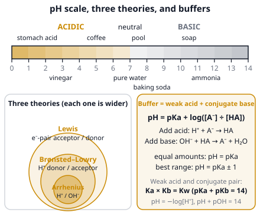

# 🟨 Acids & Bases  ·  `chemistry.analytical.acid-base`
> 📅 Study date: Sat 24 Oct · ⏱️ ~12 min read · 📋 Syllabus: Arrhenius theory, Bronsted theory, Lewis theory, pH and pOH, Ka and Kb, Buffer solutions

## 🏊 Start with the pool test strip
Every pool needs its water checked, and the test strip is mostly about the **pH**: a good pool sits at about **7.2 to 7.8**. If the pH falls too low, eyes sting and metal ladders corrode. If it rises too high, the chlorine stops working well and the water turns cloudy. Pool workers add a bit of acid or base to fix it, but the pH does not jump around wildly, because the water contains substances that **resist change**: a **buffer**. This page explains pH, what makes an acid strong, and how a buffer works. **The difference:** pH is a *logarithmic* scale. A change of 1 pH unit is a change of **10 times** in H⁺, not a change of "one more drop".

## 🖼️ Big picture

## 💡 Core ideas
1. **Three definitions, each wider than the last.** **Arrhenius:** an acid makes **H⁺** in water, a base makes **OH⁻** (HCl, NaOH). **Brønsted–Lowry:** an acid is a **proton (H⁺) donor** and a base is a **proton acceptor**. When an acid HA gives away H⁺, what is left, A⁻, is its **conjugate base**; every acid and its conjugate base form a **conjugate pair** (NH₄⁺/NH₃, H₃O⁺/H₂O). **Lewis:** an acid is an **electron-pair acceptor** and a base is an **electron-pair donor**. BF₃ (empty orbital) is a Lewis acid, NH₃ (lone pair) is a Lewis base, and metal ions like Al³⁺ or Fe³⁺ are Lewis acids. A substance that can act as both (H₂O, HCO₃⁻) is **amphoteric**.
2. **pH and pOH.** **pH = −log[H⁺]**, **pOH = −log[OH⁻]**, and at 25 °C **pH + pOH = 14**. pH < 7 acidic, = 7 neutral, > 7 basic. Because of the log, **pH 3 has 10 times more H⁺ than pH 4** and 100 times more than pH 5. **Strong acids** (HCl, HBr, HI, HNO₃, HClO₄, H₂SO₄ for its first H⁺) and **strong bases** (the hydroxides of group 1, Ba(OH)₂, Ca(OH)₂) ionize **completely**, so [H⁺] (or [OH⁻]) comes straight from the concentration. Check the formula: 0.0050 M Ba(OH)₂ gives **two** OH⁻ per unit, so [OH⁻] = 0.010 M.
3. **Weak acids and bases** ionize only a little: HA ⇌ H⁺ + A⁻. **Ka = [H⁺][A⁻] ÷ [HA]**. A **bigger Ka means a stronger acid** (pKa = −log Ka; smaller pKa means stronger). For a weak base, B + H₂O ⇌ BH⁺ + OH⁻, **Kb = [BH⁺][OH⁻] ÷ [B]**. For a conjugate pair, **Ka × Kb = Kw = 10⁻¹⁴** (pKa + pKb = 14): a strong acid has a very weak conjugate base.
4. **pH of a weak acid.** Set up the equilibrium (an "ICE" table: Initial, Change, Equilibrium). If the acid is only slightly ionized, **[H⁺] ≈ √(Ka × C)**, where C is the starting concentration. Check the answer: [H⁺] should be less than about 5 % of C. **Percent ionization = [H⁺] ÷ C × 100**; the more you dilute a weak acid, the **larger** its percent ionization becomes.
5. **Buffers.** A **buffer** is a mix of a weak acid and its conjugate base (like CH₃COOH and CH₃COO⁻) in comparable amounts. If you add H⁺, the base takes it: **A⁻ + H⁺ → HA**. If you add OH⁻, the acid gives H⁺: **HA + OH⁻ → A⁻ + H₂O**. So the pH hardly moves. The **Henderson–Hasselbalch equation**: **pH = pKa + log([A⁻] ÷ [HA])**. With equal amounts, pH = pKa. A buffer works best when the ratio is between 0.1 and 10, so **pH = pKa ± 1**. A bigger amount of buffer (more moles) resists more.
6. **Strong is not the same as concentrated.** *Strong/weak* describes how completely it ionizes; *concentrated/dilute* describes how much is dissolved. A 0.001 M HCl solution is strong and dilute (pH 3). A 10 M acetic acid is weak and concentrated. Diluting a strong acid 10 times raises its pH by exactly 1; a weak acid's pH rises by only about 0.5.

## 🧮 HUSO-style examples

**Example 1.** What is the pH of 0.10 M acetic acid, CH₃COOH? (K_a = 1.8 × 10⁻⁵)

(A) 1.0  (B) 2.9  (C) 4.7  (D) 5.7  (E) 11.1

Steps:
1. Acetic acid is **weak**, so it ionizes only a little. CH₃COOH ⇌ H⁺ + CH₃COO⁻, and K_a = [H⁺]² ÷ 0.10 (since [H⁺] = [CH₃COO⁻]).
2. [H⁺]² = K_a × 0.10 = 1.8 × 10⁻⁶, so [H⁺] = **1.34 × 10⁻³ M**.
3. pH = −log(1.34 × 10⁻³) = **2.9**. **Answer: (B).** Check: 1.34 × 10⁻³ ÷ 0.10 is only 1.3 %, so the approximation was fine.
4. Traps: (A) treats it as a strong acid (pH = −log 0.10 = 1.0). (C) 4.7 is the pKa, not the pH. (D) 5.7 forgets the square root. (E) 11.1 is 14 − 2.9 (the pOH).

**Example 2.** 🏊 A pool-style buffer holds 0.30 mol of acetic acid and 0.60 mol of sodium acetate in 1.0 L (pKa of acetic acid = 4.74). Then 0.10 mol of HCl is added (assume no change in volume). What is the new pH?

(A) 4.64  (B) 4.74  (C) 4.84  (D) 5.04  (E) 1.00

Steps:
1. The strong acid HCl is used up by the base in the buffer: **CH₃COO⁻ + H⁺ → CH₃COOH**. So acetate goes **down** by 0.10 mol (0.60 → 0.50) and acetic acid goes **up** by 0.10 mol (0.30 → 0.40).
2. Henderson–Hasselbalch: pH = 4.74 + log(0.50 ÷ 0.40) = 4.74 + log 1.25 = 4.74 + 0.097 = **4.84**. **Answer: (C).**
3. Compare: before the HCl, pH = 4.74 + log(0.60 ÷ 0.30) = 5.04. Adding 0.10 mol of strong acid moved the pH by only 0.2 units. Without the buffer, 0.10 mol of HCl in 1 L of water would give pH 1.00.
4. Traps: (A) 4.64 puts the ratio upside down. (D) 5.04 ignores the added acid. (E) 1.00 forgets the buffer.

## ⚠️ Common traps
- **Strong ≠ concentrated.** A very dilute strong acid and a concentrated weak acid can have the same pH. Always compare the real numbers.
- **Ba(OH)₂ and Ca(OH)₂ give 2 OH⁻.** H₂SO₄ gives (up to) 2 H⁺, but only its first H⁺ is fully ionized.
- **The log scale.** pH 2 is 10 times more acidic than pH 3 (not 1.5 times or "one unit more").
- **Bigger Ka = stronger acid, but smaller pKa = stronger acid.** Do not mix the two up.
- **Conjugate acid of a base** = the base + H⁺ (NH₃ → NH₄⁺), not "the acid of the same name".
- **A buffer is not just any mix of an acid and a base:** it needs a *weak* acid together with its *conjugate* base (or a weak base with its conjugate acid).

## ✏️ Redraw from memory
Close the page and draw in 5 minutes:
- [ ] A **pH scale** from 0 to 14 with "acidic", "neutral", "basic" and three everyday examples (like lemon, pure water, soap).
- [ ] **Three circles** inside each other: Arrhenius ⊂ Brønsted–Lowry ⊂ Lewis, with the definition of each.
- [ ] A **conjugate pair** arrow diagram: HA → A⁻ + H⁺ and NH₃ + H⁺ → NH₄⁺.
- [ ] A **buffer** beaker with HA and A⁻ in it, an arrow for "add H⁺" and an arrow for "add OH⁻", with the reactions.
- [ ] The three formulas: **Ka**, **pH = −log[H⁺]**, **Henderson–Hasselbalch**.

Compare with the picture and mark what you missed in red.

## 🎥 Watch / try
- [Conjugate Acid Base Pairs, Arrhenius, Bronsted Lowry and Lewis Definition](https://www.youtube.com/watch?v=OP6RKqSp1Xw) — The Organic Chemistry Tutor · 11:37 · pause and name the conjugate pairs yourself
- [pH and pOH: Crash Course Chemistry #30](https://www.youtube.com/watch?v=LS67vS10O5Y) — CrashCourse · 11:23 · watch the pH of everyday things on the scale
- [Henderson–Hasselbalch equation](https://www.youtube.com/watch?v=7QgtdYiWH50) — Khan Academy · 7:34 · see how a buffer's pH depends on the ratio

## ✅ Check your understanding (5 questions)
Do these without looking at the material. You are **READY** if you get at least 4 of 5 right. At 25 °C, Kw = 1.0 × 10⁻¹⁴.

**1.** In the reaction NH₃ + H₂O ⇌ NH₄⁺ + OH⁻, which species is the **conjugate acid** of NH₃?

(A) H₂O  (B) NH₄⁺  (C) OH⁻  (D) NH₂⁻  (E) H₃O⁺

**2.** What is the pH of 0.0050 M Ba(OH)₂ solution (a strong base)?

(A) 11.7  (B) 2.0  (C) 2.3  (D) 12.0  (E) 10.0

**3.** 🏊 Water in pool A has pH 6.4 and water in pool B has pH 7.4. How many times more H⁺ does pool A contain?

(A) 10  (B) 1.16  (C) 0.10  (D) 100  (E) 6.4

**4.** Which of these is a **Lewis acid** but **not** a Brønsted–Lowry acid?

(A) HCl  (B) H₂O  (C) NH₃  (D) OH⁻  (E) BF₃

**5.** Five 0.10 M solutions of weak acids have these K_a values. Which one has the **lowest pH**?

(A) 1.8 × 10⁻⁵  (B) 6.2 × 10⁻¹⁰  (C) 6.8 × 10⁻⁴  (D) 3.5 × 10⁻⁸  (E) 4.0 × 10⁻⁶

Answer key & explanations

1. **(B) NH₄⁺.** NH₃ accepts H⁺ and becomes NH₄⁺, its conjugate acid. OH⁻ is the conjugate base of H₂O. (D) NH₂⁻ is what you get when NH₃ *loses* H⁺ (its conjugate base).
2. **(D) 12.0.** Each Ba(OH)₂ gives 2 OH⁻, so [OH⁻] = 2 × 0.0050 = 0.010 M and pOH = 2.0, so pH = 14 − 2.0 = 12.0. (A) 11.7 forgets the factor of 2 (pOH 2.3). (B) and (C) are pOH values, not pH.
3. **(A) 10.** The difference is 1.0 pH unit, so [H⁺] in pool A is 10^1.0 = 10 times larger. (B) 1.16 is 7.4 ÷ 6.4, a wrong "ratio of pH numbers". (D) 100 would be a difference of 2 pH units.
4. **(E) BF₃.** It has an empty orbital and accepts an electron pair (Lewis acid), but it has no H⁺ to give. HCl and H₂O can donate H⁺. NH₃ and OH⁻ are bases.
5. **(C) 6.8 × 10⁻⁴.** At the same concentration, the acid with the largest K_a ionizes the most and has the lowest pH. It is the strongest acid (about pH 2.1 compared with 2.9 for 1.8 × 10⁻⁵).

