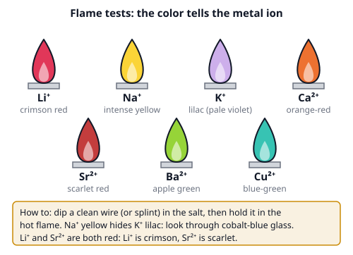
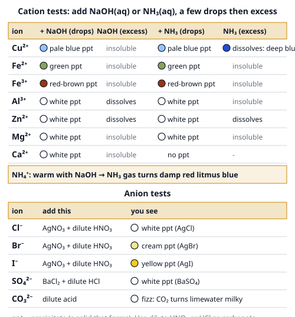

# 🟨 Qualitative Analysis  ·  `chemistry.analytical.qualitative`
> 📅 Study date: Sun 1 Nov · ⏱️ ~12 min read · 📋 Syllabus: Flame tests, Identification of common cations and anions

## 🍳 Start with boiling pasta
You have seen it: the pasta pot boils over, a little salty water hits the gas flame, and the flame flashes **bright yellow-orange** for a second. You did not measure anything and you did not need a lab. The flame told you there is **sodium** in the water.

That is **qualitative analysis**: not "how much?" (that is quantitative, like titration) but **"what is it?"** You are a detective. You use quick tests, each one leaves a clue (a color, a solid, a gas), and you combine the clues.

## 🖼️ Big picture

The second picture is your **evidence table** for precipitation tests:

## 💡 Core ideas
1. **Flame test.** Heat gives the electrons of a metal ion extra energy. When they fall back down they give off **light of one specific color**, like a fingerprint. Learn the seven: **Li⁺ crimson, Na⁺ intense yellow, K⁺ lilac, Ca²⁺ orange-red, Sr²⁺ scarlet, Ba²⁺ apple green, Cu²⁺ blue-green.** Sodium is everywhere (fingers, dust) and its yellow can hide K⁺, so look through **cobalt-blue glass**, which blocks the yellow.
2. **Precipitation tests for cations.** Add **NaOH(aq)** (a source of OH⁻) to the solution. Most metal ions make an insoluble **hydroxide** (a solid called a **precipitate**, or ppt) with a typical color: **Cu²⁺ pale blue, Fe²⁺ green, Fe³⁺ red-brown, and white for Al³⁺, Zn²⁺, Mg²⁺, Ca²⁺.** Then add **excess** NaOH: the white hydroxides of **Al³⁺ and Zn²⁺ dissolve** (they are **amphoteric**: they react with bases too, forming a colorless solution), Mg²⁺ and Ca²⁺ do not.
3. **Ammonia solution** NH₃(aq) tells the whites apart: in excess, **Zn²⁺ dissolves** (a **complex ion** with NH₃ forms) but **Al³⁺ does not**; **Cu²⁺ dissolves to a deep blue solution**. Remember **Zn²⁺: dissolves in both; Al³⁺: only in NaOH.** Also: **NH₄⁺** + warm NaOH gives NH₃ gas (**damp red litmus turns blue**), and **Fe³⁺ + SCN⁻** gives a blood-red color.
4. **Anion tests.** **Halides:** add dilute HNO₃, then AgNO₃: **Cl⁻ white** (AgCl), **Br⁻ cream** (AgBr), **I⁻ yellow** (AgI). The silver chloride dissolves in dilute ammonia, silver bromide only in concentrated ammonia, silver iodide in neither. **Sulfate:** add dilute HCl, then BaCl₂: **white BaSO₄**. **Carbonate:** add dilute acid: **fizzing**, and the gas turns limewater milky.
5. **Why acidify first?** Carbonate would also make a white solid with Ag⁺ or Ba²⁺. Dilute acid destroys the carbonate (it fizzes away) so only the real halide or sulfate gives a precipitate.
6. **Gas tests.** **H₂:** a lit splint gives a **squeaky pop**. **O₂:** a glowing splint **relights**. **CO₂:** limewater turns **milky**. **NH₃:** **damp red litmus turns blue**. **Cl₂:** **damp litmus is bleached white**. Use several clues together, and never taste or sniff an unknown.

> 🕵️ **Analogy:** each test is a witness. One witness can be wrong (white solids are everywhere), but when three witnesses agree you have a case. **The difference:** a real detective can guess, but in chemistry each clue has an exact reason (the table), so you *eliminate* candidates until one is left.

## 🧮 HUSO-style examples

**Example 1.** A white solid dissolves in water to give a colorless solution. Adding a few drops of NaOH gives a white precipitate that dissolves in excess NaOH. Adding a few drops of NH₃(aq) gives a white precipitate that does **not** dissolve in excess NH₃. Which cation is present?

(A) Zn²⁺  (B) Mg²⁺  (C) Ca²⁺  (D) Al³⁺  (E) Fe³⁺

Steps:
1. Fe³⁺ is out: its precipitate is red-brown, not white.
2. Mg²⁺ and Ca²⁺ are out: their white precipitates do **not** dissolve in excess NaOH.
3. Left: Al³⁺ and Zn²⁺, which both dissolve in excess NaOH.
4. The NH₃ test splits them: Zn²⁺ would **dissolve** in excess NH₃, Al³⁺ would not. The precipitate stays, so it is **Al³⁺**. **Answer: (D).**

**Example 2.** A white salt X gives a lilac flame when viewed through cobalt-blue glass. Its solution gives a **yellow** precipitate when dilute HNO₃ and AgNO₃ are added, and the precipitate does not dissolve in ammonia. What is X?

(A) KCl  (B) KBr  (C) NaI  (D) KI  (E) K₂CO₃

Steps:
1. Lilac through cobalt glass means **K⁺** (not Na⁺, which is yellow). That removes (C).
2. Yellow AgX that does not dissolve in ammonia means **I⁻** (AgCl is white, AgBr is cream).
3. K⁺ with I⁻ is **KI**. **Answer: (D).**
4. (E) K₂CO₃ would fizz with acid and would not give a yellow precipitate.

## ⚠️ Common traps
- **Sodium is everywhere.** A yellow flame alone does not prove sodium is the *main* ion; the yellow also hides potassium's lilac. Use cobalt glass.
- **Dissolves in excess NaOH or NH₃ is part of the clue.** "White ppt" alone fits Al³⁺, Zn²⁺, Mg²⁺ and Ca²⁺. The behavior in excess is what separates them.
- **Skipping the acid.** Without dilute HNO₃ (silver test) or dilute HCl (barium test), carbonate gives a false white precipitate.
- **Color mix-ups:** Fe²⁺ is green and Fe³⁺ is red-brown; Cu²⁺ ppt is pale blue and the NH₃(excess) solution is **deep** blue; Li⁺ and Sr²⁺ are both red.

## ✏️ Redraw from memory
Draw this on paper in 5 minutes (use colored pencils!):
- [ ] The seven flames, each with its ion and color.
- [ ] The cation table for Cu²⁺, Fe²⁺, Fe³⁺, Al³⁺, Zn²⁺ with ppt colors.
- [ ] An arrow showing which ions dissolve in excess NaOH (Al³⁺, Zn²⁺) and in excess NH₃ (Zn²⁺, Cu²⁺).
- [ ] The three silver halide colors (white, cream, yellow) in order Cl⁻, Br⁻, I⁻.
- [ ] The five gas tests as little cartoons (splint pop, relight, limewater, litmus, bleached litmus).

## 🎥 Watch / try
- [Flame Tests of Metals](https://www.youtube.com/watch?v=cBGTskrLn18) — Harvard Natural Sciences Lecture Demonstrations · 5:07 · compare the seven colors with your own table
- [GCSE Chemistry: Tests for Anions (carbonate, sulfate and halide ions)](https://www.youtube.com/watch?v=mWTgHjdea4Y) — Cognito · 4:50 · see how the acid goes in before the silver or barium
- [Qualitative Analysis of Cations](https://www.youtube.com/watch?v=jltLlzZ6FqU) — chemistry edb · 7:37 · watch each precipitate form with drops and with excess

## ✅ Check your understanding (5 questions)
Do these without looking at the page. You are **READY** if you get at least 4 out of 5.

**1.** A flame test on a salt gives an intense yellow flame. Viewed through cobalt-blue glass, a lilac flame is seen. Which ions are present?

(A) Li⁺ and Ca²⁺  (B) Na⁺ and K⁺  (C) Na⁺ and Cu²⁺  (D) K⁺ and Ba²⁺  (E) Li⁺ and Na⁺

**2.** 🍳 White crust (limescale) in a kettle fizzes when vinegar is poured on it, and the gas turns limewater milky. Which anion is in the crust?

(A) Cl⁻  (B) SO₄²⁻  (C) I⁻  (D) CO₃²⁻  (E) Br⁻

**3.** A solution gives a green precipitate with NaOH. The precipitate does not dissolve in excess NaOH, and it slowly turns brown in air. Which cation is present?

(A) Fe³⁺  (B) Cu²⁺  (C) Fe²⁺  (D) Zn²⁺  (E) Al³⁺

**4.** Two colorless solutions contain Zn²⁺ and Al³⁺. Which test shows a different result for the two ions?

(A) adding excess NaOH  (B) a flame test  (C) adding dilute HCl  (D) adding AgNO₃  (E) adding excess NH₃ solution

**5.** A halide solution is acidified with dilute HNO₃ and AgNO₃ is added. A white precipitate forms, and it dissolves in dilute ammonia solution. Which ion is present?

(A) Cl⁻  (B) Br⁻  (C) I⁻  (D) SO₄²⁻  (E) CO₃²⁻

Answer key & explanations

1. **(B) Na⁺ and K⁺.** Intense yellow is sodium; the cobalt glass blocks that yellow and lets the lilac of potassium through. Lithium is crimson, calcium orange-red, copper blue-green, barium apple green.
2. **(D) CO₃²⁻.** Limescale is calcium carbonate. Acid (vinegar) releases CO₂, which turns limewater milky. Halides and sulfate give no gas with acid.
3. **(C) Fe²⁺.** Green hydroxide that turns brown in air (Fe²⁺ is oxidized to Fe³⁺). Fe³⁺ gives a red-brown solid straight away; Cu²⁺ is pale blue; Zn²⁺ and Al³⁺ are white.
4. **(E) adding excess NH₃ solution.** The Zn²⁺ precipitate dissolves in excess ammonia, the Al³⁺ precipitate does not. Excess NaOH dissolves both, so it cannot tell them apart. A flame test, dilute HCl and AgNO₃ give the same result for both ions (no useful difference).
5. **(A) Cl⁻.** White AgCl dissolves in dilute ammonia. AgBr (cream) needs concentrated ammonia and AgI (yellow) does not dissolve. Sulfate and carbonate give no precipitate after acidifying with nitric acid and adding silver nitrate.

