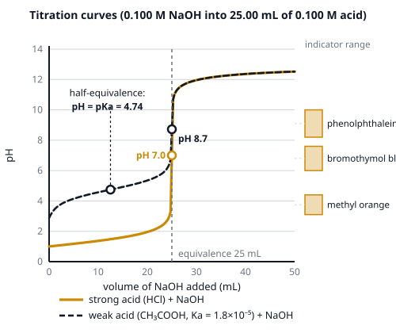

# 🟨 Quantitative Analysis  ·  `chemistry.analytical.quantitative`
> 📅 Study date: Sun 25 Oct · ⏱️ ~12 min read · 📋 Syllabus: Titration indicators, Titration curves, Acid-base titrations

## 🏊 Start with the pool test kit
At the pool, the lifeguard fills a small vial with pool water, adds a reagent, and then **counts drops** of a second liquid until the color flips from one color to another. The number of drops tells how much chlorine, acid, or base is in the water. That is a **titration**: you add a solution you know until the reaction is *exactly* finished, and then you read the answer from how much you used.

Think of it like a swimmer counting laps: you do not need to measure the whole pool, you only need to count how many 25 m laps it takes to reach the flag.

## 🖼️ Big picture

A titration has three parts: a **buret** (a long tube with a tap) holding the **titrant** (known concentration), a flask holding the **analyte** (the unknown), and an **indicator** (a dye that changes color near the finish).

## 💡 Core ideas
1. **The equivalence point** is when the moles of titrant added exactly match what the reaction needs. For a **1 : 1 acid–base reaction**: **M_a · V_a = M_b · V_b**. If the acid gives two H⁺ (H₂SO₄), then moles of H⁺ = 2 · M_a · V_a. The safe way is always: **moles of H⁺ = moles of OH⁻** at the equivalence point.
2. **The end point** is when the indicator *changes color*. A good indicator makes the end point land on top of the equivalence point (they should be within a drop or two). Equivalence point = chemistry; end point = what you see.
3. **An indicator is a weak acid** HIn whose two forms (HIn and In⁻) have different colors. It changes color over a range of about **pKa(HIn) ± 1** pH units. Three to know: **methyl orange** (pH 3.1–4.4, red → yellow), **bromothymol blue** (6.0–7.6, yellow → blue), **phenolphthalein** (8.2–10.0, colorless → pink).
4. **Titration curve = pH against volume of titrant.** The curve is flat, then jumps steeply at the equivalence point, then flattens again. **Choose the indicator whose color range sits inside the steep jump.**
   - **Strong acid + strong base:** equivalence at **pH 7.00** (25 °C). Any of the three indicators works, because the jump is huge (from about pH 3 to 11).
   - **Weak acid + strong base:** starts higher, has a **buffer region**, and the equivalence point is **above 7** (the conjugate base A⁻ reacts a little with water). Use **phenolphthalein**.
   - **Strong acid + weak base:** equivalence point **below 7**. Use **methyl orange**.
   - **Weak acid + weak base:** no sharp jump, so no indicator works well.
5. **Half-equivalence point.** When exactly half of a weak acid has been neutralized, [HA] = [A⁻], so by the **Henderson–Hasselbalch equation** pH = pKa + log([A⁻]/[HA]) = **pKa**. This is the easiest way to read Ka from a curve.
6. **Calculating the pH at any point of a strong–strong titration.** Work in **moles** first, then divide by the **total volume**: before equivalence, leftover H⁺ sets the pH; at equivalence, pH = 7; after equivalence, leftover OH⁻ sets pOH, and pH = 14 − pOH. For **Na₂CO₃ + HCl** there are **two** equivalence points (CO₃²⁻ → HCO₃⁻ → H₂CO₃), the second at **twice** the volume of the first.

> 🏊 **Analogy:** the indicator is the lifeguard's flag: it must flip right when you get to the wall. **The difference:** a flag is a fixed place, but an indicator changes over a *range* of pH, so a bad choice flips too early or too late and you miss the true wall.

## 🧮 HUSO-style examples

**Example 1.** A 25.00 mL sample of sulfuric acid, H₂SO₄, is titrated with 0.100 M NaOH. The equivalence point is reached after 30.00 mL of NaOH. What is the concentration of the H₂SO₄? (Treat both H⁺ of H₂SO₄ as fully released.)

(A) 0.0300 M  (B) 0.0833 M  (C) 0.120 M  (D) 0.0600 M  (E) 0.0500 M

Steps:
1. Moles of OH⁻ = 0.100 mol/L × 0.03000 L = 3.00 × 10⁻³ mol (3.00 mmol).
2. Each H₂SO₄ gives **2 H⁺**, so moles of H₂SO₄ = 3.00 mmol ÷ 2 = 1.50 mmol.
3. Concentration = 1.50 mmol ÷ 25.00 mL = **0.0600 M**. **Answer: (D).**
4. Traps: (C) 0.120 M forgets the factor 2 (that is [H⁺], not [H₂SO₄]); (B) 0.0833 M flips the ratio; (E) 0.0500 M divides by the wrong volume (30.00 mL).

**Example 2.** A student titrates 20.00 mL of a weak monoprotic acid HA with 0.100 M NaOH. The end point is at 20.00 mL, and after exactly 10.00 mL of NaOH the pH is 4.20. What is Ka of HA?

(A) 1.6 × 10⁻¹⁰  (B) 1.2 × 10⁻⁷  (C) 6.3 × 10⁻⁵  (D) 1.6 × 10⁻⁵  (E) 2.1 × 10⁻⁵

Steps:
1. 10.00 mL is **half** of the 20.00 mL needed, so this is the **half-equivalence point**.
2. There, [HA] = [A⁻], so **pH = pKa = 4.20**.
3. Ka = 10⁻⁴·²⁰ = **6.3 × 10⁻⁵**. **Answer: (C).**
4. Check with numbers: after 10.00 mL there are 1.00 mmol HA and 1.00 mmol A⁻ in 30.00 mL, so the ratio is 1 and the pH equals pKa. ✓
5. Traps: (B) comes from using Ka = [H⁺]² ÷ [HA] as if no A⁻ had formed yet; (D) comes from misreading the pH as 4.80.

## ⚠️ Common traps
- **Equivalence point ≠ pH 7.** It is 7 only for strong acid + strong base. Weak acid + strong base ends above 7.
- **Forgetting the number of H⁺ or OH⁻**: H₂SO₄ and Ca(OH)₂ need a factor of 2. Use moles of H⁺ = moles of OH⁻.
- **Using the wrong volume:** the concentration of the *analyte* uses the **original** sample volume; the pH after mixing uses the **total** volume.
- **Wrong indicator:** phenolphthalein for a strong acid + weak base ends too late and gives a wrong answer; use methyl orange.

## ✏️ Redraw from memory
Close this page and sketch, in 5 minutes, the titration curve of a **weak acid with a strong base**:
- [ ] Axes labeled: pH (0–14) up, volume of NaOH added across.
- [ ] The gentle start (pH about 3), the flat **buffer region**, and the steep jump.
- [ ] The **half-equivalence point** marked, with "pH = pKa".
- [ ] The **equivalence point** above pH 7 (about 8–9).
- [ ] Phenolphthalein's range (8.2–10) drawn as a band inside the jump.
- [ ] A dotted copy of the strong-acid curve that crosses pH 7 at equivalence.

## 🎥 Watch / try
- [Titration curves and acid-base indicators](https://www.youtube.com/watch?v=1YlXtpF-19A) — Khan Academy · 7:10 · see why the indicator must change color inside the steep part of the curve
- [Weak acid–strong base titrations](https://www.youtube.com/watch?v=sZW1qoQl3ng) — Khan Academy · 12:09 · watch where the buffer region and the half-equivalence point appear
- [Acid-Base Titration](https://www.youtube.com/watch?v=dLNsPqDGzms) — Professor Dave Explains · 2:40 · a quick picture of the whole procedure

## ✅ Check your understanding (5 questions)
Do these without looking at the page. You are **READY** if you get at least 4 out of 5.

**1.** Which indicator is the best choice for titrating a weak acid with a strong base?

(A) methyl orange (pH 3.1–4.4)  (B) bromothymol blue (pH 6.0–7.6)  (C) phenolphthalein (pH 8.2–10.0)  (D) none, because a weak acid titration has no jump  (E) any indicator, because the end point is always pH 7

**2.** 🏊 A pool-test kit measures a base in a 25.0 mL water sample. The sample needs 7.50 mL of 0.0200 M HCl to reach the end point. Treat the base as reacting 1 : 1 with H⁺. What is the concentration of the base in the pool water?

(A) 0.00600 M  (B) 0.0667 M  (C) 0.00462 M  (D) 0.150 M  (E) 0.0200 M

**3.** A weak acid has pKa = 6.00. Exactly one-quarter of it has been neutralized by NaOH. What is the pH of the mixture?

(A) 5.00  (B) 5.40  (C) 6.00  (D) 6.48  (E) 5.52

**4.** 20.0 mL of 0.100 M Na₂CO₃ is titrated with 0.100 M HCl until *both* steps are complete (CO₃²⁻ → HCO₃⁻ → H₂CO₃). What total volume of HCl is needed?

(A) 20.0 mL  (B) 40.0 mL  (C) 10.0 mL  (D) 80.0 mL  (E) 30.0 mL

**5.** 25.0 mL of 0.100 M HCl is mixed with 30.0 mL of 0.100 M NaOH. What is the pH of the mixture?

(A) 2.04  (B) 7.00  (C) 12.30  (D) 11.96  (E) 12.22

Answer key & explanations

1. **(C) phenolphthalein.** The equivalence point of a weak acid + strong base is above 7 (about 8–9), inside phenolphthalein's range. Methyl orange changes too early (in the buffer region), and bromothymol blue changes before the jump is finished.
2. **(A) 0.00600 M.** Moles of acid = 0.0200 M × 7.50 mL = 0.150 mmol, so the base is 0.150 mmol ÷ 25.0 mL = 0.00600 M. Choice (B) flips the ratio, (C) divides by the total volume 32.5 mL, and (D) forgets to divide by the sample volume.
3. **(E) 5.52.** One-quarter neutralized: [A⁻] : [HA] = 0.25 : 0.75 = 1 : 3. pH = 6.00 + log(1/3) = 6.00 − 0.48 = 5.52. Choice (D) flips the ratio and (B) uses 0.25 instead of 1/3.
4. **(B) 40.0 mL.** Moles of Na₂CO₃ = 2.00 mmol. Each carbonate needs **2** H⁺ in total, so 4.00 mmol H⁺ = 40.0 mL of 0.100 M HCl. Choice (A) 20.0 mL only reaches the first equivalence point.
5. **(D) 11.96.** Moles of H⁺ = 2.50 mmol; moles of OH⁻ = 3.00 mmol. Excess OH⁻ = 0.50 mmol in 55.0 mL = 0.00909 M. pOH = 2.04, so pH = 14.00 − 2.04 = 11.96. Choice (A) forgets to convert pOH to pH; (C) and (E) use the wrong volumes (25.0 mL and 30.0 mL).

