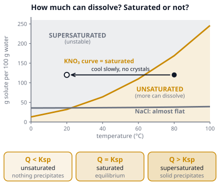

# 🟨 Solubility  ·  `chemistry.analytical.solubility`
> 📅 Study date: Sat 31 Oct · ⏱️ ~12 min read · 📋 Syllabus: Soluble, slightly soluble and insoluble salts, Solubility constants, Saturated, unsaturated and supersaturated solutions

## 🍳 Start with rock candy
To make rock candy, a cook stirs sugar into hot water until **no more sugar dissolves**, then hangs a string in the jar. As the water cools, the jar holds more sugar than cold water normally can, and the extra sugar slowly grows into crystals on the string. Hot water can dissolve much more sugar than cold water. This is a story about three words (**unsaturated, saturated, supersaturated**) and one number (**the solubility**). Later in this page you will also see why white crusts (limescale) grow on pool tiles and kettles. **The difference:** sugar dissolves as whole molecules, but a salt like CaCO₃ dissolves as **ions**, so we also need a special equilibrium constant, Ksp.

## 🖼️ Big picture

## 💡 Core ideas
1. **Solubility** is the **maximum amount of solute that dissolves in a given amount of solvent at a given temperature**. It is given in g per 100 g of water or as the **molar solubility s** in mol/L. Rough labels: **soluble** (more than about 1 g per 100 mL), **slightly soluble** (in between), **insoluble** (less than about 0.1 g per 100 mL; "insoluble" really means "very slightly soluble").
2. **Solubility rules for salts.** **Always soluble:** all salts of **group 1 (Na⁺, K⁺…)** and **NH₄⁺**, and all **nitrates (NO₃⁻)** and **acetates**. **Chlorides, bromides, iodides** are soluble **except** those of Ag⁺, Pb²⁺ and Hg₂²⁺. **Sulfates** are soluble **except** BaSO₄, PbSO₄ and SrSO₄ (CaSO₄ and Ag₂SO₄ are only slightly soluble). **Carbonates, phosphates, sulfides, hydroxides and oxides** are mostly **insoluble**, except those of group 1 and NH₄⁺ (and Ba(OH)₂ and Sr(OH)₂ dissolve fairly well).
3. **Saturated, unsaturated, supersaturated.** **Unsaturated:** less than the solubility is dissolved, so more can dissolve. **Saturated:** exactly the solubility is dissolved. If solid is present, the solid dissolves and re-forms at the same speed (a dynamic equilibrium). **Supersaturated:** *more* than the solubility is dissolved. It is **unstable** and is made by cooling a saturated hot solution carefully; one small crystal ("seed") or a bump makes the extra solute crystallize quickly.
4. **Temperature and pressure.** For **most solids** (KNO₃, sugar), solubility **rises** with temperature, but a few barely change (NaCl) or decrease (Li₂SO₄, Ca(OH)₂). For **gases** it is the opposite: they dissolve **less** when the water is warmer (a warm soda goes flat faster) and **more** at higher gas pressure.
5. **The solubility product, Ksp.** For a slightly soluble salt, AₘBₙ(s) ⇌ m Aⁿ⁺(aq) + n Bᵐ⁻(aq), **Ksp = [Aⁿ⁺]ᵐ [Bᵐ⁻]ⁿ**. The solid is **not** written in Ksp. Examples: AgCl: **Ksp = [Ag⁺][Cl⁻] = s²**. CaF₂: **Ksp = [Ca²⁺][F⁻]² = s × (2s)² = 4s³**. Ca₃(PO₄)₂: **Ksp = [Ca²⁺]³[PO₄³⁻]²**. You can compare solubility directly from Ksp only when the salts have the **same ion ratio** (AgCl and AgBr, yes; AgCl and Ag₂CrO₄, no).
6. **Will a solid form? Compare Q with Ksp.** **Q**, the **ion product**, uses the same formula as Ksp but with the *current* concentrations (remember to dilute them when you mix solutions). **Q < Ksp:** unsaturated, no solid. **Q = Ksp:** saturated. **Q > Ksp:** a **precipitate** (a solid) forms until Q falls back to Ksp. **Common ion effect:** adding an ion that is already in the equilibrium (Cl⁻ for AgCl) **lowers the solubility** (s = Ksp ÷ [Cl⁻] for AgCl).

## 🧮 HUSO-style examples

**Example 1.** Suppose the K_sp of calcium fluoride, CaF₂, is 3.2 × 10⁻¹¹ at a certain temperature. What is the molar solubility of CaF₂ in pure water?

(A) 5.7 × 10⁻⁶ M  (B) 2.0 × 10⁻⁴ M  (C) 1.6 × 10⁻¹¹ M  (D) 8.0 × 10⁻¹² M  (E) 3.2 × 10⁻⁴ M

Steps:
1. Write the equilibrium: CaF₂(s) ⇌ Ca²⁺ + 2 F⁻. If s mol/L dissolves, [Ca²⁺] = s and [F⁻] = **2s**.
2. Ksp = [Ca²⁺][F⁻]² = s × (2s)² = **4s³**.
3. 4s³ = 3.2 × 10⁻¹¹, so s³ = 8.0 × 10⁻¹² and **s = 2.0 × 10⁻⁴ M**. **Answer: (B).**
4. Traps: (A) uses Ksp = s² (that works for AgCl but not for CaF₂). (E) takes the cube root of Ksp without dividing by 4. (D) forgets the cube root. (C) divides by 2 only.

**Example 2.** 🏊 Pool water that is hard has a lot of dissolved calcium. 100 mL of 2.0 × 10⁻⁴ M CaCl₂ is mixed with 100 mL of 2.0 × 10⁻⁴ M Na₂CO₃. Suppose the K_sp of CaCO₃ is 3.3 × 10⁻⁹. What is Q, and does a precipitate of CaCO₃ form?

(A) Q = 4.0 × 10⁻⁸; a precipitate forms  (B) Q = 1.0 × 10⁻⁸; a precipitate forms  (C) Q = 1.0 × 10⁻⁸; no precipitate  (D) Q = 2.0 × 10⁻⁴; a precipitate forms  (E) Q = 3.3 × 10⁻⁹; no precipitate

Steps:
1. Mixing doubles the volume (100 mL + 100 mL = 200 mL), so each concentration is **halved**: [Ca²⁺] = [CO₃²⁻] = **1.0 × 10⁻⁴ M**.
2. Q = [Ca²⁺][CO₃²⁻] = 1.0 × 10⁻⁴ × 1.0 × 10⁻⁴ = **1.0 × 10⁻⁸**.
3. Compare with Ksp: 1.0 × 10⁻⁸ is **bigger** than 3.3 × 10⁻⁹, so Q > Ksp and CaCO₃ **precipitates** (limescale). **Answer: (B).**
4. Traps: (A) forgets that the volumes add, so the concentrations are not halved (Q = 4.0 × 10⁻⁸). (C) has the right Q but the wrong conclusion. (D) adds the two concentrations instead of multiplying. (E) is simply Q = Ksp.

## ⚠️ Common traps
- **Forgetting dilution** when two solutions are mixed. Always find the concentrations *after* mixing before you calculate Q.
- **Forgetting the exponents.** The coefficient of each ion in the equation becomes its exponent in Ksp, and also multiplies s (2s for F⁻).
- **Comparing Ksp values of different types.** A bigger Ksp means a more soluble salt only when the formulas have the same number of ions.
- **"Insoluble" does not mean zero.** Every salt dissolves a little; that tiny amount is what Ksp measures.
- **Supersaturated is not the same as saturated.** A saturated solution is stable; a supersaturated one can suddenly crystallize.
- **Gases and temperature go the opposite way** from most solids: warm water holds less gas.

## ✏️ Redraw from memory
Close the page and draw in 5 minutes:
- [ ] A **solubility curve** (temperature on x, grams per 100 g water on y) with three regions: below the curve unsaturated, on the curve saturated, above the curve supersaturated.
- [ ] A **cooling arrow** from a hot unsaturated point across the curve to a supersaturated point, and a seed crystal causing crystals.
- [ ] Three beakers showing **unsaturated** (no solid), **saturated** (solid at the bottom, in equilibrium) and **supersaturated** (clear but unstable).
- [ ] The **Ksp expression** for AgCl, CaF₂ and Ca₃(PO₄)₂, and the shortcut for molar solubility.
- [ ] The **Q versus Ksp** rule with the three cases.

Compare with the picture and mark what you missed in red.

## 🎥 Watch / try
- [Unsaturated, Saturated, and Supersaturated Solutions](https://www.youtube.com/watch?v=DwiNAMAuJ0k) — Tyler DeWitt · 15:17 · watch the first half for the three types of solution
- [Solubility Product Constant (Ksp)](https://www.youtube.com/watch?v=WjiXbemBXkE) — Professor Dave Explains · 8:36 · write the Ksp expression for each example before he does
- [Worked example: Calculating solubility from Ksp](https://www.youtube.com/watch?v=Ywvw32DaxUk) — Khan Academy · 4:52 · compare with Example 1 above

## ✅ Check your understanding (5 questions)
Do these without looking at the material. You are **READY** if you get at least 4 of 5 right.

**1.** Which of these compounds is **insoluble** in water?

(A) NaNO₃  (B) (NH₄)₂SO₄  (C) CaCO₃  (D) KCl  (E) Na₃PO₄

**2.** 🍳 A cook dissolves sugar in hot tea until no more dissolves, then lets the tea cool carefully without stirring. No crystals appear. The cooled tea is best described as

(A) unsaturated  (B) saturated  (C) dilute  (D) insoluble  (E) supersaturated

**3.** What is the K_sp expression of calcium phosphate, Ca₃(PO₄)₂?

(A) [Ca²⁺]³[PO₄³⁻]²  (B) [Ca²⁺]²[PO₄³⁻]³  (C) [Ca₃(PO₄)₂]  (D) 3[Ca²⁺] × 2[PO₄³⁻]  (E) [Ca²⁺][PO₄³⁻]

**4.** Suppose AgCl has K_sp = 1.8 × 10⁻¹⁰. In which solution is the molar solubility of AgCl the **smallest**?

(A) Pure water  (B) 0.10 M KNO₃  (C) 0.10 M NH₃  (D) 0.10 M NaCl  (E) 0.010 M NaCl

**5.** 🍳 A soda bottle fizzes much more when you open it warm than when you open it cold. Why?

(A) Warm soda holds more dissolved CO₂.  (B) CO₂ is less soluble in warm liquid, so more of it escapes.  (C) Heating makes new CO₂ from the sugar.  (D) The cold soda has a higher gas pressure.  (E) Cold liquids cannot hold any gas.

Answer key & explanations

1. **(C) CaCO₃.** Carbonates are insoluble except those of group 1 and NH₄⁺. NaNO₃ (nitrate, group 1), (NH₄)₂SO₄ (ammonium salt), KCl (group 1) and Na₃PO₄ (group 1) are all soluble.
2. **(E) supersaturated.** Hot tea held more sugar than cold tea can. After careful cooling the extra sugar is still dissolved, so the solution holds more than its solubility. It is unstable: a single seed crystal would make the sugar crystallize.
3. **(A) [Ca²⁺]³[PO₄³⁻]².** Ca₃(PO₄)₂(s) ⇌ 3 Ca²⁺ + 2 PO₄³⁻: the coefficients become exponents. (B) swaps the exponents. (C) includes the solid, which is never in Ksp. (D) multiplies by the coefficients instead of raising to the power.
4. **(D) 0.10 M NaCl.** The common ion effect: s = Ksp ÷ [Cl⁻]. In 0.10 M NaCl, s = 1.8 × 10⁻⁹ M; in 0.010 M NaCl, s = 1.8 × 10⁻⁸ M; in pure water, s = √(1.8 × 10⁻¹⁰) = 1.3 × 10⁻⁵ M. KNO₃ shares no ion (slightly more soluble). NH₃ forms [Ag(NH₃)₂]⁺ and makes AgCl dissolve *more*.
5. **(B).** Gases dissolve less in warm liquids, so warm soda releases more CO₂. (A) is the reverse. (C) is not a reaction that happens. (D) is backwards: the warm bottle has the higher gas pressure. (E) is false: cold liquids hold *more* gas.

