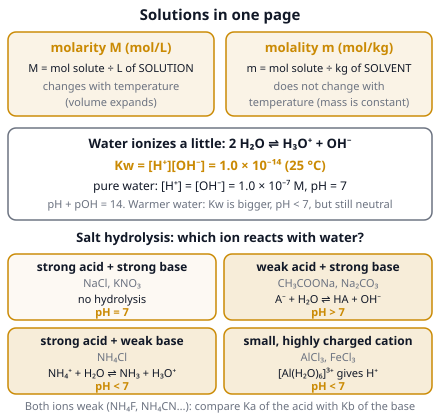

# 🟨 Solutions  ·  `chemistry.analytical.solutions`
> 📅 Study date: Sat 24 Oct · ⏱️ ~12 min read · 📋 Syllabus: Molarity, molality, Self-ionization of water, Hydrolysis of salts

## 🍳 Start with the pasta water
A cook says the pasta water should be "as salty as the sea". Taste does not depend on how much salt is in the pot, but on how much salt there is **compared with the amount of water**. If the water boils away, the same salt is now in less water, so the soup tastes saltier. Chemists measure this "saltiness" exactly with **concentration**. And water itself is a tiny bit "salty" too, because a few of its molecules split into ions. That is the key to pH. **The difference:** your tongue only senses the salt, but chemistry cares about every dissolved particle, counted in moles.

## 🖼️ Big picture

## 💡 Core ideas
1. **Words.** A **solution** is a **solute** (the thing that dissolves, like salt) in a **solvent** (what it dissolves in, like water). **Concentration** says how much solute is in a given amount of solution. Common units: **mass percent** (g solute per 100 g solution), **ppm** (parts per million: mg of solute per kg of dilute water solution, about mg per liter) and **mole fraction** X = moles of one part ÷ total moles (no unit).
2. **Molarity (M).** **M = moles of solute ÷ liters of solution** (mol/L). The "solution" in the denominator includes the solute. **Dilution:** when you add water, the moles do not change, so **M₁V₁ = M₂V₂**. When you mix two solutions, add the moles and divide by the total volume.
3. **Molality (m).** **m = moles of solute ÷ kilograms of solvent** (mol/kg). The denominator is only the solvent. Because it uses mass, **molality does not change with temperature**, while molarity does (the volume expands when heated). In dilute water solutions the two numbers are almost equal. To convert mass percent to molarity: **M = (10 × % × ρ) ÷ M_solute**, where ρ is the density in g/mL.
4. **Self-ionization of water.** Water molecules pass H⁺ to each other: **2 H₂O ⇌ H₃O⁺ + OH⁻** (we often write H⁺ for H₃O⁺). The equilibrium constant is **Kw = [H⁺][OH⁻] = 1.0 × 10⁻¹⁴** at 25 °C. In pure water [H⁺] = [OH⁻] = 1.0 × 10⁻⁷ M, so **pH = −log[H⁺] = 7** (neutral). Always **pH + pOH = 14** at 25 °C. Kw gets bigger when water is warmer, so the "neutral" pH is **below 7** in warm water, but it is still neutral because [H⁺] = [OH⁻].
5. **Hydrolysis of salts.** A salt splits into its **cation** (+) and **anion** (−) in water, and an ion may react with water ("hydrolysis"). Ions from **strong** acids and bases (Na⁺, K⁺, Ca²⁺ / Cl⁻, Br⁻, NO₃⁻) **do not react**. So: **strong acid + strong base** (NaCl) → neutral. **Weak acid + strong base** (CH₃COONa, Na₂CO₃, NaF): the anion takes H⁺ from water, A⁻ + H₂O ⇌ HA + OH⁻ → **basic**. **Strong acid + weak base** (NH₄Cl): the cation gives away H⁺, NH₄⁺ + H₂O ⇌ NH₃ + H₃O⁺ → **acidic**. Small highly charged cations (**Al³⁺, Fe³⁺**) are also **acidic**.
6. **Numbers for hydrolysis.** For the anion of a weak acid, **K_b = Kw ÷ K_a** of its acid (the weaker the acid, the more basic its anion). Example: 0.10 M CH₃COONa, with K_a(acetic acid) = 1.8 × 10⁻⁵: K_b = 1.0 × 10⁻¹⁴ ÷ 1.8 × 10⁻⁵ = 5.6 × 10⁻¹⁰. Then [OH⁻] = √(K_b × C) = √(5.6 × 10⁻¹¹) = 7.5 × 10⁻⁶ M, pOH = 5.13 and **pH ≈ 8.9**. If both ions are weak (NH₄F, NH₄CN), compare K_a of the cation with K_b of the anion: the larger one wins.

## 🧮 HUSO-style examples

**Example 1.** 🍳 A cook dissolves 117 g of table salt (NaCl, M = 58.5 g/mol) in 2.0 kg of water. The final volume of the solution is 2.1 L. What are the **molality** and the **molarity**?

(A) 1.0 m and 0.95 M  (B) 0.95 m and 1.0 M  (C) 1.0 m and 1.0 M  (D) 2.0 m and 0.95 M  (E) 1.0 m and 2.0 M

Steps:
1. Moles of NaCl: 117 ÷ 58.5 = **2.0 mol**.
2. Molality uses **kg of solvent**: 2.0 mol ÷ 2.0 kg = **1.0 m**.
3. Molarity uses **liters of solution**: 2.0 mol ÷ 2.1 L = **0.95 M**. **Answer: (A).**
4. Traps: (C) treats the two units as the same. (B) swaps the two units. (D) is the moles divided by the wrong mass (1 kg). (E) divides by 1 L.

**Example 2.** At 50 °C, the value of Kw is 5.5 × 10⁻¹⁴. What is the pH of **pure water** at 50 °C?

(A) 7.00  (B) 6.63  (C) 13.26  (D) 7.37  (E) 6.13

Steps:
1. In pure water, [H⁺] = [OH⁻], so Kw = [H⁺]², and [H⁺] = √(5.5 × 10⁻¹⁴) = 2.3 × 10⁻⁷ M.
2. pH = −log(2.3 × 10⁻⁷) = **6.63**. **Answer: (B).**
3. The water is still **neutral** (equal H⁺ and OH⁻). Only the number "7" is not the neutral point at this temperature.
4. Traps: (A) assumes pH 7 always. (C) is pKw (= −log Kw), not the pH. (D) goes the wrong way (a bigger Kw means more H⁺, so a lower pH). (E) slips by one power of ten in Kw (5.5 × 10⁻¹³).

## ⚠️ Common traps
- **Molarity needs the volume of the solution**, not the volume of water you added, and it must be in **liters**.
- **Molality needs the mass of the solvent only**, in **kg**.
- **"pH 7 is always neutral" is only true at 25 °C.** Neutral means [H⁺] = [OH⁻].
- **Strong-acid anions** (Cl⁻, NO₃⁻) and **strong-base cations** (Na⁺, K⁺) never hydrolyze. Don't call NaCl "basic because of Na".
- **Dilution adds water, not solute:** moles stay, concentration drops, so M₁V₁ = M₂V₂ (and V₂ is the *total* volume).

## ✏️ Redraw from memory
Close the page and draw in 5 minutes:
- [ ] Two beakers: one labeled **molarity** (mol per liter of the *whole solution*), one **molality** (mol per kg of *solvent only*), with the formulas.
- [ ] A drawing of two water molecules making H₃O⁺ and OH⁻, with **Kw = 10⁻¹⁴** and the pH scale from 0 to 14 with neutral at 7.
- [ ] The **four salt types** (strong/strong, weak acid/strong base, strong acid/weak base, highly charged cation) with an example and acidic / neutral / basic.
- [ ] The dilution formula with a beaker before and after adding water.
- [ ] A one-line recipe for **K_b = Kw ÷ K_a**.

Compare with the picture and mark what you missed in red.

## 🎥 Watch / try
- [Molarity vs. molality](https://www.youtube.com/watch?v=4VltXjR64SU) — Khan Academy (khanacademymedicine) · 8:02 · say out loud what is in the denominator of each
- [What's the Difference Between Molarity and Molality?](https://www.youtube.com/watch?v=96oNrVnTk50) — Tyler DeWitt · 5:11 · a friendly picture-based explanation
- [Acidic Basic and Neutral Salts - Compounds](https://www.youtube.com/watch?v=MXTsUBC0Nlk) — The Organic Chemistry Tutor · 11:44 · try to guess acidic, basic or neutral before he says it

## ✅ Check your understanding (5 questions)
Do these without looking at the material. You are **READY** if you get at least 4 of 5 right. At 25 °C, Kw = 1.0 × 10⁻¹⁴.

**1.** 🏊 You pour 50 mL of 2.0 M HCl into a pool bucket and add water until the total volume is 200 mL. What is the new molarity of the HCl?

(A) 8.0 M  (B) 4.0 M  (C) 0.50 M  (D) 0.25 M  (E) 1.0 M

**2.** Which concentration unit does **not** change when you heat the solution?

(A) Molarity  (B) Volume percent  (C) Grams per liter  (D) ppm by volume  (E) Molality

**3.** A solution at 25 °C has [OH⁻] = 1.0 × 10⁻³ M. What is [H⁺]?

(A) 1.0 × 10⁻¹¹ M  (B) 1.0 × 10⁻³ M  (C) 1.0 × 10⁻⁷ M  (D) 1.0 × 10⁻¹⁴ M  (E) 1.0 × 10¹¹ M

**4.** Which 0.1 M solution is **acidic**?

(A) NaCl  (B) KNO₃  (C) CH₃COONa  (D) NH₄Cl  (E) Na₂CO₃

**5.** Which 0.1 M solution has the **highest pH**?

(A) NaCl  (B) Na₂CO₃  (C) NH₄Cl  (D) KBr  (E) AlCl₃

Answer key & explanations

1. **(C) 0.50 M.** Use M₁V₁ = M₂V₂: 2.0 × 50 = M₂ × 200, so M₂ = 0.50 M. Moles stay the same (0.10 mol); the volume is 4 times larger, so the molarity is 4 times smaller. (D) 0.25 M divides by 8, and (A) 8.0 M multiplies by 4.
2. **(E) Molality.** It uses the mass of the solvent, and mass does not change with temperature. The others use a volume, and the volume expands when heated.
3. **(A) 1.0 × 10⁻¹¹ M.** [H⁺] = Kw ÷ [OH⁻] = 1.0 × 10⁻¹⁴ ÷ 1.0 × 10⁻³ = 1.0 × 10⁻¹¹ M. (B) is the OH⁻ itself. (D) is Kw. (E) divides the wrong way round.
4. **(D) NH₄Cl.** NH₄⁺ is the conjugate acid of the weak base NH₃, and Cl⁻ does nothing, so the solution is acidic (pH ≈ 5.1). NaCl and KNO₃ are neutral. CH₃COONa and Na₂CO₃ are basic.
5. **(B) Na₂CO₃.** CO₃²⁻ is the anion of a weak acid (HCO₃⁻, K_a ≈ 4.7 × 10⁻¹¹), so it is a fairly strong base: pH ≈ 11.7. NaCl and KBr are neutral (pH 7). NH₄Cl (pH ≈ 5.1) and AlCl₃ (about 3) are acidic.

