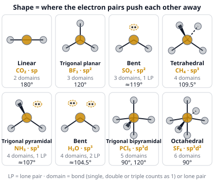
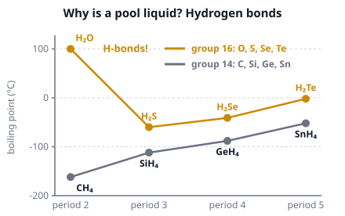

# 🟨 Chemical Bonding  ·  `chemistry.inorganic.bonding`
> 📅 Study date: Sun 18 Oct · ⏱️ ~12 min read · 📋 Syllabus: Bond types, Hybridization, VSEPR shapes, polarity, bond angles, Intermolecular forces, Metallic bonding, Acid-base properties of oxides

## 🏊 Start with why a pool is liquid
A water molecule (H₂O) is tiny: its mass is only 18. A molecule of H₂S is almost twice as heavy (34), yet H₂S is a gas that boils at −60 °C, while water stays liquid up to 100 °C. If it were not, there would be no pool to swim in. The secret is that water molecules **hold hands** with each other. This page shows what holds atoms together (bonds), what shape the molecules take, and how molecules hold on to each other. **The difference:** the "hand-holding" between water molecules (a hydrogen bond) is more than 10 times weaker than the bonds inside the molecule, and it keeps breaking and re-forming.

## 🖼️ Big picture

## 💡 Core ideas
1. **Three kinds of bond.** **Ionic**: a metal gives electrons to a nonmetal (Na⁺Cl⁻). The ions form a lattice with high melting points; it conducts only when melted or dissolved. **Covalent**: two nonmetals *share* electron pairs (H₂O, CO₂). Single, double and triple bonds are shorter and stronger as the bond order rises (C≡C is shortest and strongest). **Metallic**: metal cations sit in a "sea" of **delocalized** (free-moving) electrons. That is why metals conduct, are shiny and can be hammered into shape. The **difference in electronegativity (ΔEN)** guides you: ≈ 0 → nonpolar covalent, in the middle → polar covalent, large (roughly > 1.7) → ionic.
2. **VSEPR (valence shell electron pair repulsion).** Electron pairs around a central atom repel each other, so they spread out as far as possible. Count the **electron domains** (each bond counts as **one** domain, whether single, double or triple; each lone pair is one more domain). **2 domains: linear 180°. 3: trigonal planar 120°. 4: tetrahedral 109.5°. 5: trigonal bipyramidal (90° and 120°). 6: octahedral 90°.** The **shape** only counts the atoms, not the lone pairs: NH₃ (3 bonds + 1 lone pair) is **trigonal pyramidal** (≈ 107°), H₂O (2 bonds + 2 lone pairs) is **bent** (≈ 104.5°). Lone pairs push harder than bonds, so angles shrink.
3. **Hybridization.** To make equal bonds, the s and p orbitals of an atom mix ("hybridize"). The number of domains decides: **2 → sp, 3 → sp², 4 → sp³** (5 → sp³d, 6 → sp³d²). In carbon compounds: four single bonds make carbon sp³; one double bond makes it sp² (one π bond); a triple bond makes it sp (two π bonds). A **σ bond** is the first bond between two atoms (head-on overlap); a **π bond** is an extra bond in a double or triple bond (side-on overlap) and is not a separate domain.
4. **Polarity of a molecule.** A bond is **polar** when the two atoms differ in electronegativity (the shared electrons lean toward the stronger puller). A **molecule** is polar only if those bond dipoles **do not cancel**, which depends on the shape. CO₂ (linear), BF₃ (flat), CH₄ and CCl₄ (tetrahedral) are **nonpolar**. H₂O (bent), NH₃ (pyramid) and CHCl₃ are **polar**.
5. **Intermolecular forces (IMFs)** act *between* molecules; they are much weaker than bonds. **London dispersion**: in every molecule, stronger for bigger molecules (more electrons). **Dipole–dipole**: between polar molecules. **Hydrogen bond**: an H atom bonded to **N, O or F** is attracted to a lone pair on a neighboring N, O or F (usually the strongest of the three for molecules of a similar size). **Ion–dipole**: an ion and a polar molecule (NaCl in water). **Stronger IMFs mean a higher boiling point**, and "like dissolves like" (polar dissolves polar, nonpolar dissolves nonpolar). That is why water is liquid, and why oil and water do not mix.
6. **Acid–base character of oxides.** **Metal oxides are basic**: Na₂O + H₂O → 2NaOH. **Nonmetal oxides are acidic**: CO₂ + H₂O ⇌ H₂CO₃, SO₃ + H₂O → H₂SO₄. A few are **amphoteric** (they react with both acids and bases): **Al₂O₃, ZnO, BeO**. Some are **neutral**: CO, NO, N₂O. Across period 3, the oxides go from basic (Na₂O, MgO) to amphoteric (Al₂O₃) to acidic (SiO₂, P₄O₁₀, SO₃).

## 🧮 HUSO-style examples

**Example 1.** Which of these molecules is **nonpolar** even though its bonds are polar?

(A) H₂O  (B) NH₃  (C) SO₂  (D) CCl₄  (E) CHCl₃

Steps:
1. Find the shape of each with VSEPR. H₂O: bent. NH₃: trigonal pyramidal. SO₂: bent (S has 2 bonds and 1 lone pair). CCl₄: tetrahedral, 4 identical bonds. CHCl₃: tetrahedral, but with 3 Cl and 1 H.
2. Bent and pyramidal shapes are lopsided, so the bond dipoles add up: H₂O, NH₃ and SO₂ are **polar**.
3. CCl₄ is perfectly symmetric: the four C–Cl dipoles point to the four corners of a tetrahedron and **cancel exactly**. **Answer: (D).**
4. Trap (E): CHCl₃ has the same shape, but the C–H bond is different from the C–Cl bonds, so the dipoles do not cancel. The molecule is polar.

**Example 2.** The molecule acrylonitrile is H₂C=CH–C≡N. What is the hybridization of the three carbon atoms, from left to right?

(A) sp³, sp², sp  (B) sp², sp², sp  (C) sp², sp, sp  (D) sp², sp², sp²  (E) sp³, sp³, sp

Steps:
1. Count the domains on each carbon. A double or triple bond counts as **one** domain (the extra bonds are π bonds).
2. Carbon 1 (H₂C=): two H and one C = **3 domains** → sp².
3. Carbon 2 (=CH–): one H, one C on the left, one C on the right = **3 domains** → sp².
4. Carbon 3 (–C≡N): one C and one N = **2 domains** → sp. **Answer: (B).**
5. Trap: (A) and (E) call a carbon with a double bond sp³. Only carbons with four single bonds are sp³.

## ⚠️ Common traps
- **Double and triple bonds count as one domain.** Do not count each bond line separately when you decide the shape.
- **Shape ≠ electron geometry.** H₂O has a *tetrahedral* arrangement of 4 domains but a *bent* shape.
- **Polar bonds ≠ polar molecule.** CO₂ and CCl₄ have polar bonds and are nonpolar molecules.
- **A hydrogen bond needs H attached to N, O or F.** CH₄ and CH₃F do not form hydrogen bonds. HCl does not either (Cl is too big and not N, O, F).
- **IMFs are not bonds.** Boiling a liquid breaks the weak IMFs between molecules, not the covalent bonds inside them.

## ✏️ Redraw from memory
Close the page and draw in 5 minutes:
- [ ] The **eight shapes** with the number of domains, the bond angles and one example molecule each.
- [ ] H₂O, NH₃ and CH₄ side by side, with the **lone pairs** drawn in, to show why the angles are 104.5°, 107° and 109.5°.
- [ ] Two water molecules with a **dotted hydrogen bond** from H to O.
- [ ] A line with the three IMFs from weakest to strongest and one example each.
- [ ] A short list of **oxides**: basic, acidic, amphoteric with one example each.

Compare with the picture and mark what you missed in red.

## 🎥 Watch / try
- [VSEPR Theory and Molecular Geometry](https://www.youtube.com/watch?v=Q9-JjyAEqnU) — Professor Dave Explains · 6:31 · pause on each shape and say its angle
- [Intermolecular Forces and Boiling Points](https://www.youtube.com/watch?v=08kGgrqaZXA) — Professor Dave Explains · 10:54 · look for the hydrogen-bond examples
- [Hybridization of Atomic Orbitals – Sigma & Pi Bonds – Sp Sp2 Sp3](https://www.youtube.com/watch?v=pdJeQUd2g_4) — The Organic Chemistry Tutor · 10:55 · count the domains before you look at his answers

## ✅ Check your understanding (5 questions)
Do these without looking at the material. You are **READY** if you get at least 4 of 5 right.

**1.** 🏊 Which substance has the **highest boiling point**?

(A) H₂O  (B) H₂S  (C) CH₄  (D) HCl  (E) Ne

**2.** Which of these species has a **trigonal pyramidal** shape?

(A) BF₃  (B) CH₄  (C) NH₃  (D) CO₂  (E) SO₃

**3.** In CO₂, the carbon atom is ______ hybridized and the molecule is ______.

(A) sp², bent  (B) sp³, tetrahedral  (C) sp², linear  (D) sp³, bent  (E) sp, linear

**4.** In which of these liquids are **hydrogen bonds** formed between the molecules of the liquid itself?

(A) CH₄  (B) CH₃OH  (C) CH₃F  (D) CH₃OCH₃  (E) CO₂

**5.** Which oxide is **amphoteric**?

(A) Na₂O  (B) CO₂  (C) SO₃  (D) Al₂O₃  (E) MgO

Answer key & explanations

1. **(A) H₂O.** Boiling points: H₂O 100 °C, HCl −85 °C, H₂S −60 °C, CH₄ −162 °C, Ne −246 °C. Water is the only one with hydrogen bonds. Do not choose H₂S because it is "heavier": it has no hydrogen bonds.
2. **(C) NH₃.** N has 3 bonds and 1 lone pair (4 domains, so a tetrahedral arrangement and a pyramid shape). BF₃ and SO₃ are trigonal planar, CH₄ is tetrahedral, CO₂ is linear.
3. **(E) sp, linear.** C has two double bonds, so only 2 domains. Two domains means sp and 180°. The two C=O dipoles cancel, so CO₂ is nonpolar.
4. **(B) CH₃OH.** Methanol has an O–H group, so its H can bond to the O of a neighbor. CH₄ has no N, O or F. In CH₃F the F has no H attached. In CH₃OCH₃ (dimethyl ether) the O has no H. CO₂ has no H.
5. **(D) Al₂O₃.** It reacts with acids (Al₂O₃ + 6HCl → 2AlCl₃ + 3H₂O) and with bases (Al₂O₃ + 2NaOH + 3H₂O → 2Na[Al(OH)₄]). Na₂O and MgO are basic; CO₂ and SO₃ are acidic.

