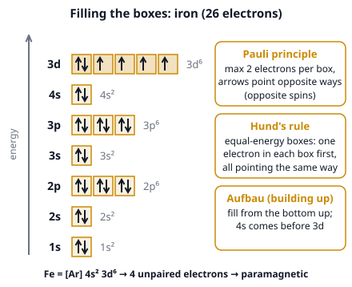
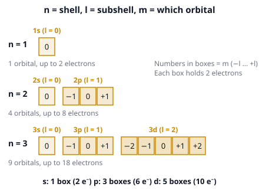

# 🟨 Electron Configuration  ·  `chemistry.inorganic.electron-config`
> 📅 Study date: Sun 18 Oct · ⏱️ ~12 min read · 📋 Syllabus: Quantum numbers (n, l, m), Orbital types (s, p, d), Hund's rule, Pauli principle, Para- vs diamagnetism

## 🏊 Start with lanes in a pool
Picture a swimming hall with several pools, and each pool has lanes. The coach has two rules. Rule 1: a lane holds at most **two** swimmers, and they must swim in opposite directions so they never collide. Rule 2: when swimmers arrive, **every lane gets one swimmer first**; only when all lanes have one, the next swimmer shares a lane. Electrons in an atom follow almost exactly these rules. **The difference:** electrons are not swimmers in a pool. They are spread-out "clouds" of probability, and the "lanes" are called **orbitals**.

## 🖼️ Big picture

## 💡 Core ideas
1. **Four quantum numbers give every electron an "address".** **n** is the **shell** (1, 2, 3…): bigger n means higher energy and farther from the nucleus. **l** is the **subshell** type and can be 0 up to n − 1: l = 0 is **s**, l = 1 is **p**, l = 2 is **d**. **m** (written m_l) tells *which orbital* in the subshell and runs from −l to +l. The fourth number, **spin**, is +½ or −½ (arrow up or down).
2. **Count the orbitals.** An s subshell has **1** orbital, p has **3**, d has **5** (that is 2l + 1). Each orbital holds at most **2 electrons**, so s holds 2, p holds 6, d holds 10. Shell n has n subshells and a maximum of **2n²** electrons (n = 1: 2, n = 2: 8, n = 3: 18). Shapes: s is a sphere, p is a dumbbell (three, pointing along x, y and z), d is a four-leaf clover (mostly).
3. **Pauli exclusion principle.** No two electrons in an atom can have all four quantum numbers the same. So an orbital holds **at most 2 electrons, with opposite spins** (↑↓).
4. **Aufbau ("building up") order.** Fill the lowest energy first: **1s, 2s, 2p, 3s, 3p, 4s, 3d, 4p, 5s, 4d, 5p…** Note that **4s fills before 3d**. Write it like **O: 1s² 2s² 2p⁴** (the small number is how many electrons) or with a noble-gas shortcut: **S = [Ne] 3s² 3p⁴**. Two famous exceptions: **Cr = [Ar] 4s¹ 3d⁵** and **Cu = [Ar] 4s¹ 3d¹⁰** (half-full and full d subshells are extra stable).
5. **Hund's rule.** When orbitals have the *same energy* (like the three 2p orbitals), put **one electron in each orbital first, all spinning the same way**, and only then pair them up. Nitrogen (2p³) has **3** unpaired electrons; oxygen (2p⁴) has **2**.
6. **Ions and magnetism.** To make a **cation**, remove electrons from the **highest shell n first** (4s before 3d): Fe = [Ar] 4s² 3d⁶, so **Fe²⁺ = [Ar] 3d⁶** and **Fe³⁺ = [Ar] 3d⁵**. An anion adds electrons: Cl⁻ = [Ne] 3s² 3p⁶. An atom or ion with **at least one unpaired electron** is **paramagnetic** (a magnet attracts it). One with **all electrons paired** is **diamagnetic** (very weakly pushed away).

## 🧮 HUSO-style examples

**Example 1.** How many unpaired electrons are in an **Fe³⁺** ion?

(A) 0  (B) 1  (C) 3  (D) 4  (E) 5

Steps:
1. Write the neutral atom (26 electrons): Fe = [Ar] 4s² 3d⁶.
2. A cation loses electrons from the **highest shell first**. So the two **4s** electrons leave first, which gives Fe²⁺ = [Ar] 3d⁶.
3. The third electron comes from 3d: Fe³⁺ = [Ar] **3d⁵**.
4. Five d orbitals and five electrons: Hund's rule puts **one in each**, all unpaired. **Answer: (E) 5.** (Fe³⁺ is strongly paramagnetic.)
5. Traps: (D) 4 is the answer for the Fe *atom* and for Fe²⁺ (3d⁶: one pair plus four singles). Taking the three electrons from 3d first would give 4s² 3d³, which has 3 unpaired electrons: that is the trap in (C).

**Example 2.** Which set of quantum numbers (n, l, m) is **not allowed** for an electron?

(A) (2, 1, −1)  (B) (3, 2, 0)  (C) (1, 0, 0)  (D) (2, 2, 1)  (E) (4, 3, −3)

Steps:
1. The rules: n is 1, 2, 3…; **l goes from 0 to n − 1**; **m goes from −l to +l**.
2. (A) n = 2, l = 1 (a 2p orbital), m = −1 is fine. (B) 3d, m = 0 fine. (C) 1s fine. (E) 4f, m = −3 is inside −3 to +3, fine.
3. (D) has n = 2 but l = 2. Since l can only be 0 or 1 when n = 2 (there are no "2d" orbitals), it is **not allowed**. **Answer: (D).**

## ⚠️ Common traps
- **4s fills first, but also leaves first.** Fill 4s before 3d, but when making an ion, take electrons from 4s (the highest n) before 3d.
- **Pairing too early.** Never pair electrons in p or d orbitals while an equal-energy orbital is still empty (Hund's rule).
- **Cr and Cu are exceptions:** [Ar] 4s¹ 3d⁵ and [Ar] 4s¹ 3d¹⁰, not 4s² 3d⁴ and 4s² 3d⁹.
- **Paramagnetic does not mean charged.** It means "has unpaired electrons". Count unpaired electrons, not total electrons.
- **Odd number of electrons** (like Na, Cl, NO) means at least one unpaired electron, so it is always paramagnetic.

## ✏️ Redraw from memory
Close the page and draw in 5 minutes:
- [ ] The **energy ladder** 1s, 2s, 2p, 3s, 3p, 4s, 3d with the right number of boxes in each (1, 1, 3, 1, 3, 1, 5).
- [ ] The orbital diagram for **nitrogen** and **oxygen** (arrows in boxes) to show Hund's rule.
- [ ] **Fe** and **Fe³⁺** drawn in the 4s and 3d boxes.
- [ ] A little table: l = 0, 1, 2 → s, p, d → 1, 3, 5 orbitals → 2, 6, 10 electrons.
- [ ] A note on which is **para-** and which is **dia-magnetic**.

Compare with the page and mark what you missed in red.

## 🎥 Watch / try
- [Aufbau's Principle, Hund's Rule & Pauli's Exclusion Principle – Electron Configuration](https://www.youtube.com/watch?v=C6afrc1QS6Y) — The Organic Chemistry Tutor · 5:24 · watch how the arrows go into the boxes one by one
- [Quantum Numbers, Atomic Orbitals, and Electron Configurations](https://www.youtube.com/watch?v=Aoi4j8es4gQ) — Professor Dave Explains · 8:42 · stop and write down the allowed values of n, l and m
- [Paramagnetic vs Diamagnetic – Paired vs Unpaired Electrons](https://www.youtube.com/watch?v=z7vvUaqu5As) — The Organic Chemistry Tutor · 11:02 · practice counting unpaired electrons in ions

## ✅ Check your understanding (5 questions)
Do these without looking at the material. You are **READY** if you get at least 4 of 5 right.

**1.** What is the maximum number of electrons in the shell with n = 3?

(A) 8  (B) 18  (C) 9  (D) 32  (E) 6

**2.** 🏊 In the pool picture, "a lane holds at most two swimmers, going in opposite directions" matches which rule for electrons?

(A) Hund's rule  (B) The Aufbau principle  (C) Le Chatelier's principle  (D) The Pauli exclusion principle  (E) The octet rule

**3.** Which of these particles has the electron configuration 1s² 2s² 2p⁶ 3s² 3p⁶?

(A) Ca²⁺  (B) Na⁺  (C) K  (D) Ne  (E) Mg²⁺

**4.** Which of these species is **paramagnetic**?

(A) Zn  (B) Mg²⁺  (C) Cu⁺  (D) Ar  (E) Ti²⁺

**5.** Which set of quantum numbers (n, l, m) could describe an electron in a **3p** orbital?

(A) (3, 0, 0)  (B) (3, 2, 1)  (C) (3, 1, −1)  (D) (2, 1, 0)  (E) (3, 1, 2)

Answer key & explanations

1. **(B) 18.** The maximum is 2n² = 2 × 3² = 18 (3s: 2, 3p: 6, 3d: 10). (A) 8 is the n = 2 shell, and also the "octet" that people over-apply. (D) 32 is n = 4.
2. **(D) The Pauli exclusion principle.** Two electrons can share an orbital only if their spins are opposite. Hund's rule is the *other* pool rule (one swimmer per lane first). The Aufbau principle is about the order of filling.
3. **(A) Ca²⁺.** The configuration holds 18 electrons. Ca has 20 and loses 2, so Ca²⁺ has 18. Na⁺, Ne and Mg²⁺ have 10 electrons, and K (19 electrons) has one too many (K⁺ would match).
4. **(E) Ti²⁺.** Ti = [Ar] 4s² 3d²; Ti²⁺ = [Ar] 3d² has two unpaired electrons. Zn (3d¹⁰ 4s²), Mg²⁺ (2p⁶), Cu⁺ (3d¹⁰) and Ar (3p⁶) have every electron paired, so they are diamagnetic.
5. **(C) (3, 1, −1).** A 3p orbital has n = 3 and l = 1, with m = −1, 0 or +1. (A) is 3s. (B) is 3d. (D) is 2p. (E) has m = 2, which is not allowed when l = 1.

