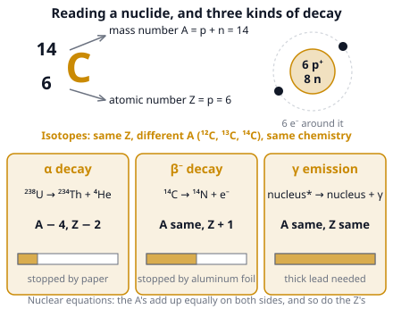

# 🟨 Isotopes & Nuclear Reactions  ·  `chemistry.inorganic.isotopes`
> 📅 Study date: Sat 24 Oct · ⏱️ ~12 min read · 📋 Syllabus: Atomic number, Mass number, Relative atomic mass, Radioactive decay (alpha, beta, gamma)

## 🎮 Start with one agent, different loadouts
Pick one Valorant agent. Whatever the loadout, they have the same abilities and play the same way, but a heavier loadout makes the total weight different. Atoms of one element are like that agent: they all have the same number of **protons** (so they behave the same in chemistry), but they can carry different numbers of **neutrons** (extra weight). These versions are called **isotopes**. A few heavy versions are unstable and fall apart after a while, and that is **radioactive decay**. **The difference:** a game loadout is your choice, but the neutrons in a nucleus are fixed by nature, and decay happens by chance, not on command.

## 🖼️ Big picture

## 💡 Core ideas
1. **Inside the atom.** The nucleus holds **protons** (charge +1) and **neutrons** (charge 0); **electrons** (charge −1, almost no mass) move around it. The **atomic number Z** is the number of protons: it **defines the element**. The **mass number A** is protons + neutrons. Neutrons = A − Z. In a neutral atom, electrons = Z. In an ion, electrons = Z − charge (Cl⁻ has 17 + 1 = 18 electrons). We write a nuclide as ᴬ_Z X, for example ¹⁴₆C or ³⁵₁₇Cl.
2. **Isotopes** are atoms with the **same Z** but **different A** (different number of neutrons): ¹H, ²H, ³H or ¹²C, ¹³C, ¹⁴C. They have the **same chemical behavior** (same electrons) but different mass, and sometimes different stability.
3. **Relative atomic mass (Ar)** is the **weighted average** of the isotope masses, using their natural abundances: **Ar = Σ (fraction × mass)**. Chlorine is 75.8 % ³⁵Cl and 24.2 % ³⁷Cl, so Ar = 0.758 × 35 + 0.242 × 37 ≈ **35.5**. That is why the periodic table says 35.5 and not a whole number.
4. **Radioactive decay.** An unstable nucleus changes by sending out radiation. **Alpha (α)** is a helium nucleus ⁴₂He: A decreases by 4 and Z by 2. **Beta-minus (β⁻)** is a fast electron ⁰₋₁e, made when a neutron turns into a proton: A stays the same and Z **increases by 1**. **Gamma (γ)** is a high-energy light wave (photon): A and Z do not change, it usually comes along with α or β. (Beta-plus, a positron ⁰₊₁e, lowers Z by 1.) Penetration: **α is stopped by paper, β by a few millimeters of aluminum, γ needs thick lead or concrete**. Alpha is the most ionizing and the least penetrating.
5. **Balancing a nuclear equation.** The sum of the mass numbers (top) and the sum of the atomic numbers (bottom) must be the same on both sides. ²³⁸₉₂U → ²³⁴₉₀Th + ⁴₂He: 238 = 234 + 4 and 92 = 90 + 2. ¹⁴₆C → ¹⁴₇N + ⁰₋₁e: 14 = 14 + 0 and 6 = 7 + (−1). Other nuclear reactions: **fission** (a heavy nucleus splits, e.g. uranium-235 hit by a neutron) and **fusion** (light nuclei join, like in the Sun).
6. **Half-life (T½).** The time for **half** of the radioactive nuclei in a sample to decay. After n half-lives, the fraction left is **(½)ⁿ**, so N = N₀ × (½)^(t ÷ T½). Carbon-14 has T½ ≈ 5730 years. A half-life is a property of the isotope: heating or squeezing the sample does not change it.

## 🧮 HUSO-style examples

**Example 1.** An element has two isotopes: ⁶³X (69.0 % of the atoms) and ⁶⁵X (31.0 %). What is its relative atomic mass? (Use the mass numbers as the isotope masses.)

(A) 63.0  (B) 63.6  (C) 64.0  (D) 64.4  (E) 63.9

Steps:
1. Multiply each mass by its fraction: 0.690 × 63 = 43.47 and 0.310 × 65 = 20.15.
2. Add them: 43.47 + 20.15 = 63.62 ≈ **63.6**. **Answer: (B).**
3. Sense check: ⁶³X is more common, so the answer must be closer to 63 than to 65. The halfway point is 64.0, and 63.6 is below it.
4. Traps: (C) 64.0 is the plain average of 63 and 65, which ignores the abundances. (D) 64.4 swaps the percentages.

**Example 2.** Radium-226 (²²⁶₈₈Ra) emits one alpha particle. The nucleus that forms then emits one beta-minus particle. What is the final nuclide?

(A) ²²²₈₆Rn  (B) ²²²₈₇Fr  (C) ²²²₈₅At  (D) ²²⁶₈₇Fr  (E) ²²⁶₈₉Ac

Steps:
1. Alpha decay: A goes down by 4 and Z by 2: ²²⁶₈₈Ra → ²²²₈₆Rn + ⁴₂He. (Check: 226 = 222 + 4 and 88 = 86 + 2.)
2. Beta-minus decay of ²²²₈₆Rn: A stays at 222, Z goes **up** by 1 to 87: ²²²₈₆Rn → ²²²₈₇Fr + ⁰₋₁e.
3. Z = 87 is francium, so the final nuclide is **²²²₈₇Fr**. **Answer: (B).**
4. Traps: (A) stops after the alpha. (C) lowers Z for the beta (that would be β⁺). (D) forgets that alpha lowers A. (E) applies only the beta to radium.

## ⚠️ Common traps
- **Mass number is not atomic mass.** A is a whole number (protons + neutrons); the relative atomic mass on the table is an average and is not a whole number.
- **Alpha lowers A by 4 *and* Z by 2.** People forget one of the two. Beta changes only Z.
- **Isotopes of one element have the same Z.** ¹⁴C and ¹⁴N have the same A but different Z, so they are *not* isotopes.
- **Half-life is not "half the life".** After two half-lives, ¼ is left, not 0.
- **Charge changes electrons, not protons.** Na⁺ has 11 protons and 10 electrons.

## ✏️ Redraw from memory
Close the page and draw in 5 minutes:
- [ ] The nuclide symbol ᴬ_Z X with arrows showing which number is protons + neutrons and which is protons only.
- [ ] A nucleus drawing of **¹⁴C** (6 protons, 8 neutrons) and of **¹²C**; label them as isotopes.
- [ ] The three types of decay with their particles, how A and Z change, and what stops them.
- [ ] A half-life graph: a curve starting at 100 %, with 50 %, 25 %, 12.5 % at 1, 2 and 3 half-lives.
- [ ] The formula for the weighted average (relative atomic mass) with the chlorine example.

Compare with the picture and mark what you missed in red.

## 🎥 Watch / try
- [Nuclide Symbols: Atomic Number, Mass Number, Ions, and Isotopes](https://www.youtube.com/watch?v=5PyVoMnRTlQ) — Professor Dave Explains · 5:04 · practice counting protons, neutrons and electrons
- [How To Calculate The Average Atomic Mass](https://www.youtube.com/watch?v=JT18bDAadQ0) — The Organic Chemistry Tutor · 7:19 · pause and try each problem before he solves it
- [Different types of decay: Alpha vs. Beta vs. Gamma decay](https://www.youtube.com/watch?v=s7zPzBnf6Us) — Dr. Paulien Moyaert · 8:08 · compare the three decays side by side

## ✅ Check your understanding (5 questions)
Do these without looking at the material. You are **READY** if you get at least 4 of 5 right.

**1.** How many **neutrons** are in one ion of ³⁷₁₇Cl⁻?

(A) 17  (B) 18  (C) 19  (D) 21  (E) 20

**2.** 🎮 Which pair are **isotopes** of the same element ("same agent, different loadout")?

(A) ¹⁴₆C and ¹⁴₇N  (B) ¹²₆C and ¹⁴₆C  (C) ¹⁶₈O and ¹⁶₈O²⁻  (D) ³⁹₁₉K⁺ and ⁴⁰₁₈Ar  (E) ²³₁₁Na and ²⁴₁₂Mg

**3.** Polonium-210 (²¹⁰₈₄Po) decays by emitting an alpha particle. What are the mass number and atomic number of the new nucleus?

(A) A = 210, Z = 82  (B) A = 214, Z = 86  (C) A = 206, Z = 86  (D) A = 206, Z = 82  (E) A = 210, Z = 85

**4.** A sample contains 80 mg of an isotope with a half-life of 3.0 days. How much of it is left after 9.0 days?

(A) 10 mg  (B) 20 mg  (C) 26.7 mg  (D) 40 mg  (E) 0 mg

**5.** In which kind of radioactive decay does the mass number stay the same and the atomic number go **up by 1**?

(A) Alpha decay  (B) Gamma emission  (C) Beta-minus decay  (D) Beta-plus decay  (E) Neutron emission

Answer key & explanations

1. **(E) 20.** Neutrons = A − Z = 37 − 17 = 20. The extra electron (making it Cl⁻) changes the electron count (18), not the neutrons. (A) is the protons, (B) is the electrons.
2. **(B) ¹²₆C and ¹⁴₆C.** Same Z = 6, different A. (A) has the same A but different Z. (C) is the same nuclide (one is an ion). (D) K⁺ and Ar have the same number of electrons, but they are different elements. (E) are different elements.
3. **(D) A = 206, Z = 82.** Alpha: A − 4 = 206 and Z − 2 = 82 (this is lead-206). (B) adds 4 and 2 instead of subtracting. (A) forgets to subtract 4 from A. (C) subtracts 4 from A but adds 2 to Z. (E) is what a beta-minus decay would give.
4. **(A) 10 mg.** 9.0 days ÷ 3.0 days = 3 half-lives. 80 → 40 → 20 → 10 mg, which is 80 × (½)³ = 10. (D) 40 mg is only one half-life. (B) is two. (C) 26.7 mg divides 80 by 3 as if the decay were linear. (E) 0 mg is wrong because decay never reaches exactly zero in this simple model.
5. **(C) Beta-minus decay.** A neutron becomes a proton, so Z + 1 and A is unchanged. Alpha lowers both. Gamma changes neither. Beta-plus lowers Z by 1. Neutron emission lowers A by 1 and does not change Z.

