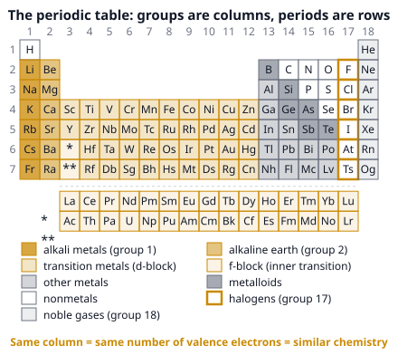

# 🟨 Periodic Table  ·  `chemistry.inorganic.periodic-table`
> 📅 Study date: Sun 18 Oct · ⏱️ ~12 min read · 📋 Syllabus: Main group elements, Transition elements

## 🎮 Start with agent roles
In Valorant you pick an agent by role: duelist, initiator, controller or sentinel. Two agents in the same role look different, but they play in a similar way. The periodic table sorts the elements the same way: not by looks, but by how they *behave*. Once you know the role of a column, you can guess how a brand-new element will act. **The difference:** an agent's role is chosen by the game designers, but an element's "role" comes from nature: it is set by its **valence electrons** (the outer electrons that do all the chemistry). Nobody can patch it.

## 🖼️ Big picture

## 💡 Core ideas
1. **The table is sorted by atomic number.** The **atomic number (Z)** is the number of protons in the nucleus. Z goes up by one from each box to the next. A row is a **period** (1 to 7). A column is a **group** (1 to 18).
2. **Group = valence electrons, period = shells.** Elements in the same group have the same number of valence electrons, so they react in a similar way. The period number is the number of electron shells (energy levels). For the main groups: groups 1 and 2 have 1 and 2 valence electrons; groups 13 to 18 have **group number − 10** (so group 16 has 6).
3. **Blocks.** The **s-block** is groups 1 and 2 (plus He). The **p-block** is groups 13 to 18. The **d-block** is groups 3 to 12. The **f-block** is the two rows at the bottom. The **main group elements** are the s-block and the p-block.
4. **Metals, nonmetals, metalloids.** Metals (left and middle) are shiny, conduct electricity and heat, and bend without breaking. Nonmetals (upper right) are dull and do not conduct. A "staircase" line from B down to Te holds the **metalloids** (B, Si, Ge, As, Sb, Te), which are in between: for example, silicon is shiny but a poor conductor, so we use it in chips.
5. **The main group families.** **Alkali metals** (group 1: Li, Na, K…): soft, one valence electron, form **+1** ions, react strongly with water: 2Na + 2H₂O → 2NaOH + H₂. **Alkaline earth metals** (group 2): form **+2** ions. **Halogens** (group 17: F, Cl, Br, I): form **−1** ions, exist as pairs like Cl₂. Br₂ is a liquid, I₂ is a solid. **Noble gases** (group 18): single atoms with a full outer shell, so they almost never react. Group 16 forms **−2** ions (O²⁻) and group 15 forms **−3** ions (N³⁻); group 13 forms **+3** ions (Al³⁺).
6. **Transition elements** (the d-block: Fe, Cu, Ni, Mn, Ti, Zn…). Typical properties: hard and strong, high melting points (Hg is the liquid exception), **more than one charge** (Fe²⁺ and Fe³⁺; Cu⁺ and Cu²⁺; Mn goes up to +7), **colored ions** (Cu²⁺ blue, Fe³⁺ yellow-brown, MnO₄⁻ purple), and they make good **catalysts** (a catalyst speeds up a reaction without being used up). Zn (group 12) is a special case: it only forms Zn²⁺, which is colorless.

> 🎒 **Quick check by position:** the element at "period 3, group 16" has 3 shells and 6 valence electrons. That is sulfur (Z = 16).

## 🧮 HUSO-style examples

**Example 1.** 🎮 Your scouting report says: "Mystery agent *Element X* has **34 electrons** when it is a neutral atom." In which period and group of the periodic table is X?

(A) Period 3, group 16  (B) Period 4, group 6  (C) Period 4, group 16  (D) Period 6, group 4  (E) Period 4, group 14

Steps:
1. A neutral atom has as many electrons as protons, so Z = 34.
2. Fill the shells: 2 + 8 + 18 + 6 = 34. So there are **4 shells** and **6 valence electrons** (the outer shell holds 6).
3. 4 shells means **period 4**.
4. Main group, 6 valence electrons: group = 10 + 6 = **16**. The element is selenium. **Answer: (C).**
5. Traps: (B) reads the "6" as the group number (that would be chromium, a transition metal). (A) counts only 3 shells because the 3rd shell is "full" at 8 in the simple picture. (E) mixes up 14 and 16.

**Example 2.** Which set of atomic numbers contains three elements from the **same group**?

(A) 6, 7, 8  (B) 9, 17, 35  (C) 10, 11, 12  (D) 2, 10, 20  (E) 1, 2, 3

Steps:
1. Find each element: Z = 9 is F, 17 is Cl, 35 is Br.
2. Each has **7 valence electrons**: F (2,7), Cl (2,8,7), Br (2,8,18,7). They are all in group 17, the halogens. **Answer: (B).**
3. (A) C, N, O are neighbors in one *period*, not one group. (C) Ne, Na, Mg and (E) H, He, Li are just *consecutive* atomic numbers, which land in different groups.
4. (D) is the trap: He and Ne are both noble gases (group 18), but Z = 20 is calcium (group 2). Helium has only 2 valence electrons, yet it sits in group 18 because its only shell is full.

## ⚠️ Common traps
- **Group is not period.** A group is a *column* (same valence electrons). A period is a *row* (same number of shells).
- **Helium** has 2 valence electrons but belongs with the noble gases (group 18), not group 2.
- **"Group number = valence electrons" only works for the main groups.** For groups 13 to 18 you subtract 10. For transition metals it does not work.
- **Zn is a d-block element but not a typical transition metal:** it has one charge (+2) and colorless compounds.
- **Hydrogen** sits in group 1, but it is a nonmetal, not an alkali metal.

## ✏️ Redraw from memory
Close the page and draw in 5 minutes, using only boxes (no need for all symbols):
- [ ] A grid with **18 columns and 7 rows**; number the groups and periods.
- [ ] Shade the four blocks: **s** (groups 1 to 2), **d** (3 to 12), **p** (13 to 18), **f** (two rows below).
- [ ] Label the families: alkali metals (1), alkaline earth metals (2), halogens (17), noble gases (18).
- [ ] The metalloid "staircase" (B, Si, Ge, As, Sb, Te) and which side holds the metals.
- [ ] Next to each family, the typical ion charge: +1, +2, +3, −3, −2, −1, 0.

Compare with the picture and mark what you missed in red.

## 🎥 Watch / try
- [The Periodic Table: Atomic Radius, Ionization Energy, and Electronegativity](https://www.youtube.com/watch?v=hePb00CqvP0) — Professor Dave Explains · 7:53 · watch the first minutes where he explains groups, periods and families
- [Transition metals and their properties](https://www.youtube.com/watch?v=m0Uj7mSC6HU) — FuseSchool · 3:21 · list the four properties that make the d-block special
- [What Are Periods & Groups In The Periodic Table?](https://www.youtube.com/watch?v=7mLPC74GHMo) — FuseSchool · 3:04 · check that you can say the difference between a period and a group

## ✅ Check your understanding (5 questions)
Do these without looking at the material. You are **READY** if you get at least 4 of 5 right.

**1.** Which of these elements is a **liquid** at room temperature (about 20 °C)?

(A) Chlorine  (B) Iodine  (C) Bromine  (D) Neon  (E) Sulfur

**2.** 🎮 Li, Na and K form one "team" because they all react with water in a similar way (fizzing, making H₂). What do their atoms have in common that explains this?

(A) One valence electron each  (B) The same number of protons  (C) The same number of electron shells  (D) The same atomic mass  (E) A full outer shell

**3.** Aluminum is in group 13. What is the formula of aluminum oxide?

(A) AlO  (B) Al₂O  (C) AlO₂  (D) Al₂O₃  (E) Al₃O₂

**4.** Which statement about transition metals is **true**?

(A) All of their compounds are colorless.  (B) Many of them form ions with different charges, like Fe²⁺ and Fe³⁺.  (C) They are the elements in groups 1 and 2.  (D) They are all gases at room temperature.  (E) They do not conduct electricity.

**5.** Which of these elements is a transition metal?

(A) Ca  (B) Al  (C) Sn  (D) Se  (E) Ti

Answer key & explanations

1. **(C) Bromine.** Br₂ melts at −7 °C and boils at 59 °C, so it is a liquid at 20 °C (mercury is the only liquid *metal*). Chlorine and neon are gases; iodine and sulfur are solids.
2. **(A) One valence electron each.** All three are in group 1, so each has 1 valence electron and loses it easily to form +1 ions. Their proton numbers (3, 11, 19) and shells (2, 3, 4) all differ, and their atoms do not have a full outer shell.
3. **(D) Al₂O₃.** Al forms Al³⁺ (group 13: +3) and oxygen forms O²⁻ (group 16: −2). The charges must cancel: 2 × (+3) = +6 and 3 × (−2) = −6, so Al₂O₃. (A) would be Al²⁺ and O²⁻, which Al does not form.
4. **(B).** Fe forms Fe²⁺ and Fe³⁺. Transition metal compounds are often colored, they are metals (solids that conduct, except Hg which is liquid), and they are in groups 3 to 12.
5. **(E) Ti.** Titanium (Z = 22) is in group 4, the d-block. Ca is group 2, Al group 13, Sn group 14, Se group 16 (all main group).

