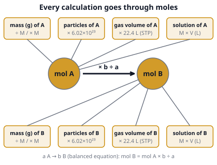

# 🟨 Reactions & Stoichiometry  ·  `chemistry.inorganic.reactions`
> 📅 Study date: Sun 18 Oct · ⏱️ ~12 min read · 📋 Syllabus: Reaction types, Balancing reactions, Empirical formulas, Concentrations, Mole concept (volume, mass, number of atoms)

## 🍳 Start with a sandwich recipe
A cheese sandwich needs **2 slices of bread + 1 slice of cheese**. You have 10 slices of bread and 3 slices of cheese. How many sandwiches? Not 5. You run out of cheese after **3** sandwiches, and 4 slices of bread are left over. A chemical equation is exactly this kind of recipe: it tells you the *ratio* of ingredients, and the ingredient you run out of first (the **limiting reactant**) decides how much you make. **The difference:** a recipe counts slices, but chemists count atoms and molecules in bundles called **moles**, because we cannot count single atoms.

## 🖼️ Big picture

## 💡 Core ideas
1. **The mole.** One **mole** is **6.02 × 10²³** particles (Avogadro's number, N_A), like a "dozen" is 12. The **molar mass M** (g/mol) is the atomic masses added up: H₂O = 2(1) + 16 = 18 g/mol. Then **n = mass ÷ M**, **number of particles = n × N_A**, and for a gas at **STP** (0 °C, 1 atm) **V = n × 22.4 L**. Remember: count **atoms** too. 1 mol of H₂O has 3 mol of atoms (2 H + 1 O).
2. **Reaction types.** **Synthesis**: A + B → AB. **Decomposition**: AB → A + B. **Single replacement**: A + BC → AC + B (a more reactive metal pushes out a less reactive one). **Double replacement**: AB + CD → AD + CB (it happens when a solid, a gas or water forms). **Combustion**: a fuel + O₂ → CO₂ + H₂O. **Neutralization**: acid + base → salt + water. Many of these are **redox** reactions, where electrons move from one species to another.
3. **Balancing.** The same number of each kind of atom on both sides. **Change only the coefficients** (the big numbers in front), **never the subscripts** (changing H₂O to H₂O₂ makes a different substance). Tip: balance metals first, then other nonmetals, and **H and O last**. Example: C₃H₈ + 5 O₂ → 3 CO₂ + 4 H₂O.
4. **Stoichiometry.** Follow the road map: **grams of A → moles of A → (× coefficient ratio) → moles of B → grams of B**. **Limiting reactant:** for each reactant divide moles by its coefficient; the **smallest** result is the limiting one, and it decides how much product forms. **Percent yield = actual ÷ theoretical × 100.** Mass is always conserved: total mass before = total mass after.
5. **Empirical formula** (the simplest whole-number ratio of atoms). From the percent composition: pretend you have **100 g**, so the percents turn into grams; divide each by its atomic mass to get moles; divide all by the smallest; if you get x.5 multiply by 2 (x.33 or x.67: multiply by 3). The **molecular formula** = empirical formula × (M ÷ M of the empirical formula). Glucose is C₆H₁₂O₆, and its empirical formula is CH₂O.
6. **Concentrations.** **Molarity** M = moles of solute ÷ liters of **solution** (mol/L). **Dilution:** M₁V₁ = M₂V₂ (the moles do not change when you add water). **Mass percent** = mass of solute ÷ mass of solution × 100. **Avogadro's law:** equal volumes of gases at the same T and P hold equal numbers of molecules.

## 🧮 HUSO-style examples

**Example 1.** 🍳 A cook drops 8.4 g of baking soda (NaHCO₃) into plenty of vinegar: NaHCO₃ + CH₃COOH → CH₃COONa + H₂O + CO₂. How many liters of CO₂ form at STP? (Use H = 1, C = 12, O = 16, Na = 23 and 22.4 L/mol.)

(A) 0.224 L  (B) 1.12 L  (C) 2.24 L  (D) 4.48 L  (E) 8.4 L

Steps:
1. Molar mass of NaHCO₃: 23 + 1 + 12 + 3 × 16 = **84 g/mol**.
2. Moles: 8.4 g ÷ 84 g/mol = **0.10 mol**.
3. The equation is balanced as written, 1 NaHCO₃ : 1 CO₂, so moles of CO₂ = **0.10 mol**. (The vinegar is in excess, so the baking soda limits the reaction.)
4. Volume: 0.10 mol × 22.4 L/mol = **2.24 L**. **Answer: (C).**
5. Traps: (A) divides by 10 too many. (B) and (D) use a wrong ratio of 1 : 0.5 or 1 : 2, but the coefficients are both 1. (E) copies the mass as if it were a volume.

**Example 2.** 4.0 g of hydrogen gas reacts with 40 g of oxygen gas: 2 H₂ + O₂ → 2 H₂O. What is the maximum mass of water that forms? (H = 1, O = 16)

(A) 18 g  (B) 36 g  (C) 45 g  (D) 22.5 g  (E) 44 g

Steps:
1. Moles: H₂ = 4.0 ÷ 2 = **2.0 mol**. O₂ = 40 ÷ 32 = **1.25 mol**.
2. Find the limiting reactant: moles ÷ coefficient. H₂: 2.0 ÷ 2 = **1.0**. O₂: 1.25 ÷ 1 = 1.25. The smaller is H₂, so **H₂ is limiting** (like the cheese in the sandwiches).
3. Water: 2 H₂ → 2 H₂O, so 2.0 mol of H₂O. Mass = 2.0 × 18 = **36 g**. **Answer: (B).**
4. Traps: (C) 45 g assumes O₂ is limiting (1.25 × 2 × 18). (E) 44 g adds the two masses together, but 4 g of the oxygen is left over. (A) forgets the ratio and makes only 1 mol.

## ⚠️ Common traps
- **Changing subscripts** to balance. Only coefficients may change.
- **Using the mass ratio instead of the mole ratio.** The coefficients are in moles, not grams.
- **Forgetting the limiting reactant.** Always check when two amounts are given.
- **Molarity uses the volume of the whole solution** (in liters), not the volume of solvent, and not milliliters.
- **22.4 L/mol is only for gases at STP.** Never use it for liquids or solids (1 mol of liquid water is about 18 mL).
- **Empirical is not molecular.** H₂O₂ and HO have the same ratio, but the compound is H₂O₂ (M = 34).

## ✏️ Redraw from memory
Close the page and draw in 5 minutes:
- [ ] The **mole road map**: mass, particles, gas volume and solution on one side of "moles A"; the same four for B, and the arrow in the middle with the coefficient ratio.
- [ ] The conversion factor on each spoke (÷ M, × 6.02 × 10²³, × 22.4 L, M × V).
- [ ] The **sandwich recipe** as an equation: 2 bread + 1 cheese → 1 sandwich, and how you find the limiting ingredient.
- [ ] The 6 **reaction types** as little letter diagrams (A + B → AB and so on).
- [ ] The steps of the **empirical formula** from percentages (100 g, ÷ M, ÷ smallest, ×).

Compare with the picture and mark what you missed in red.

## 🎥 Watch / try
- [Stoichiometry Basic Introduction, Mole to Mole, Grams to Grams, Mole Ratio Practice Problems](https://www.youtube.com/watch?v=7Cfq0ilw7ps) — The Organic Chemistry Tutor · 25:16 · watch the first 10 minutes and pause to try each problem
- [How to Balance Chemical Equations in 5 Easy Steps](https://www.youtube.com/watch?v=zmdxMlb88Fs) — Wayne Breslyn (Dr. B.) · 5:01 · follow the atom-counting table
- [Empirical Formulae From Percentage Composition](https://www.youtube.com/watch?v=5xVTw6LFG2E) — FuseSchool · 4:33 · write each step in the order of the video

## ✅ Check your understanding (5 questions)
Do these without looking at the material. You are **READY** if you get at least 4 of 5 right. Use H = 1, C = 12, N = 14, O = 16, Na = 23, Cl = 35.5, Ar = 40.

**1.** Ethane burns: **C₂H₆ + O₂ → CO₂ + H₂O**. When the equation is balanced with the smallest whole numbers, what is the coefficient of O₂?

(A) 3  (B) 5  (C) 6  (D) 7  (E) 9

**2.** A compound is 40.0 % carbon, 6.7 % hydrogen and 53.3 % oxygen by mass. What is its empirical formula?

(A) CH₂O  (B) C₂H₄O  (C) CHO  (D) C₂H₂O  (E) CH₄O₂

**3.** 🍳 To make 250 mL of a 0.20 M sodium hydroxide (NaOH) solution for a cleaning recipe, how many grams of NaOH are needed? (M = 40 g/mol)

(A) 8.0 g  (B) 0.050 g  (C) 20 g  (D) 0.20 g  (E) 2.0 g

**4.** Which sample contains the **largest number of atoms**?

(A) 16 g of CH₄  (B) 36 g of H₂O  (C) 22 g of CO₂  (D) 32 g of O₂  (E) 40 g of Ar

**5.** Which of these equations is a **double replacement** (precipitation) reaction?

(A) 2 Mg + O₂ → 2 MgO  (B) CaCO₃ → CaO + CO₂  (C) AgNO₃ + NaCl → AgCl + NaNO₃  (D) Zn + CuSO₄ → ZnSO₄ + Cu  (E) CH₄ + 2 O₂ → CO₂ + 2 H₂O

Answer key & explanations

1. **(D) 7.** Balance C first: 2 CO₂. Then H: 6 H need 3 H₂O. Count O: 2 × 2 + 3 = 7 O atoms, which is 3.5 O₂. Double everything to avoid a fraction: **2 C₂H₆ + 7 O₂ → 4 CO₂ + 6 H₂O**.
2. **(A) CH₂O.** In 100 g: C = 40.0 ÷ 12 = 3.33 mol; H = 6.7 ÷ 1 = 6.7 mol; O = 53.3 ÷ 16 = 3.33 mol. Divide by 3.33: C : H : O = 1 : 2 : 1. (B) would need twice as much C and H as O.
3. **(E) 2.0 g.** n = M × V = 0.20 mol/L × 0.250 L = 0.050 mol. Mass = 0.050 × 40 = 2.0 g. (A) uses 1 L instead of 0.25 L. (B) gives the moles (0.050) but calls them grams. (C) and (D) slip by a factor of 10 when changing mL to L (2.5 L or 0.025 L).
4. **(B) 36 g of H₂O.** 36 g ÷ 18 = 2 mol of molecules × 3 atoms = **6 mol of atoms**. (A) 16 g ÷ 16 = 1 mol × 5 atoms = 5 mol. (C) 0.5 mol × 3 = 1.5. (D) 1 mol × 2 = 2. (E) 1 mol × 1 = 1. Do not just pick the heaviest sample.
5. **(C).** The two compounds swap partners and one of them (AgCl) is a solid that falls out of the solution. (A) is synthesis, (B) is decomposition, (D) is single replacement, (E) is combustion.

