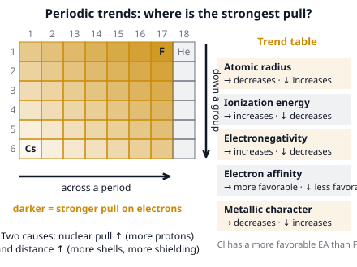

# 🟨 Periodic Trends  ·  `chemistry.inorganic.trends`
> 📅 Study date: Sun 18 Oct · ⏱️ ~12 min read · 📋 Syllabus: Electronegativity, Ionization energy, Electron affinity, Reactivity, Metallic character, Atomic and ionic size

## 🎮 Start with a tug-of-war over the spike
In a Valorant round, the team with more players near the dropped spike controls it. Add smokes that block the view and distance from the site, and the control gets weaker. An atom works the same way: the **nucleus** (protons) pulls on the outer electrons. More protons pull harder, **inner electrons** act like smokes that block part of the pull, and a far-away electron is pulled less. Almost every periodic trend is just these three things. **The difference:** in the game you can swap players, but atoms follow fixed rules: protons only ever increase from left to right.

## 🖼️ Big picture

## 💡 Core ideas
1. **Two causes explain all trends.** (a) The **effective nuclear charge** (the pull of the nucleus after the inner electrons block part of it) **grows from left to right** in a period because protons are added but the electrons go into the *same* shell. (b) Going **down** a group, there is a **new shell** each row, so the outer electrons are far away and shielded.
2. **Atomic and ionic size.** Atomic radius **decreases across** a period and **increases down** a group. A **cation is smaller** than its atom (it loses its outer shell or has fewer electrons repelling each other). An **anion is larger** than its atom. For ions with the **same number of electrons** (isoelectronic: O²⁻, F⁻, Na⁺, Mg²⁺, Al³⁺ all have 10), more protons means smaller: **Al³⁺ is the smallest, O²⁻ the largest**.
3. **Ionization energy (IE).** The energy needed to remove an electron from a gaseous atom: X(g) → X⁺(g) + e⁻. It **increases across** and **decreases down** (the electron is easier to pull off when it is far away). Two small dips to know: **B is lower than Be** (a 2p electron is higher in energy than a 2s) and **O is lower than N** (in O one 2p orbital holds a pair, and the pair repels, so one electron leaves more easily). Removing electrons one after the other gives **successive** IEs, with a **huge jump after the last valence electron** (the next one comes from the stable inner shell).
4. **Electron affinity (EA).** The energy *released* when a gaseous atom gains an electron: X(g) + e⁻ → X⁻(g). Atoms that are close to a full shell, like the **halogens**, release the most. In general, EA becomes more favorable toward the right (not for the noble gases), and **Cl releases more energy than F** (F is so small that the new electron is crowded).
5. **Electronegativity (EN).** How strongly an atom **pulls on the electrons it shares** in a bond (Pauling scale). It **increases across and up**. **Fluorine is the highest (≈ 4.0)**, then O (3.4), N and Cl (≈ 3.0–3.2). Cs and Fr are the lowest. Noble gases are left out because they hardly form bonds.
6. **Metallic character and reactivity.** Metals *lose* electrons, so **metallic character is highest at the bottom left** (Cs, Fr) and falls across a period. **Reactive metals** (those with a low IE) get **more reactive going down** a group: Li < Na < K in water. **Reactive nonmetals** (those with a high EN and a strongly favorable EA) get **more reactive going up** a group: F₂ > Cl₂ > Br₂ > I₂.

## 🧮 HUSO-style examples

**Example 1.** Which list is in order of **increasing radius**?

(A) O²⁻ < F⁻ < Na⁺ < Mg²⁺ < Al³⁺  (B) Al³⁺ < Mg²⁺ < Na⁺ < F⁻ < O²⁻  (C) Na⁺ < Mg²⁺ < Al³⁺ < O²⁻ < F⁻  (D) F⁻ < O²⁻ < Al³⁺ < Mg²⁺ < Na⁺  (E) Mg²⁺ < Al³⁺ < Na⁺ < O²⁻ < F⁻

Steps:
1. Count the electrons. O²⁻ has 8 + 2 = 10, F⁻ has 9 + 1 = 10, Na⁺ has 11 − 1 = 10, Mg²⁺ has 12 − 2 = 10, Al³⁺ has 13 − 3 = 10. All five have **the same 10 electrons** (isoelectronic), in the same shells.
2. With equal electrons, the one with **more protons pulls harder**, so it is **smaller**. Protons: Al³⁺ (13) > Mg²⁺ (12) > Na⁺ (11) > F⁻ (9) > O²⁻ (8).
3. So the sizes grow in the order Al³⁺ < Mg²⁺ < Na⁺ < F⁻ < O²⁻. **Answer: (B).**
4. Traps: (A) is the exact reverse (it says that the most protons give the biggest ion). (C), (D) and (E) are mixed-up orders that forget the proton count.

**Example 2.** The first five ionization energies of an element, in kJ/mol, are: 738, 1451, 7733, 10 543, 13 630. In which group of the periodic table is the element?

(A) Group 1  (B) Group 2  (C) Group 13  (D) Group 14  (E) Group 15

Steps:
1. Divide each energy by the one before it: 1451 ÷ 738 ≈ 2.0, then 7733 ÷ 1451 ≈ **5.3**, then 10 543 ÷ 7733 ≈ 1.4, then 13 630 ÷ 10 543 ≈ 1.3.
2. The **big jump comes after the 2nd electron**. The first two electrons are the valence electrons (the "outer armor"). The third has to come from the full inner shell, which is held far more tightly.
3. Two valence electrons means **group 2** (this is magnesium). **Answer: (B).**
4. Traps: (A) would show a jump right after the *first* energy. (C), (D), (E) would show the big jump after the 3rd, 4th or 5th.

## ⚠️ Common traps
- **Bigger radius does not mean higher IE.** It is the opposite: far-away electrons are easy to remove, so a *large* atom has a *low* IE.
- **Noble gases** have the highest IE in their period but no (useful) electronegativity.
- **The N/O and Be/B dips.** The IE does not rise perfectly smoothly across a period; this is a favorite exam question.
- **"Cation is larger because it has more protons than electrons."** No: a cation is *smaller* than its atom. Look at the number of electrons and shells.
- **Electron affinity is not electronegativity.** EA is an *energy* of a lone gaseous atom. EN is a *pull* on shared electrons in a bond.

## ✏️ Redraw from memory
Close the page and draw in 5 minutes:
- [ ] A simple main-group table with **two arrows**: "across a period →" and "down a group ↓".
- [ ] Beside the arrows, write what **radius, IE, EN and metallic character** do on each arrow.
- [ ] Mark the corner with the **highest EN (F)** and the corner with the **most metallic element (Cs/Fr)**.
- [ ] Draw the isoelectronic series **O²⁻, F⁻, Na⁺, Mg²⁺, Al³⁺** as circles of different sizes with the proton numbers.
- [ ] Sketch a **successive ionization energy** bar chart for Mg (a small bar, a small bar, then a huge one).

Compare with the picture and mark what you missed in red.

## 🎥 Watch / try
- [The Periodic Table: Atomic Radius, Ionization Energy, and Electronegativity](https://www.youtube.com/watch?v=hePb00CqvP0) — Professor Dave Explains · 7:53 · pause at each trend and say the direction of the arrows out loud
- [Periodic Trends: Electronegativity, Ionization Energy, Atomic Radius, and Electron Affinity](https://www.youtube.com/watch?v=E0YdrosU0lk) — London Jenks · 4:47 · a fast revision of all four trends

## ✅ Check your understanding (5 questions)
Do these without looking at the material. You are **READY** if you get at least 4 of 5 right.

**1.** Which atom has the **largest** atomic radius?

(A) Mg  (B) Cl  (C) K  (D) Cs  (E) Si

**2.** Which of these elements has the **highest** electronegativity?

(A) Cl  (B) O  (C) N  (D) S  (E) Br

**3.** 🎮 The alkali metals "rush" into water: they react faster and faster as you go down the group. Which of these reacts the **fastest** with water?

(A) Lithium  (B) Sodium  (C) Potassium  (D) Magnesium  (E) Calcium

**4.** Why is the first ionization energy of oxygen **lower** than that of nitrogen?

(A) In oxygen, one 2p orbital holds a pair of electrons, and their repulsion makes one easier to remove.  (B) Oxygen has fewer protons than nitrogen.  (C) Oxygen's outer electron is in a higher shell.  (D) Oxygen is a metal.  (E) Oxygen has a larger atomic radius than nitrogen.

**5.** Which equation represents the **first electron affinity** of chlorine?

(A) Cl(g) → Cl⁺(g) + e⁻  (B) Cl₂(g) → 2 Cl(g)  (C) Cl⁻(g) → Cl(g) + e⁻  (D) NaCl(s) → Na⁺(g) + Cl⁻(g)  (E) Cl(g) + e⁻ → Cl⁻(g)

Answer key & explanations

1. **(D) Cs.** Radius grows down a group and shrinks across a period. Cs is in period 6, group 1: the bottom-left corner. K (period 4) is smaller than Cs. Mg, Si and Cl are in period 3 and small.
2. **(B) O.** Electronegativity rises across and up. Of the five, oxygen (3.4) is the highest, then Cl (3.2), N (3.0), Br (3.0) and S (2.6). F would be higher, but it is not in the list.
3. **(C) Potassium.** Alkali metals react faster down the group because the single outer electron is easier to lose (lower IE). K is lower in the group than Li and Na. Mg and Ca are in group 2 and react more slowly with water than K.
4. **(A).** N is 2p³ (three unpaired electrons, one per orbital). In O (2p⁴), one orbital holds two electrons, and their mutual repulsion makes one of them easier to remove. (B) is the opposite: O has *more* protons (8 against 7). (C) and (E) are wrong because both atoms have the same shell and O is slightly smaller.
5. **(E) Cl(g) + e⁻ → Cl⁻(g).** Electron affinity is the energy change when a gaseous atom *gains* an electron. (A) is the ionization energy. (B) is the bond dissociation. (C) is the reverse of the electron affinity. (D) is the lattice energy (reverse).

