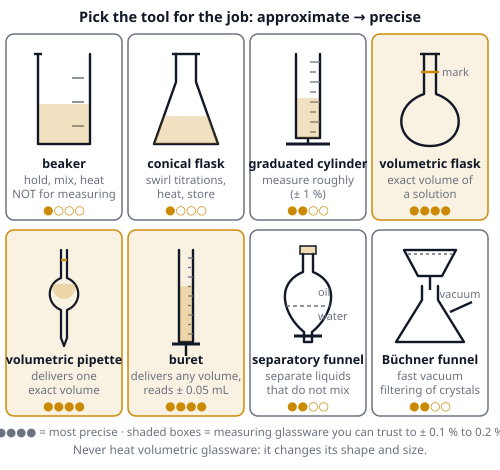
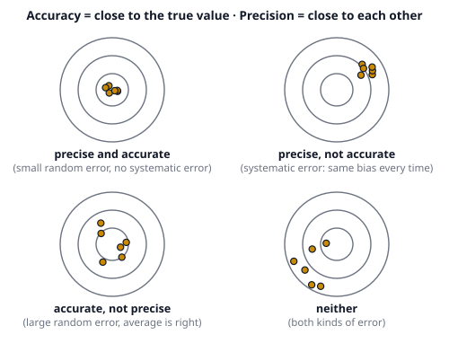

# 🟨 Lab Skills  ·  `chemistry.lab.skills`
> 📅 Study date: Sun 1 Nov · ⏱️ ~12 min read · 📋 Syllabus: Choosing lab materials, Correct lab procedures, Error analysis

## 🎮 Start with the practice range
On the practice range you fire six shots at a wall. All six holes sit very close together, but they are a bit to the left of the target. Is that good aim? Your **grouping** is excellent, but your **position** is wrong, maybe because your sight is set off by a little. You fix that with one adjustment, not with more practice.

A measurement in a lab gets the same two scores. **Precision** is how close your repeated results are to *each other* (the grouping). **Accuracy** is how close they are to the *true value* (the target). Lab skills are about picking the right tool, following the right steps, and knowing which kind of error you have.

## 🖼️ Big picture

And the two scores, drawn as targets:

## 💡 Core ideas
1. **Choose the tool by the job.** **Beakers and conical (Erlenmeyer) flasks** hold, mix and heat, but their marks are only rough: **never use them to measure** a volume. A **graduated cylinder** measures roughly (about ± 1 %). For an **exact** volume use **volumetric glassware** (about ± 0.1 %): a **volumetric flask** makes a solution of exact volume, a **volumetric pipette** delivers one fixed volume, and a **buret** delivers *any* volume you choose (read to ± 0.05 mL). Mass: an **analytical balance** (± 0.0001 g). Heating: beakers and conical flasks, **never** volumetric glassware.
2. **Correct procedures.** **Making a standard solution:** weigh the solid, dissolve it in a **little** water in a beaker, **transfer and rinse** the beaker into a volumetric flask, then add water until the **bottom of the meniscus** touches the mark (eyes level with it), stopper, and **invert** to mix. **Titration:** rinse the buret with the **titrant** and the pipette with the **solution it will deliver** (the flask can be wet with plain water, because water does not change the moles), fill the tip so there is **no air bubble**, add the titrant quickly at first and **drop by drop** near the end point, swirl, and repeat until two results agree within about 0.1 mL (**concordant** results). **Dilution:** **add acid to water**, slowly, never water to concentrated acid. **Heating:** use boiling chips, never heat a closed system, point a test tube away from people. Always wear **goggles**, and use a **fume hood** for toxic or smelly vapors.
3. **Separation methods, chosen by a property.** **Filtration:** a solid in a liquid (a **Büchner funnel** with suction collects crystals fast). **Evaporation or crystallization:** a dissolved solid. **Simple distillation:** liquids with different **boiling points** (use fractional distillation when they are close). **Separatory funnel (extraction):** two liquids that **do not mix** (they have different densities). **Chromatography:** substances with different attraction to the paper. Its result is **Rf = distance moved by the spot ÷ distance moved by the solvent front** (always between 0 and 1).
4. **Measure and report.** Read an instrument to **half of its smallest division**. **Significant figures:** for **adding or subtracting**, keep the fewest **decimal places**; for **multiplying or dividing**, keep the fewest **significant figures**. **Uncertainty:** for **adding or subtracting**, the **absolute** uncertainties add; for **multiplying or dividing**, the **relative (percent)** uncertainties add. **Percent error = |measured − accepted| ÷ accepted × 100 %.**
5. **Accuracy and precision, random and systematic error.** **Random errors** (reading a scale, noise) make results scatter both ways; they hurt **precision** and shrink when you **repeat and average**. **Systematic errors** (a badly calibrated balance, reading the meniscus from above every time) push every result the **same direction**; they hurt **accuracy**, and repeating does **not** help. You fix them with calibration or a better method. A spill or a mistake is a **blunder**, not an "error bar": repeat the experiment.
6. **Predict the direction of an error.** Write the formula you use (for a titration, c(acid) = c(base) × V(base) ÷ V(acid)). Ask: *does the mistake make the number you read too big or too small, compared with what really happened?* Example: if the buret reading says more titrant was used than really was delivered (an air bubble that left the tip, or overshooting the end point), c(acid) comes out **too high**. If the pipette is wet with water and you do not rinse it with the sample, the sample is diluted, less acid is delivered, and c(acid) comes out **too low**. A conical flask wet with water changes **nothing**.

> 🎯 **Analogy:** precision is the size of your shot group and accuracy is where the group lands. **The difference:** in a game you can see the target, but in a chemistry experiment you often do not know the true value, so you must judge accuracy from *calibration* and from comparing different methods.

## 🧮 HUSO-style examples

**Example 1.** A student needs exactly 250.0 mL of 0.100 M NaCl (molar mass 58.44 g/mol) from solid salt. Which plan is best?

(A) 1.46 g in a beaker, then water up to the beaker's 250 mL mark  (B) 1.461 g in a beaker with a little water, transferred and rinsed into a 250.0 mL volumetric flask, filled to the mark  (C) 1.461 g added to 250 mL of water from a graduated cylinder  (D) 14.61 g in a beaker with a little water, transferred and rinsed into a 250.0 mL volumetric flask, filled to the mark  (E) 5.844 g in a beaker with a little water, transferred and rinsed into a 250.0 mL volumetric flask, filled to the mark

Steps:
1. Moles needed = 0.100 mol/L × 0.2500 L = 0.0250 mol.
2. Mass = 0.0250 mol × 58.44 g/mol = **1.461 g**. That removes (D) (ten times too much) and (E) (the mass for 1 L).
3. An exact volume needs a **volumetric flask**, not a beaker (A) or a graduated cylinder (C).
4. Dissolve in a little water first, transfer, rinse, then fill to the mark: **(B)**. **Answer: (B).**

**Example 2.** A student finds the mass of a metal sample, 15.62 ± 0.01 g, and its volume by water displacement in a graduated cylinder, 5.8 ± 0.1 mL. What is the density with its uncertainty?

(A) 2.69 ± 0.01 g/mL  (B) 2.69 ± 0.05 g/mL  (C) 2.69 ± 0.11 g/mL  (D) 2.69 ± 0.10 g/mL  (E) 2.69 ± 0.02 g/mL

Steps:
1. Density = 15.62 ÷ 5.8 = **2.69 g/mL**.
2. Dividing, so the **relative uncertainties add**: 0.01 ÷ 15.62 = 0.064 % and 0.1 ÷ 5.8 = 1.72 %. Total ≈ 1.79 %.
3. Absolute uncertainty = 2.69 × 0.0179 = **0.048 ≈ 0.05 g/mL**. **Answer: (B).**
4. Sense check: the volume is the weak link (0.1 out of 5.8). The balance is far more precise than the cylinder, so the answer is almost entirely controlled by the volume reading.
5. Traps: (C) adds the absolute uncertainties; (D) uses only the volume's absolute uncertainty; (A) uses only the balance.

## ⚠️ Common traps
- **A wet flask is fine, a wet buret or pipette is not.** Water in the flask does not change the *moles* of analyte. Water in the buret dilutes the titrant, and water in the pipette dilutes the sample.
- **Precision does not mean accuracy.** Six identical results can all be wrong (systematic error).
- **Adding versus multiplying uncertainties:** add the **absolute** uncertainties for + and −; add the **relative** ones for × and ÷.
- **Significant figures:** the number of decimals matters when adding, the number of significant figures when multiplying.
- **Do not add water to concentrated acid.** Acid into water, slowly.
- **A measuring cylinder is not for exact work:** 25 mL cylinder ≠ 25.00 mL pipette.

## ✏️ Redraw from memory
Draw on paper (6 minutes):
- [ ] The **four targets** (precise/accurate combinations) with dots.
- [ ] **Buret, volumetric pipette, volumetric flask, graduated cylinder, beaker** in order of precision.
- [ ] The **steps of a titration** as a numbered flow (rinse, fill, no bubble, swirl, drop by drop, concordant results).
- [ ] A **meniscus** with the eye at the right height and the reading at the **bottom** of the curve.
- [ ] A **chromatography strip** with solvent front, start line, one spot and the Rf formula.

## 🎥 Watch / try
- [Setting up and Performing a Titration](https://www.youtube.com/watch?v=sFpFCPTDv2w) — Carolina Science · 6:53 · see the rinse, the bubble check and the drop-by-drop finish
- [Measurement and Significant Figures](https://www.youtube.com/watch?v=Gn97hpEkTiM) — Professor Dave Explains · 3:39 · a quick review of counting significant figures
- [Titration Technique using a buret](https://www.youtube.com/watch?v=9DkB82xLvNE) — naitchemtech · 5:03 · how to read the meniscus and handle the tap

## ✅ Check your understanding (5 questions)
Do these without looking at the page. You are **READY** if you get at least 4 out of 5.

**1.** 🎮 A player sprays several shots that land very close together, but all of them are 20 cm to the left of the target. In lab language, this is:

(A) accurate and precise  (B) accurate but not precise  (C) precise but not accurate, a systematic error  (D) neither accurate nor precise  (E) accurate, with only random error

**2.** In a titration of an acid with NaOH from a buret, there is an air bubble in the buret tip at the start, and it is gone at the end point. How is the calculated concentration of the acid affected?

(A) too high  (B) too low  (C) too high only if the acid is weak  (D) unchanged, because the bubble is only air  (E) unchanged, because the moles of acid are fixed

**3.** 🍳 A cook skims oil off the top of a pot of soup. Which piece of lab equipment does the same job for two liquids that do not mix?

(A) Büchner funnel  (B) condenser  (C) buret  (D) crucible  (E) separatory funnel

**4.** A student finds the boiling point of pure water to be 98.6 °C at 1.00 atm. The accepted value is 100.0 °C. What is the percent error?

(A) 0.014 %  (B) 1.4 %  (C) 14 %  (D) 98.6 %  (E) 1.4 °C

**5.** What is the result of 12.11 + 0.3 + 1.457, with the correct number of significant figures?

(A) 13.867  (B) 13.87  (C) 14  (D) 13.9  (E) 13.8

Answer key & explanations

1. **(C) precise but not accurate, a systematic error.** The tight group means good precision. The shift from the target means poor accuracy, and since every shot is off in the same direction it is a systematic error (like a sight set off to the side), not a random one.
2. **(A) too high.** The buret reading shows more titrant used than the liquid actually delivered (part of the volume was the air space that filled up). The calculation c(acid) = c(base) × V(base) ÷ V(acid) uses a V(base) that is too big.
3. **(E) separatory funnel.** Oil and water do not mix and have different densities, so they form two layers that you can drain separately. A Büchner funnel separates a solid from a liquid, a condenser is for distillation, a buret delivers liquid, and a crucible holds solids that are heated strongly.
4. **(B) 1.4 %.** |98.6 − 100.0| ÷ 100.0 × 100 = 1.4 %. Choice (E) forgets the last step and gives the error in degrees, not percent.
5. **(D) 13.9.** The sum is 13.867. When adding, keep the fewest decimal places; 0.3 has one, so the answer is **13.9**. (If you round 13.867 to 13.87 you used the wrong rule.)

