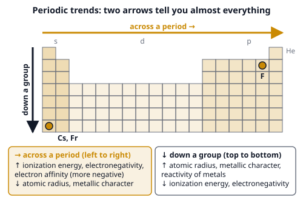

# 🟨 HUSO Chemistry Cheat Sheet, Grade 9–10

> 🖨️ Print 2 pages (Ctrl+P). The exam gives you a **periodic table and the constants** (h, F, c, R), but **not the formulas and reactions**: learn these. All concentrations are at 25 °C unless said otherwise. A scientific calculator is allowed in Round 1.

---
## 📄 Page 1: Atoms, bonds, moles, solutions

### Constants (the exam gives h, F, c and R; the rest are good to know)
| Name | Value | Name | Value |
|---|---|---|---|
| Gas constant R | 8.314 J/(mol·K) = 0.08206 L·atm/(mol·K) | Faraday F | 96 485 C per mole of electrons |
| Planck h | 6.626 × 10⁻³⁴ J·s | Speed of light c | 2.998 × 10⁸ m/s |
| Avogadro N_A | 6.022 × 10²³ per mole | Molar volume of an ideal gas | 22.4 L/mol at 0 °C and 1 atm |
| K_w (water) | 1.0 × 10⁻¹⁴ at 25 °C | c of liquid water | 4.184 J/(g·°C) |

### 🧮 Mole and concentration
- **n = m ÷ M = N ÷ N_A = V ÷ 22.4 L** (gas, 0 °C, 1 atm) · **percent yield** = actual ÷ theoretical × 100 %.
- **Molarity M = mol solute ÷ L solution** · **molality m = mol solute ÷ kg solvent** · mole fraction X = n_part ÷ n_total · mass % = m_part ÷ m_total × 100.
- **Dilution: C₁V₁ = C₂V₂** · **Empirical formula:** percent → grams → moles → divide by the smallest → whole-number ratio.
- **Balancing:** same number of each atom on both sides, then reduce to the smallest whole numbers. **Limiting reagent:** the one that gives the *least* product.
- **Ideal gas: PV = nRT** (T in kelvin) · M = dRT ÷ P · partial pressure P_i = X_i · P_total.

### ⚛️ Atoms
| Idea | Rule |
|---|---|
| Atom | protons = atomic number Z · mass number A = protons + neutrons · neutrons = A − Z |
| Isotopes | same Z, different A · average atomic mass = Σ (fraction × mass) |
| Decay | **α:** A − 4, Z − 2 · **β⁻:** Z + 1, A same · **β⁺:** Z − 1, A same · **γ:** no change |
| Half-life | N = N₀ · (½)^(t ÷ t½) |
| Quantum numbers | n = 1, 2, 3… · l = 0 … n − 1 (s, p, d, f) · m = −l … +l · spin ±½ · shell holds **2n²** electrons |
| Filling order | 1s 2s 2p 3s 3p **4s 3d** 4p 5s 4d 5p 6s |
| Rules | **Aufbau** (lowest first) · **Pauli** (max 2 per orbital, opposite spins) · **Hund** (one each before pairing) |
| Exceptions | Cr [Ar]4s¹3d⁵ · Cu [Ar]4s¹3d¹⁰ · cations lose **4s first** (Fe²⁺ = [Ar]3d⁶) |
| Magnetism | **paramagnetic** = unpaired electrons (pulled into a magnet) · **diamagnetic** = all paired |

### 📈 Periodic trends

- **Exceptions:** first ionization energy dips from Be → B and from N → O. Cations are **smaller** than their atoms, anions **larger**. In an isoelectronic series (same electrons) more protons = smaller.

### 🔗 Bonding and shapes (VSEPR)
| Electron domains | Lone pairs | Shape | Angle | Hybrid | Example |
|---|---|---|---|---|---|
| 2 | 0 | linear | 180° | sp | CO₂, BeCl₂ |
| 3 | 0 / 1 | trigonal planar / bent | 120° / < 120° | sp² | BF₃ / SO₂ |
| 4 | 0 / 1 / 2 | tetrahedral / trigonal pyramidal / bent | 109.5° / ≈ 107° / ≈ 104.5° | sp³ | CH₄ / NH₃ / H₂O |
| 5 | 0 / 1 / 2 / 3 | trigonal bipyramidal / seesaw / T-shaped / linear | 90° and 120° | sp³d | PCl₅ / SF₄ / ClF₃ / XeF₂ |
| 6 | 0 / 1 / 2 | octahedral / square pyramidal / square planar | 90° | sp³d² | SF₆ / BrF₅ / XeF₄ |
- **Bond type by electronegativity difference:** > about 1.7 **ionic** · 0.4 to 1.7 **polar covalent** · < 0.4 **nonpolar covalent**. **Polar molecule** = polar bonds that do not cancel (H₂O yes, CO₂ no).
- **Intermolecular forces (weak to strong):** London dispersion < dipole–dipole < **hydrogen bond** (H on N, O, F) < ionic. Stronger forces mean a higher boiling point. Metals: positive ions in a sea of electrons (conduct, malleable).
- **Oxides:** metal oxides are **basic** (Na₂O + H₂O → 2NaOH), nonmetal oxides are **acidic** (CO₂ + H₂O ⇌ H₂CO₃, SO₃ → H₂SO₄), Al₂O₃ and ZnO are **amphoteric**.

### 💧 Solubility rules
- **Always soluble:** all **Na⁺, K⁺, NH₄⁺** salts · all **nitrates** and **acetates**.
- **Cl⁻, Br⁻, I⁻:** soluble, **except** with **Ag⁺, Pb²⁺, Hg₂²⁺**. **Sulfates:** soluble, **except** with **Ba²⁺, Sr²⁺, Pb²⁺** (Ca²⁺ slightly).
- **Carbonates, phosphates, sulfides, hydroxides, oxides:** **insoluble**, except with Na⁺, K⁺, NH₄⁺ (Ba(OH)₂ is soluble; Ca(OH)₂ slightly).

---
## 📄 Page 2: Acids, equilibrium, energy, organic, lab

### 🧪 Acids, bases, solutions
| Idea | Formula |
|---|---|
| pH, pOH | **pH = −log[H⁺]** · pOH = −log[OH⁻] · **pH + pOH = 14** · [H⁺][OH⁻] = K_w = 10⁻¹⁴ |
| Strong acid / base | fully ionized: [H⁺] = c (HCl) · [OH⁻] = 2c (Ca(OH)₂) |
| Weak acid | Ka = [H⁺][A⁻] ÷ [HA] · **[H⁺] ≈ √(Ka·c)** (check x ≪ c) · weak base: [OH⁻] ≈ √(Kb·c) |
| Conjugate pair | **Ka · Kb = K_w** · pKa + pKb = 14 |
| Buffer | **pH = pKa + log([A⁻] ÷ [HA])** · works best within pKa ± 1 |
| Theories | **Arrhenius:** H⁺ / OH⁻ in water · **Brønsted:** proton donor / acceptor · **Lewis:** electron-pair acceptor / donor |
| Salt hydrolysis | strong + strong → neutral · weak acid + strong base → **basic** · strong acid + weak base → **acidic** |
| Solubility product | AgCl: Ksp = [Ag⁺][Cl⁻] = s² · **Ca(OH)₂ or any A₂B / AB₂: s = ∛(Ksp ÷ 4)** · **Q > Ksp → precipitate** |

### 🧴 Titration
- **moles of H⁺ = moles of OH⁻** at the equivalence point (watch H₂SO₄: 2 H⁺) · **half-equivalence of a weak acid: pH = pKa**.
- Equivalence point: strong + strong **pH 7** · weak acid + strong base **> 7** (phenolphthalein) · strong acid + weak base **< 7** (methyl orange).
- **Indicators:** methyl orange 3.1–4.4 · bromothymol blue 6.0–7.6 · phenolphthalein 8.2–10.

### ⚖️ Equilibrium and energy
| Idea | Formula |
|---|---|
| K | **K = [C]ᶜ[D]ᵈ ÷ ([A]ᵃ[B]ᵇ)** (no solids, no liquids) · Q < K → shifts right · Q > K → shifts left |
| Kp and Kc | **Kp = Kc (RT)^Δn** (Δn = gas moles products − reactants) |
| Le Chatelier | add reactant → right · more pressure → fewer gas moles · heat → endothermic direction · **catalyst and inert gas: no shift** · only T changes K |
| K and ΔG | **ΔG° = −RT ln K** · ΔG = ΔG° + RT ln Q · ΔG < 0 spontaneous |
| First law | **ΔU = q + w** (w on the system; w = −PΔV) · calorimetry **q = mcΔT** |
| Enthalpy | **ΔH°rxn = Σ ΔHf°(products) − Σ ΔHf°(reactants)** · elements = 0 · **bonds: ΔH ≈ Σ broken − Σ formed** |
| Hess | reverse a reaction → flip the sign · multiply → multiply ΔH · add the steps |
| Spontaneity | **ΔG = ΔH − TΔS**: (−, +) always · (+, −) never · (−, −) low T · (+, +) high T |
| Water | ΔH_fus = 6.01 kJ/mol · ΔH_vap = 40.7 kJ/mol · temperature is flat during a phase change |
| Colligative | **ΔT = i · K · m** (Kb = 0.512, Kf = 1.86 °C·kg/mol for water) · vapor pressure P = X_solvent · P° |
| Lattice energy | grows with ion charge and shrinks with ion size: MgO ≫ NaCl |
| Bonus (on the sample paper) | ΔG° = −nFE° · charge Q = I·t, moles of e⁻ = Q ÷ F · photon E = hc ÷ λ · first order: t½ = 0.693 ÷ k |

### 🔥 Qualitative analysis
- **Flame colors:** Li⁺ crimson · Na⁺ intense yellow · K⁺ lilac (look through cobalt glass) · Ca²⁺ orange-red · Sr²⁺ scarlet · Ba²⁺ apple green · Cu²⁺ blue-green.
- **Cation + NaOH(aq):** Cu²⁺ pale blue ppt · Fe²⁺ green · Fe³⁺ red-brown · Al³⁺, Zn²⁺, Mg²⁺, Ca²⁺ white. **Excess NaOH dissolves Al³⁺ and Zn²⁺.** **Excess NH₃ dissolves Zn²⁺ and Cu²⁺ (deep blue), not Al³⁺.** NH₄⁺ + warm NaOH → NH₃ gas (damp red litmus turns blue). Fe³⁺ + SCN⁻ → blood red.
- **Anions:** Cl⁻ white, Br⁻ cream, I⁻ yellow with AgNO₃ + HNO₃ · SO₄²⁻ white with BaCl₂ + HCl · CO₃²⁻ + acid → CO₂ (limewater milky).
- **Gases:** H₂ squeaky pop · O₂ relights a glowing splint · CO₂ limewater milky · Cl₂ bleaches damp litmus.

### 🌿 Organic
- **Stems:** meth 1 · eth 2 · prop 3 · but 4 · pent 5 · hex 6 · hept 7 · oct 8 · non 9 · dec 10. **Name:** longest chain with the main group, lowest number to the main group, side groups alphabetical. **Suffixes:** -ane, -ene, -yne, -ol, -al, -one, -oic acid. **DoU = (2C + 2 + N − H − X) ÷ 2**.
- **Stereo:** a chiral carbon has 4 different groups · n centers → at most **2ⁿ** stereoisomers · meso = internal mirror plane · **R/S:** lowest priority away, 1 → 2 → 3 clockwise = R · butane: anti < gauche < eclipsed.
- **Reactions:** **alkene + HX → Markovnikov** (H to the carbon with more H, X to the more substituted carbon; carbocation 3° > 2° > 1°) · alkene decolorizes Br₂ water · **SN2:** 1 step, inversion, methyl > 1° > 2°, strong Nu · **SN1:** carbocation, racemic, 3° · **E2:** strong base, **Zaitsev** (more substituted alkene) · heat favors elimination.

| Substrate | Good Nu, weak base | Strong base | Weak Nu / heat |
|---|---|---|---|
| methyl, primary | SN2 | SN2 (t-BuO⁻: E2) | no reaction |
| secondary | SN2 | E2 | SN1 + E1 |
| tertiary | no SN2 | E2 | SN1 + E1 |

- **Acidity (pKa):** carboxylic acid ≈ 5 · phenol 10 · water, alcohol ≈ 16 · ketone α-H ≈ 19 · terminal alkyne 25 · amine N–H ≈ 35 · alkane ≈ 50. Amines are bases, **amides are not**.
- **Carbonyl:** aldehyde > ketone in reactivity · **Tollens' / Fehling's** positive for aldehydes only · **oxidation (K₂Cr₂O₇, orange → green):** primary alcohol → aldehyde → acid · secondary → ketone · tertiary: none · acid + alcohol ⇌ ester + water · alkene + H₂ (Pt) → alkane (alkyne takes 2 H₂).

### 🔬 Lab skills
- **Exact volume:** volumetric flask, volumetric pipette, buret (± 0.05 mL) · **rough:** graduated cylinder (≈ 1 %) · beakers and conical flasks are **not** for measuring · a wet conical flask is fine, a wet buret or pipette is not.
- **Separation:** filtration (solid–liquid) · distillation (different boiling points) · separatory funnel (immiscible liquids) · chromatography **Rf = spot distance ÷ solvent-front distance** · acid into water.
- **Errors:** random → scatter (precision), repeat and average · systematic → same-direction bias (accuracy), repeating does not help · **percent error = |measured − accepted| ÷ accepted × 100 %** · uncertainties: add absolute for + −, add relative for × ÷ · significant figures: + − keep decimals, × ÷ keep significant figures.

### ✅ Exam habits
- Convert to **moles first**, then use the ratio from the balanced equation. Write **units** all the way.
- **Kelvin** in gas laws and ΔG. **Joules** with R = 8.314. Check that K, pH and ΔG signs agree.
- Do the **quick** questions first (definitions, colors, trends). Skip anything that takes more than 2 minutes and come back.
