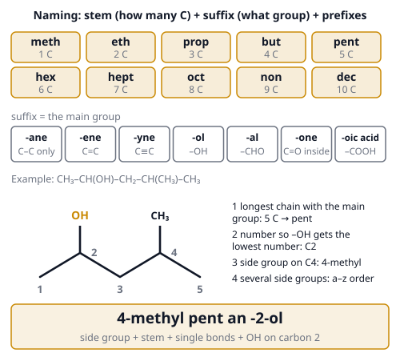
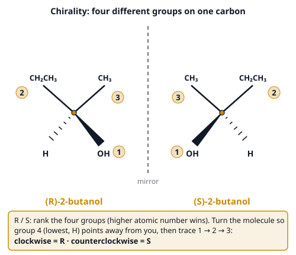
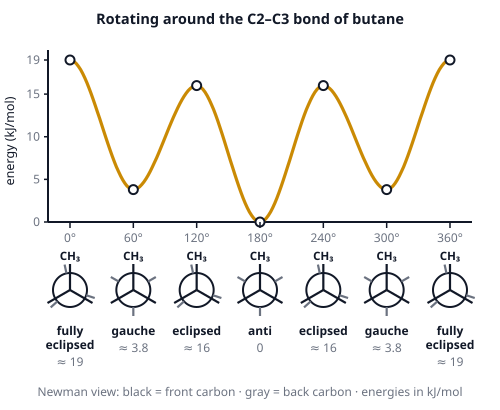

# 🟨 General Concepts of Organic Chemistry  ·  `chemistry.organic.concepts`
> 📅 Study date: Sat 7 Nov · ⏱️ ~12 min read · 📋 Syllabus: Nomenclature, Structures, Arrow pushing mechanisms, Conformational analysis, Stereochemistry and chirality

## 🍳 Start with spearmint and caraway
Chew spearmint gum and then smell caraway seeds in rye bread. They smell completely different. Yet the molecule that makes the smell, **carvone**, has the **same atoms joined in the same order** in both. The only difference: one is the **mirror image** of the other, like your left and right hands. The smell receptors in your nose are shaped like hands themselves, so they can tell the two apart.

Organic chemistry is the chemistry of carbon, and it is all about **shape**: how to name a molecule, how to draw it, how it twists, and whether it has a mirror twin.

## 🖼️ Big picture

The second picture shows what a mirror twin is, and the third shows how a molecule twists around a single bond:

## 💡 Core ideas
1. **Nomenclature (naming).** (1) Find the **longest carbon chain that contains the main functional group**. Its length gives the **stem**: meth, eth, prop, but, pent, hex, hept, oct, non, dec (1–10 C). (2) The **suffix** names the main group: -ane (single bonds), -ene (C=C), -yne (C≡C), -ol (OH), -al (CHO), -one (C=O), -oic acid (COOH). (3) **Number the chain** so the main group gets the **lowest** number. (4) Put the **side groups** in front, with their numbers, in **alphabetical order** (methyl, ethyl, bromo, chloro…). Example: CH₃CH(OH)CH₂CH(CH₃)CH₃ is **4-methylpentan-2-ol**.
2. **Structures.** A **condensed** formula (CH₃CH₂OH) lists atoms in order. In a **skeletal (line) formula** each corner and each line end is a **carbon**, and hydrogens are hidden so that every carbon has **4 bonds**. **Isomers** have the same molecular formula but different structures. The **degree of unsaturation** tells how many rings plus double bonds (a triple bond counts 2): **DoU = (2C + 2 + N − H − X) ÷ 2**.
3. **Arrow pushing.** A **curved arrow** shows where a **pair of electrons moves**. It **starts** at the electron pair (a lone pair or a bond) and **points** to where the pair ends up (an atom, which forms a new bond or a lone pair). Rich in electrons (a **nucleophile**, Nu⁻, often a lone pair) attacks poor in electrons (an **electrophile**, often δ⁺ or a cation). Count the charges at the end: they must add up to the charge at the start.
4. **Conformational analysis.** Atoms can spin around a **single** bond, giving different **conformers** of the same molecule. In a **Newman projection** you look straight down one C–C bond. **Staggered** is more stable than **eclipsed** (the bonds are far apart). For butane looking down C2–C3: **anti** (CH₃ groups opposite) is the lowest energy, **gauche** (60° apart) is about **3.8 kJ/mol** higher, eclipsed is ≈ 16 and fully eclipsed ≈ 19 kJ/mol. In **cyclohexane** the **chair** has no strain; big groups prefer the **equatorial** position (sticking out sideways) over **axial**.
5. **Chirality.** A carbon with **four different groups** is a **stereocenter**. Its molecule and the mirror image **cannot be placed on top of each other**: they are **enantiomers** (same melting point and boiling point, but they rotate polarized light in opposite directions and react differently with other chiral things, like the receptors in your nose). **R/S:** rank the four groups by atomic number (higher first, and go on to the next atoms if tied), point the lowest toward the back, then 1 → 2 → 3 **clockwise = R, counterclockwise = S**.
6. **Counting stereoisomers.** With **n** stereocenters there are **at most 2ⁿ** stereoisomers. **Diastereomers** are stereoisomers that are **not** mirror images. A **meso** compound has stereocenters but also an internal mirror plane, so it is **achiral**. Double bonds give **cis/trans** or **E/Z** isomers (E = higher-priority groups on opposite sides, Z = same side).

> ✋ **Analogy:** your left and right hands are enantiomers: the same parts, mirror arrangement, no overlap. **The difference:** a hand is a whole object, but a molecule can **flip** between conformers by rotating a bond. Enantiomers can **not** become each other by rotating bonds: you must break bonds.

## 🧮 HUSO-style examples

**Example 1.** What is the correct IUPAC name of CH₃CH(OH)CH₂CH(CH₃)CH₃?

(A) 2-methylpentan-4-ol  (B) 4-methylpentan-2-ol  (C) 2-methylpentan-3-ol  (D) 1,3-dimethylbutan-1-ol  (E) 4-methylpentan-3-ol

Steps:
1. The longest chain with the OH has **5 carbons**: pentane. The side group is a methyl, and OH is the main group: **pentanol**.
2. Number from the end that gives OH the **lowest number**. From the left: OH on C2, methyl on C4. From the right: OH on C4. Choose the left.
3. Name: **4-methylpentan-2-ol**. **Answer: (B).**
4. Traps: (A) is the same molecule numbered from the wrong end (it gives OH the higher number); (D) did not use the longest chain; (C) and (E) put the OH on a different carbon, so they are different molecules.

**Example 2.** How many different stereoisomers does CH₃CHBrCHBrCH₃ (2,3-dibromobutane) have?

(A) 2  (B) 3  (C) 4  (D) 6  (E) 8

Steps:
1. There are **two stereocenters** (C2 and C3), so at most 2² = 4 combinations: RR, SS, RS, SR.
2. RR and SS are mirror images of each other: a pair of **enantiomers**.
3. RS and SR are the **same** molecule, because the molecule is symmetric (the two ends are identical). It has an internal mirror plane, so it is the **meso** compound.
4. Total: RR, SS and meso = **3**. **Answer: (B).**

## ⚠️ Common traps
- **Lowest number goes to the main group first**, not to the side groups. Substituents only break a tie.
- **Longest chain, not the straight line you drew.** A chain can bend. The longest chain may run around a corner.
- **A carbon with two identical groups is not a stereocenter**, and a molecule with stereocenters is **not always chiral** (meso).
- **R/S is not "right/left" of the picture:** the lowest-priority group must point **away** from you before you read the direction. If it points toward you, reverse the answer.
- **Conformers are not isomers you can separate**: they interconvert by rotating a single bond. Enantiomers cannot.

## ✏️ Redraw from memory
On paper (6 minutes):
- [ ] The **stems meth → dec** with numbers of carbons, and the 4 steps of naming with one example.
- [ ] A **skeletal formula** of 4-methylpentan-2-ol with the carbons numbered.
- [ ] A **chiral carbon with wedge and dash bonds** and its mirror image across a dashed line, labeled R and S.
- [ ] The **butane energy curve** with anti, gauche and eclipsed marked.
- [ ] **Two curved arrows** for OH⁻ + H–Br → H₂O + Br⁻ (start at the lone pair and at the bond).

## 🎥 Watch / try
- [IUPAC Nomenclature of Alkanes: Part 1](https://www.youtube.com/watch?v=rHyIdxOzj9U) — Professor Dave Explains · 8:01 · follow the four naming steps on real examples
- [Chiral vs Achiral Molecules: Chirality Carbon Centers, Stereoisomers, Enantiomers, & Meso Compounds](https://www.youtube.com/watch?v=KztTL3FTcOw) — The Organic Chemistry Tutor · 11:04 · how to spot a stereocenter and a meso compound
- [R,S system](https://www.youtube.com/watch?v=kFD6hzLseVs) — Khan Academy Organic Chemistry · 9:47 · assigning priorities and reading the direction

## ✅ Check your understanding (5 questions)
Do these without looking at the page. You are **READY** if you get at least 4 out of 5.

**1.** 🍳 (R)-carvone smells like spearmint and (S)-carvone smells like caraway. Both have the same atoms bonded in the same order. How are the two molecules related?

(A) enantiomers  (B) diastereomers  (C) constitutional isomers  (D) conformers  (E) the same molecule

**2.** What is the IUPAC name of CH₃CH₂CH(CH₃)CH₂CH₂CH₃?

(A) 2-ethylpentane  (B) 4-methylhexane  (C) 3-methylhexane  (D) 3-methylheptane  (E) 2-propylbutane

**3.** Looking along the C2–C3 bond of butane, which conformation has the lowest energy?

(A) fully eclipsed (CH₃ groups on top of each other)  (B) partly eclipsed  (C) gauche (CH₃ groups 60° apart)  (D) all conformations have the same energy  (E) anti (CH₃ groups 180° apart)

**4.** In the reaction OH⁻ + H–Br → H₂O + Br⁻, which description of the curved arrows is correct?

(A) one arrow, from the H–Br bond to O  (B) one arrow, from a lone pair on O to Br  (C) two arrows, starting at the H atom and the Br atom  (D) two arrows: from a lone pair on O to H, and from the H–Br bond to Br  (E) three arrows, one for each atom

**5.** 🍳 Vanillin, the main flavor of vanilla, has the formula C₈H₈O₃. What is its degree of unsaturation?

(A) 3  (B) 5  (C) 4  (D) 6  (E) 8

Answer key & explanations

1. **(A) enantiomers.** Same connectivity and each stereocenter inverted means the two are non-superimposable mirror images. Diastereomers differ at only some of several stereocenters (carvone has one). Constitutional isomers would have atoms connected in a different order.
2. **(C) 3-methylhexane.** The longest chain has 6 carbons (hexane) with a methyl group. Numbering from the left puts the methyl on C3, from the right on C4: take the lower number, 3. Choices (A) and (E) are the same molecule named with a shorter chain, (B) numbers from the wrong end, and (D) has the wrong formula (7 carbons).
3. **(E) anti.** The two big CH₃ groups are as far apart as possible, so there is no crowding. The order is anti < gauche < eclipsed < fully eclipsed.
4. **(D) two arrows.** The first arrow starts at an oxygen lone pair and points to H (a new O–H bond forms). The second starts at the H–Br bond and points to Br (it becomes a lone pair on Br⁻). Arrows start at electrons, never at atoms.
5. **(B) 5.** DoU = (2 × 8 + 2 − 8) ÷ 2 = 5. In vanillin that is the benzene ring (1 ring + 3 double bonds = 4) plus the C=O of the aldehyde (1).

