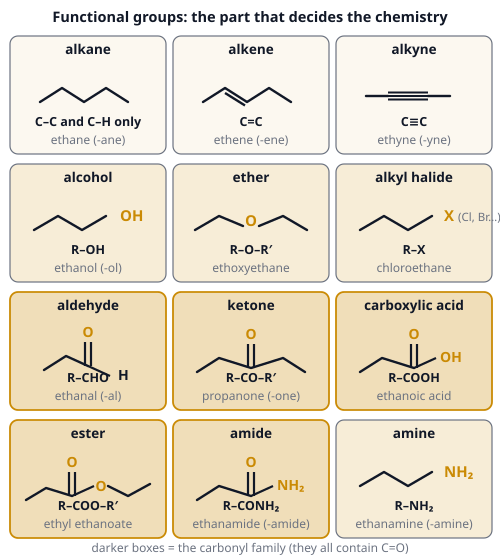
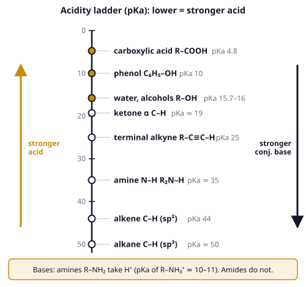

# 🟨 Functional Groups  ·  `chemistry.organic.functional-groups`
> 📅 Study date: Sat 7 Nov · ⏱️ ~12 min read · 📋 Syllabus: Acidity and basicity of functional groups, Alkanes, alkenes and alkynes, Carbonyl compounds

## 🏊 Start with the swimmer's ear drops
After a long swim, water can stay stuck in your ear. A common home trick is a few drops of **rubbing alcohol mixed with white vinegar**. Both bottles are on the shelf and both look like water, but their molecules are very different. Rubbing alcohol has an **–OH** group on a carbon chain. Vinegar is a solution of a molecule with a **–COOH** group, and that one makes it sour.

A **functional group** is a small cluster of atoms that decides how a whole molecule behaves: how it smells, whether it is an acid, how it reacts. Learn the groups, and you can predict the chemistry of a molecule you have never seen.

## 🖼️ Big picture

How acidic is each group? This ladder shows the acid strength as pKa (lower number = stronger acid):

## 💡 Core ideas
1. **Spot the group first.** Hydrocarbons: **alkane** (only single bonds), **alkene** (C=C), **alkyne** (C≡C). With oxygen: **alcohol** R–OH, **ether** R–O–R′. The **carbonyl family** (all have C=O): **aldehyde** R–CHO, **ketone** R–CO–R′, **carboxylic acid** R–COOH, **ester** R–COO–R′, **amide** R–CONH₂. Also **amine** R–NH₂ and **alkyl halide** R–X. The group sets the suffix of the name: -ane, -ene, -yne, -ol, -al, -one, -oic acid, -oate, -amide, -amine.
2. **Alkanes** (C–C and C–H single bonds) are **nonpolar and unreactive**: no electron-rich or electron-poor spots. They **burn** (CₙH₂ₙ₊₂ + O₂ → CO₂ + H₂O) and, in **light**, react with Cl₂ or Br₂ by **radical substitution** (a mess of products). Boiling points go up with chain length and down with branching.
3. **Alkenes and alkynes** are **electron-rich** (π bonds) and do **addition** reactions: H₂ with a Pt catalyst (**hydrogenation**: an alkene takes 1 H₂, an alkyne takes **2 H₂**), Br₂, HX (Markovnikov) and H₂O/H⁺. A **terminal alkyne** (R–C≡C–H) is **weakly acidic** (pKa ≈ 25), because its carbon is **sp** hybridized (50 % s-character holds the negative charge close to the nucleus). A very strong base such as NaNH₂ removes that H. Alkenes can form **polymers** (many C=C add to each other: polyethene).
4. **Acidity and basicity.** An acid is stronger when its **conjugate base is more stable**. Four things stabilize the base: (a) the charge sits on a **more electronegative** atom (O⁻ beats C⁻), (b) **resonance**: the negative charge is spread over several atoms (**carboxylate** has the charge shared by two O atoms, so ethanoic acid pKa ≈ 4.8 but ethanol ≈ 16), (c) **inductive effect**: electron-withdrawing atoms such as Cl nearby (ClCH₂COOH is stronger than CH₃COOH), (d) **hybridization** sp > sp² > sp³. Order: **carboxylic acid (≈ 5) > phenol (≈ 10) > water ≈ alcohol (≈ 16) > ketone α-H (≈ 19) > terminal alkyne (25) > amine N–H (≈ 35) > alkene C–H (44) > alkane C–H (≈ 50).** **Basicity:** **amines** are bases (the N lone pair takes H⁺: R–NH₂ + H⁺ → R–NH₃⁺). **Amides are not basic**, because the N lone pair is spread into the C=O (resonance).
5. **Carbonyl compounds.** The carbon of C=O is δ⁺, so it is attacked by nucleophiles. **Reactivity toward nucleophiles:** **aldehyde > ketone** > ester ≈ acid > amide. **Aldehydes and ketones** undergo **addition** (e.g. NaBH₄ makes an alcohol). Acids and their derivatives (esters, amides) undergo **substitution** at the carbonyl carbon (the –OR or –NH₂ is swapped). **Esterification:** carboxylic acid + alcohol ⇌ ester + water (H₂SO₄ catalyst; esters smell fruity). **Tests:** **Tollens' reagent** (silver mirror) or **Fehling's** solution (red-brown solid) are positive for **aldehydes only**; **2,4-DNP** (orange solid) is positive for both aldehydes and ketones. In IR, C=O gives a strong peak near **1700 cm⁻¹**, and the O–H of an acid gives a very **broad** peak around 3000 cm⁻¹.
6. **Oxidation ladder of alcohols.** Heat with acidified **K₂Cr₂O₇** (orange → green) or KMnO₄. A **primary** alcohol → **aldehyde** (if you distill it out as it forms) → **carboxylic acid** (excess oxidant, reflux). A **secondary** alcohol → **ketone** (and stops). A **tertiary** alcohol: **no reaction**, because the carbon with OH has no H to lose.

> 🧢 **Analogy:** a functional group is like the tool a character carries: the same agent with a different ability plays a different role. **The difference:** a character can swap ability, but a molecule's group changes only by a *reaction*, and the rest of the molecule (the carbon skeleton) still shapes how fast it happens.

## 🧮 HUSO-style examples

**Example 1.** Which list is in order from the **weakest** to the **strongest** acid?

(A) ethane < ethyne < ethanol < phenol < ethanoic acid  (B) ethyne < ethane < ethanol < phenol < ethanoic acid  (C) ethane < ethanol < ethyne < phenol < ethanoic acid  (D) ethane < ethyne < phenol < ethanol < ethanoic acid  (E) ethane < ethyne < ethanol < ethanoic acid < phenol

Steps:
1. Use the pKa ladder: ethane ≈ 50, ethyne 25, ethanol 16, phenol 10, ethanoic acid 4.8.
2. **Weakest acid = highest pKa.** So from weakest to strongest: ethane (50), ethyne (25), ethanol (16), phenol (10), ethanoic acid (4.8).
3. That is **(A)**. **Answer: (A).**
4. Why: ethanoic acid's carboxylate has **resonance**; phenoxide has resonance too (into the ring), but less effectively; an alkoxide has none; an alkyne's carbon is sp, which beats sp³.

**Example 2.** Propan-1-ol is heated under reflux with an **excess** of acidified potassium dichromate(VI). What is the organic product?

(A) propanal  (B) propanone  (C) propanoic acid  (D) propan-2-ol  (E) propene

Steps:
1. Propan-1-ol, CH₃CH₂CH₂OH, is a **primary** alcohol: the carbon with OH has two H's.
2. Oxidation takes it first to the aldehyde, **propanal**.
3. With **excess** oxidant and **reflux** (so the aldehyde cannot escape), it is oxidized further to the acid: **propanoic acid**. **Answer: (C).**
4. Traps: (A) is the answer only if you **distill** the aldehyde out; (B) propanone would need a *secondary* alcohol (propan-2-ol).

## ⚠️ Common traps
- **Alcohol vs carboxylic acid:** both have an O–H, but the carboxylic acid is about **10¹¹ times** more acidic than an alcohol (pKa 5 against 16).
- **Aldehyde vs ketone:** an aldehyde has an H on the C=O carbon, a ketone has two carbons. Tollens' and Fehling's tell them apart; 2,4-DNP does **not**.
- **Tertiary alcohols do not oxidize.** No H on the carbon bearing OH.
- **Amide is not a base**, and not an amine: the N lone pair is tied up in resonance with C=O.
- **Alkenes add; alkanes substitute.** Do not mix them up: an alkene decolorizes bromine water in the dark, an alkane needs light.

## ✏️ Redraw from memory
Draw on paper (6 minutes):
- [ ] The **12 functional groups** with the part that is the group circled (at least the 5 carbonyl ones in the right order of drawing).
- [ ] The **acidity ladder** with at least 6 groups and their pKa values (carboxylic acid ≈ 5 at the top).
- [ ] The **oxidation ladder**: primary alcohol → aldehyde → carboxylic acid, and secondary → ketone, tertiary → ✗.
- [ ] **Resonance of a carboxylate** (two arrows or a double-headed arrow, charge on both O).
- [ ] The **esterification** equation with ethanoic acid and ethanol.

## 🎥 Watch / try
- [Functional Groups](https://www.youtube.com/watch?v=m9jM8lWxrAE) — The Organic Chemistry Tutor · 20:20 · skim for the carbonyl family and the names of each group (watch the first 10 minutes)
- [An Overview of Aldehydes and Ketones: Crash Course Organic Chemistry #27](https://www.youtube.com/watch?v=-fBPX-4kFlw) — CrashCourse · 11:34 · why the C=O carbon is attacked by nucleophiles
- [Learn Functional Groups FAST (Organic Chemistry)](https://www.youtube.com/watch?v=fhvuHPtrXsY) — KnowledgeIsCool · 3:51 · a quick review of the whole zoo

## ✅ Check your understanding (5 questions)
Do these without looking at the page. You are **READY** if you get at least 4 out of 5.

**1.** 🏊 Swimmer's ear drops are made by mixing rubbing alcohol (propan-2-ol) with white vinegar (ethanoic acid). Which functional groups are present in the two ingredients?

(A) an ester and a ketone  (B) an alcohol and a carboxylic acid  (C) an ether and an aldehyde  (D) an alcohol and an ester  (E) a ketone and an amine

**2.** Why is ethanoic acid (pKa 4.8) a much stronger acid than ethanol (pKa 16)?

(A) the ethanoate ion is stabilized by resonance, with the negative charge shared by two oxygens  (B) ethanoic acid has more hydrogen atoms  (C) ethanoic acid is a bigger molecule  (D) ethanol is an ionic compound  (E) the O–H bond in ethanoic acid is non-polar

**3.** Which reagent gives a positive result (a silver mirror) with ethanal but **not** with propanone?

(A) litmus paper  (B) 2,4-dinitrophenylhydrazine  (C) ammonia solution  (D) Tollens' reagent  (E) sodium chloride solution

**4.** How many moles of H₂ are needed to convert 1 mole of hex-1-yne (HC≡C–CH₂CH₂CH₂CH₃) completely into hexane with a Pt catalyst?

(A) 1  (B) 4  (C) 2  (D) 3  (E) 0

**5.** 🍳 Fish smells "fishy" because of small amines such as trimethylamine. Squeezing lemon juice (a weak acid) on the fish reduces the smell. Why?

(A) the amine is oxidized into an alcohol  (B) the acid reduces the amine to an alkane  (C) the amine and the acid form an ester  (D) the amine adds across a C=C bond in the lemon  (E) the amine is a base, so the acid turns it into an ammonium salt that does not evaporate easily

Answer key & explanations

1. **(B) an alcohol and a carboxylic acid.** Propan-2-ol is an alcohol (–OH on a carbon), and ethanoic acid contains –COOH. No ester forms in the mixture and neither contains a nitrogen.
2. **(A) the ethanoate ion is stabilized by resonance.** The negative charge is shared equally by both oxygens, which makes the conjugate base much more stable. An ethoxide ion has the charge on one oxygen only. The number of H atoms and the size of the molecule do not matter, and ethanol is a covalent molecule.
3. **(D) Tollens' reagent.** An aldehyde is oxidized and reduces Ag⁺ to a silver mirror; a ketone is not oxidized. 2,4-DNP reacts with both (orange solid), so it cannot tell them apart.
4. **(C) 2.** A triple bond needs 2 H₂: first it becomes an alkene (1 H₂), then an alkane (1 more H₂). Hexane is C₆H₁₄ and hex-1-yne is C₆H₁₀, so 4 H atoms = 2 H₂.
5. **(E) the amine is a base...** The acid protonates the amine: R₃N + H⁺ → R₃NH⁺. The ammonium ion is a salt, so it does not evaporate easily, and the smell goes away.

