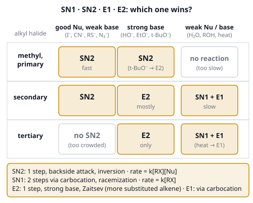
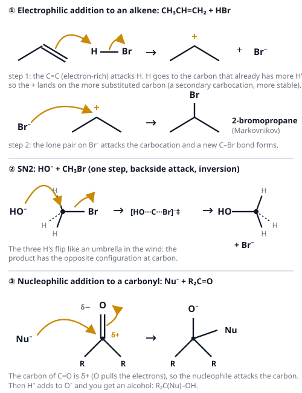

# 🟨 Organic Reactions  ·  `chemistry.organic.reactions`
> 📅 Study date: Sat 7 Nov · ⏱️ ~12 min read · 📋 Syllabus: Electrophilic addition, Nucleophilic substitution, Elimination

## 🎮 Start with attackers and a site
On an attack, the attackers do not rush a site that is well defended. They look for the site that is **weak**, then they push in and a defender is forced out. Many organic reactions are exactly this. A molecule has a carbon that is **electron-poor** (δ⁺, the weak site). An electron-rich particle, the **nucleophile**, is the attacker. It pushes in, and a **leaving group** (the defender) gets kicked out.

In **SN2** the attacker comes in at the same moment the defender goes out: one clean push. In **SN1** the defender leaves first, the site is empty for a moment, and then any attacker can walk in from any side.

**The difference:** electrons do not plan or choose a site. They follow charge (opposite charges attract), and there are no teams. The game picture only helps you remember the *order of events*.

## 🖼️ Big picture

How the electrons move in the three main mechanisms of this topic:

## 💡 Core ideas
1. **Three families.** **Addition:** two groups add across a double bond (C=C or C=O), and the double bond becomes a single bond. **Substitution:** one group is **swapped** for another (a leaving group leaves, a nucleophile enters). **Elimination:** H and a leaving group are **removed** and a C=C forms. Show every step with **curved arrows** (they start at electrons).
2. **Electrophilic addition to alkenes.** The C=C **π bond is electron-rich**, so it attacks an **electrophile** (H⁺ from HBr, or Br₂). The first step makes a **carbocation** (C⁺), and the halide then attacks it. **Markovnikov's rule:** in HX + alkene, H goes to the carbon that **already has more H's**, and X ends up on the **more substituted** carbon. The reason is that the more substituted carbocation is more stable: **3° > 2° > 1° > methyl**. With **Br₂** the orange color disappears (the test for C=C). With **H₂O/H⁺** you get an alcohol; with **H₂/Pt** an alkane.
3. **Addition to carbonyl C=O.** Oxygen pulls the electrons, so the **carbon is δ⁺** (electrophilic) and oxygen is δ⁻. A **nucleophile attacks the carbon**, the π electrons move onto oxygen (O⁻), and then H⁺ makes the alcohol. Hydride (from NaBH₄) turns an aldehyde into a **primary** alcohol and a ketone into a **secondary** alcohol; a Grignard reagent R–MgBr adds an R group and builds a new C–C bond. **Aldehydes are more reactive than ketones** (less crowded and more δ⁺).
4. **Substitution: SN2 and SN1.** **SN2:** one step, the nucleophile attacks from the **back**, **inversion of configuration**, rate = k[RX][Nu] (**second order**). It is fastest at **methyl > primary > secondary** and does not happen at tertiary (too crowded). Best with a strong nucleophile in a polar aprotic solvent (acetone, DMSO). **SN1:** two steps: the leaving group leaves first to make a **carbocation**, then the nucleophile attacks from either face, giving a **racemic mixture**. Rate = k[RX] (**first order**, the nucleophile does not matter). It needs **tertiary** (or other stable carbocations), a weak nucleophile and a polar protic solvent (water, alcohols). **Good leaving groups** are weak bases: **I⁻ > Br⁻ > Cl⁻ ≫ F⁻**, and H₂O (HO⁻ is poor until it is protonated).
5. **Elimination: E2 and E1.** **E2:** one step, a **strong base** pulls off a β-hydrogen (a hydrogen on the carbon next to C–X) while X leaves; rate = k[RX][base]. **E1:** two steps through the same carbocation as SN1, favored by **heat** and weak bases. **Zaitsev's rule:** the **more substituted alkene** (more carbons on the C=C) is the major product. A big, bulky base such as tert-butoxide, (CH₃)₃CO⁻, prefers the less hindered hydrogen and gives the less substituted alkene.
6. **Picking the pathway.** Look at the **carbon**, then at the **reagent**. **Primary:** SN2 (E2 only with a bulky base). **Tertiary:** never SN2; a strong base gives E2, a weak nucleophile (water, alcohol) gives SN1 + E1. **Secondary:** a good nucleophile that is a weak base (I⁻, CN⁻) gives SN2, a strong base gives E2. **Heat** always shifts the balance toward **elimination**.

## 🧮 HUSO-style examples

**Example 1.** 2-Methylbut-2-ene, (CH₃)₂C=CHCH₃, reacts with HBr. What is the major product?

(A) 2-bromo-3-methylbutane  (B) 2-bromo-2-methylbutane  (C) 1-bromo-2-methylbutane  (D) 2,3-dibromo-2-methylbutane  (E) 2-methylbutan-2-ol

Steps:
1. The H⁺ can add to either carbon of the C=C.
2. If H adds to the CH carbon, the carbocation is on the carbon with **two methyls**: it is **tertiary**. If H adds to the C(CH₃)₂ carbon, the carbocation is secondary. Tertiary is more stable, so that path wins.
3. Br⁻ attacks the tertiary carbocation: Br ends up on C2 together with the methyl: **2-bromo-2-methylbutane**. **Answer: (B).**
4. Traps: (A) is the anti-Markovnikov product (secondary); (D) would come from Br₂; (E) from H₂O/H⁺; (C) puts Br on a CH₂ end, which is not formed.

**Example 2.** (R)-2-Bromobutane reacts with sodium iodide in acetone by the SN2 mechanism. What is the product?

(A) (R)-2-iodobutane  (B) (S)-2-iodobutane  (C) a 1 : 1 mixture of (R)- and (S)-2-iodobutane  (D) but-2-ene  (E) 1-iodobutane

Steps:
1. NaI in acetone: iodide is a good nucleophile and a weak base, acetone is polar aprotic: **SN2**.
2. SN2 means **backside attack, inversion** of configuration at the carbon.
3. The priorities are the same in the reactant and the product (Br or I first, then ethyl, then methyl, then H), so inversion changes the label: R → **S**.
4. Product: **(S)-2-iodobutane**. **Answer: (B).**
5. Traps: (A) is retention (it would need two inversions); (C) is what SN1 would give; (D) needs a strong base.

## ⚠️ Common traps
- **Inversion changes the 3D arrangement**, but whether the letter changes from R to S depends on the priorities. Re-rank the groups in the product if the nucleophile has a different priority.
- **Markovnikov is about stability, not about "more H's wins" as a magic rule.** If a more stable carbocation can form, it wins (even with rearrangements, in harder problems).
- **Tertiary halides never do SN2**, and primary halides almost never do SN1.
- **A strong base is not the same as a good nucleophile.** HO⁻ and ethoxide are both, but I⁻ and CN⁻ are good nucleophiles and weak bases. t-BuO⁻ is a strong base but a poor nucleophile.
- **Br₂ addition and substitution look the same (the color vanishes).** Alkenes decolorize bromine water instantly in the dark; alkanes need light and react slowly.

## ✏️ Redraw from memory
Draw on paper (6 minutes, use two colors for electrons and charges):
- [ ] The mechanism of **HBr + propene** with 3 curved arrows and the carbocation.
- [ ] **SN2** with the nucleophile attacking from the back and the three groups flipping.
- [ ] **SN1** in two steps (leaving group first, carbocation flat, attack from either side).
- [ ] The **3 × 3 table** (methyl or primary, secondary, tertiary × good Nu, strong base, weak Nu).
- [ ] **E2** with the base removing a β-hydrogen, and the major (Zaitsev) product named.

## 🎥 Watch / try
- [SN1/SN2/E1/E2 Reaction Mechanism Overview](https://www.youtube.com/watch?v=OWHCYY2FJGc) — Leah4sci · 7:29 · see the four mechanisms side by side
- [An Animated Explanation of Electrophilic Addition](https://www.youtube.com/watch?v=_yNnJVncD0k) — Chemistorian · 5:34 · follow the curved arrows from the double bond to the bromide
- [Choosing Between SN1/SN2/E1/E2 Mechanisms](https://www.youtube.com/watch?v=IOViLLuDMTs) — Professor Dave Explains · 18:52 · practice picking the pathway (watch the first 8 minutes)

## ✅ Check your understanding (5 questions)
Do these without looking at the page. You are **READY** if you get at least 4 out of 5.

**1.** Which alkyl bromide reacts fastest with sodium iodide in acetone (SN2)?

(A) (CH₃)₃CBr  (B) (CH₃)₂CHBr  (C) CH₃CH₂Br  (D) CH₃Br  (E) all react at the same rate

**2.** 2-Bromo-2-methylbutane is heated with sodium ethoxide (a strong base) in ethanol. What is the major product?

(A) 2-methylbut-1-ene  (B) 3-methylbut-1-ene  (C) 2-ethoxy-2-methylbutane  (D) 2-methylbutan-2-ol  (E) 2-methylbut-2-ene

**3.** 🎮 Suppose a defender (the leaving group) leaves a site on its own first, and only afterwards does any attacker walk in. In chemistry terms, which mechanism is this, and what happens to the rate if you triple the concentration of the nucleophile?

(A) SN2; the rate triples  (B) SN1; the rate does not change  (C) SN1; the rate triples  (D) SN2; the rate does not change  (E) E2; the rate triples

**4.** Which compound reacts fastest with a nucleophile such as NaBH₄ (addition to C=O)?

(A) pentan-3-one  (B) propanone  (C) ethanal  (D) 2,4-dimethylpentan-3-one  (E) ethyl ethanoate

**5.** 🍳 A cook shakes a few drops of orange bromine water with a sample of cooking oil. The orange color disappears at once. What does this show?

(A) the oil has C=C bonds, which add Br₂  (B) the oil has OH groups, which are substituted by Br  (C) the oil has only single bonds, which react quickly in the dark  (D) the oil is acidic  (E) the oil has carbonyl groups, which Br₂ reduces

Answer key & explanations

1. **(D) CH₃Br.** SN2 is blocked by crowding at the carbon, so the order is methyl > primary > secondary ≫ tertiary. Choice (A) tertiary would not react by SN2 at all.
2. **(E) 2-methylbut-2-ene.** A strong base on a tertiary halide gives E2. By Zaitsev's rule, the more substituted alkene (three carbons on the C=C) is the major product, not the less substituted 2-methylbut-1-ene (A). Tertiary halides do not do SN2, and (C) or (D) would be SN1 with a weak nucleophile.
3. **(B) SN1; the rate does not change.** The slow first step is the leaving group leaving, so rate = k[RX] and does not depend on the nucleophile. In SN2 the rate depends on both.
4. **(C) ethanal.** An aldehyde carbon with only one alkyl group is the least crowded and the most δ⁺. Ketones are slower, and the more crowded the ketone, the slower (D is the slowest of the ketones). An ester (E) is the least reactive because the oxygen on the carbon donates electrons into C=O.
5. **(A) the oil has C=C bonds, which add Br₂.** Bromine adds across C=C bonds immediately (the electrophilic addition), which uses up the orange Br₂. Alkanes (only single bonds) do not react in the dark.

