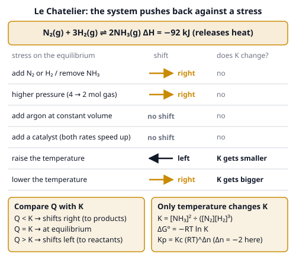
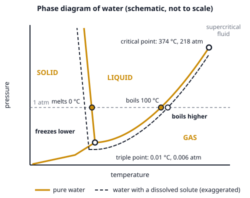

# 🟨 Equilibrium  ·  `chemistry.physical.equilibrium`
> 📅 Study date: Sat 31 Oct · ⏱️ ~12 min read · 📋 Syllabus: Le Chatelier's principle, Ideal gas law, Phase diagrams, Boiling point elevation and freezing point depression, Kc and Kp, K and Gibbs free energy, Solubility product

## 🏊 Start with the pool chemicals
The germ-killer in pool water is a molecule called **HOCl**. But HOCl does not just sit there: it keeps splitting into H⁺ and OCl⁻, and the pieces keep joining back to HOCl, at the same speed. The pool person adjusts the **pH** so that more of the water's chlorine stays as HOCl, because HOCl kills germs much better than OCl⁻.

That is **equilibrium**: a reaction that goes both ways at once, until nothing seems to change. Push on it (add acid, heat it, squeeze it) and it quietly **re-balances**.

## 🖼️ Big picture

Two more pictures: the **phase diagram** (equilibrium between solid, liquid and gas) and how a dissolved solute moves it.

## 💡 Core ideas
1. **Dynamic equilibrium and K.** At equilibrium the forward and backward rates are **equal** (not the concentrations!). For aA + bB ⇌ cC + dD: **K = [C]ᶜ[D]ᵈ ÷ ([A]ᵃ[B]ᵇ)**. Pure solids and pure liquids are **left out**. Big K: mostly products. Small K: mostly reactants. **K depends only on temperature.** Reverse the reaction: K → 1/K. Double the equation: K → K². **Q** is the same fraction with *current* amounts: **Q < K** → shifts right; **Q > K** → shifts left. The **solubility product Ksp** is just K for a solid dissolving, for example Ksp = [Ag⁺][Cl⁻] for AgCl(s) ⇌ Ag⁺ + Cl⁻.
2. **ICE table.** Write **I**nitial, **C**hange (−x, +2x according to the coefficients), **E**quilibrium. Put the equilibrium row into K and solve for x. Always check that no concentration goes negative.
3. **Kp and Kc.** For gases you can use partial pressures: **Kp = Kc · (RT)^Δn**, where **Δn = (moles of gas on the right) − (moles of gas on the left)**, R = 0.08206 L·atm/(mol·K), pressures in atm. If Δn = 0, Kp = Kc. Partial pressure = mole fraction × total pressure.
4. **Le Chatelier's principle.** If you disturb an equilibrium, it **shifts to partly undo the disturbance**. Add a substance → it shifts away from it. Squeeze (higher pressure) → toward **fewer gas moles**. **Heat** is like a reactant or product: raising T favors the **endothermic** direction. A **catalyst** and an **inert gas at constant volume** do **not** shift anything (a catalyst only gets you there faster). Only a change of **temperature** changes the value of K.
5. **K and Gibbs free energy.** **ΔG° = −RT ln K** (R = 8.314 J/(mol·K), T in kelvin). If ΔG° < 0, then K > 1. If ΔG° = 0, K = 1. A shortcut: ΔG° of **−5.7 kJ/mol gives K ≈ 10** at 25 °C, and each extra −5.7 kJ multiplies K by 10 again. More generally ΔG = ΔG° + RT ln Q; at equilibrium ΔG = 0.
6. **Gases, phases and solutions.** **Ideal gas law: PV = nRT.** Density gives molar mass: **M = dRT ÷ P**. On a **phase diagram** every line is an equilibrium between two phases. The **triple point** has all three phases; past the **critical point** there is no liquid–gas difference. Water's solid–liquid line leans backward (ice melts under pressure). A dissolved solute lowers the freezing point and raises the boiling point: **ΔT = i · K · m**, with **Kb = 0.512** and **Kf = 1.86 °C·kg/mol** for water, **m** = molality (mol solute per kg solvent) and **i** = number of particles per formula (glucose 1, NaCl 2, CaCl₂ 3).

> ⚖️ **Analogy:** equilibrium is like a swimmer treading water in the middle of the pool: arms and legs are moving all the time, but the swimmer is not going anywhere. **The difference:** a swimmer stays at the middle only by effort, while a chemical equilibrium has no "effort"; it is just two equal rates, and the position is set by K.

## 🧮 HUSO-style examples

**Example 1.** 1.00 mol of H₂ and 1.00 mol of I₂ are placed in a 1.00 L flask. They react: H₂ + I₂ ⇌ 2HI. At equilibrium [HI] = 1.60 M. What is Kc?

(A) 0.016  (B) 4.0  (C) 40  (D) 64  (E) 13

Steps (ICE table, in M):
1. Initial: H₂ = 1.00, I₂ = 1.00, HI = 0.
2. Change: HI goes up by **2x**, H₂ and I₂ each go down by **x**.
3. Equilibrium HI = 2x = 1.60, so **x = 0.80** and H₂ = I₂ = 1.00 − 0.80 = **0.20**.
4. Kc = [HI]² ÷ ([H₂][I₂]) = 1.60² ÷ (0.20 × 0.20) = 2.56 ÷ 0.04 = **64**. **Answer: (D).**
5. Traps: (C) 40 forgets to square [HI]; (A) 0.016 flips the fraction; (B) 4.0 uses 0.80 for H₂.

**Example 2.** For N₂O₄(g) ⇌ 2NO₂(g), Kc = 0.0050 at 400 K. What is Kp at 400 K? (R = 0.08206 L·atm/(mol·K))

(A) 1.5 × 10⁻⁴  (B) 0.0050  (C) 0.164  (D) 1.64  (E) 6.1

Steps:
1. Δn = 2 (NO₂) − 1 (N₂O₄) = **+1**.
2. Kp = Kc · (RT)^Δn = 0.0050 × (0.08206 × 400) = 0.0050 × 32.8 = **0.164**. **Answer: (C).**
3. Traps: (A) divides by RT instead of multiplying; (B) assumes Kp = Kc; (E) is 1/0.164.

## ⚠️ Common traps
- **Equal rates, not equal amounts.** At equilibrium the concentrations are constant, but rarely equal.
- **Only temperature changes K.** Pressure, concentration and catalysts can change *where you are*, but never the value of K.
- **Inert gas:** adding argon at constant volume changes the total pressure but not the partial pressures, so nothing shifts. A catalyst does not shift anything either.
- **Units and signs:** use kelvin in ΔG° = −RT ln K, and use joules for R = 8.314 J/(mol·K) (so convert kJ to J). A negative ΔG° means K > 1, *not* K < 0.
- **Colligative properties count particles:** 0.10 m CaCl₂ lowers the freezing point three times more than 0.10 m glucose. And one tablespoon of salt in the pasta pot raises the boiling point by only a tiny amount.

## ✏️ Redraw from memory
Close the page and draw from memory (6 minutes):
- [ ] The **water phase diagram**: three regions, triple point, critical point, the 1 atm line with the melting and boiling points.
- [ ] The **dashed shift** for a solution: freezing line to the left, boiling point to the right.
- [ ] A **Le Chatelier table** with the five stresses (add reactant, pressure, inert gas, catalyst, temperature).
- [ ] An **ICE table** for H₂ + I₂ ⇌ 2HI with the numbers from Example 1.
- [ ] The formulas **ΔG° = −RT ln K**, **Kp = Kc(RT)^Δn**, **ΔT = i·K·m**.

## 🎥 Watch / try
- [Le Chatelier's Principle](https://www.youtube.com/watch?v=XmgRRmxS3is) — Professor Dave Explains · 4:09 · see each stress and which way the reaction shifts
- [Free energy and the equilibrium constant](https://www.youtube.com/watch?v=F1k8TJsVg_g) — Bozeman Science · 6:45 · how ΔG° and K are two views of the same thing
- [Phase diagrams](https://www.youtube.com/watch?v=Qp87Z4m8R-w) — Khan Academy · 12:36 · how to read triple points and why water's solid–liquid line leans backward

## ✅ Check your understanding (5 questions)
Do these without looking at the page. You are **READY** if you get at least 4 out of 5.

**1.** For the exothermic reaction 2SO₂(g) + O₂(g) ⇌ 2SO₃(g), which change **increases the value of K**?

(A) increasing the pressure  (B) adding more O₂  (C) adding a catalyst  (D) decreasing the temperature  (E) removing SO₃

**2.** A reaction has ΔG° = −5.71 kJ/mol at 298 K. What is K? (R = 8.314 J/(mol·K))

(A) 0.10  (B) 2.3  (C) 10  (D) 5.7  (E) 100

**3.** 🍳 A cook dissolves 20.0 g of table salt (NaCl, molar mass 58.4 g/mol) in 2.00 kg of water for pasta. By how much does the boiling point rise? (Kb = 0.512 °C·kg/mol; NaCl gives 2 particles.)

(A) 0.0877 °C  (B) 0.175 °C  (C) 0.351 °C  (D) 0.0438 °C  (E) 0.685 °C

**4.** 🍳 A chef uses dry ice for fog. The triple point of CO₂ is at 5.11 atm and −56.6 °C. A block of dry ice sits in a kitchen at 1.00 atm and 25 °C. What happens to it?

(A) It turns directly into a gas  (B) It melts into a liquid, then boils  (C) It stays solid  (D) It melts and then freezes again  (E) It becomes a liquid that stays liquid

**5.** A gas has a density of 1.96 g/L at 273.15 K and 1.00 atm. Which gas is it most likely to be? (R = 0.08206 L·atm/(mol·K))

(A) N₂ (28.0 g/mol)  (B) O₂ (32.0 g/mol)  (C) SO₂ (64.1 g/mol)  (D) Cl₂ (71.0 g/mol)  (E) CO₂ (44.0 g/mol)

Answer key & explanations

1. **(D) decreasing the temperature.** Only temperature changes K. The reaction is exothermic, so cooling shifts it toward SO₃ and makes K bigger. Pressure, extra O₂ and removing SO₃ shift the position but leave K unchanged, and a catalyst does neither.
2. **(C) 10.** ln K = 5710 ÷ (8.314 × 298) = 2.30, and e²·³⁰ = 10. Choice (B) 2.3 is ln K itself, and (A) 0.10 has the wrong sign.
3. **(B) 0.175 °C.** Moles NaCl = 20.0 ÷ 58.4 = 0.342 mol. Molality = 0.342 ÷ 2.00 = 0.171 mol/kg. ΔT = i·Kb·m = 2 × 0.512 × 0.171 = 0.175 °C. Choice (A) forgets i = 2; (C) uses 1.00 kg of water instead of 2.00 kg; (E) multiplies the moles by 2 and forgets Kb. The effect is tiny: salt in pasta water is for taste, not for boiling faster.
4. **(A) It turns directly into a gas.** At 1.00 atm the pressure is *below* the triple-point pressure (5.11 atm), so liquid CO₂ cannot exist. The solid **sublimes** straight to gas.
5. **(E) CO₂ (44.0 g/mol).** M = dRT ÷ P = 1.96 × 0.08206 × 273.15 ÷ 1.00 = 43.9 g/mol, which matches CO₂ (44.0).

