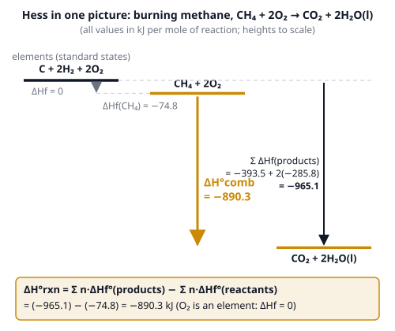
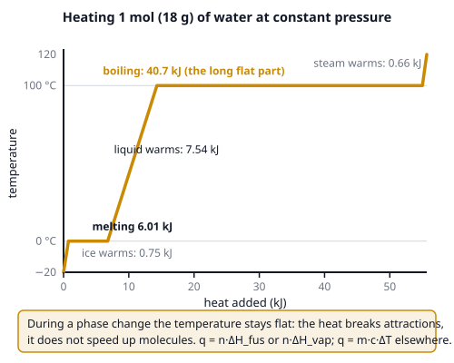

# 🟨 Thermochemistry  ·  `chemistry.physical.thermo`
> 📅 Study date: Sat 31 Oct · ⏱️ ~12 min read · 📋 Syllabus: First law (energy, heat, work), Entropy, Enthalpy of formation, Enthalpy of phase transitions, Bond dissociation enthalpy, Hess's law, Lattice energy

## 🏊 Start with stepping out of the pool
You climb out of the pool on a warm day and you shiver. The air is not cold. The water on your skin is **evaporating**, and evaporating water takes energy from you: about **40.7 kJ for every mole** (18 g) of water that turns to vapor. Your skin is the "surroundings" that pays the energy bill.

**Thermochemistry** is the bookkeeping of that energy: where it goes in a reaction or a phase change, how much, and whether the process happens by itself.

## 🖼️ Big picture

And the energy bill for a phase change:

## 💡 Core ideas
1. **First law: ΔU = q + w.** The **system** is the thing you study, the **surroundings** is everything else. In chemistry, **q** is heat *added to* the system and **w** is work done *on* the system (so squeezing a gas gives w > 0). Energy is only moved, never made or lost. Careful: many physics books write ΔU = Q − W with W done *by* the gas; the physics is the same, the sign of W is flipped. For gas expansion at constant pressure: **w = −PΔV**. Heat in a calorimeter: **q = m·c·ΔT** (water: c = 4.184 J/(g·°C)), and q(reaction) = −q(water).
2. **Enthalpy.** At **constant pressure** the heat exchanged is **ΔH** (enthalpy change). **ΔH < 0: exothermic** (heat released, the surroundings warm up). **ΔH > 0: endothermic** (heat absorbed). The **standard enthalpy of formation ΔHf°** is the ΔH to make **1 mole** of a compound from its **elements in their standard states**. For an element in its standard state (O₂, graphite, H₂) **ΔHf° = 0**. Then: **ΔH°rxn = Σ n·ΔHf°(products) − Σ n·ΔHf°(reactants)**.
3. **Hess's law.** ΔH depends only on the start and the end, not on the route (it is a **state function**). So you can add reactions and add their ΔH. **Reverse a reaction → change the sign of ΔH. Multiply a reaction by n → multiply ΔH by n.** The **lattice energy** (energy released when gaseous ions pack into 1 mole of solid; or the energy needed to pull them apart) can be found this way (**Born–Haber cycle**). It gets bigger with **higher charges** and **smaller ions**: MgO ≫ NaCl.
4. **Bond enthalpies.** Breaking a bond **costs** energy; making a bond **gives back** energy. **ΔH ≈ Σ (bonds broken) − Σ (bonds formed)**, all in the gas phase. It is only an estimate, because bond enthalpies are averages. Handy values (kJ/mol): H–H 436, Cl–Cl 243, H–Cl 431, N≡N 945, N–H 391.
5. **Phase transitions.** The temperature stays **flat** during melting and boiling, because the heat goes into breaking attractions between molecules. **q = n·ΔH_fus** (water: **6.01 kJ/mol**) or **q = n·ΔH_vap** (water: **40.7 kJ/mol**). Sublimation = fusion + vaporization: ΔH_sub = ΔH_fus + ΔH_vap (Hess again). Going the other way (freezing, condensing) gives back the same energy with the opposite sign.
6. **Entropy and spontaneity.** **Entropy S** measures how spread out the energy and the particles are (more ways to arrange them). **Gas ≫ liquid > solid**, and more moles of gas means more entropy. **ΔS°rxn = Σ S°(products) − Σ S°(reactants)**. The second law says the total entropy of the universe goes up. Combine both into **ΔG = ΔH − TΔS** (T in kelvin): **ΔG < 0 means spontaneous.** Signs: **ΔH −, ΔS +: always spontaneous. ΔH +, ΔS −: never. ΔH −, ΔS −: only at low T. ΔH +, ΔS +: only at high T** (the switch is at T = ΔH/ΔS).

> ⛰️ **Analogy:** a state function is like altitude: going from camp A to camp B, the change in height is the same by any trail, just like ΔH is the same by any reaction path. **The difference:** the *effort* you spend (heat and work) does depend on the trail. Only ΔH, ΔU, ΔS and ΔG are the same for every route.

## 🧮 HUSO-style examples

**Example 1.** Use these standard enthalpies of formation: CH₄(g) −74.8 kJ/mol, CO₂(g) −393.5 kJ/mol, H₂O(l) −285.8 kJ/mol. What is ΔH° for CH₄(g) + 2O₂(g) → CO₂(g) + 2H₂O(l)?

(A) +890.3 kJ  (B) −604.5 kJ  (C) −890.3 kJ  (D) −1039.9 kJ  (E) −802.3 kJ

Steps:
1. Products: −393.5 + 2(−285.8) = −965.1 kJ. (Water has **two** moles.)
2. Reactants: −74.8 + 2(0) = −74.8 kJ. (O₂ is an element, so 0.)
3. ΔH° = (−965.1) − (−74.8) = **−890.3 kJ**. **Answer: (C).**
4. Traps: (A) has the wrong sign; (B) forgets the 2 in front of H₂O; (D) adds the reactants instead of subtracting; (E) uses H₂O(g) (−241.8) instead of H₂O(l).

**Example 2.** Given: (1) C(s) + O₂(g) → CO₂(g), ΔH = −393.5 kJ and (2) CO(g) + ½O₂(g) → CO₂(g), ΔH = −283.0 kJ. What is ΔH for C(s) + ½O₂(g) → CO(g)? (You cannot measure it directly, because some CO₂ always forms too.)

(A) −676.5 kJ  (B) −110.5 kJ  (C) +110.5 kJ  (D) −393.5 kJ  (E) +676.5 kJ

Steps:
1. Keep (1): C + O₂ → CO₂, ΔH = −393.5.
2. **Reverse** (2): CO₂ → CO + ½O₂, ΔH = **+283.0**.
3. Add them. The CO₂ cancels, and O₂ − ½O₂ leaves ½O₂: C + ½O₂ → CO.
4. ΔH = −393.5 + 283.0 = **−110.5 kJ**. **Answer: (B).**
5. Sense check: burning C all the way to CO₂ releases more heat than burning it only to CO, so −110.5 is smaller in size than −393.5. ✓

## ⚠️ Common traps
- **Sign of reversing:** reversing a reaction flips the sign of ΔH. Doubling the equation doubles ΔH.
- **Products − reactants** (for ΔHf°), but **broken − formed** (for bond enthalpies). They are opposite ways around, so write which one you use.
- **Units:** ΔH is in **kJ**, ΔS is in **J/(mol·K)**. Convert before ΔG = ΔH − TΔS, and use kelvin.
- **Phase matters:** H₂O(l) and H₂O(g) have different ΔHf° (−285.8 and −241.8 kJ/mol).
- **Temperature does not change during a phase change.** Adding heat to boiling water does not make it hotter than 100 °C (at 1 atm).

## ✏️ Redraw from memory
Draw on paper (6 minutes):
- [ ] The **heating curve** of water with the two flat steps (melting, boiling) and which one is longer.
- [ ] A **Hess energy-level diagram** with elements at 0, reactants, products, and an arrow for ΔH°rxn.
- [ ] The formula **ΔH°rxn = Σ ΔHf°(products) − Σ ΔHf°(reactants)**.
- [ ] The **bond enthalpy rule**: broken (+) minus formed (−), with H₂ + Cl₂ → 2HCl as the example.
- [ ] The **four sign cases of ΔG = ΔH − TΔS** as a 2 × 2 table.

## 🎥 Watch / try
- [Hess's Law and Heats of Formation](https://www.youtube.com/watch?v=2q2u5sj4V00) — Professor Dave Explains · 4:58 · see how to flip and add reactions
- [Enthalpy of formation](https://www.youtube.com/watch?v=TNwGNHqwHxc) — Khan Academy · 9:25 · why elements in their standard state are zero
- [The Laws of Thermodynamics, Entropy, and Gibbs Free Energy](https://www.youtube.com/watch?v=8N1BxHgsoOw) — Professor Dave Explains · 8:12 · how ΔH and ΔS decide spontaneity

## ✅ Check your understanding (5 questions)
Do these without looking at the page. You are **READY** if you get at least 4 out of 5.

**1.** 🍳 A pot holds 500 g of water already at 100 °C. How much heat is needed to boil it all away? (ΔH_vap = 40.7 kJ/mol; molar mass of water 18.0 g/mol)

(A) 167 kJ  (B) 1130 kJ  (C) 20 350 kJ  (D) 209 kJ  (E) 40.7 kJ

**2.** Estimate ΔH for N₂(g) + 3H₂(g) → 2NH₃(g) with bond enthalpies N≡N 945, H–H 436 and N–H 391 kJ/mol.

(A) +93 kJ  (B) +1080 kJ  (C) −965 kJ  (D) +1471 kJ  (E) −93 kJ

**3.** Melting ice has ΔH = +6.01 kJ/mol and ΔS = +22.0 J/(mol·K). Above which temperature is melting spontaneous?

(A) 0.273 K  (B) 3.66 K  (C) 273 K  (D) 373 K  (E) 3660 K

**4.** Which compound has the **largest** lattice energy?

(A) MgO  (B) NaCl  (C) KBr  (D) CsI  (E) LiF

**5.** 🏊 A pump compresses the air in a pool float. The pump does 200 J of work on the air, while 50 J of heat flows out of the air into the pump wall. What is ΔU of the air?

(A) −150 J  (B) +250 J  (C) −250 J  (D) +150 J  (E) +200 J

Answer key & explanations

1. **(B) 1130 kJ.** n = 500 ÷ 18.0 = 27.8 mol, and q = 27.8 × 40.7 = 1130 kJ. It is already at 100 °C, so no heating step is needed. Choice (A) uses the melting value 6.01; (C) uses grams instead of moles; (D) is the heat to warm the water from 0 to 100 °C; (E) is just one mole.
2. **(E) −93 kJ.** Bonds broken: 945 + 3 × 436 = 2253 kJ. Bonds formed: 2 NH₃ has **6** N–H bonds = 6 × 391 = 2346 kJ. ΔH = 2253 − 2346 = −93 kJ. Choice (A) swaps broken and formed; (B) counts only 3 N–H bonds; (C) forgets the 3 in front of H₂.
3. **(C) 273 K.** ΔG = 0 when T = ΔH/ΔS = 6010 J ÷ 22.0 J/K = 273 K (0 °C). Above that ΔG < 0. Choice (A) forgets to convert kJ to J; (E) divides the other way; (D) is the boiling point of water.
4. **(A) MgO.** Lattice energy grows with the ion charges (Mg²⁺ and O²⁻ against 1+ and 1−) and with smaller ions. The charge effect beats the others, so MgO is by far the largest. Among the others, small LiF is bigger than NaCl, KBr and CsI.
5. **(D) +150 J.** In the chemistry sign convention ΔU = q + w = (−50) + (+200) = +150 J. Choice (C) uses w = −200 (the physics W), and (E) ignores the heat.

