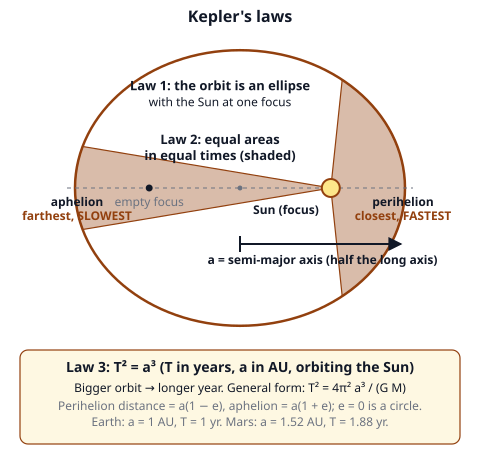
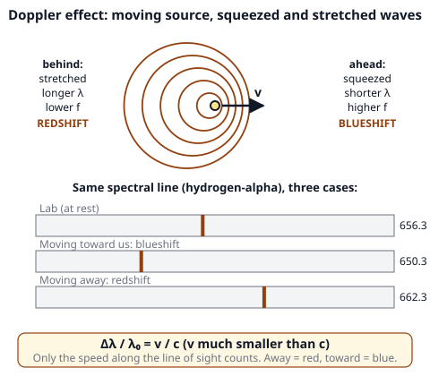
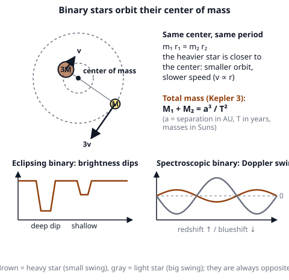

# 🟫 Celestial Mechanics  ·  `earth.astronomy.mechanics`
> 📅 Study date: Sun 25 Oct · ⏱️ ~12 min read · 📋 Syllabus: Kepler's laws, Gravitational force, Binary stars, Doppler effect

## 🎮 Start with a round timer
Suppose every round in a game must be finished in exactly the same time. Planets do not play like that. Mercury finishes one lap around the Sun in 88 days, Earth in one year, and Neptune needs about 165 years. **The farther the planet, the longer the lap.** One clean rule connects every planet: Kepler's third law. And the same gravity that holds the planets also makes two stars dance around each other. **The difference:** a round timer is fixed by the game's rules; a planet's lap time is set by its distance and the Sun's gravity.

## 🖼️ Big picture

## 💡 Core ideas
1. **Kepler's three laws.**
   - **Law 1:** every planet moves on an **ellipse** with the Sun at **one focus** (the other focus is empty). The long half-axis is **a** (the *semi-major axis*). The closest point to the Sun is **perihelion**, a(1 − e), and the farthest is **aphelion**, a(1 + e), where **e** is the eccentricity (0 = circle). Earth has e = 0.017, almost a circle.
   - **Law 2:** the line from the Sun to the planet sweeps out **equal areas in equal times**. So a planet moves **fastest at perihelion** and **slowest at aphelion**.
   - **Law 3:** **T² = a³** when T is in **years** and a is in **AU** (1 AU = the Earth–Sun distance). A planet with a 4 times bigger orbit takes 8 times longer (4³ = 64, √64 = 8).
2. **Gravitational force.** Newton: **F = G M m / r²** (r is the distance between the centers). Gravity is the force that makes Kepler's laws happen. For a **circular orbit** gravity gives the centripetal force: **v = √(GM/r)**. Farther means slower. The speed needed to **escape** completely is **v_esc = √(2GM/r)**, which is √2 ≈ 1.41 times the circular orbit speed. Newton's form of the third law, for any two bodies: **T² = 4π² a³ / (G (M₁ + M₂))**. (Earth moves at about 29.8 km/s around the Sun. Its escape speed from the ground is 11.2 km/s.)
3. **Binary stars** are two stars that orbit their common **center of mass**. The heavier star is closer to the center and moves slower: **m₁ r₁ = m₂ r₂**, so r₁/r₂ = m₂/m₁ and v₁/v₂ = m₂/m₁. The separation is a = r₁ + r₂. Kepler's third law gives the **total mass**: **M₁ + M₂ = a³ / T²** (a in AU, T in years, mass in Suns). Binaries are found in several ways: **visual** (you see two stars), **eclipsing** (the brightness dips when one star passes in front of the other), **spectroscopic** (the spectral lines swing back and forth) and **astrometric** (a single star wobbles).
4. **Doppler effect.** When a source of waves moves, the waves get squeezed ahead of it and stretched behind it. **Light:** source **moving away** → longer wavelength → **redshift**. Source **moving toward** us → shorter wavelength → **blueshift**. For speeds much smaller than the speed of light **c = 3.0 × 10⁵ km/s**: **Δλ / λ₀ = v / c**, where λ₀ is the wavelength measured in the lab. Only the **radial speed** (along your line of sight) counts. **Sound** works the same way: a siren sounds higher while it comes toward you and lower after it passes: f = f₀ · v_sound / (v_sound ∓ v_source) (− while approaching, + while leaving).
5. **What astronomers use it for.** Doppler shifts measure the speeds of stars and galaxies. A **spectroscopic binary** shows two sets of lines that swing in opposite directions; the heavier star has the smaller swing. A planet makes its star wobble too, which is one way to find exoplanets. Distant galaxies are **redshifted** because the universe is expanding.

> 🎮 **Analogy:** a planet far from the Sun is like a player running the outer lane of a track: the longer path and the weaker pull mean a longer lap. **The difference:** a runner chooses a speed, but a planet's speed is fixed by its distance (v = √(GM/r)).

## 🧮 HUSO-style examples

**Example 1.** An asteroid orbits the Sun with a semi-major axis of **4 AU**. What is its orbital period?

(A) 2 years  (B) 4 years  (C) 8 years  (D) 16 years  (E) 64 years

Steps:
1. Kepler's third law: T² = a³ (years and AU, because the Sun is the central body).
2. a³ = 4³ = 64.
3. T = √64 = **8 years**. **Answer: (C).**
4. Traps: (B) says T = a. (D) says T = a². (E) forgets the square root (T² = 64). (A) takes √a.

**Example 2.** Two stars orbit each other with a period of **4 years**. Their average separation is **6 AU**. What is the total mass of the pair?

(A) 1.5 solar masses  (B) 9 solar masses  (C) 13.5 solar masses  (D) 54 solar masses  (E) 216 solar masses

Steps:
1. For two stars: M₁ + M₂ = a³ / T², with a the separation in AU and T in years.
2. a³ = 6³ = 216 and T² = 4² = 16.
3. M₁ + M₂ = 216 ÷ 16 = **13.5 solar masses**. **Answer: (C).**
4. Traps: (E) forgets to divide by T². (D) divides by T instead of T². (B) uses a² ÷ T. (A) divides a by T.

## ⚠️ Common traps
- **Units for T² = a³.** It only works with **years** and **AU** around the Sun. For other units, use T² = 4π²a³/(GM).
- **The Sun is not at the center of the ellipse.** It sits at a **focus**, so the planet is sometimes closer, sometimes farther.
- **Closer means faster.** At perihelion the planet is quickest, even though Earth's perihelion is in January, in the northern winter. The seasons come from the tilt, not from the distance.
- **Which wavelength is "red"?** Redshift means a **longer** wavelength (the light is moving toward the red end), caused by a source moving **away**.
- **The Doppler shift only measures the part of the motion along your line of sight.** A star moving sideways shows no shift.
- **In a binary, the lighter star moves more.** Its orbit is bigger and it is faster. The **center of mass** is not in the middle, it is closer to the heavy star.

## ✏️ Redraw from memory
Close the page and draw in 6 minutes:
- [ ] An ellipse with both foci, the Sun at one, perihelion and aphelion, and two shaded equal-area wedges (one fat, one thin).
- [ ] The three laws in one line each, with the units for T² = a³.
- [ ] Two stars of masses 3M and M around their center of mass, with orbit sizes and speed arrows.
- [ ] Waves from a moving source with the redshift side and the blueshift side marked.
- [ ] The formula Δλ/λ₀ = v/c with a small spectrum showing a line shifted to the red.

Compare with the page and mark what you missed in red.

## 🎥 Watch / try
- [Explained In 5 Questions: Kepler's Law of Planetary Motion](https://www.youtube.com/watch?v=AKbfR5KHUm4) — Encyclopaedia Britannica · 3:59 · see the three laws in animation
- [The Doppler Effect: Redshift, Blueshift, and Why to Give a Shift](https://www.youtube.com/watch?v=QL3JeOldO7U) — AstroNaught · 5:42 · watch the waves bunch up and what it does to a spectrum
- [Types of Binary Star Systems](https://www.youtube.com/watch?v=AnE9EYgXxpU) — Professor Dave Explains · 6:33 · learn the visual, eclipsing and spectroscopic kinds

## ✅ Check your understanding (5 questions)
Do these without looking at the material. You are **READY** if you get at least 4 of 5 right.

**1.** 🎮 In a space-themed game, a planet orbits a star with the same mass as the Sun once every **27 years**. What is the semi-major axis of its orbit?

(A) 3 AU  (B) 5.2 AU  (C) 9 AU  (D) 27 AU  (E) 729 AU

**2.** At which point of its orbit does a planet move fastest?

(A) At aphelion  (B) At the end of the short axis  (C) Everywhere the same, because the force is the same  (D) Halfway between perihelion and aphelion  (E) At perihelion

**3.** The distance between two stars is doubled, and the mass of one of the stars is tripled. The gravitational force between them becomes

(A) 3/4 as large  (B) 3/2 as large  (C) 6 times as large  (D) 12 times as large  (E) 3/8 as large

**4.** The hydrogen-alpha line of a galaxy, which has a wavelength of 656.3 nm in the lab, is measured at 658.5 nm. Use c = 3.0 × 10⁵ km/s. Which statement is correct?

(A) The galaxy approaches at about 100 km/s  (B) The galaxy approaches at about 1,000 km/s  (C) The galaxy recedes at about 100 km/s  (D) The galaxy recedes at about 1,000 km/s  (E) The galaxy recedes at about 10,000 km/s

**5.** Stars A and B orbit their common center of mass. Star A has 3 times the mass of star B. Compared with star B, star A has

(A) an orbit 3 times larger and a speed 3 times larger  (B) an orbit 3 times smaller and a speed 3 times smaller  (C) an orbit 3 times smaller and a speed 3 times larger  (D) the same orbit and the same speed  (E) an orbit 9 times smaller and a speed 9 times smaller

Answer key & explanations

1. **(C) 9 AU.** T² = a³ gives a³ = 27² = 729, so a = ∛729 = 9 AU. (A) 3 is ∛27. (B) 5.2 is √27. (D) 27 says a = T. (E) 729 says a = T².
2. **(E) At perihelion.** Equal areas in equal times means the planet must move faster when it is closer to the Sun. (A) is the slowest point. (B) and (D) are in between. (C) The force changes with distance, and so does the speed.
3. **(A) 3/4 as large.** F ∝ m₁m₂/r². Tripling a mass multiplies F by 3, doubling the distance multiplies it by 1/2² = 1/4. 3 × 1/4 = 3/4. (B) forgets to square the distance. (C) multiplies by 3 and by 2. (D) multiplies by 3 and by 4. (E) cubes the distance (3/8).
4. **(D) The galaxy recedes at about 1,000 km/s.** Δλ = 658.5 − 656.3 = 2.2 nm, so v = c × Δλ/λ₀ = 3.0 × 10⁵ × 2.2/656.3 ≈ 1,005 km/s. A longer wavelength means redshift, which means moving away. (A) and (B) have the wrong sign. (C) is a factor 10 too small. (E) is a factor 10 too big.
5. **(B) an orbit 3 times smaller and a speed 3 times smaller.** m_A r_A = m_B r_B, so r_A = r_B/3. Both stars take the same time per lap, so the speed is proportional to the orbit size and v_A = v_B/3. (A) is the opposite. (C) has the right orbit but the wrong speed. (D) would need equal masses. (E) squares the ratio.

