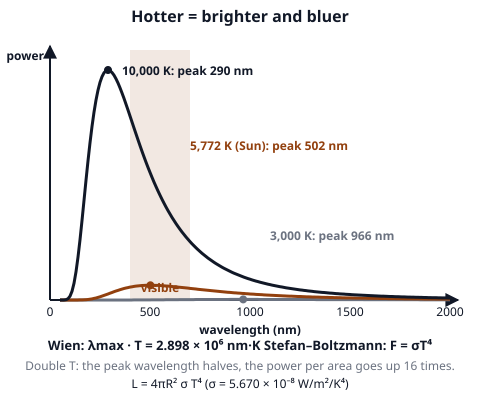
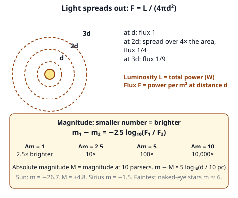
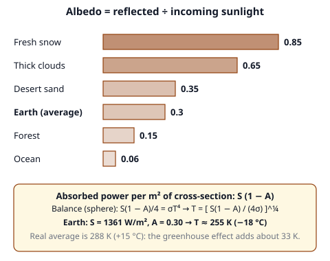

# 🟫 Radiation  ·  `earth.astronomy.radiation`
> 📅 Study date: Sat 7 Nov · ⏱️ ~12 min read · 📋 Syllabus: Albedo, Radiation laws, Luminosity, flux, magnitude

## 🍳 Start with the stove coil
Turn an electric stove on. First the coil is invisible but you feel its heat on your hand. Then it glows dull red, and if it got hotter it would glow orange, then yellow-white. **Color tells temperature.** Stars work the same way: a red star is cooler than a white or blue one. And the farther you stand from the stove, the less heat you feel, just like the farther a star is, the fainter it looks. **The difference:** a coil is not a perfect blackbody, but a star is very close to one.

## 🖼️ Big picture

## 💡 Core ideas
1. **Radiation laws.** A **blackbody** absorbs all light and glows only because of its temperature T (in **kelvin**). **Wien's law:** the peak wavelength is **λmax = 2.898 × 10⁶ nm·K ÷ T**. Hotter means a **shorter** (bluer) peak. The Sun (5772 K) peaks at 502 nm. A person (310 K) peaks at about 9,300 nm, in the infrared. **Stefan–Boltzmann law:** the power per square meter of surface is **F = σT⁴**, with σ = 5.670 × 10⁻⁸ W/m²/K⁴. Double T and the power goes up **16 times**.
2. **Luminosity.** The total power a star sends out is its **luminosity L** (in watts). A sphere has area 4πR², so **L = 4πR²σT⁴**. Doubling the radius makes L four times bigger; doubling T makes it 16 times bigger. The Sun: L = 3.83 × 10²⁶ W, R = 6.96 × 10⁸ m, T = 5772 K.
3. **Flux.** The light you receive per square meter is the **flux F = L / (4πd²)**, the same inverse-square rule as gravity. At **twice** the distance the flux is **¼**; at **three times**, **1/9**. At Earth the Sun's flux is the **solar constant**, S = 1361 W/m².
4. **Magnitude.** Astronomers rate brightness on a **backward** scale: **smaller (or more negative) = brighter**. A difference of **5 magnitudes = 100 times** in flux, so one magnitude is a factor 100^(1/5) ≈ **2.512**: **m₁ − m₂ = −2.5 log₁₀(F₁/F₂)**. **Apparent magnitude m** is how bright it looks from Earth (Sun −26.7, Sirius −1.5, faintest naked-eye stars about +6). **Absolute magnitude M** is the magnitude at a distance of **10 parsecs**, so it compares true luminosity. The **distance modulus**: **m − M = 5 log₁₀(d / 10 pc)**.
5. **Albedo.** Albedo **A** is the fraction of incoming light that a surface **reflects** (0 = black, 1 = mirror). Fresh snow about 0.85, thick clouds about 0.65, desert sand about 0.35, forest about 0.15, ocean about 0.06; **Earth overall 0.30**. A planet absorbs the fraction **(1 − A)**.
6. **Planet temperature.** A planet's disk catches S(1 − A) per square meter, but the whole sphere radiates, which is 4 times the disk's area. In balance: **S(1 − A)/4 = σT⁴**, so **T = [S(1 − A) / (4σ)]^¼**. Earth (A = 0.30) comes out at **255 K (−18 °C)**. The real average is 288 K: the **greenhouse effect** adds about 33 K. Less ice means a lower albedo, more absorbed light, a warmer planet: a **feedback**.

> 🍳 **Analogy:** standing twice as far from the stove, you get a quarter of the heat. **The difference:** your skin is not a blackbody; for stars the law F = L/(4πd²) is exact because nothing absorbs the light on the way (in empty space).

## 🧮 HUSO-style examples

**Example 1.** Star X has twice the radius and twice the surface temperature of star Y. How many times more luminous is X?

(A) 8  (B) 16  (C) 32  (D) 64  (E) 128

Steps:
1. L = 4πR²σT⁴, so L ∝ R²T⁴.
2. Radius ×2 gives ×2² = 4. Temperature ×2 gives ×2⁴ = 16.
3. 4 × 16 = **64**. **Answer: (D).**
4. Traps: (B) 16 forgets the radius. (A) 8 uses R and T² (2 × 4). (C) 32 uses R and T⁴ (2 × 16). (E) 128 uses R³ and T⁴ (8 × 16).

**Example 2.** Two identical stars have apparent magnitudes 2.0 and 7.0. How many times farther away is the fainter one?

(A) 2.5  (B) 5  (C) 10  (D) 25  (E) 100

Steps:
1. Δm = 5, so the flux ratio is 100.
2. The stars are identical, so flux ∝ 1/d². Flux ratio 100 means d² ratio 100.
3. Distance ratio = √100 = **10**. **Answer: (C).**
4. Traps: (E) 100 is the flux ratio. (B) 5 is Δm. (A) 2.5 is the factor per magnitude. (D) 25 is a guess from 5².

## ⚠️ Common traps
- **Kelvin only.** In Wien and Stefan–Boltzmann use K = °C + 273. 27 °C is 300 K, not 27.
- **Magnitudes run backward.** Magnitude 1 is brighter than magnitude 6. Negative is very bright.
- **Magnitude is logarithmic.** 5 magnitudes is ×100, not ×5.
- **Flux vs. luminosity.** Luminosity is a property of the star. Flux depends on where you are.
- **The factor ¼ in planet temperature.** The planet intercepts πR² but radiates from 4πR². Forgetting it gives a temperature too high by √2.
- **High albedo is cold.** A bright, reflective surface absorbs less.

## ✏️ Redraw from memory
Close the page and draw in 6 minutes:
- [ ] Three blackbody curves (cool, medium, hot) showing the peak moving left and the curve rising.
- [ ] The formulas λmax·T = 2.898 × 10⁶ nm·K and F = σT⁴, L = 4πR²σT⁴.
- [ ] Three spheres at d, 2d, 3d with flux 1, ¼, 1/9.
- [ ] The magnitude table: 1 → 2.5×, 5 → 100×, 10 → 10,000×.
- [ ] A bar chart of albedo for snow, clouds, sand, forest and ocean, with Earth at 0.30.

Compare with the page and mark what you missed in red.

## 🎥 Watch / try
- [Blackbody Radiation and Wien's Law](https://www.youtube.com/watch?v=yCNcbkLFTFs) — The Organic Chemistry Tutor · 8:37 · see how temperature sets the peak wavelength
- [Magnitudes: How astronomers measure brightness and use it to measure distances](https://www.youtube.com/watch?v=GnFFNcJ5Aks) — Las Cumbres Observatory · 2:45 · learn why 5 magnitudes means 100 times
- [What is Albedo?](https://www.youtube.com/watch?v=nc9ywdt-u_k) — CSHubMIT · 3:03 · connect reflectivity with the ice-albedo feedback

## ✅ Check your understanding (5 questions)
Do these without looking at the material. You are **READY** if you get at least 4 of 5 right.

**1.** 🍳 A stove coil at 1000 K glows dull red. Where is the peak of its emission? (Use λmax = 2.898 × 10⁶ nm·K ÷ T.)

(A) Ultraviolet  (B) Blue light  (C) Green light  (D) Red light  (E) Infrared

**2.** Sunlight reaching a planet carries 1000 W per square meter. The planet's albedo is 0.30. How much power per square meter of its cross-section does it absorb?

(A) 300 W  (B) 700 W  (C) 1000 W  (D) 1300 W  (E) 70 W

**3.** The spectrum of star A peaks at 500 nm and that of star B peaks at 1000 nm. How do their temperatures compare?

(A) A is half as hot as B  (B) They are the same  (C) A is 4 times hotter than B  (D) A is 2 times hotter than B  (E) A is 16 times hotter than B

**4.** Star P has apparent magnitude −1 and star Q has apparent magnitude +4. Star P appears

(A) 5 times brighter  (B) 10 times brighter  (C) 100 times brighter  (D) 500 times brighter  (E) 2.5 times brighter

**5.** A star is moved to three times its distance. The flux we receive becomes

(A) 1/9 as large  (B) 1/3 as large  (C) 1/6 as large  (D) 3 times as large  (E) 9 times as large

Answer key & explanations

1. **(E) Infrared.** λmax = 2.898 × 10⁶ ÷ 1000 = 2,898 nm, far beyond red light (700 nm). The coil looks red only because the short-wavelength tail of its curve reaches the visible range. (A) to (D) would need a much higher temperature.
2. **(B) 700 W.** Absorbed = S(1 − A) = 1000 × 0.70 = 700 W/m². (A) 300 W is the reflected part. (C) ignores albedo. (D) adds instead of subtracting. (E) 70 forgets a factor 10.
3. **(D) A is 2 times hotter than B.** Wien: λmax ∝ 1/T. A's peak is half as long, so A is twice as hot. (A) is the reverse. (C) and (E) square or use the fourth power of the ratio.
4. **(C) 100 times brighter.** Δm = 4 − (−1) = 5, which is a factor 100. (A) uses Δm itself. (B) is Δm = 2.5. (D) is 5 × 100. (E) is the factor for 1 magnitude.
5. **(A) 1/9 as large.** F ∝ 1/d², so 3× the distance gives 1/3² = 1/9. (B) forgets the square. (C) is a guess. (D) and (E) say the flux rises.

