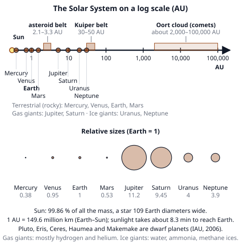
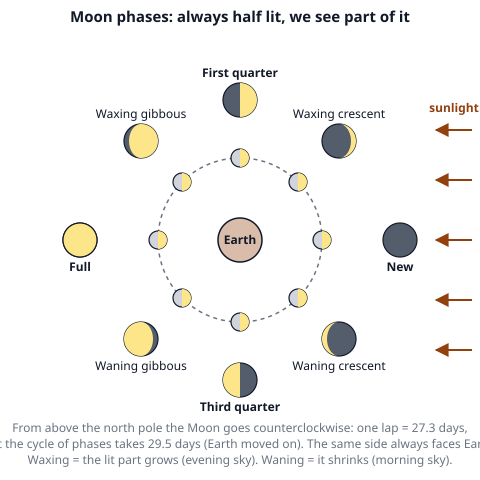
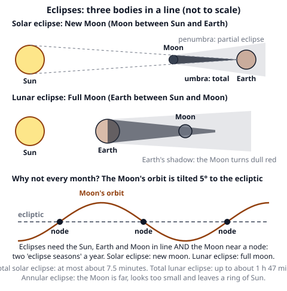
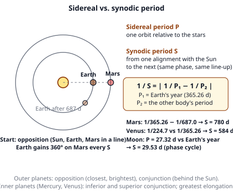

# 🟫 Solar System  ·  `earth.astronomy.solar-system`
> 📅 Study date: Fri 30 Oct · ⏱️ ~12 min read · 📋 Syllabus: Earth-Moon system, Solar System structure, Sidereal and synodic periods, Eclipses, Space missions

## 🏊 Start with the tide at the beach
Stand knee-deep in the sea and you feel the water slowly pulling out, then pushing back in, about twice a day. That is the **tide**, and the Moon causes most of it. On some days the tide is extra high and extra low, and on other days it is weak. Those days follow the **phases of the Moon**. The same Moon also lines up with the Sun to make **eclipses**. **The difference:** in a swimming pool the water moves because you push it; in the ocean the Moon's gravity pulls the whole sea, and the pull is stronger on the side facing the Moon.

## 🖼️ Big picture

## 💡 Core ideas
1. **Earth–Moon system.** The Moon is 384,400 km away (about 60 Earth radii; light needs 1.3 s), 0.27 of Earth's diameter and 1/81 of Earth's mass, and its gravity is about 1/6 of Earth's. It orbits in **27.32 days** (sidereal period) but its phases repeat every **29.53 days** (synodic period). It is **tidally locked**: it spins once per orbit, so the **same side** always faces Earth. Its orbit is tilted **5.1°** to the ecliptic. It probably formed when a Mars-sized body hit the young Earth. It is drifting away by about 3.8 cm per year.
   - **Phases:** half of the Moon is always lit by the Sun. We see more or less of the lit half depending on where the Moon is: **new** (between Earth and Sun, dark), **first quarter** (right half lit), **full** (Earth between), **third quarter** (left half lit). (This is the view from the Northern Hemisphere; from the Southern Hemisphere the pictures are turned upside down.) **Waxing** means growing, **waning** shrinking, **crescent** less than half, **gibbous** more than half.
   - **Timing:** new Moon rises at sunrise, **first quarter** rises at noon (sets at midnight), **full** rises at sunset, **third quarter** rises at midnight. The Moon rises about **50 minutes later** each day.
   - **Tides:** **spring tides** (biggest range) at **new and full Moon**, when Sun and Moon pull along the same line; **neap tides** (smallest range) at the **quarter** Moons, when they pull at right angles.
2. **Solar System structure.** The **Sun** holds 99.86 % of the mass. **Terrestrial planets** (Mercury, Venus, Earth, Mars) are small and rocky. The **asteroid belt** (2.1–3.3 AU) lies between Mars and Jupiter; its biggest member, Ceres, is a dwarf planet. **Gas giants** (Jupiter, Saturn) are mostly hydrogen and helium. **Ice giants** (Uranus, Neptune) hold water, ammonia and methane ices. Beyond Neptune is the **Kuiper belt** (30–50 AU: Pluto, Eris, Haumea, Makemake) and, far out, the **Oort cloud** (a huge shell of comets, about 2,000 to 100,000 AU). A **planet** (IAU, 2006) orbits the Sun, is round, and has **cleared its orbit**; a **dwarf planet** is round but has not cleared its orbit. 1 AU = 149.6 million km; light takes 8.3 minutes.

   | Planet | Distance (AU) | Year (sidereal period) | Size (Earth = 1) | Remember |
   |---|---|---|---|---|
   | **Mercury** | 0.39 | 88 d | 0.38 | smallest, fastest, huge temperature swings |
   | **Venus** | 0.72 | 225 d | 0.95 | hottest (about 465 °C), spins backward, day longer than year |
   | **Earth** | 1.00 | 365.26 d | 1.00 | liquid water, one Moon, tilt 23.4° |
   | **Mars** | 1.52 | 687 d | 0.53 | red (iron oxide), thin CO₂ air, Olympus Mons |
   | **Jupiter** | 5.20 | 11.9 yr | 11.2 | biggest, Great Red Spot, moons Io, Europa, Ganymede, Callisto |
   | **Saturn** | 9.54 | 29.5 yr | 9.45 | rings, less dense than water, moon Titan |
   | **Uranus** | 19.2 | 84 yr | 4.0 | axis tilted 98°: rolls on its side |
   | **Neptune** | 30.1 | 165 yr | 3.9 | farthest planet, fastest winds |
3. **Sidereal and synodic periods.** The **sidereal period** P is one orbit relative to the **stars**. The **synodic period** S is the time between two identical line-ups with the **Sun** (for example, from one opposition of Mars to the next, or from one full Moon to the next). Because Earth also moves, **1/S = |1/P₁ − 1/P₂|**. Mars: S = 780 days. Venus: S = 584 days. For the Moon, P₁ = 27.32 d and P₂ = Earth's year give S = 29.53 d. **Outer planets** are best seen at **opposition** (opposite the Sun, closest and brightest, up all night). **Inner planets** (Mercury, Venus) stay near the Sun, with **greatest elongation** (Venus up to 47°, Mercury 28°).
4. **Eclipses.** **Solar eclipse:** at **new Moon**, the Moon passes between Sun and Earth. Inside the dark **umbra** (a path up to about 270 km wide) the eclipse is **total** (at most about 7.5 minutes); in the **penumbra** it is **partial**. If the Moon is far away and looks a bit too small, you get a ring of Sun: an **annular** eclipse. **Lunar eclipse:** at **full Moon**, the Moon passes through **Earth's shadow**; a total lunar eclipse turns the Moon dull red (sunlight bent through Earth's air) and can be seen from the whole night side. **Why not every month?** The Moon's orbit is tilted 5.1°, so most months the shadow passes above or below. Eclipses need the Moon near a **node** (where its orbit crosses the ecliptic): two **eclipse seasons** a year. The same eclipse pattern comes back every **saros**, 18 years 11 days.
5. **Important space missions.**

   | Mission | Year | What it did |
   |---|---|---|
   | **Sputnik 1** (USSR) | 1957 | first artificial satellite |
   | **Vostok 1** (USSR) | 1961 | Yuri Gagarin, first human in space |
   | **Apollo 11** (USA) | 1969 | first humans on the Moon (Armstrong and Aldrin landed) |
   | **Voyager 1 and 2** | 1977 | tours of the outer planets; Voyager 2 visited all four giants; Voyager 1 was the first spacecraft in interstellar space (2012) |
   | **Hubble Space Telescope** | 1990 | visible-light telescope in orbit around Earth |
   | **Cassini–Huygens** | 1997 | orbited Saturn 2004–2017, Huygens landed on Titan (2005) |
   | **Mars rovers** | 1997–2021 | Sojourner, Spirit, Opportunity, Curiosity (2012), Perseverance (2021) |
   | **New Horizons** | 2006 | first flyby of Pluto (2015) |
   | **Mars Orbiter Mission** (India) | 2013 | first Asian mission to orbit Mars (2014) |
   | **Chandrayaan-3** (India) | 2023 | soft landing near the Moon's south pole |
   | **James Webb Space Telescope** | 2021 | infrared telescope at the Sun–Earth L2 point |
   | **Parker Solar Probe** | 2018 | flies through the Sun's corona |

> 🏊 **Analogy:** a swimmer lapping a slower swimmer in the next lane catches up once every so often: the **synodic period** is the time between two meetings, while each swimmer's own lap time is a **sidereal period**. **The difference:** in the pool both swimmers start at the same wall; in the sky the "meeting" is the line-up of a planet, Earth and the Sun.

## 🧮 HUSO-style examples

**Example 1.** Mars orbits the Sun once every **687 days**. Earth takes 365.26 days. About how often is Mars at opposition (the time between two oppositions)?

(A) 322 days  (B) 365 days  (C) 687 days  (D) 780 days  (E) 1,052 days

Steps:
1. Earth is on the inside track and moves faster. It has to gain one whole lap (360°) on Mars.
2. Per day Earth moves 1/365.26 of a lap and Mars 1/687. The gain is 1/365.26 − 1/687 = 0.002738 − 0.001456 = 0.001282 laps per day.
3. S = 1 ÷ 0.001282 ≈ **780 days**. **Answer: (D).**
4. Traps: (A) 322 is just 687 − 365. (E) 1,052 is 687 + 365. (B) and (C) are the two periods themselves.

**Example 2.** The Moon goes around Earth once in 27.3 days (relative to the stars), but the cycle of phases takes 29.5 days. Why?

(A) The Moon slows down in the second half of its orbit  (B) During one orbit Earth moves about 27° around the Sun, so the Moon needs about 2 more days to line up with the Sun again  (C) The Moon's orbit is tilted 5° to the ecliptic  (D) Earth's shadow delays the phases by two days  (E) Light from the Moon takes two days to reach Earth

Steps:
1. A phase is set by the angle between the Moon and the **Sun**, not the stars.
2. In 27.3 days Earth moves 27.3 × (360° ÷ 365.26) = **26.9°** along its orbit, so the Sun appears to have shifted by that much.
3. The Moon moves about 12.2° per day relative to the Sun (13.2° relative to the stars minus Earth's 1°), so it needs 26.9 ÷ 12.2 ≈ **2.2 days** more. 27.3 + 2.2 = 29.5 days. **Answer: (B).**
4. Traps: (C) is true but does not change the length of the phase cycle. (E) The Moon is only 1.3 light-seconds away.

## ⚠️ Common traps
- **Phases are not Earth's shadow.** Phases come from our viewing angle on the lit half. Only a **lunar eclipse** involves Earth's shadow.
- **"New Moon" is not "no Moon".** The Moon is there but its dark side faces us. A solar eclipse happens at new Moon, a lunar eclipse at full Moon.
- **The Moon does not have a "dark side".** It has a **far side** that we never see; it gets as much sunlight as the near side.
- **Spring tides are not "in spring".** They happen every two weeks, at new and full Moon.
- **Sidereal vs. synodic.** Sidereal = relative to the stars (the true orbit). Synodic = relative to the Sun (what we observe). Synodic is **longer** for the Moon.
- **Pluto is still there.** It is a dwarf planet because it has not cleared its orbit, not because it is small.
- **A planet near the Sun is not hottest because of distance only.** Venus (second from the Sun) is hotter than Mercury because of its thick CO₂ air.

## ✏️ Redraw from memory
Close the page and draw in 6 minutes:
- [ ] The Solar System as a line of planets in order, with the asteroid belt, Kuiper belt and Oort cloud, and the groups (terrestrial, gas giants, ice giants).
- [ ] The Moon around Earth in 8 positions with the lit half toward the Sun and the 8 phase pictures.
- [ ] A solar eclipse and a lunar eclipse in a line, with umbra and penumbra.
- [ ] The tilted Moon orbit with two nodes, and a note on why eclipses are not monthly.
- [ ] The formula 1/S = |1/P₁ − 1/P₂| with the Mars example.

Compare with the page and mark what you missed in red.

## 🎥 Watch / try
- [Solar System 101](https://www.youtube.com/watch?v=libKVRa01L8) — National Geographic · 4:11 · see the planets, belts and the Sun in one tour
- [Why Aren't There Eclipses Every Month?](https://www.youtube.com/watch?v=vIZyuXl-91U) — minutephysics · 2:23 · watch the tilt of the Moon's orbit decide when eclipses happen
- [What Are The Differences Between Sidereal And Synodic Orbital Periods?](https://www.youtube.com/watch?v=cMPQX1b5r0s) — AstroPhil · 2:45 · compare the two kinds of period

## ✅ Check your understanding (5 questions)
Do these without looking at the material. You are **READY** if you get at least 4 of 5 right.

**1.** 🏊 A swimmer at the beach notices that today's high tide is the highest and the low tide the lowest of the fortnight (a spring tide). Which Moon phase fits?

(A) First quarter  (B) Third quarter  (C) Waxing crescent  (D) Full Moon  (E) Waning crescent

**2.** Why isn't there a solar eclipse at every new Moon?

(A) The Moon is usually too far away to cover the Sun  (B) The Moon's orbit is tilted about 5° to Earth's orbit, so the Moon's shadow usually passes above or below Earth  (C) Eclipses only happen at the equinoxes  (D) At new Moon the Moon is on the far side of the Sun  (E) The Moon's shadow is too wide to touch Earth

**3.** According to the IAU, what separates a planet from a dwarf planet?

(A) A planet has moons  (B) A planet is bigger than Mercury  (C) A planet has cleared its orbit of other large bodies  (D) A planet is made of gas  (E) A planet has a circular orbit

**4.** Venus orbits the Sun in 224.7 days and Earth in 365.26 days. About how long between two successive inferior conjunctions (the same line-up of Sun, Venus and Earth)?

(A) 140 days  (B) 225 days  (C) 365 days  (D) 730 days  (E) 584 days

**5.** Which spacecraft was the first to enter interstellar space?

(A) Voyager 1  (B) Voyager 2  (C) New Horizons  (D) Cassini  (E) Hubble Space Telescope

Answer key & explanations

1. **(D) Full Moon.** Spring tides come at new Moon and full Moon, when Sun and Moon are in line. Only full Moon is in the list. (A) and (B) The quarter Moons give neap tides (small range). (C) and (E) are crescents, between new and quarter.
2. **(B) The Moon's orbit is tilted about 5° to Earth's orbit, so the Moon's shadow usually passes above or below Earth.** Only near the nodes does the shadow hit Earth. (A) is not the main reason (a far Moon gives an annular eclipse, not no eclipse). (C) Eclipses can happen in any month. (D) At new Moon the Moon is between Earth and Sun. (E) The shadow is narrow: it covers only a small patch of Earth.
3. **(C) A planet has cleared its orbit of other large bodies.** The IAU rule has three parts: orbits the Sun, is round, has cleared its neighborhood. (A) Dwarf planets can have moons. (B) Ganymede and Titan are bigger than Mercury but are moons. (D) Mars is not gas. (E) No orbit is perfectly circular.
4. **(E) 584 days.** 1/S = 1/224.7 − 1/365.26 = 0.004450 − 0.002738 = 0.001712, so S = 584 days. (A) 140 is 365 − 225. (B) and (C) are the two periods. (D) 730 is just two Earth years.
5. **(A) Voyager 1.** It crossed the heliopause in 2012. (B) Voyager 2 followed in 2018. (C) New Horizons is still in the outer Solar System. (D) Cassini ended in Saturn's atmosphere in 2017. (E) Hubble orbits Earth.

