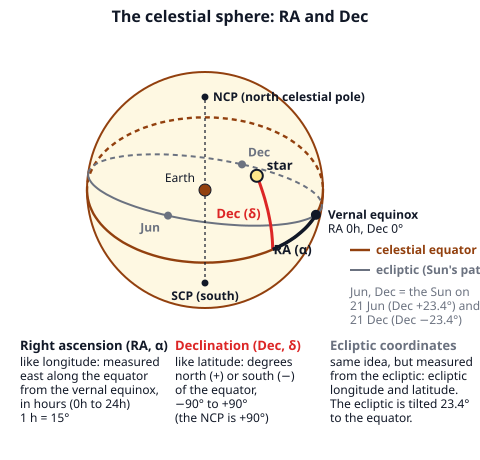
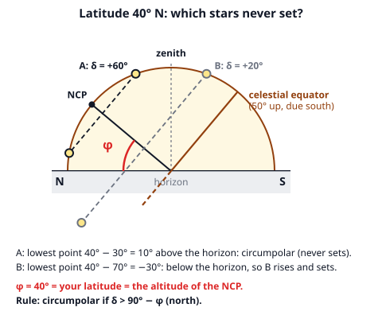
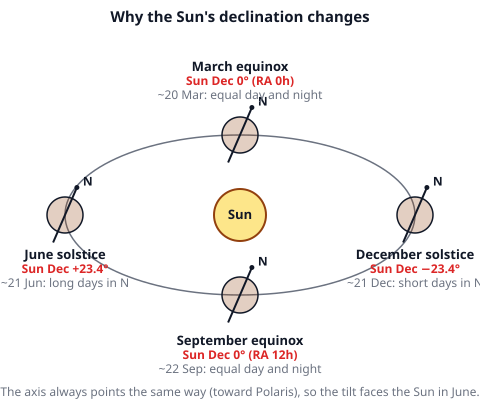
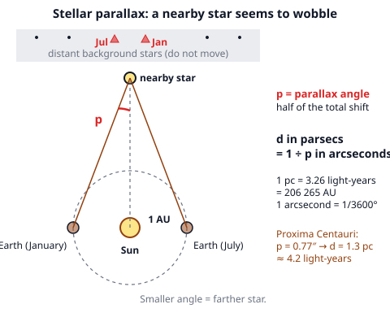
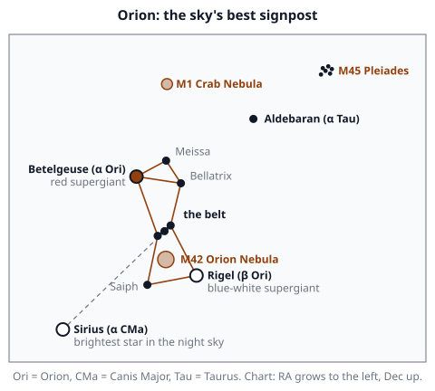
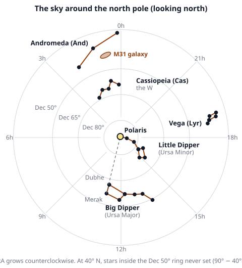

# 🟫 Celestial Sphere  ·  `earth.astronomy.sphere`
> 📅 Study date: Sat 17 Oct · ⏱️ ~12 min read · 📋 Syllabus: Celestial coordinates, Circumpolar stars, Equinox and solstice, Stellar parallax, Stars: Sirius, Betelgeuse, Rigel, Vega, Proxima Centauri, Polaris, Deep sky: M42, M31, M1, M45, Constellations: Orion, Ursa Major, Ursa Minor, Cassiopeia, Lyra, Andromeda, zodiac

## 🏊 Start with the pool ceiling
In a pool you can name any spot with two numbers: the **lane** and the **meters from the wall**. Backstrokers even use the flags above the pool to know where the wall is. The night sky works the same way: any star can be named with two numbers, and it looks like a giant dome over you. Astronomers treat the sky as a huge **celestial sphere** with Earth at its center. **The difference:** a pool is flat and the sky is a sphere, so the two numbers are **angles**, not meters. Also, the stars are not really on a sphere: they are at very different distances, we just see their directions.

## 🖼️ Big picture

## 💡 Core ideas
1. **Celestial coordinates.** The celestial sphere is Earth's equator, poles and axis projected onto the sky: the **north celestial pole (NCP)**, the **celestial equator** and the **south celestial pole**.
   - **Equatorial system** (fixed to the stars): **right ascension (RA, α)** is like longitude, measured east from the **vernal equinox** in hours (0h–24h, 1h = 15°). **Declination (Dec, δ)** is like latitude: −90° to +90°, equator = 0°, NCP = +90°.
   - **Horizon system** (fixed to you): **azimuth** is the compass direction (0° = N, 90° = E, 180° = S, 270° = W) and **altitude** (height) is the angle above the horizon (0°–90°). The point straight up is the **zenith** (altitude 90°). These numbers change as the sky turns.
   - **Ecliptic system:** ecliptic longitude and latitude, measured from the **ecliptic**, the Sun's yearly path. The ecliptic is tilted **23.4°** to the equator.
2. **Latitude and the sky.** The altitude of the celestial pole equals your **latitude φ**. A star crossing the meridian (due north-south line) due south has altitude **h = 90° − |φ − δ|**. The celestial equator crosses the meridian at altitude **90° − φ**. At the equator (φ = 0°) both poles sit on the horizon; at the North Pole the NCP is at the zenith.
3. **Circumpolar stars** circle the pole and **never set**. In the north, a star is circumpolar if **δ > 90° − φ**. Its lowest altitude is then **δ + φ − 90°**. Stars with δ < −(90° − φ) never rise at all. From Indonesia (latitude within about 10° of the equator) almost nothing is circumpolar, and from 6° S the north celestial pole, and so Polaris, is **below** the horizon.
4. **Equinox and solstice.** The Earth's axis is tilted 23.4° and keeps pointing at the same place in space (toward Polaris), so the **Sun's declination** swings between +23.4° and −23.4° during the year. **Equinox** (Sun on the celestial equator, Dec 0°; day and night about equal; Sun rises due east and sets due west): **~20 March** (RA 0h) and **~22–23 September** (RA 12h). **Solstice** (Sun farthest from the equator): **~21 June** (Dec +23.4°, RA 6h; longest day in the north, the Sun is overhead at the Tropic of Cancer) and **~21 December** (Dec −23.4°, RA 18h; shortest day in the north).
5. **Stellar parallax.** As Earth moves around the Sun, a **nearby star** seems to shift against the far-away stars. Half the total shift is the **parallax angle p**. **d (parsecs) = 1 / p (arcseconds)**. One parsec = 3.26 light-years = 206,265 AU. Smaller parallax means a farther star. Proxima Centauri has p = 0.77″, so d = 1.3 pc ≈ 4.2 light-years.
6. **Things to know in the sky.** **Bold** = on the exam list.

   | Star | Constellation | What it is | Distance | Brightness (magnitude) |
   |---|---|---|---|---|
   | **Sirius** (α CMa) | Canis Major | white star, **brightest star in the night sky** | 8.6 ly | −1.46 |
   | **Betelgeuse** (α Ori) | Orion | **red supergiant**, orange-red shoulder | about 550–700 ly | about 0.4 (varies) |
   | **Rigel** (β Ori) | Orion | **blue-white supergiant**, the foot | about 860 ly | 0.13 |
   | **Vega** (α Lyr) | Lyra | white star, very bright | 25 ly | 0.03 |
   | **Proxima Centauri** (α Cen C) | Centaurus | **red dwarf, the closest star** to the Sun, too faint to see | 4.24 ly | 11.1 |
   | **Polaris** (α UMi) | Ursa Minor | the North Star, within 1° of the NCP, only about the 50th brightest | about 430 ly | 2.0 |

   | Deep sky object | Type | Where | Remember |
   |---|---|---|---|
   | **M42** Orion Nebula | **emission nebula** (glowing gas where stars are born) | Orion's sword | about 1,300 ly |
   | **M31** Andromeda Galaxy | **spiral galaxy** | Andromeda | 2.5 million ly, one of the farthest things you can see without a telescope |
   | **M1** Crab Nebula | **supernova remnant** (a nebula) | Taurus | exploded in the year 1054 |
   | **M45** Pleiades | **open cluster** (young stars loosely bound) | Taurus | "Seven Sisters", about 440 ly |

   | Constellation | IAU abbreviation | How to find it |
   |---|---|---|
   | **Orion** | Ori | the hunter; three-star **belt**, Betelgeuse and Rigel at opposite corners |
   | **Ursa Major** | UMa | the Great Bear; the **Big Dipper** (Plough) is its tail and back |
   | **Ursa Minor** | UMi | the Little Bear; the **Little Dipper**, Polaris at the tip of the handle |
   | **Cassiopeia** | Cas | a bright **W** (or M) opposite the Big Dipper across the pole |
   | **Lyra** | Lyr | little parallelogram next to blue-white Vega |
   | **Andromeda** | And | a long line of stars from the Square of Pegasus; M31 is nearby |
   | **Zodiac** (the Sun's path) | Ari, Tau, Gem, Cnc, Leo, Vir, Lib, Sco, Sgr, Cap, Aqr, Psc | Aries, Taurus, Gemini, Cancer, Leo, Virgo, Libra, Scorpius, Sagittarius, Capricornus, Aquarius, Pisces |

   Star names often come from **Bayer letters**: a Greek letter plus the constellation (α = "alpha" is usually, not always, the brightest: Betelgeuse is α Ori, but Rigel is brighter).

> 🏊 **Analogy:** RA and Dec are like lane and meters from the wall. **The difference:** RA is an angle that wraps around (0h = 24h), and Dec is an angle that shrinks toward the poles, like the meridians on a globe.

## 🧮 HUSO-style examples

**Example 1.** An observer at latitude **40° N** watches a star with declination **+55°**. Which statement is correct?

(A) The star sets; its lowest altitude is −5°  (B) The star never sets; its lowest altitude is 5°  (C) The star never sets; its lowest altitude is 15°  (D) The star sets; its lowest altitude is −15°  (E) The star never sets; its lowest altitude is 55°

Steps:
1. The circumpolar limit is δ > 90° − φ = 90° − 40° = **50°**. The star has δ = 55° > 50°, so it **never sets**. That removes (A) and (D).
2. The lowest altitude is δ + φ − 90° = 55° + 40° − 90° = **5°**. Check with the sketch: the NCP is 40° up, and the star circles it at 90° − 55° = 35° away, so its lowest point is 40° − 35° = 5° up. **Answer: (B).**
3. Traps: (C) 15° is |φ − δ|, the distance from the zenith side. (E) 55° is just the declination. (A) and (D) use the right numbers with the wrong sign.

**Example 2.** A star has a parallax of **0.050″**. About how far away is it, in light-years?

(A) 0.16 ly  (B) 6.5 ly  (C) 20 ly  (D) 65 ly  (E) 650 ly

Steps:
1. d (in parsecs) = 1 ÷ p = 1 ÷ 0.050 = **20 pc**.
2. Convert: 1 pc = 3.26 ly, so d = 20 × 3.26 = **65 ly**. **Answer: (D).**
3. Traps: (C) 20 stops in parsecs. (A) 0.16 multiplies by p instead of dividing. (B) 6.5 reads the parallax as 0.5″. (E) 650 reads it as 0.005″.

## ⚠️ Common traps
- **Altitude of the pole = latitude, not 90° − latitude.** The celestial *equator* is the one at 90° − φ.
- **Mixing hours and degrees.** RA is in hours (1h = 15°), Dec in degrees. 6h is a quarter of the way around, 90°.
- **Parallax upside down.** A **small** parallax means a **far** star. d = 1/p, never p × something.
- **"The North Star is the brightest star."** Polaris is only about the 50th brightest. It is special because it sits almost exactly on the pole, so it hardly moves. Sirius is the brightest.
- **Solstice is not "hottest or coldest day".** It is the day the Sun is farthest north or south in the sky. Seasons lag behind it.
- **Messier types.** M1 is not a galaxy and M45 is not a nebula. Remember: M42 gas, M31 galaxy, M1 exploded star, M45 young cluster.

## ✏️ Redraw from memory
Close the page and draw in 6 minutes:
- [ ] A celestial sphere with the NCP, the equator, the tilted ecliptic and the vernal equinox, and one star located by RA and Dec.
- [ ] A side view at latitude φ: the horizon, the NCP at altitude φ, and one circumpolar and one non-circumpolar star.
- [ ] Earth on four sides of the Sun with the tilted axis and the Sun's Dec at each (0°, +23.4°, 0°, −23.4°).
- [ ] The parallax triangle with 1 AU, the angle p and the formula d = 1/p.
- [ ] Orion with the belt, Betelgeuse, Rigel, M42, and the line from the belt to Sirius.

Compare with the page and mark what you missed in red.

## 🎥 Watch / try
- [Right Ascension versus Declination](https://www.youtube.com/watch?v=oMZdYPJHE8s) — Learn the Sky · 8:22 · see how the two numbers place a star on the sphere
- [Stellar parallax and measuring distance](https://www.youtube.com/watch?v=iwlMmJs1f5o) — Las Cumbres Observatory · 1:58 · watch the nearby star shift against the background
- [Stellarium Web](https://stellarium-web.org/) — Stellarium · interactive sky · set your location to 6° S and to 40° N and find Polaris and the Big Dipper, then turn on the equatorial grid

## ✅ Check your understanding (5 questions)
Do these without looking at the material. You are **READY** if you get at least 4 of 5 right.

**1.** 🏊 A swimmer at an outdoor pool at latitude **6° S** looks at the night sky. Which statement is true?

(A) Polaris is 6° above the north horizon  (B) The south celestial pole is 6° above the south horizon  (C) The south celestial pole is directly overhead  (D) The south celestial pole is 84° above the south horizon  (E) Polaris is at the zenith at midnight

**2.** Which statement about the March equinox is true?

(A) The Sun's declination is +23.4°  (B) The Sun's right ascension is 6h  (C) The Sun is overhead at the Tropic of Cancer  (D) The Sun is at its southernmost point  (E) The Sun is on the celestial equator and day and night are about equal

**3.** The Pleiades (M45) is a(n)

(A) open cluster  (B) spiral galaxy  (C) globular cluster  (D) emission nebula  (E) supernova remnant

**4.** Star A has a parallax of 0.20″ and star B has a parallax of 0.04″. How do their distances compare?

(A) A is 5 times farther than B  (B) They are the same distance  (C) B is 5 times farther than A  (D) B is 25 times farther than A  (E) B is 5 times closer than A

**5.** At latitude 50° N, a star with declination +20° crosses the meridian due south. What is its altitude at that moment?

(A) 20°  (B) 30°  (C) 40°  (D) 60°  (E) 70°

Answer key & explanations

1. **(B) The south celestial pole is 6° above the south horizon.** The altitude of the visible pole equals the latitude, 6°. In the Southern Hemisphere this is the south pole. (A) The north celestial pole is 6° **below** the north horizon, so Polaris (almost on the pole) cannot be seen. (C) The pole is overhead only at the South Pole. (D) 84° is 90° − 6°, the altitude of the celestial equator. (E) Polaris is never at the zenith, except from the North Pole.
2. **(E) The Sun is on the celestial equator and day and night are about equal.** At the equinox Dec = 0° and RA = 0h. (A) +23.4° is the June solstice. (B) RA 6h is the June solstice. (C) is also June. (D) The southernmost point is the December solstice.
3. **(A) open cluster.** The Pleiades are a young, loose group of hot stars. (B) M31 is the spiral galaxy. (C) A globular cluster is old, dense and round (like M13). (D) M42 is the emission nebula. (E) M1 is the supernova remnant.
4. **(C) B is 5 times farther than A.** d = 1/p. A: 1/0.20 = 5 pc. B: 1/0.04 = 25 pc. 25 ÷ 5 = 5. (A) and (E) turn the rule upside down. (B) ignores the different parallaxes. (D) squares the ratio.
5. **(D) 60°.** h = 90° − |φ − δ| = 90° − |50° − 20°| = 90° − 30° = 60°. (A) 20° is just the declination. (B) 30° is |φ − δ|, the angle from the zenith. (C) 40° is the altitude of the celestial equator (90° − 50°). (E) 70° is φ + δ.

