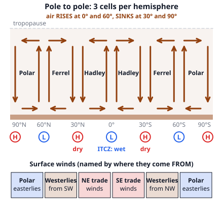
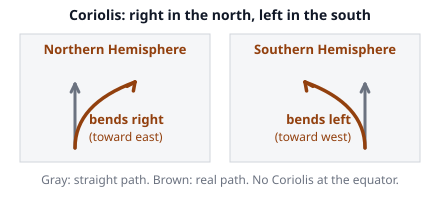

# 🟫 Circulation  ·  `earth.atmosphere.circulation`
> 📅 Study date: Sat 17 Oct · ⏱️ ~12 min read · 📋 Syllabus: Winds, Circulation cells

## 🍳 Start with a pot of soup
Heat a pot of soup on the stove. The soup in the middle, right above the flame, is hottest, so it rises. At the top it spreads out toward the sides, cools, and sinks again along the edge of the pot. That round trip is called **convection**. The whole atmosphere does the same thing, with the Sun as the flame: the equator is the hot middle of the pot, and the poles are the cool edges. **The difference:** Earth spins and is huge, so instead of one big loop the air makes **three loops** in each hemisphere.

## 🖼️ Big picture

## 💡 Core ideas
1. **Wind is air moving from high to low pressure.** The Sun heats the equator much more than the poles (its rays hit the equator head-on and the poles at a slant). Warm air expands and rises, leaving low pressure at the ground. Cool air sinks, making high pressure. Air then flows from the high to the low: that flow is **wind**. A wind is **named by where it comes from**: a *westerly* blows *from* the west *toward* the east.
2. **The Coriolis effect bends the wind.** Because Earth rotates, anything moving over its surface curves: to the **right** in the Northern Hemisphere and to the **left** in the Southern Hemisphere. It is **zero at the equator** and **strongest at the poles**, and it does not start a wind, it only bends it. This is why winds spiral around highs and lows.
3. **Three cells in each hemisphere.** The **Hadley cell** (0° to 30°): air rises at the equator and sinks at 30°. The **polar cell** (60° to 90°): air rises at 60° and sinks at the pole. Between them the **Ferrel cell** (30° to 60°) is dragged along by its two neighbors, like a middle gear. So air **rises at 0° and 60°** and **sinks at 30° and 90°**.
4. **Surface winds from the cells.** Near the ground the air in the Hadley cell flows toward the equator, in the Ferrel cell toward the pole, and in the polar cell toward the equator again. Then add the Coriolis bend. In the north: the Hadley flow goes south and bends west, so you get the **northeast trade winds**. The Ferrel flow goes north and bends east, so you get the **westerlies** (from the southwest). The polar flow goes south and bends west: **polar easterlies**. The Southern Hemisphere is the mirror image: **southeast trades**, **westerlies from the northwest**, **polar easterlies**.
5. **Pressure belts decide the climate.** Where air rises you get low pressure, clouds and rain: the **ITCZ** (intertropical convergence zone: where the two trade winds meet near the equator, also called the doldrums) and the **subpolar lows** near 60°. Where air sinks you get high pressure and dry weather: the **subtropical highs** near 30° (the big deserts: Sahara, Arabia, the Australian outback) and the **polar highs**. The ITCZ follows the overhead Sun, shifting north in July and south in January, which makes the wet and dry seasons of the tropics.
6. **Jet streams.** High in the troposphere (about 9 to 16 km) are narrow, fast rivers of air that flow from **west to east**, often 100 to 300 km/h. The **polar jet** (near 60°) lies over the polar front, where cold meets warm air, and steers storms. The **subtropical jet** sits near 30°. A plane flying east can ride the jet and save time.

> 🍲 **Analogy:** the Hadley cell is like the soup in the pot: hot at the middle, rising, spreading out at the top, sinking at the side, and returning along the bottom. **The difference:** a pot has one loop. Earth's rotation splits the flow into three cells, and the middle (Ferrel) cell turns the "wrong" way, driven by its neighbors rather than by heat.

## 🧮 HUSO-style examples

**Example 1.** A ship sails at 45° N in the Atlantic. From which direction does the prevailing wind blow near the surface?

(A) northeast  (B) southeast  (C) southwest  (D) northwest  (E) north

Steps:
1. At 45° N we are in the **Ferrel cell** (30° to 60°), where the surface air flows **toward the pole**, that is, toward the north.
2. In the Northern Hemisphere the Coriolis effect bends moving air to the **right**. The right of north is east, so the air heads north-east.
3. Wind is named by where it comes from: air moving toward the northeast comes from the **southwest**. **Answer: (C).** These are the westerlies.
4. Trap: (D) northwest is what you get at 45° **S** (a mirror image). (A) northeast is the trade wind direction in the north, but the trades blow only between 0° and 30°.

**Example 2.** A puff of smoke is lifted at the equator to the top of the troposphere. Which latitude is it most likely to sink back to the ground?

(A) 0°  (B) about 30°  (C) about 60°  (D) the pole  (E) it stays up forever

Steps:
1. At the equator the Hadley cell air rises, then flows toward the poles high up.
2. It cools on the way, and at about **30°** it sinks again. **Answer: (B).**
3. That sinking air is dry and creates the subtropical high-pressure belt and the deserts.
4. Trap: (C) at 60° the air *rises* (the Ferrel and polar cells meet there), it does not sink. (E) smoke cannot stay up: the cells are closed loops.

## ⚠️ Common traps
- **Naming the wind by where it goes.** A northeast trade wind blows *from* the northeast, toward the southwest.
- **"Coriolis starts the wind."** No: pressure differences start it; Coriolis only bends it. At the equator it is zero.
- **Forgetting the hemisphere.** Right in the north, left in the south. The trades are NE in the north and SE in the south.
- **"The Ferrel cell is driven by heat."** It is driven by the neighboring cells. Hadley and polar cells are the heat-driven ones.
- **Deserts at the equator.** The wet belt is at the equator and 60°; the dry belts are at 30° and the poles.

## ✏️ Redraw from memory
Close the page and draw in 5 minutes:
- [ ] A pole-to-pole slice with the three cells in each hemisphere and their boundaries at 0°, 30°, 60°, 90°.
- [ ] Arrows showing where the air rises (0°, 60°) and sinks (30°, 90°).
- [ ] The pressure belts at the ground (L, H, L, H) and wet / dry labels.
- [ ] The 3 surface wind belts per hemisphere, with the directions they come *from*.
- [ ] A small Coriolis sketch: a path bending right in the north and left in the south.

Compare with the page and mark what you missed in red.

## 🎥 Watch / try
- [What is global circulation? | Part Two | The three cells](https://www.youtube.com/watch?v=xqM83_og1Fc) — Met Office - Learn About Weather · 3:35 · follow the air around each cell
- [What is global circulation? | Part Three | The Coriolis effect & winds](https://www.youtube.com/watch?v=PDEcAxfSYaI) — Met Office - Learn About Weather · 6:19 · see how the Coriolis effect turns the surface flow into the named winds
- [Global wind patterns](https://www.youtube.com/watch?v=xp50_ixPOhY) — Khan Academy · 6:23 · connect the cells to deserts and rainforests

## ✅ Check your understanding (5 questions)
Do these without looking at the material. You are **READY** if you get at least 4 of 5 right.

**1.** The trade winds in the Northern Hemisphere blow from the

(A) northwest.  (B) northeast.  (C) southwest.  (D) southeast.  (E) west.

**2.** Many of the world's big deserts, such as the Sahara and the Australian outback, lie near 30° latitude. Why?

(A) They are far from any sea.  (B) The Sun is directly overhead all year.  (C) Cold ocean currents flow past them.  (D) Tall mountains block the rain there.  (E) Air in the Hadley cell sinks there, which warms it and dries it out.

**3.** A wind starts to blow due north in the Southern Hemisphere. The Coriolis effect bends it toward the

(A) west.  (B) east.  (C) north.  (D) south.  (E) It does not bend, because Coriolis only acts at the equator.

**4.** 🍳 In a pot of soup heated from below, the soup rises in the middle and sinks at the sides. Which place on Earth is most like the middle of the pot?

(A) the poles  (B) 30° latitude  (C) 60° latitude  (D) the equator  (E) all places at once

**5.** At 45° S the prevailing surface winds blow from the

(A) northeast.  (B) southeast.  (C) northwest.  (D) southwest.  (E) east.

Answer key & explanations

1. **(B) northeast.** In the Hadley cell the surface air flows toward the equator (south in the north). Coriolis bends it to the right, which is west. Moving to the southwest means the wind comes *from* the northeast. (D) southeast is the trade wind of the *Southern* Hemisphere.
2. **(E).** The Hadley cell air rises at the equator and sinks at about 30°. Sinking air warms as it is squeezed, and warm air can hold more water vapor, so no clouds form. (B) is wrong: the Sun is overhead only between the Tropics.
3. **(A) west.** Left of north is west. In the Northern Hemisphere the same wind would bend to the east. (E) is wrong: Coriolis is zero at the equator, not only there.
4. **(D) the equator.** The Sun heats the equator most, so air rises there, like the soup above the flame. Air sinks at the cooler 30° and the poles. **The difference:** a pot has only one loop and the Earth has three per hemisphere.
5. **(C) northwest.** At 45° S the surface air flows toward the pole (south). Coriolis bends it to the *left* in the south: left of south is east. Moving to the southeast means coming *from* the northwest. (D) southwest is the westerly direction of the *north*.

