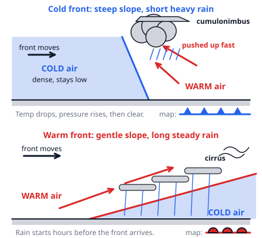
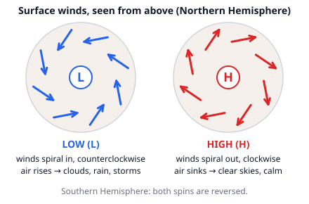

# 🟫 Fronts & Pressure Systems  ·  `earth.atmosphere.fronts`
> 📅 Study date: Sat 17 Oct · ⏱️ ~12 min read · 📋 Syllabus: Air masses and fronts, Pressure systems, Cyclone formation

## 🎮 Start with two teams meeting at a choke point
Picture a Valorant round: a big team (the attackers) pushes into the space held by the defenders, and the fighting happens along the line where the two teams meet. Weather works the same way. Two huge blobs of air, one cold and one warm, push against each other, and almost all the clouds, rain and storms happen **along the line where they meet**. That line is a **front**. **The difference:** air blobs never "win" a round: they do not mix quickly, and the heavier one slides *under* the lighter one instead of pushing it sideways.

## 🖼️ Big picture

## 💡 Core ideas
1. **Air masses.** An **air mass** is a huge body of air (hundreds to thousands of km wide) with nearly the same temperature and moisture everywhere. It takes on the character of the place it formed, its **source region**. It gets a two-letter name: a small letter for the surface (**c** = continental, dry; **m** = maritime, moist) and a capital letter for the latitude (**A** arctic, **P** polar, **T** tropical, **E** equatorial). Example: **mT** = maritime tropical = **warm and moist**; **cP** = continental polar = **cold and dry**.
2. **Fronts.** A **front** is the boundary between two air masses. Cold air is **denser**, so it stays low, and warm air is forced to rise over it. Rising air cools, its water vapor condenses, and clouds and rain form. So the weather map's fronts are where the action is.
3. **Four kinds of front.** See the table below. Remember **the name is the air that is advancing**: a *cold* front means cold air is moving in and replacing warm air.
4. **Pressure systems.** A **low** (L, cyclone) has the lowest pressure in the middle. Air at the surface flows *in* and spirals **counterclockwise** in the Northern Hemisphere, then **rises**: cloudy, rainy, windy. A **high** (H, anticyclone) has the highest pressure in the middle. Air **sinks** and flows *out*, spiraling **clockwise** in the Northern Hemisphere: clear, calm, dry. In the Southern Hemisphere both spins are reversed. Winds are stronger where the pressure changes fast, which is where the isobars (lines of equal pressure) are close together.
5. **How a mid-latitude cyclone forms.** (1) Along the **polar front** cold air lies on the poleward side and warm air on the other, blowing in opposite directions past each other. (2) A small **wave** (kink) develops and the pressure drops: a low is born. (3) The wave grows, with a **cold front** and a **warm front** and a **warm sector** between them. (4) The cold front moves faster, **catches up** with the warm front and lifts the warm air off the ground: an **occluded front**. (5) The warm air is cut off, the temperature contrast fades and the storm dies after a few days. The whole system drifts west to east with the prevailing winds.
6. **Reading a passing front.** Cold front: the air gets colder, pressure rises, the wind turns (southwest to northwest in the north), a short heavy shower. Warm front: pressure falls slowly, clouds thicken for hours, steady rain, then warmer, muggier air.

| Front | Map symbol | Slope and speed | Clouds and weather | After it passes |
|---|---|---|---|---|
| ❄️ **Cold** | blue line, triangles point the way it moves | steep (about 1:50 to 1:100), fast (30 to 50 km/h) | towering cumulonimbus, heavy short showers, thunderstorms | colder, drier, clearing, pressure rises |
| ☀️ **Warm** | red line, semicircles point the way it moves | gentle (about 1:200), slower (15 to 25 km/h) | cirrus, then thicker layers, nimbostratus: long steady rain | warmer and muggier |
| ⏸️ **Stationary** | triangles and semicircles on opposite sides | neither air mass advances | like a warm front, but lasts for days | little change |
| 🔄 **Occluded** | purple line with both symbols on the same side | cold front has caught the warm front | mix of both, then clearing | cooler |

## 🧮 HUSO-style examples

**Example 1.** A weather station in the Northern Hemisphere records: the temperature falls by 10 °C in one hour, the pressure rises, the wind turns from southwest to northwest, and a short heavy thunderstorm passes, followed by clear skies. What passed over the station?

(A) a warm front  (B) a stationary front  (C) an occluded warm front  (D) a cold front  (E) the center of a high-pressure system

Steps:
1. The temperature **dropped** quickly, so cold air arrived: it is a cold front or an occlusion.
2. A short, heavy thunderstorm with clear skies right after means steep lifting, which is typical of a **cold front** (steep slope).
3. Rising pressure and a wind shift to the northwest also fit. **Answer: (D).**
4. Traps: (A) a warm front brings a *rise* in temperature and long, steady rain. (E) the center of a high has calm winds and no storm.

**Example 2.** A warm front has a slope of about 1:200 (it rises 1 km for every 200 km). The thick rain clouds sit where the front's surface is 3 km above the ground. The front moves at 25 km/h. How long before the front reaches the ground at your town do these rain clouds first arrive overhead?

(A) 6 h  (B) 12 h  (C) 24 h  (D) 48 h  (E) 600 h

Steps:
1. Height 3 km at a slope of 1:200 means a horizontal distance of 3 × 200 = **600 km** ahead of the ground position of the front.
2. The whole pattern moves at 25 km/h, so the time is 600 km ÷ 25 km/h = **24 h**. **Answer: (C).**
3. So steady rain can begin a full day before the front reaches the ground. That is why warm fronts give long warnings.
4. Traps: (A) 6 h uses the steep cold-front slope 1:50 (150 km). (B) 12 h uses 1:100 (300 km). (D) 48 h uses a height of 6 km (1200 km). (E) 600 h mixes up km and hours.

## ⚠️ Common traps
- **Naming the front by the air that is leaving.** A cold front is named for the cold air that is *advancing*.
- **"Warm air is pushed sideways."** No: the dense cold air wedges *under* the warm air and lifts it. That is why the clouds are above the front line.
- **Mixing up low and high.** Low = air rises, clouds, rain, counterclockwise inflow (northern hemisphere). High = air sinks, clear, clockwise outflow.
- **Forgetting the hemisphere.** All the spin directions flip in the Southern Hemisphere.
- **Thinking both fronts bring the same rain.** Cold front: short and heavy. Warm front: long and gentle.

## ✏️ Redraw from memory
Close the page and draw in 5 minutes:
- [ ] A side view of a **cold front**: steep wedge of cold air, warm air pushed up, tall cloud, heavy shower.
- [ ] A side view of a **warm front**: gentle slope, layered clouds getting thicker, long rain. Label both slopes (1:50 and 1:200 roughly).
- [ ] The map symbols of the 4 fronts (triangles, semicircles, mixed, purple).
- [ ] A low and a high from above, with arrows (counterclockwise in, clockwise out) and what the air does vertically.
- [ ] The 5 stages of a mid-latitude cyclone as a quick strip of drawings, ending in an occlusion.

Compare with the page and mark what you missed in red.

## 🎥 Watch / try
- [The Four Types of Fronts Explained](https://www.youtube.com/watch?v=UKHXfoKZxE4) — Pilot Institute Airplanes · 4:38 · compare the cold and the warm front side views
- [Life of a Midlatitude Cyclone - Ch. 9](https://www.youtube.com/watch?v=ZUaOP677NlI) — Dr. Gigi Richard · 3:48 · follow the stages from a kink in the polar front to occlusion
- [High vs. Low-Pressure Weather Systems: What's the Difference?](https://www.youtube.com/watch?v=5YfxvISIQas) — Pilot Institute Airplanes · 4:43 · look at what the air does vertically in each

## ✅ Check your understanding (5 questions)
Do these without looking at the material. You are **READY** if you get at least 4 of 5 right.

**1.** A maritime tropical (mT) air mass is

(A) cold and dry.  (B) cold and moist.  (C) warm and dry.  (D) warm and moist.  (E) very cold and very dry.

**2.** 🎮 In a round, the attackers rush into a site and take over the space the defenders were holding. Suppose the attackers are a mass of cold air and the defenders are warm air. Which front is this?

(A) a cold front  (B) a warm front  (C) a stationary front  (D) an occluded front  (E) no front, only a high-pressure system

**3.** In the Northern Hemisphere, the surface winds around a low-pressure system

(A) spiral clockwise outward while air sinks.  (B) spiral clockwise inward while air rises.  (C) spiral counterclockwise inward while air rises.  (D) spiral counterclockwise outward while air sinks.  (E) blow straight from the low to the high.

**4.** What kind of front forms when a cold front catches up with a warm front?

(A) a stationary front  (B) a warm front  (C) a polar front  (D) a dry front  (E) an occluded front

**5.** A cold front moves at 45 km/h. A town is 180 km ahead of it. In how many hours will the front arrive?

(A) 0.25 h  (B) 4 h  (C) 8 h  (D) 135 h  (E) 225 h

Answer key & explanations

1. **(D) warm and moist.** The capital T means tropical (warm) and the small m means maritime (formed over the sea, so moist). (C) is cT (continental tropical: warm and dry).
2. **(A) a cold front.** The advancing air is the cold air, and cold air advancing into warm air is a cold front. **The difference:** in the game the attackers push the defenders away, but cold air does not push warm air sideways: it wedges under it and lifts it.
3. **(C).** A low has inflow near the ground; the air must go somewhere, so it rises. The Coriolis force turns the inflow to the right, which gives a counterclockwise spin in the north. (A) and (D) describe a high or have the wrong spin.
4. **(E) an occluded front.** The cold front moves faster and lifts the warm air off the ground. A stationary front is one where neither air mass moves.
5. **(B) 4 h.** time = distance ÷ speed = 180 ÷ 45 = 4 h. (A) 0.25 h turns the division upside down (45 ÷ 180). (C) 8 h uses 22.5 km/h. (D) 135 h subtracts the numbers, (E) 225 h adds them.

