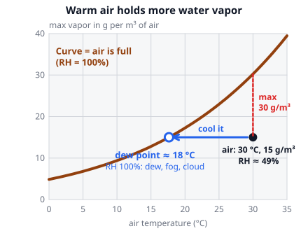
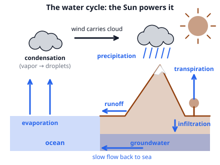

# 🟫 Humidity & Precipitation  ·  `earth.atmosphere.humidity`
> 📅 Study date: Thu 22 Oct · ⏱️ ~12 min read · 📋 Syllabus: Relative humidity, Water cycle, Precipitation formation

## 🏊 Start with foggy goggles
You pull your swim goggles out of a cold locker and put them on in the warm, steamy pool hall. Within seconds the inside of the lenses fogs up. Nothing was added to the air: the *same* air just touched something colder. That fog is a tiny cloud, and the temperature at which air starts to fog up is called the **dew point**. This page explains it, and follows the water from the pool to the sky and back down as rain.

## 🖼️ Big picture

## 💡 Core ideas
1. **Warm air can hold more vapor.** **Water vapor** is water as an invisible gas. The most vapor 1 m³ of air can hold depends on temperature, and it **almost doubles for every 10 °C** of warming (see the table). When the air holds that maximum it is **saturated**.
2. **Relative humidity (RH)** tells how *full* the air is: **RH = actual vapor ÷ maximum vapor at that temperature × 100 %**. It is not the amount of water. The same air has a *lower* RH when it warms (the maximum grows) and a *higher* RH when it cools (the maximum shrinks), even if no water is added or removed.
3. **Dew point** is the temperature to which you must cool the air (at the same pressure and with the same vapor) to reach **RH = 100 %**. It depends only on how much vapor there is: a high dew point means lots of vapor (muggy). A rule of thumb for RH of 60 % or more (good to about 1 °C): **dew point ≈ temperature − (100 − RH) ÷ 5** (all in °C). Cool air below its dew point and the vapor **condenses**: **dew** on surfaces, **fog** near the ground, **cloud** higher up (it needs tiny particles, **condensation nuclei**, such as dust or salt, to condense on).
4. **The water cycle.** The Sun's energy drives it. Water goes up by **evaporation** (from oceans and lakes; takes heat and cools the surface), **transpiration** (from plants) and **sublimation** (ice straight to vapor). Vapor **condenses** into clouds (this *releases* heat into the air). It comes down as **precipitation**, then it runs over the ground as **runoff**, soaks in as **infiltration** and flows underground back to the sea. The air holds only about 0.001 % of Earth's water, and a water molecule stays up there about **9 days** on average.
5. **How air makes clouds.** Rising air expands because the pressure around it falls, and expanding air cools (**adiabatic cooling**). Unsaturated air cools by about **9.8 °C per km** (the dry adiabatic rate). Its dew point falls about 1.8 °C per km, so the gap between temperature and dew point shrinks by about 8 °C per km. Cloud forms where they meet: the **lifting condensation level**, at about **125 m × (T − dew point)**. Air gets pushed up in four ways: **convection** (heated ground), **orographic** lifting (a mountain), **frontal** lifting (at fronts) and **convergence** (winds meeting). Once condensing starts, the air cools more slowly (about 5 to 6 °C per km) because condensation releases heat.
6. **Making precipitation.** A cloud droplet is only about 0.02 mm wide, and a raindrop is about 100 times wider (a million droplets in one drop). Two ways to grow: **collision-coalescence** (warm clouds, common in the tropics: big droplets fall faster and sweep up smaller ones) and the **Bergeron process** (cold clouds): the droplets stay liquid below 0 °C (**supercooled**), but the saturation vapor pressure is lower over ice than over water, so vapor moves to the ice crystals, which grow into snowflakes and fall. They melt on the way down into rain if the air below is warm. Types: **rain**, **drizzle**, **snow**, **sleet** (rain refreezes into pellets in a cold layer), **freezing rain** (liquid rain that freezes on contact) and **hail** (lumps that circle up and down inside a thunderstorm cloud).

| Air temperature | 0 °C | 10 °C | 20 °C | 30 °C | 40 °C |
|---|---|---|---|---|---|
| Most water vapor in 1 m³ | 4.8 g | 9.4 g | 17.3 g | 30.4 g | 51.1 g |

> 🧊 **Analogy:** air is like a sponge that gets bigger when warm and shrinks when cold. A sponge holding a fixed amount of water drips (condenses) when you squeeze it smaller. **The difference:** a sponge squeezes water out by force; air at its dew point lets the vapor condense because the molecules are moving too slowly to stay a gas.

## 🧮 HUSO-style examples

**Example 1.** 🏊 The air in a pool hall is 25 °C with a relative humidity of 70 %. Cold goggles fog when their surface is colder than the dew point. About what is the dew point?

(A) 15 °C  (B) 17.5 °C  (C) 19 °C  (D) 22 °C  (E) 25 °C

Steps:
1. Use the rule of thumb: dew point ≈ T − (100 − RH) ÷ 5.
2. 100 − 70 = 30, and 30 ÷ 5 = 6.
3. 25 − 6 = **19 °C**. **Answer: (C).** Goggles colder than 19 °C will fog.
4. Traps: (B) 17.5 °C multiplies 25 × 0.70, which is not how dew point works. (E) 25 °C would be the dew point only at RH = 100 %.

**Example 2.** A parcel of air at 28 °C has a dew point of 20 °C. It is lifted by a mountain slope. About how high does it rise before a cloud forms?

(A) 125 m  (B) 800 m  (C) 1000 m  (D) 2500 m  (E) 3500 m

Steps:
1. Temperature minus dew point = 28 − 20 = 8 °C.
2. Each °C of gap needs about 125 m of lifting: 8 × 125 = **1000 m**. **Answer: (C).**
3. Check with the rates: the temperature falls 9.8 °C/km and the dew point 1.8 °C/km. The gap closes by 8 °C per km, so 8 °C closes in 1 km.
4. Traps: (A) 125 m forgets to multiply by the gap. (B) 800 m uses 100 m per °C. (D) 2500 m multiplies the dew point (20) instead of the gap. (E) 3500 m multiplies the temperature (28).

## ⚠️ Common traps
- **"RH is the amount of water."** It is a percentage of the maximum *at that temperature*. Cold air at 90 % RH holds much less water than warm air at 40 %.
- **"Dew point changes when the air warms."** It stays the same (same vapor), but the RH falls.
- **Using only the Bergeron process.** Tropical rain often comes from warm clouds with no ice at all (collision-coalescence).
- **Mixing up sleet and freezing rain.** Sleet is already frozen when it hits the ground. Freezing rain is liquid and freezes *on contact*.
- **"Condensation cools the air."** It *releases* heat. Evaporation is the one that takes heat (that is why you shiver when you leave the pool).

## ✏️ Redraw from memory
Close the page and draw in 5 minutes:
- [ ] The water cycle with the arrows named: evaporation, transpiration, condensation, precipitation, runoff, infiltration.
- [ ] A saturation curve: temperature on the bottom, maximum vapor on the side, curving upward.
- [ ] A dot under the curve (air with RH below 100 %), an arrow moving left to the curve, and the label **dew point**.
- [ ] A rising parcel of air with the lifting condensation level and the two cooling rates (9.8 and about 5 to 6 °C/km).
- [ ] A cold cloud with ice crystals growing and droplets shrinking (Bergeron), and a warm cloud with droplets merging.

Compare with the page and mark what you missed in red.

## 🎥 Watch / try
- [Relative Humidity vs Dewpoint](https://www.youtube.com/watch?v=OiejHVHrdOo) — NWSChicago · 2:38 · hear how the two ideas differ
- [Ch. 5 - Bergeron Process & Collision/Coalescence Process](https://www.youtube.com/watch?v=WByQ3yKxj1s) — Dr. Gigi Richard · 6:11 · compare the cold and warm ways to make rain
- [How does rain form and what is the water cycle?](https://www.youtube.com/watch?v=zBnKgwnn7i4) — Met Office - UK Weather · 1:48 · follow the steps from vapor to raindrop

## ✅ Check your understanding (5 questions)
Do these without looking at the material. You are **READY** if you get at least 4 of 5 right. Use: the most water vapor 1 m³ of air can hold is 30.4 g at 30 °C and 17.3 g at 20 °C.

**1.** Which step of the water cycle releases heat into the air?

(A) condensation  (B) evaporation  (C) transpiration  (D) sublimation  (E) infiltration

**2.** A cubic meter of air at 30 °C contains 15 g of water vapor. It is cooled to 20 °C with nothing added or removed. What is its relative humidity at 20 °C?

(A) 49 %  (B) 15 %  (C) 87 %  (D) 100 %  (E) 115 %

**3.** In a cold cloud the ice crystals grow while the supercooled droplets shrink. Why?

(A) Ice is lighter than water, so it floats up through the droplets.  (B) The droplets freeze and stick to each other.  (C) The ice crystals are warmer than the droplets, so they take heat.  (D) The ice crystals are positively charged and attract the droplets.  (E) The saturation vapor pressure over ice is lower than over water, so vapor moves to the ice.

**4.** 🏊 Two identical outdoor pools have water at 28 °C. The air is also 28 °C on both days. On Monday the relative humidity is 30 %, on Tuesday 90 %. How does evaporation from the pools compare?

(A) It is the same on both days because the water temperature is the same.  (B) It is faster on Monday because dry air can still take up a lot of vapor.  (C) It is faster on Tuesday because humid air pushes water out of the pool.  (D) It is faster on Tuesday because humid air is heavier.  (E) There is no evaporation on either day because the air and the water have the same temperature.

**5.** Air at 24 °C has a dew point of 14 °C. It is lifted until its temperature reaches its dew point. About how high does it rise?

(A) 125 m  (B) 1000 m  (C) 1750 m  (D) 1250 m  (E) 3000 m

Answer key & explanations

1. **(A) condensation.** Vapor turning to liquid gives back the heat it took when it evaporated. This extra heat powers thunderstorms. (B), (C) and (D) all take heat in. (E) infiltration is just water soaking into the ground.
2. **(C) 87 %.** At 20 °C the air can hold at most 17.3 g/m³. RH = 15 ÷ 17.3 × 100 % ≈ 87 %. (A) 49 % is the RH *before* cooling (15 ÷ 30.4). (D) 100 % would mean the air is full (17.3 g), but it holds only 15 g. (E) 115 % turns the fraction upside down (17.3 ÷ 15). (B) 15 % uses the grams as a percentage.
3. **(E).** At the same temperature, water molecules escape ice less easily than liquid water, so the vapor pressure that is "saturated" over ice is lower. Air that is just saturated for the droplets is oversaturated for the ice, so vapor lands on the crystals and the droplets evaporate to replace it.
4. **(B).** Evaporation continues as long as the air can still take up more vapor. At 30 % RH the air is far from full, so the pool loses water quickly; at 90 % RH the air is nearly full, so evaporation is slow. (E) is wrong: even when the air and water have the same temperature, water still evaporates if the air is not saturated. (D) is wrong: humid air is actually a bit *lighter* than dry air.
5. **(D) 1250 m.** The gap is 24 − 14 = 10 °C, so 10 × 125 m = 1250 m. (A) 125 m forgets to multiply. (B) 1000 m uses 100 m per °C. (C) 1750 m multiplies the dew point (14). (E) 3000 m multiplies the temperature (24).

