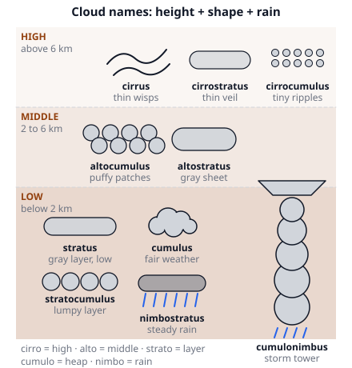
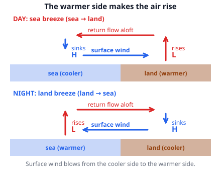
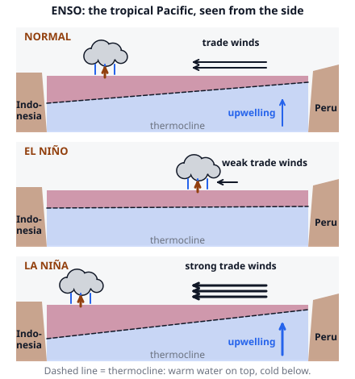

# 🟫 Weather Phenomena  ·  `earth.atmosphere.phenomena`
> 📅 Study date: Mon 26 Oct · ⏱️ ~12 min read · 📋 Syllabus: Cloud types, Local winds, Thunderstorms and severe weather, El Nino and La Nina, Monsoons, Hurricanes

## 🎮 Start with maps that have their own climate
Valorant maps feel different because each one has its own "climate": a snowy one, a dry desert, a tropical coast. On the real Earth, the same variety comes from a few big weather machines: clouds that stack up, winds that flip with the time of day, storms that build in an afternoon, and ocean-air partnerships like El Niño. This page is a tour of six of them, one core idea each. Keep the tropical coast in mind: you meet it again in the questions.

## 🖼️ Big picture

## 💡 Core ideas
1. **Clouds: name = height + shape + rain.** **Cirro-** means high (above about 6 km, made of ice crystals), **alto-** means middle (2 to 6 km), **strato-** means a flat layer, **cumulo-** means a heap, **nimbo-** means rain. So: *cirrus, cirrostratus, cirrocumulus* (high); *altocumulus, altostratus* (middle); *stratus, stratocumulus, cumulus* (low); and the two rain makers, **nimbostratus** (a thick gray layer: long, steady rain) and **cumulonimbus** (a tall storm tower with an anvil top: thunder, hail, downpours). Layered clouds come from slow, wide lifting (fronts). Heaped clouds come from rising bubbles of warm air (convection). **Fog** is just a cloud that touches the ground.
2. **Local winds.** The **sea breeze**: by day land heats faster than sea (water has a high specific heat and mixes downward), so air rises over land, and cooler air flows in from the sea. At night it reverses: the **land breeze**. In the mountains a **valley breeze** blows up the sunny slopes by day and a **mountain breeze** flows down the cold slopes at night. A **foehn** (or chinook) is a warm, dry wind on the lee side of a mountain: the air loses its water as rain going up (cooling slowly, about 5 °C/km), then warms by compression coming down (about 10 °C/km), so it arrives warmer than it started.
3. **Thunderstorms.** You need three things: **moist air**, **unstable air** (warm air near the ground, cold air above, so a rising bubble keeps rising) and **a trigger** (a front, a mountain, heated ground). Life cycle: **cumulus stage** (only updrafts), **mature stage** (updraft and downdraft side by side: heavy rain, hail, lightning, an anvil at the tropopause), **dissipating stage** (the downdraft chokes the updraft). Lightning comes from ice crystals and hail colliding inside the cloud, which separates electric charges. The bolt heats air to about 30 000 °C, so the air bursts outward: that is **thunder**. Light is instant, sound travels about 343 m/s, so **distance ≈ seconds between flash and bang ÷ 3 km**. Severe weather includes **tornadoes** (a rotating funnel from a spinning supercell storm; rated on the EF scale 0 to 5 by damage), large **hail**, **downbursts** (a sinking blast of wind) and flash floods.
4. **El Niño and La Niña (ENSO).** Normally the **trade winds** blow from east to west across the Pacific and pile up warm water near **Indonesia**. Air rises and rains there, and cold, rich water rises (**upwells**) off Peru. In an **El Niño** the trade winds weaken, warm water slides east, rain moves to the middle of the Pacific and Indonesia and Australia get **drier** (droughts, forest fires) while Peru gets floods. In a **La Niña** the trades are *stronger*, the east is colder, and Indonesia gets *more* rain. It repeats every 2 to 7 years. The air-pressure see-saw between Tahiti and Darwin is the **Southern Oscillation**.
5. **Monsoons.** A **monsoon** is a wind that **reverses with the season** and brings a wet season and a dry season. In summer the land heats more than the ocean, a low forms over land and the ITCZ shifts toward it, so moist air flows in from the sea: **heavy rain**. In winter the land is colder, the wind blows out from the land: **dry**. In South Asia the wet wind comes from the southwest in summer (June to September). In Indonesia the rain comes mostly with the northwest monsoon (about November to March) and the dry season comes with the southeast winds from Australia.
6. **Hurricanes.** A **tropical cyclone** is called a **hurricane** (Atlantic, East Pacific), a **typhoon** (West Pacific) or just a **cyclone** (Indian Ocean, South Pacific). It needs: **sea-surface water of at least 26.5 °C** (down to about 50 m), **moist air**, **little wind shear** (steady winds from the ground upward), a starting disturbance and **a Coriolis effect strong enough to make it spin**, which is why they do not form within about 5° of the equator. Latent heat from condensation is the engine. It has a calm clear **eye** (air sinking), a ring of the strongest winds and heaviest rain, the **eyewall**, and spiral **rainbands**. It spins counterclockwise in the north and clockwise in the south. It dies over land or cold water. The big killer is the **storm surge** (sea pushed onto the shore). **Saffir–Simpson scale** by sustained wind: Category 1: 119 to 153 km/h · 2: 154 to 177 · 3: 178 to 208 · 4: 209 to 251 · 5: 252 km/h or more.

## 🧮 HUSO-style examples

**Example 1.** A tropical cyclone has sustained winds of 60 m/s. Which category on the Saffir–Simpson scale is it?

(A) Category 1  (B) Category 2  (C) Category 3  (D) Category 4  (E) Category 5

Steps:
1. The scale uses km/h. Convert: 60 m/s × 3.6 = **216 km/h**.
2. Category 4 covers 209 to 251 km/h, and 216 is inside. **Answer: (D).**
3. Trap: reading "60" as km/h would not even make a hurricane (the minimum is 119 km/h).

**Example 2.** A foehn wind: moist air at 20 °C at sea level blows toward a mountain 3 km high. It cools at 10 °C/km while it is unsaturated, and a cloud forms at 1 km. Above that it cools at 5 °C/km. Over the top it has lost all its water as rain. On the other side it sinks all the way down to sea level, warming at 10 °C/km. What is its temperature at the bottom?

(A) 15 °C  (B) 20 °C  (C) 10 °C  (D) 30 °C  (E) 0 °C

Steps:
1. At 1 km: 20 − 10 = **10 °C** (cloud forms).
2. From 1 km to 3 km: 2 km × 5 °C/km = 10 °C of cooling, so the summit is **0 °C**.
3. Going down 3 km in dry air: 3 km × 10 °C/km = 30 °C of warming, so 0 + 30 = **30 °C**. **Answer: (D).**
4. The air ends 10 °C warmer than it began, because the water vapor's condensation heat stayed in the air.
5. Traps: (B) 20 °C uses the dry rate both ways. (A) 15 °C uses the moist rate on the way down. (C) 10 °C is the temperature at the cloud base. (E) 0 °C is the summit.

## ⚠️ Common traps
- **"Nimbostratus and cumulonimbus are the same."** Nimbostratus gives long, steady rain with no thunder. Cumulonimbus is the tall one with thunder, hail and anvil.
- **Wind direction at the beach.** A sea breeze blows *from* the sea (cooler) *to* the land. It is named for where it comes from.
- **"El Niño brings rain everywhere."** It dries Indonesia and Australia and floods Peru. La Niña does the reverse.
- **"Monsoon means heavy rain."** A monsoon is the *seasonal reversal* of the wind: the wet season is only one half of it.
- **Hurricanes at the equator.** The Coriolis effect is almost zero there, so they do not form.
- **Time between lightning and thunder.** Count from the flash, not from the first rumble.

## ✏️ Redraw from memory
Close the page and draw in 5 minutes:
- [ ] A cloud height chart: high, middle, low, with at least 6 of the 10 cloud names and the tall cumulonimbus.
- [ ] A coast in side view with a sea breeze by day: land warmer, rising air over the land, the surface wind from the sea and the return flow above.
- [ ] A thunderstorm: updraft, downdraft, anvil, and the 3 stages as words.
- [ ] The Pacific in normal and El Niño years: trade winds, where the warm water and the rain are, and where Indonesia and Peru are.
- [ ] A hurricane from above and from the side: eye, eyewall, rainbands, the spin directions, and the 26.5 °C rule.

Compare with the page and mark what you missed in red.

## 🎥 Watch / try
- [Weather 101: A Tutorial on Cloud Types](https://www.youtube.com/watch?v=FMagDRCpJ14) — NWSAlbuquerque · 5:06 · match the names to the shapes and heights
- [El Niño and La Niña Explained](https://www.youtube.com/watch?v=wVlfyhs64IY) — usoceangov · 1:55 · follow the trade winds and the warm water
- [How Do Hurricanes Form?](https://www.youtube.com/watch?v=wPDoIrGUrEc) — NOAA SciJinks · 2:23 · note the four ingredients

## ✅ Check your understanding (5 questions)
Do these without looking at the material. You are **READY** if you get at least 4 of 5 right.

**1.** A tall, dark cloud with a flat anvil-shaped top that brings thunder, hail and heavy showers is a

(A) cirrus.  (B) stratus.  (C) altocumulus.  (D) cumulonimbus.  (E) nimbostratus.

**2.** 🎮 Imagine a map on a tropical coast, with the sea on the west and hot sand on the east. At 2 p.m. on a sunny day, how does the surface wind blow along the beach?

(A) From the land toward the sea.  (B) From the sea toward the land.  (C) Straight up, with no horizontal wind.  (D) Parallel to the coast.  (E) There is no wind because the pressure is the same over land and sea.

**3.** During a strong El Niño, what is most likely in Indonesia?

(A) A drier than normal season, with a risk of drought and forest fires.  (B) Much heavier monsoon rain than normal, with floods.  (C) More snow in the mountains.  (D) Many more hurricanes.  (E) No change, because El Niño only affects South America.

**4.** Why do tropical cyclones almost never form right on the equator?

(A) The ocean is too cold there.  (B) There is too much wind shear.  (C) The Sun is too weak there.  (D) There is no land to feed the storm.  (E) The Coriolis effect is almost zero there, so the air cannot start to spin.

**5.** You see a lightning flash and hear the thunder 9 seconds later. Sound travels about 343 m/s, and light arrives instantly. About how far away was the lightning?

(A) 1 km  (B) 2 km  (C) 3 km  (D) 9 km  (E) 27 km

Answer key & explanations

1. **(D) cumulonimbus.** *Cumulo* = heap, *nimbus* = rain: the tall storm tower. (E) nimbostratus is a flat gray layer with steady rain and no anvil or thunder. (A) cirrus is a thin high cloud, (B) stratus a low flat layer, (C) altocumulus a middle-level patch of puffs.
2. **(B).** In the afternoon the sand is much hotter than the water. Air rises over the land, so the pressure near the ground is lower over the land and the cooler sea air flows in: a sea breeze. At night it would flip (land breeze).
3. **(A).** In El Niño the warm water and the rain move east, away from Indonesia. The usual rain machine over Indonesia weakens, so it is drier. (B) is what usually happens in La Niña.
4. **(E).** Cyclones need the Coriolis effect to turn the inflowing air into a spiral. It is zero at the equator and too weak within about 5° of it. (A) is wrong: the equatorial ocean is warm.
5. **(C) 3 km.** distance = speed × time = 343 m/s × 9 s ≈ 3087 m ≈ 3 km. The shortcut: seconds ÷ 3 = km. (D) 9 km counts 1 km per second. (E) 27 km multiplies by 3 instead of dividing. (A) and (B) are not the result of this calculation.

