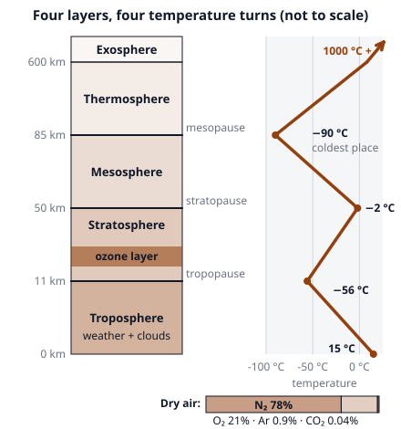

# 🟫 Atmospheric Structure  ·  `earth.atmosphere.structure`
> 📅 Study date: Sat 17 Oct · ⏱️ ~12 min read · 📋 Syllabus: Layers and composition, Vertical structure

## 🏊 Start with the bottom of the pool
Dive to the bottom of a 3 m deep pool and your ears feel the squeeze: 3 m of water is sitting on top of you. On land you live at the bottom of an **ocean of air** that is about 100 km deep, and its weight pushes on you as hard as 10 m of water would. This page climbs up through that air ocean, layer by layer, and checks what happens to the pressure and the temperature on the way.

## 🖼️ Big picture

## 💡 Core ideas
1. **What the air is made of.** Dry air is **78 % nitrogen (N₂)**, **21 % oxygen (O₂)**, **0.9 % argon (Ar)** and a tiny **0.04 % carbon dioxide (CO₂)**, plus traces of neon, helium, methane and ozone (O₃). **Water vapor** is the odd one out: it is 0 to about 4 % and changes from place to place, which is why we talk about *dry* air. The mix stays the same up to about 100 km.
2. **Pressure drops fast with height.** **Air pressure** is the weight of all the air above you. At sea level it is about **1013 hPa** (hectopascals; 1 atm). The air at the bottom is squeezed by the air above, so pressure falls by **half about every 5.5 km**: about 500 hPa at 5.5 km, about 250 hPa near 11 km. Half of all the air in the atmosphere is below 5.5 km, and about 99 % is below 30 km.
3. **Four temperature turns make five layers.** Scientists name the layers by what the temperature does with height. The ending **-sphere** is the layer and **-pause** is the boundary where the trend flips. From the ground up: **troposphere**, **stratosphere**, **mesosphere**, **thermosphere**, **exosphere**.
4. **Troposphere (0 to about 11 km): cooling.** The Sun warms the *ground*, and the ground warms the air from below. So the air gets colder as you climb, by about **6.5 °C per km** (the *environmental lapse rate*). It ends at the **tropopause**, about **−56 °C**. This layer holds about 80 % of the air's mass and almost all the water vapor, so **all the weather** is here. The tropopause is high over the equator (16 to 18 km) and low over the poles (about 8 km).
5. **Stratosphere (11 to 50 km): warming.** Here it gets *warmer* with height, up to about −2 °C at the **stratopause**. The reason is the **ozone layer** (roughly 15 to 35 km): ozone absorbs the Sun's harmful **ultraviolet (UV)** light and turns it into heat. Warm air on top of cold air does not rise, so this layer is calm and layered ("strata"). Jets cruise at its bottom.
6. **Mesosphere, thermosphere, exosphere (above 50 km).** In the **mesosphere** (50 to 85 km) it cools again, down to about **−90 °C** at the **mesopause**: the coldest place in the atmosphere, where meteors burn up. In the **thermosphere** (85 km to about 600 km) it warms again, to **1000 °C or more**, because single atoms absorb X-rays and extreme UV. But the air is so thin that very little heat is carried. The **ionosphere** (charged particles; auroras; radio waves bounce) overlaps the upper mesosphere and thermosphere. The **exosphere** slowly fades into space; there is no sharp top.

| Layer | Height | Temperature with height | What heats it |
|---|---|---|---|
| 🟫 Exosphere | above ~600 km | (very thin, fades out) | the Sun |
| 🟫 Thermosphere | 85 to ~600 km | rises (to 1000 °C +) | X-rays and extreme UV |
| 🟫 Mesosphere | 50 to 85 km | falls (to about −90 °C) | little heating |
| 🟫 Stratosphere | 11 to 50 km | rises (to about −2 °C) | ozone absorbing UV |
| 🟫 Troposphere | 0 to 11 km | falls (15 °C to −56 °C) | the warm ground |

> 🌊 **Analogy:** air pressure is like the water pressure in the pool: the deeper you are, the more fluid sits on top of you. **The difference:** water is almost impossible to squeeze, so water pressure grows in a straight line (about +1 atm for every 10 m). Air *can* be squeezed, so most of it is crowded near the ground and the pressure drops by half again and again.

## 🧮 HUSO-style examples

**Example 1.** 🏊 A jet flies at 11 km. The air on the ground at the airport is 15 °C. Assume the temperature falls by 6.5 °C for every km. What is the air temperature around the jet?

(A) 86.5 °C  (B) 4 °C  (C) −56.5 °C  (D) −71.5 °C  (E) −6.5 °C

Steps:
1. The temperature falls 6.5 °C for each km, and the jet is 11 km up. The total drop is 6.5 × 11 = 71.5 °C.
2. Start from the ground temperature: 15 − 71.5 = **−56.5 °C**. **Answer: (C).**
3. Sense check: this is right at the tropopause value (−56 °C). A jet cruises just at the top of the troposphere.
4. Traps: (D) −71.5 °C forgets to start from 15 °C. (B) 4 °C uses 1 °C per km. (A) 86.5 °C adds instead of subtracting.

**Example 2.** On the ground the pressure is 1013 hPa. Assume it halves every 5.5 km. About what is the pressure at 11 km?

(A) 507 hPa  (B) 338 hPa  (C) 253 hPa  (D) 127 hPa  (E) 0 hPa

Steps:
1. 11 km is 11 ÷ 5.5 = 2 halvings.
2. After one halving: 1013 ÷ 2 ≈ 507 hPa. After two: 1013 ÷ 4 ≈ **253 hPa**. **Answer: (C).**
3. Sense check: the real value is about 227 hPa; the "halving" rule is only a good approximation.
4. Traps: (A) 507 hPa is only *one* halving. (E) the air does not vanish at 11 km: there is still a quarter of the ground pressure.

## ⚠️ Common traps
- **"Higher always means colder."** Only in the troposphere and the mesosphere. In the stratosphere and thermosphere the temperature *rises* with height.
- **"The thermosphere is hot, so it would burn you."** The thermometer number is high because each atom moves fast, but there are so few atoms that almost no heat is passed on. You would feel freezing, not hot.
- **Ozone location.** The protective ozone layer is in the **stratosphere**. Ozone near the ground is just smog.
- **Weather in the stratosphere.** No. Weather and clouds live in the troposphere, under the tropopause "lid".
- **Mixing up the layer and its boundary.** The *-sphere* is the layer; the *-pause* is the line between two layers.

## ✏️ Redraw from memory
Close the page and draw in 5 minutes:
- [ ] A column with the 5 layers in the right order, with the heights 11, 50, 85 km.
- [ ] The 4 "pause" lines and their names.
- [ ] The temperature zigzag next to it: falls, rises, falls, rises, with −56 °C, about −2 °C and about −90 °C marked.
- [ ] The ozone layer inside the stratosphere, and "weather" inside the troposphere.
- [ ] A small bar or list of dry air: N₂ 78 %, O₂ 21 %, Ar 0.9 %, CO₂ 0.04 %.

Compare with the page and mark what you missed in red.

## 🎥 Watch / try
- [Layers of the Atmosphere | What is Atmosphere | Animation](https://www.youtube.com/watch?v=y9mbrAVRPSU) — VectorGlobe - Know the World · 2:32 · count the layers and see where the temperature goes up and down
- [Layers Of Atmosphere | The Dr. Binocs Show](https://www.youtube.com/watch?v=5sg9sCOXFIk) — Peekaboo Kidz · 3:28 · what is special about each layer

## ✅ Check your understanding (5 questions)
Do these without looking at the material. You are **READY** if you get at least 4 of 5 right.

**1.** By volume, which gas is the second most abundant in dry air?

(A) Nitrogen  (B) Argon  (C) Oxygen  (D) Carbon dioxide  (E) Water vapor

**2.** Temperature rises with height in the stratosphere mainly because

(A) the ground is hotter there.  (B) ozone absorbs ultraviolet light from the Sun.  (C) clouds trap heat there.  (D) air pressure is higher there.  (E) meteors burn up there.

**3.** 🏊 A weather balloon leaves the pool deck where the air is 30 °C. Assume the temperature falls by 6.5 °C per km. What is the air temperature at 5 km?

(A) 62.5 °C  (B) 25 °C  (C) 23.5 °C  (D) −2.5 °C  (E) −32.5 °C

**4.** The thermosphere can reach 1000 °C, yet an astronaut floating there would not feel hot. Why?

(A) The space suit reflects all heat.  (B) The thermometer readings are mistakes.  (C) The Sun is always behind Earth there.  (D) The ozone layer protects her.  (E) The air is so thin that very few particles touch her, so little heat is passed on.

**5.** The pressure at the ground is 1000 hPa. Assume it halves every 5.5 km. What is it at 22 km?

(A) 62.5 hPa  (B) 125 hPa  (C) 250 hPa  (D) 500 hPa  (E) 31.3 hPa

Answer key & explanations

1. **(C) Oxygen.** About 78 % is nitrogen and about 21 % is oxygen. Argon (0.9 %) is third. (A) is the *first* most abundant, not the second.
2. **(B).** Ozone absorbs UV light and turns it into heat, mostly in the upper stratosphere. (A) is the reason for the *troposphere*, where the ground heats the air from below. (E) belongs to the mesosphere.
3. **(D) −2.5 °C.** The drop is 6.5 × 5 = 32.5 °C, so 30 − 32.5 = −2.5 °C. (C) 23.5 °C uses only one km. (B) 25 °C uses 1 °C per km. (A) 62.5 °C adds. (E) −32.5 °C forgets to start from 30 °C.
4. **(E).** Temperature measures how fast the atoms move. Heat transfer needs many collisions, and the thermosphere has very few atoms. So the astronaut gains almost no heat (and loses more by radiation).
5. **(A) 62.5 hPa.** 22 ÷ 5.5 = 4 halvings: 1000 → 500 → 250 → 125 → 62.5 hPa. (B) counts only 3 halvings. (C) counts 2, (D) counts 1. (E) 31.3 hPa counts 5 halvings.

