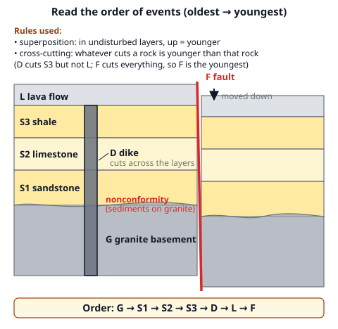
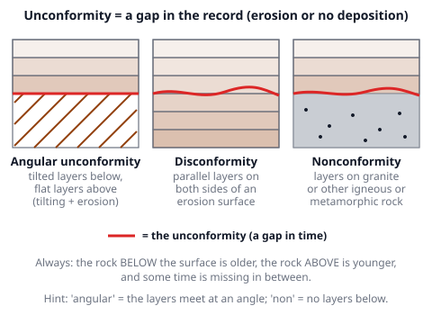
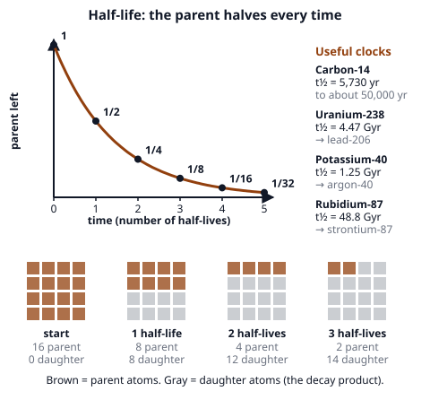
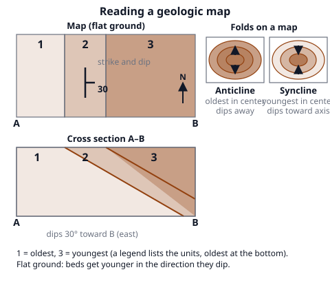

# 🟫 Dating & Mapping  ·  `earth.geosphere.dating`
> 📅 Study date: Wed 28 Oct · ⏱️ ~12 min read · 📋 Syllabus: Geologic maps, Relative dating and unconformities, Radiometric dating

## 🏊 Start with the swim meet scoreboard
After a race, the scoreboard can tell you two different things: **the order** (lane 4 touched the wall before lane 2) and **the exact time** (52.31 seconds). Geologists also get two kinds of "results". **Relative dating** says which rock is older: the order of events. **Radiometric dating** is the stopwatch: it gives an age in years. **The difference:** a swimmer's stopwatch starts when the race starts, but a rock's "stopwatch" (its radioactive atoms) starts the moment the rock forms, and nobody was there to watch.

## 🖼️ Big picture

## 💡 Core ideas
1. **Relative dating: seven rules.**
   - **Original horizontality:** sediment is laid down in flat layers. Tilted layers were moved later.
   - **Superposition:** in undisturbed layers, the **bottom is oldest** and the top is youngest.
   - **Lateral continuity:** a layer spreads sideways until it thins out, so matching layers on two sides of a valley were once connected.
   - **Cross-cutting:** whatever **cuts** a rock (a fault, a dike, an erosion surface) is **younger** than the rock it cuts.
   - **Inclusions:** a piece of rock inside another rock is **older** than the rock around it.
   - **Faunal succession:** fossils appear in a fixed order. An **index fossil** lived for a short time over a wide area, so it dates the layer it is found in.
   - **Uniformitarianism:** "the present is the key to the past": the same processes that work today made the old rocks.
2. **Unconformities** are surfaces that mark a **gap in the record** (erosion or no deposition). **Angular unconformity:** tilted older layers cut off and covered by flat younger layers (deposit → tilt → erode → deposit). **Disconformity:** layers on both sides are parallel, with an erosion surface between them. **Nonconformity:** layered sedimentary (or volcanic) rock lies on igneous or metamorphic rock. The rock **below** the surface is always older.
3. **Radiometric dating.** Some atoms are unstable: the **parent** isotope turns into a stable **daughter** isotope at a steady rate. The time for **half** of the parent to decay is the **half-life**, and it does not change with heat or pressure. After n half-lives the fraction of parent left is **(½)ⁿ**: ½, ¼, ⅛, 1/16, … So **age = n × half-life**. If you know the ratio, convert it to a fraction first: parent : daughter = 1 : 3 means ¼ is parent (**2 half-lives**), not 3.
   - **Carbon-14** (5,730 yr) for **once-living** things up to about 50,000 years. **Uranium-238 → lead-206** (4.47 billion yr), **potassium-40 → argon-40** (1.25 billion yr) and **rubidium-87 → strontium-87** (48.8 billion yr) for rocks.
   - The method needs a **closed system** (nothing gained or lost since the rock formed). It dates when an **igneous** rock **crystallized**. Sediment grains are older than the rock they are in, so sedimentary layers are dated by **bracketing** them between dated igneous layers (e.g., ash below and a lava flow above).
   - **Earth's age** is about **4.54 billion years**. The oldest minerals (zircon crystals) are about 4.4 billion years old.
4. **Geologic time scale.** Earth's history is divided by big changes in life. The four **eons** are the **Hadean**, **Archean**, **Proterozoic** and **Phanerozoic**. The first three together are the **Precambrian**, about **88 %** of all time. The Phanerozoic (the last 539 million years, "visible life") has three eras: **Paleozoic** (539 to 252 million years ago, ending with the biggest mass extinction), **Mesozoic** (252 to 66, the age of dinosaurs) and **Cenozoic** (66 million years ago to now, mammals).
5. **Geologic maps** show which rock unit is at the surface. Each **unit** has a color and a letter, the **legend** lists them (oldest at the bottom), lines are **contacts** (boundaries) and heavier lines are **faults**.
   - **Strike and dip** symbol: the long line is the **strike** (the compass direction of a level line on the bed), the short tick points the **way the bed slopes down**, and the number is the **dip angle** (0° flat, 90° vertical).
   - **Patterns:** flat beds make contacts that follow the **contour lines**; tilted beds on flat ground make straight **parallel bands**; a dipping contact that crosses a valley bends into a **V that points in the direction of dip** (when the dip is steeper than the valley floor).
   - **Rule on flat ground:** beds get **younger in the direction of dip** (unless they are overturned).
6. **Folds on maps and cross sections.** An **anticline** is an arch: the **oldest** rock is in the **center** and the beds dip **away** from the axis. A **syncline** is a trough: the **youngest** rock is in the center and the beds dip **toward** the axis. To draw a **cross section**, follow the surface line, put each contact where the map crosses it, and continue it at the dip angle.

> 🏊 **Analogy:** the order of finish is relative dating, the stopwatch is radiometric dating. **The difference:** the order of finish tells you who was first even if no one took the time. Likewise, relative dating works on any rock, but radiometric dating works best on igneous rocks.

## 🧮 HUSO-style examples

**Example 1.** In a canyon wall, tilted limestone beds are cut by a basalt dike. The dike stops at a flat erosion surface. Above the surface lie flat sandstone beds that contain rounded pieces of basalt. Which line gives the sequence from oldest to youngest and the type of contact at the erosion surface?

(A) Dike, limestone, sandstone; angular unconformity  (B) Limestone, sandstone, dike; disconformity  (C) Limestone, dike, sandstone; angular unconformity  (D) Limestone, dike, sandstone; nonconformity  (E) Sandstone, dike, limestone; angular unconformity

Steps:
1. The dike **cuts** the limestone, so the limestone is older than the dike (cross-cutting).
2. The dike is **cut off** by the erosion surface, and the sandstone lies on top and contains pieces of the basalt (inclusions). So the sandstone is **younger** than the dike.
3. Sequence: limestone → dike → sandstone. That removes (A), (B) and (E).
4. Tilted beds below and flat beds above the surface make an **angular unconformity**. A nonconformity needs igneous or metamorphic rock below, and the dike is only a thin sheet. **Answer: (C).**

**Example 2.** A volcanic rock contains a clock isotope with a half-life of **1.25 billion years**. In the rock there are **3 daughter atoms for every 1 parent atom**. How old is the rock?

(A) 0.625 billion years  (B) 1.25 billion years  (C) 2.5 billion years  (D) 3.75 billion years  (E) 5.0 billion years

Steps:
1. Parent : daughter = 1 : 3, so out of every 4 atoms only **1 is still parent**: the fraction left is ¼.
2. ½ → ¼ takes **2 half-lives**.
3. Age = 2 × 1.25 = **2.5 billion years**. **Answer: (C).**
4. Traps: (D) uses 3 half-lives because of the "3". (B) is only one half-life (that would be 1:1). (E) uses 4 half-lives (the number of atoms). (A) halves the half-life.

## ⚠️ Common traps
- **Half-life is not "half the age".** After 2 half-lives a quarter is left, not zero. The decay never "finishes".
- **Ratio vs. fraction.** 1 : 3 is a quarter parent, not a third. Count the **total** first.
- **Young on top is not always true.** Folds and thrust faults can turn layers upside down. The rule needs undisturbed layers.
- **A fault is younger than what it cuts**, and a dike is younger than the rock it cuts. A layer on an unconformity is younger than the surface.
- **Carbon dating does not date rocks.** C-14 is only for once-living material, back to about 50,000 years.
- **The tick on strike-dip points down-dip**, not along the strike.

## ✏️ Redraw from memory
Close the page and draw in 6 minutes:
- [ ] The three unconformities, each with a one-line description (tilted/flat, parallel, igneous or metamorphic below).
- [ ] A decay curve with ½, ¼, ⅛, 1/16 and the equation age = n × half-life.
- [ ] A cross section with a dike, a fault and an unconformity, and the order of events written next to it.
- [ ] A map with tilted beds, a strike-and-dip symbol and the rule for younger rocks.
- [ ] An anticline and a syncline as map patterns, with dip arrows and "old"/"young" in the center.

Compare with the page and mark what you missed in red.

## 🎥 Watch / try
- [Laws of Relative Rock Dating](https://www.youtube.com/watch?v=M2Ex5DIjtfU) — London Jenks · 4:11 · follow how each rule puts events in order
- [Radiometric Dating: Carbon-14 and Uranium-238](https://www.youtube.com/watch?v=8QnsA_1pEd8) — Professor Dave Explains · 6:07 · see how half-lives turn into ages
- [What is Strike and Dip and How is it Indicated on a Map?](https://www.youtube.com/watch?v=-yPcPlIHDl0) — Ruppert Rocks Geology · 6:33 · learn to read the strike-and-dip symbol

## ✅ Check your understanding (5 questions)
Do these without looking at the material. You are **READY** if you get at least 4 of 5 right.

**1.** 🏊 A swim meet scoreboard says "lane 4 finished before lane 2" and also "52.31 s". Which geologic statement is most like the **first** one?

(A) This granite is 2.7 billion years old  (B) The sandstone is older than the dike that cuts it  (C) The sample has 25 % of its carbon-14 left  (D) The half-life of uranium-238 is 4.47 billion years  (E) The lava flow formed 12 million years ago

**2.** Flat sandstone layers lie directly on top of a body of granite. No tilted layers are present. This contact is

(A) an angular unconformity  (B) a disconformity  (C) a nonconformity  (D) a normal fault  (E) an intrusive contact

**3.** A wooden tool contains 1/16 of the carbon-14 it had when the tree was cut. The half-life of carbon-14 is 5,730 years. How old is the tool?

(A) 5,730 years  (B) 11,460 years  (C) 17,190 years  (D) 22,920 years  (E) 91,680 years

**4.** On flat ground, a geologist walks east across rock layers that all dip east at 40° (the layers are not overturned). What happens to the age of the rocks as she walks?

(A) They get younger  (B) They get older  (C) They stay the same age  (D) They get older, then younger  (E) It cannot be told without fossils

**5.** On a map, rock units form an oval pattern. The youngest unit is in the center, and the strike-and-dip symbols show dips toward the center. This structure is

(A) an anticline  (B) a dike  (C) a fault  (D) an unconformity  (E) a syncline

Answer key & explanations

1. **(B) The sandstone is older than the dike that cuts it.** The finishing order is an **order of events** with no numbers, like relative dating. (A), (C), (D) and (E) all give numbers or ages: they are like the stopwatch time (radiometric dating).
2. **(C) a nonconformity.** Layered sedimentary rock on top of igneous rock is a nonconformity. (A) needs tilted layers below. (B) needs parallel layers on both sides. (D) A fault is a break with movement. (E) An intrusive contact is where magma pushed into rock.
3. **(D) 22,920 years.** 1/16 = (½)⁴, so 4 half-lives: 4 × 5,730 = 22,920. (A) is 1 half-life (½). (B) is 2 half-lives (¼). (C) is 3 half-lives (⅛). (E) is 16 × 5,730, using the 16 as a number of half-lives.
4. **(A) They get younger.** On flat ground, beds that are not overturned get younger in the direction of dip. (B) is the opposite (walking west). (C) and (D) ignore the dip. (E) Fossils are not needed for this rule.
5. **(E) a syncline.** A syncline has the youngest rock in the center and beds dipping toward the axis. (A) An anticline is the opposite (oldest in the center, dips away). (B) A dike is a narrow sheet of igneous rock. (C) A fault would show an offset line. (D) An unconformity shows a gap, not an oval.

