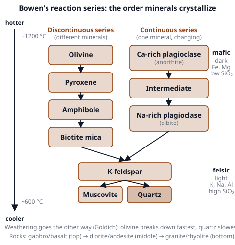
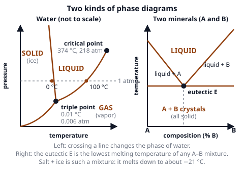
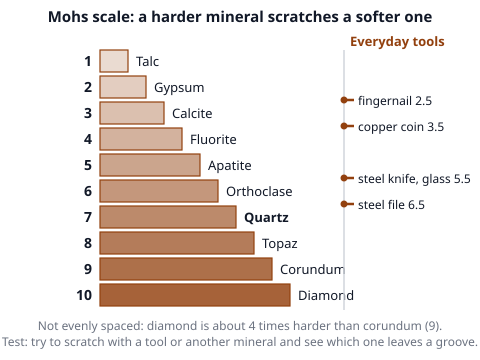
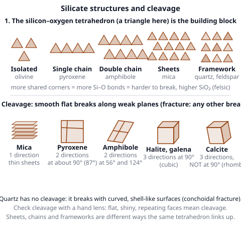

# 🟫 Geochemistry & Minerals  ·  `earth.geosphere.geochemistry`
> 📅 Study date: Sun 25 Oct · ⏱️ ~12 min read · 📋 Syllabus: Phase diagrams, Bowen's reaction series, Mineral properties (crystal structure, hardness, cleavage...)

## 🍳 Start with salty ice
To make ice cream by hand, cooks pack ice around the pot and **pour salt on the ice**. The mix gets much colder than ice alone, around −18 °C, even though ice normally melts at 0 °C. Salt changes the temperature where the ice melts. Geologists use exactly this kind of **melting-point map** (a *phase diagram*) to understand how rocks melt and how minerals crystallize out of magma, and they use a few simple tests (scratch, break, streak) to tell minerals apart. **The difference:** the salt-and-ice mixture is a kitchen trick for cooling; in rocks the same diagram tells you which crystals form first.

## 🖼️ Big picture

## 💡 Core ideas
1. **What is a mineral?** A **mineral** is a natural, solid, non-living substance with a definite chemical formula and an orderly **crystal structure** (atoms in a repeating pattern). Eight elements make up 98.5 % of the crust by mass: **O 46.6 %, Si 27.7 %, Al 8.1 %, Fe 5.0 %, Ca 3.6 %, Na 2.8 %, K 2.6 %, Mg 2.1 %**. That is why **silicates** (Si + O) are by far the most common minerals. The other classes are oxides, carbonates (calcite, CaCO₃), sulfides (pyrite), sulfates (gypsum), halides (halite, NaCl) and native elements (gold, diamond).
2. **Properties used to identify minerals.** Always try several, because color alone can fool you.
   - **Hardness:** the **Mohs scale** 1–10 (talc, gypsum, calcite, fluorite, apatite, orthoclase, quartz, topaz, corundum, diamond). A harder material scratches a softer one. Tools: fingernail 2.5, copper coin 3.5, steel knife or glass 5.5, steel file 6.5.
   - **Cleavage** (flat, smooth breaks along weak planes) or **fracture** (any other break; quartz breaks with curved, shell-like **conchoidal** surfaces). Count the cleavage directions and the angles between them.
   - **Luster** (metallic or nonmetallic: glassy, pearly, silky, dull), **streak** (the color of the powder on a white tile; it is more reliable than the surface color, e.g., hematite is reddish-brown in streak) and **opacity** (opaque, translucent or transparent).
   - **Crystal habit:** the usual shape (cubes, six-sided prisms, needles, fibers, rounded "grape" masses). It follows the **crystal structure**, which is one of seven crystal systems (cubic, tetragonal, orthorhombic, hexagonal, trigonal, monoclinic, triclinic).
   - **Special tests:** **density** (galena feels heavy), **magnetism** (magnetite), **fizz with acid** (calcite), **taste** (halite is salty), **striations** (fine parallel lines on plagioclase).

   | Mineral | Hardness | Cleavage / fracture | Quick ID |
   |---|---|---|---|
   | **Quartz** SiO₂ | 7 | none, conchoidal fracture | glassy, six-sided prisms |
   | **Feldspar** (K-feldspar, plagioclase) | 6 | 2 directions at about 90° | pink or white; plagioclase has striations |
   | **Mica** (biotite, muscovite) | 2.5–3 | 1 direction, thin sheets | peels in flakes |
   | **Calcite** CaCO₃ | 3 | 3 directions, not at 90° (rhombs) | fizzes with acid |
   | **Halite** NaCl | 2.5 | 3 directions at 90° (cubes) | tastes salty |
   | **Gypsum** | 2 | 1 good direction | scratched by a fingernail |
   | **Olivine** | 6.5–7 | none | green, glassy, in mafic rocks |
   | **Pyroxene** | 5–6 | 2 directions at about 90° (87°) | dark green to black |
   | **Amphibole** | 5–6 | 2 directions at 56° and 124° | dark, long blades |
   | **Magnetite** | 5.5–6.5 | none | black, magnetic |
   | **Galena** PbS | 2.5 | 3 directions at 90° | metallic, very heavy |
3. **Silicate structures.** The basic unit is the **silica tetrahedron**: one Si atom surrounded by 4 O atoms. How tetrahedra link decides the mineral: **isolated** (olivine), **single chains** (pyroxene), **double chains** (amphibole), **sheets** (micas, clay), **3D framework** (quartz, feldspar). More sharing of oxygen means a higher SiO₂ content and a more felsic mineral. This is also why mica has one cleavage (it splits between the sheets) and quartz has none (bonds are strong in every direction). Other polymorphs: the same formula can have different structures, like **diamond and graphite** (both carbon) or **kyanite, andalusite and sillimanite** (all Al₂SiO₅, stable at different pressures and temperatures).
4. **Bowen's reaction series** shows the order in which minerals crystallize from a **cooling magma**. Two branches run side by side and join at the end. **Discontinuous branch:** olivine → pyroxene → amphibole → biotite; each mineral **reacts** with the leftover melt and changes into the next one. **Continuous branch:** plagioclase changes **gradually** from **Ca-rich** to **Na-rich** with the same framework. Both branches then lead to **K-feldspar → muscovite → quartz**, the last to crystallize. Hot minerals (olivine, pyroxene, Ca-plagioclase) belong to **mafic** rocks (gabbro, basalt) and cool ones (quartz, K-feldspar, muscovite) to **felsic** rocks (granite, rhyolite). Because of the reactions, **olivine and quartz do not occur together**. Minerals that form first weather fastest at the surface (**Goldich**): olivine fastest, quartz slowest.
5. **Phase diagrams** show which phase (solid, liquid, gas) is stable at a given temperature and pressure (or composition).
   - **Water, pressure vs. temperature:** three lines meet at the **triple point** (0.01 °C, 0.006 atm), where ice, liquid and vapor coexist. Below that pressure ice goes straight to vapor (**sublimation**). The **boiling line** ends at the **critical point** (374 °C, 218 atm); above it there is no difference between liquid and gas. Water's **melting line leans backward**: more pressure makes ice melt, which is why ice floats on water. Higher pressure also raises the boiling point (**pressure cooker**).
   - **Binary eutectic diagram** (two minerals A and B, temperature vs. composition): above the **liquidus** curves everything is liquid, below the **solidus** line everything is solid, in between you have **liquid + crystals**. The lowest point where the curves meet is the **eutectic**: the mixture with the **lowest melting temperature** of all. A mixture of exactly that composition melts and freezes at one temperature, like a pure substance. Salt + water has a eutectic at −21 °C.
6. **Reading a diagram.** Follow a **path**: move across the diagram and note each line you cross. When you cool a liquid of composition A + B, the first crystals appear when you hit a liquidus line; the melt then moves toward the eutectic until it is all solid. When you heat a rock, the first melt forms at the **eutectic** temperature: that is why partial melting makes magma richer in the low-melting minerals (more felsic) than the source rock.

> 🍳 **Analogy:** a eutectic is like the salt-and-ice mixture that melts at a lower temperature than either pure ice or pure salt. **The difference:** in a rock, the "ingredients" are silicate minerals, and the melting happens at temperatures above 600 °C.

## 🧮 HUSO-style examples

**Example 1.** 🍳 A pressure cooker holds the pressure inside at about **2 atm** (absolute pressure). At about what temperature does water boil inside?

(A) 80 °C  (B) 100 °C  (C) 120 °C  (D) 140 °C  (E) 200 °C

Steps:
1. On the water phase diagram the **boiling line slopes upward**: more pressure means a **higher** boiling point. That removes (A) and (B), which are at or below the 100 °C of normal pressure (1 atm).
2. Reading the boiling line at 2 atm (twice the normal pressure) gives about **120 °C**. **Answer: (C).**
3. Traps: (A) 80 °C is the boiling point on a very high mountain, where the pressure is low. (D) and (E) come from thinking that the boiling point rises as fast as the pressure.

**Example 2.** Which set of minerals is most likely to be found together in one igneous rock?

(A) Olivine and quartz  (B) Quartz, K-feldspar and muscovite  (C) Olivine and K-feldspar  (D) Ca-rich plagioclase and quartz  (E) Pyroxene and muscovite

Steps:
1. Use Bowen's series. A rock holds minerals from **neighboring parts** of the series, because the early minerals react away or are used up when the late ones form.
2. Olivine (top, hot) cannot coexist with quartz (bottom, cool): they react to make pyroxene. That removes (A), and similarly (C), (D) and (E), which all pair a hot mineral with a cool one.
3. Quartz, K-feldspar and muscovite are all from the **cool end**: they make a **granite**. **Answer: (B).**

## ⚠️ Common traps
- **Color is not a safe test.** Quartz comes in many colors (clear, pink, purple, smoky). Hardness, cleavage and streak are more reliable.
- **Hardness vs. toughness.** A diamond is the hardest mineral (10) but it can still **break** along its cleavage, because that is a different property.
- **Cleavage is not crystal shape.** A mineral can grow as a six-sided prism (quartz) and have no cleavage at all. Cleavage is how it **breaks**, not how it grows.
- **Bowen's series is about crystallization, not melting order.** Do not mix it up with the order of weathering (the reverse: olivine weathers fastest).
- **Liquidus vs. solidus.** Above the liquidus it is all liquid. Below the solidus it is all solid. The region between is a **mix** of liquid and crystals.
- **Water's solid–liquid line leans left** (backward). For most substances it leans to the right.

## ✏️ Redraw from memory
Close the page and draw in 6 minutes:
- [ ] Bowen's reaction series with both branches, the joining point and the final three minerals, plus a temperature arrow and "mafic" and "felsic" at the ends.
- [ ] The pressure–temperature phase diagram of water with the solid, liquid and gas fields, the triple point, the critical point and the backward-leaning melting line.
- [ ] A eutectic diagram with the liquid field, the two "liquid + crystal" fields, the solid field and the eutectic point.
- [ ] The Mohs scale (1–10 with names) and where a fingernail, a copper coin and a knife fit.
- [ ] Silicate structures (isolated, chain, double chain, sheet, framework) with one mineral for each.

Compare with the page and mark what you missed in red.

## 🎥 Watch / try
- [What is Bowen's Reaction Series?](https://www.youtube.com/watch?v=1KOFP1OaCaA) — Ruppert Rocks Geology · 6:00 · follow the two branches and see which minerals can sit together
- [Macroscopic Characteristics of Minerals Part 2: Cleavage and Hardness](https://www.youtube.com/watch?v=zS6Lro53c-Q) — Professor Dave Explains · 5:16 · watch how cleavage planes and the Mohs scale are used
- [Phase Diagrams of Water & CO2 Explained](https://www.youtube.com/watch?v=QrHlwgmMTq4) — The Organic Chemistry Tutor · 10:28 · find the triple point and the critical point and see why water's melting line leans backward

## ✅ Check your understanding (5 questions)
Do these without looking at the material. You are **READY** if you get at least 4 of 5 right.

**1.** 🍳 A cook packs crushed ice around an ice-cream pot and adds salt. The mixture drops to about −18 °C. Which idea explains this best?

(A) Salt releases cold as it dissolves  (B) Salt raises the melting point of ice  (C) Salt blocks heat from entering the pot  (D) Salt lowers the melting point of ice, so the ice melts at a temperature below 0 °C and takes heat from the cream  (E) Salt turns the water into a gas

**2.** A mineral can be scratched by a steel knife blade but cannot be scratched by a copper coin. Its Mohs hardness is most likely

(A) less than 2.5  (B) between 2.5 and 3.5  (C) between 3.5 and 5.5  (D) between 5.5 and 6.5  (E) more than 6.5

**3.** A geologist finds a light-colored rock made mostly of quartz, K-feldspar and muscovite. According to Bowen's series, which description fits best?

(A) A felsic rock that crystallized from a cool, silica-rich magma  (B) A mafic rock that crystallized from a hot magma  (C) An ultramafic rock from the mantle  (D) A metamorphic rock formed at subduction zones  (E) A rock made of minerals that weather faster than olivine

**4.** A mineral breaks into small blocks with slanted faces. It has three cleavage directions that are not at 90°, and a drop of dilute acid makes it fizz. What is it?

(A) Halite  (B) Calcite  (C) Quartz  (D) Mica  (E) Pyroxene

**5.** A block of ice is warmed slowly at a pressure of 0.001 atm, which is below the triple point of water. What happens?

(A) It melts into liquid water  (B) It first melts and then boils at 0 °C  (C) It becomes supercritical  (D) It stays solid until 100 °C  (E) It turns directly into water vapor

Answer key & explanations

1. **(D) Salt lowers the melting point of ice, so the ice melts at a temperature below 0 °C and takes heat from the cream.** Melting takes in heat. A salt–water mixture can stay liquid down to about −21 °C (its eutectic), so the ice keeps melting and keeps cooling the pot. (A) Dissolving salt does not release cold by itself. (B) is the opposite. (C) The salty ice is not an insulator. (E) Nothing boils.
2. **(C) between 3.5 and 5.5.** A knife (5.5) scratches it, so it is softer than 5.5. A copper coin (3.5) cannot scratch it, so it is harder than 3.5. (A) and (B) would be scratched by the coin. (D) and (E) would not be scratched by the knife.
3. **(A) A felsic rock that crystallized from a cool, silica-rich magma.** Quartz, K-feldspar and muscovite are the **last** minerals in Bowen's series: this is granite. (B) A mafic rock has olivine, pyroxene and Ca-plagioclase. (C) An ultramafic rock is mostly olivine and pyroxene. (D) is not a rock type from a magma. (E) Quartz weathers slower than olivine, not faster.
4. **(B) Calcite.** Three cleavage directions not at 90° (rhombs) and acid fizz are the signs of calcite. (A) Halite has cubic cleavage and tastes salty. (C) Quartz has no cleavage. (D) Mica has one direction. (E) Pyroxene has two directions near 90°.
5. **(E) It turns directly into water vapor.** Below the triple point pressure there is no liquid field, so warming ice makes it sublimate. (A) and (B) need a pressure above 0.006 atm. (C) Supercritical needs more than 218 atm and 374 °C. (D) Ice does not stay solid up to 100 °C at such a low pressure.

