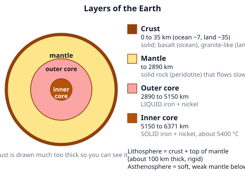
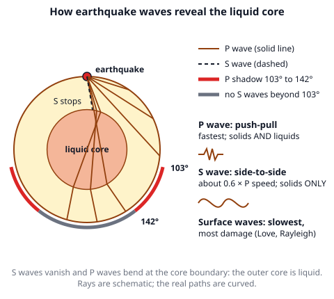
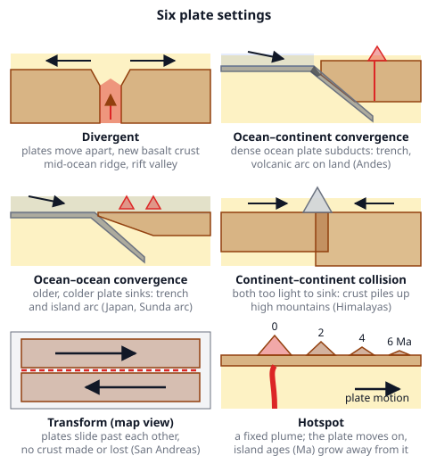
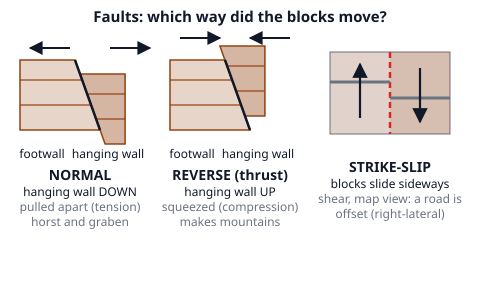
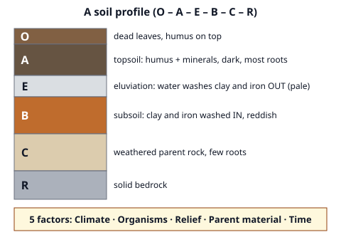

# 🟫 Earth's Interior  ·  `earth.geosphere.interior`
> 📅 Study date: Sat 17 Oct · ⏱️ ~12 min read · 📋 Syllabus: Layers of the Earth, Seismic waves, Plate boundaries, Faults, Tectonics, Soil formation

## 🎮 Start with a ping through the walls
Imagine an agent whose recon dart "pings" the map and shows what is hidden behind the walls. Scientists do the same with the Earth. The deepest hole ever drilled is only about 12 km, but the planet is 6371 km deep to the center. So they listen to **earthquake waves**: how fast they travel, where they bend and which ones disappear tells us what is down there. **The difference:** a recon dart is sent on purpose; scientists wait for natural earthquakes and listen with seismometers all over the world.

## 🖼️ Big picture

## 💡 Core ideas
1. **Layers of the Earth.** By **composition**: **crust** (thin and light: oceanic about 7 km of basalt, continental about 35 km of granite-like rock), **mantle** (to 2890 km, peridotite, about 84 % of Earth's volume), **outer core** (2890 to 5150 km, **liquid** iron and nickel) and **inner core** (5150 to 6371 km, **solid** iron and nickel: the pressure is so high that it stays solid even though it is about 5400 °C). The boundary between crust and mantle is the **Moho**. By **strength**: the rigid **lithosphere** (crust + top of the mantle, about 100 km) rides on the soft, slowly flowing **asthenosphere**. Density grows with depth.
2. **Seismic waves.** An earthquake starts at the **focus** (underground); the point right above it on the surface is the **epicenter**. **P waves** (primary) push and pull in the direction they travel, are the **fastest** and go through **solids and liquids**. **S waves** (secondary) shake sideways, are about **0.6 × as fast as P** and go through **solids only**. **Surface waves** are the slowest and do the most damage. The **S–P time** at a station gives the distance: d = Δt × v_P·v_S / (v_P − v_S). Three stations, three circles: the crossing point is the epicenter. Every +1 in magnitude means 10 times bigger shaking and about 32 times more energy.
3. **How waves found the core.** S waves never arrive on the far side of the Earth (beyond 103°): the **outer core is liquid**. P waves bend at the core and leave a **shadow zone** from 103° to 142°. Faint P waves that bounce off a boundary deep inside the core (found by Inge Lehmann in 1936) revealed a separate **inner core**, and later measurements showed it is **solid**.
4. **Plate boundaries and tectonics.** The lithosphere is broken into plates that move a few cm per year (about as fast as your fingernails grow), driven by **mantle convection**, **slab pull** (a heavy sinking plate drags the rest) and **ridge push**.
   - **Divergent:** plates move apart, new basalt crust (mid-ocean ridge, rift valley), shallow quakes.
   - **Convergent:** the denser plate **subducts**. Ocean–continent: trench + volcanic arc on land (Andes). Ocean–ocean: trench + island arc (Japan, Sunda arc of Indonesia). Continent–continent: neither sinks, so the crust piles up (Himalayas). Quakes can be deep, along a slanted zone.
   - **Transform:** plates slide sideways, no crust made or destroyed (San Andreas fault).
   - **Hotspot:** a fixed plume under a moving plate makes an island chain that gets older away from the hotspot (Hawaii).
5. **Faults** are cracks where blocks moved. The block above the fault plane is the **hanging wall**; the one below is the **footwall**. **Normal fault:** hanging wall moves **down**, rock is stretched (**tension**). **Reverse fault:** hanging wall moves **up**, rock is squeezed (**compression**; a low-angle reverse fault is a thrust). **Strike-slip fault:** blocks slide sideways (**shear**); right-lateral means the far block seems to move to your right. Earthquakes happen when stress overcomes the friction on a fault and the rock snaps back (**elastic rebound**).
6. **Soil formation and classification.** **Weathering** breaks rock into the **parent material**; living things add **humus**. Five factors make a soil: **climate, organisms, relief (slope), parent material, time**. A **soil profile** has horizons: **O** (dead leaves), **A** (topsoil, dark, humus), **E** (pale, clay and iron washed out), **B** (subsoil, clay and iron washed in), **C** (weathered parent rock), **R** (bedrock). **Clay** holds water best (tiny grains, large surface), sand drains fast and a mix is called **loam**. Examples of USDA soil orders: **Oxisols** (old, red, tropical, very weathered), **Mollisols** (dark grassland soils, best farmland), **Aridisols** (dry deserts), **Gelisols** (frozen, permafrost), **Histosols** (peat), **Entisols** (young, no horizons yet).

## 🧮 HUSO-style examples

**Example 1.** A seismometer records the first P wave and then the first S wave **25 s** later. In the crust here P waves travel at 6.0 km/s and S waves at 3.5 km/s. How far away is the earthquake?

(A) 63 km  (B) 88 km  (C) 150 km  (D) 210 km  (E) 525 km

Steps:
1. Both waves left the focus at the same moment. The S wave is slower, so it falls behind more and more with distance.
2. After a distance d: t_P = d/6.0 and t_S = d/3.5. The gap is d/3.5 − d/6.0 = d × (1/3.5 − 1/6.0) = d × 0.119 s per km.
3. Set the gap to 25 s: d = 25 ÷ 0.119 = **210 km**. (Shortcut: every second of gap is 8.4 km.) **Answer: (D).**
4. Traps: (C) 150 km uses only the P speed (6.0 × 25). (B) 88 km uses only the S speed (3.5 × 25). (A) 63 km multiplies the gap by the *difference* of the speeds (2.5 × 25). (E) 525 km forgets to divide by the difference of the speeds (6.0 × 3.5 × 25).

**Example 2.** In a cross section of a rock layer, the hanging wall of a fault has moved **down** relative to the footwall. Which line describes the stress, the fault and the plate setting that makes it most often?

(A) Compression, reverse fault, convergent boundary  (B) Tension, normal fault, divergent boundary  (C) Compression, normal fault, convergent boundary  (D) Shear, strike-slip fault, transform boundary  (E) Tension, reverse fault, divergent boundary

Steps:
1. Hanging wall **down** means a **normal fault**. That removes (A), (D) and (E).
2. A normal fault means the crust is being **stretched** (tension), not squeezed. That removes (C).
3. Stretching is typical of **divergent** boundaries and rifts. **Answer: (B).**

## ⚠️ Common traps
- **"The mantle is liquid."** The mantle is solid rock that **flows very slowly** (like thick toothpaste over millions of years). Only the **outer core** is liquid. The "magma" you see comes from small melted patches.
- **Mixing P and S.** P = Push-pull, **P**rimary, goes through everything. S = Sideways shake, **S**econd, solids only.
- **Epicenter vs. focus.** The focus is underground where the rock breaks. The epicenter is the spot on the surface straight above it.
- **Lithosphere is not the crust.** The lithosphere is the crust *plus* the rigid top of the mantle.
- **Hanging wall "down" does not mean the left block.** Hanging wall and footwall are named by the *fault plane*: the hanging wall is the block lying above it.

## ✏️ Redraw from memory
Close the page and draw in 6 minutes:
- [ ] A circle with the four layers, with their depths (35, 2890, 5150, 6371 km) and the state (solid or liquid) of each.
- [ ] An earthquake at the top with P waves going through the core and S waves stopping there, with the 103° and 142° marks.
- [ ] The three boundary types as small cross sections with arrows, each with one example.
- [ ] The three fault types with the hanging wall and footwall labeled.
- [ ] A soil column with the horizons O, A, E, B, C, R in order.

Compare with the page and mark what you missed in red.

## 🎥 Watch / try
- [Seismic waves](https://www.youtube.com/watch?v=NhioAAdYDJM) — Khan Academy · 8:38 · watch how P and S waves differ and why S waves vanish at the core
- [Introduction to plate tectonics](https://www.youtube.com/watch?v=7jbwX1Uvd18) — Khan Academy · 4:36 · see the three kinds of boundaries and what each one makes
- [3 Basic Fault Types: Normal, Reverse, Strikeslip](https://www.youtube.com/watch?v=f0N4uaykxy4) — IRIS Earthquake Science · 0:53 · watch the hanging wall move in each type

## ✅ Check your understanding (5 questions)
Do these without looking at the material. You are **READY** if you get at least 4 of 5 right.

**1.** 🎮 Seismologists "ping" the Earth with earthquake waves. After a big earthquake, stations on the opposite side of the Earth record P waves but **no S waves**. What does this tell us?

(A) The mantle is liquid  (B) The outer core is liquid  (C) The inner core is liquid  (D) The crust is very thin  (E) S waves are faster than P waves

**2.** If you could drill straight down to a depth of 4000 km, what would the drill meet?

(A) Solid mantle rock  (B) Solid iron and nickel  (C) Liquid iron and nickel  (D) Liquid silicate rock  (E) Solid granite

**3.** Earthquakes occur along a slanted zone that goes deeper and deeper (down to about 600 km) below a deep ocean trench. Which plate setting is this?

(A) Convergent: an ocean plate sinking into the mantle  (B) Divergent: two plates moving apart  (C) Transform: two plates sliding sideways  (D) A hotspot under the middle of a plate  (E) A mid-ocean ridge

**4.** A farmer stands on one side of a fault and sees that a straight fence on the far side has moved to her **right** when it meets the fault. What kind of fault is this?

(A) A normal fault  (B) A reverse fault  (C) A right-lateral strike-slip fault  (D) A left-lateral strike-slip fault  (E) A thrust fault

**5.** In a soil profile, which horizon is the layer where clay and iron that were washed down from above collect?

(A) O  (B) A  (C) E  (D) B  (E) C

Answer key & explanations

1. **(B) The outer core is liquid.** S waves can only travel through solids. They stop at the liquid outer core, so the far side of the Earth is in an S-wave shadow. (A) The S waves cross the whole solid mantle, so it is not liquid. (C) The inner core is solid; that was found from the extra bend of P waves. (D) says nothing about S waves. (E) S waves are slower than P waves.
2. **(C) Liquid iron and nickel.** The outer core runs from 2890 to 5150 km depth, and 4000 km is inside it. (A) The mantle ends at 2890 km. (B) Solid iron and nickel is the inner core, below 5150 km. (D) Liquid silicate rock is not a layer of the Earth. (E) Granite is only found in the continental crust.
3. **(A) Convergent: an ocean plate sinking into the mantle.** Earthquakes along a slanted zone below a trench trace a **subducting** slab. (B) and (E) Divergent boundaries have shallow quakes only. (C) Transform quakes are shallow. (D) A hotspot has no trench and no slanted zone.
4. **(C) A right-lateral strike-slip fault.** The movement was sideways, so it is a strike-slip fault. Seen from either side, the far block moved to the right. (D) would show a move to the left. (A), (B) and (E) have up-and-down movement, not sideways.
5. **(D) B.** The B horizon is the subsoil where clay and iron washed down from above are deposited (it is often reddish). (A) O is dead leaves and humus. (B) A is the dark topsoil. (C) E is the pale layer that lost clay and iron. (E) C is weathered parent rock.

