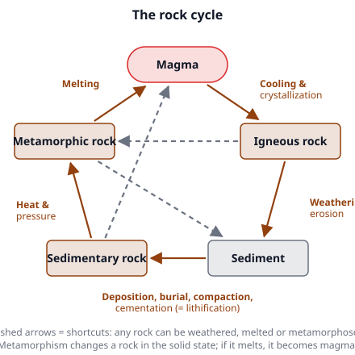
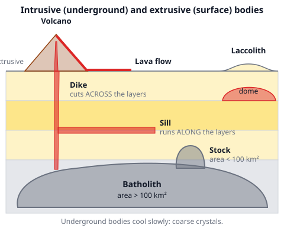
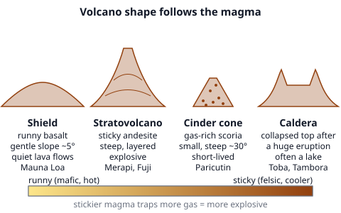
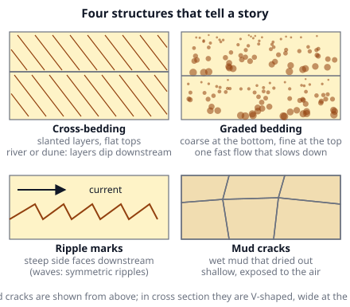

# 🟫 Rocks  ·  `earth.geosphere.rocks`
> 📅 Study date: Sat 17 Oct · ⏱️ ~12 min read · 📋 Syllabus: Sedimentary structures and environments, Types of metamorphism, Igneous rocks and magma types, Intrusive and extrusive bodies, Volcanism

## 🍳 Start with sugar syrup
Pour hot sugar syrup on a cold plate and it sets in seconds into clear, glassy toffee. Let the same syrup cool slowly in a jar for days and you get big **rock-candy crystals**. Magma does exactly this: the same melted rock makes tiny crystals when it cools fast at the surface and big crystals when it cools slowly underground. **The difference:** syrup has one ingredient, but magma is a mixture of many minerals that crystallize at different temperatures.

## 🖼️ Big picture

## 💡 Core ideas
1. **The rock cycle.** There are three families of rock. **Igneous** rock cools from molten rock (**magma** underground, **lava** at the surface). **Sedimentary** rock is built from pieces of older rock or from shells and dissolved minerals: weathering and erosion make **sediment**, and burial, **compaction** and **cementation** (together called **lithification**) turn it to stone. **Metamorphic** rock is any rock changed in the **solid state** by heat, pressure or hot fluids. Any rock can become any other.
2. **Igneous rocks and magma types.** The more **silica** (SiO₂) in the magma, the lighter the color, the lower the melting temperature and the **stickier** (more viscous) the magma. Where it cools sets the grain size: **intrusive** (slow, underground) means **coarse** crystals, **extrusive** (fast, at the surface) means **fine** crystals or glass. A **porphyritic** rock has big crystals in a fine background: slow cooling first, then a fast finish.

   | Magma type | SiO₂ | Main minerals | Intrusive / extrusive | Lava |
   |---|---|---|---|---|
   | **Felsic** | > 65 % | quartz, K-feldspar, Na-plagioclase, mica | **granite** / **rhyolite** | cooler (about 700 °C), very sticky, light-colored |
   | **Intermediate** | 55–65 % | plagioclase, amphibole | **diorite** / **andesite** | medium |
   | **Mafic** | 45–55 % | Ca-plagioclase, pyroxene, olivine (rich in **Fe** and **Mg**) | **gabbro** / **basalt** | hot (1000–1200 °C), runny, dark, dense |
   | **Ultramafic** | < 45 % | olivine, pyroxene | **peridotite** (the mantle rock) | very rare at the surface |

   Special textures: **obsidian** is volcanic glass (cooled too fast to crystallize), **pumice** (felsic) and **scoria** (mafic) are full of gas holes called **vesicles**, **pegmatite** has giant crystals.
3. **Intrusive and extrusive bodies.** Magma that stops underground makes **plutons**. A **batholith** is a huge body (more than 100 km² at the surface). A **stock** is smaller (less than 100 km²). A **dike** cuts **across** the layers; a **sill** squeezes **between** (parallel to) the layers; a **laccolith** is a sill that swelled into a dome and lifted the layers above it. Magma that reaches the surface makes **lava flows**, ash beds and **volcanoes**. By cross-cutting, an intrusion is always **younger** than the rock it cuts.
4. **Volcanism.** Volcanoes form at **subduction zones** (most of the Ring of Fire, including Indonesia), at **divergent boundaries** (mid-ocean ridges, Iceland) and over **hotspots** (Hawaii). The magma sets the shape: **shield** volcanoes (runny basalt, wide and gentle, quiet), **stratovolcanoes** (sticky andesite, steep cones of alternating lava and ash, explosive; Merapi, Fuji) and **cinder cones** (small, steep piles of gas-rich scoria). Stickier magma traps more gas and erupts **more explosively**. A **caldera** is a huge pit left when an emptied magma chamber collapses (Toba, Tambora). Explosive eruptions throw out ash and **pyroclastic flows** (hot clouds of gas and ash).
5. **Sedimentary rocks, structures and environments.**
   - **Clastic** rocks are classified by grain size: **gravel** (> 2 mm, makes conglomerate if rounded, breccia if angular), **sand** (1/16–2 mm, sandstone), **silt** (1/256–1/16 mm, siltstone) and **clay** (< 1/256 mm, shale). **Chemical** rocks precipitate from water (rock salt, gypsum). **Biochemical** rocks come from living things (limestone from shells, coal from plants).
   - **Structures** are clues: **bedding** (layers), **cross-bedding** (slanted layers made by moving wind or water, they dip downstream), **graded bedding** (coarse at the bottom, fine on top: one flow slowing down, e.g., an underwater landslide), **ripple marks** (asymmetric = a current, symmetric = waves) and **mud cracks** (mud that dried in the air).
   - **Environments:** river (gravel and sand, cross-beds), desert dunes (very well-sorted, rounded sand, huge cross-beds), beach and shallow sea (well-sorted sand, symmetric ripples, shell pieces), deep ocean (fine mud, graded beds from landslides), lake (thin laminated mud), swamp (coal), warm clear reef (limestone), evaporating bay (salt, gypsum), glacier (unsorted mix called till). Longer transport means **rounder** and **better sorted** grains.
6. **Types of metamorphism.** **Contact** metamorphism: heat from a nearby intrusion bakes a thin zone (no direction to the minerals; **hornfels**, marble). **Regional** metamorphism: heat and pressure over a huge area during mountain building; platy minerals line up in layers called **foliation**. **Burial** (deep basins), **dynamic** (crushing along a fault), **hydrothermal** (hot fluids) and **shock** (meteorite impacts) are the others. At subduction zones a cold slab gets high pressure but low temperature (**blueschist**). **Grade sequence of shale:** slate → phyllite → schist → gneiss. Non-foliated: **marble** (from limestone) and **quartzite** (from sandstone).

> 🍳 **Analogy:** rock candy and toffee show why cooling speed sets crystal size. **The difference:** a rock has many minerals that crystallize one after another (see Bowen's series in *Geochemistry & Minerals*), so a slowly cooled rock is a mix of crystals, not one big crystal.

## 🧮 HUSO-style examples

**Example 1.** A light-colored rock has crystals about 4 mm across that you can see without a lens: pink feldspar, gray glassy quartz and a few flakes of black mica. Which description fits best?

(A) Basalt, a mafic extrusive rock  (B) Rhyolite, a felsic extrusive rock  (C) Granite, a felsic intrusive rock  (D) Gabbro, a mafic intrusive rock  (E) Obsidian, volcanic glass

Steps:
1. **Crystals you can see** mean slow cooling, so the rock is **intrusive**. That removes (A), (B) and (E).
2. **Quartz and K-feldspar, light color** means high silica: **felsic**. Gabbro would be dark with pyroxene and Ca-plagioclase, so (D) is out.
3. Felsic and intrusive is **granite**. **Answer: (C).**
4. Traps: (B) has the same minerals but is fine-grained (you could not see the crystals). (D) has the right grain size but the wrong color and minerals.

**Example 2.** Hot magma squeezed between two flat sandstone layers and cooled into a thin sheet parallel to the layers. What is the body and how does its age compare with the sandstone?

(A) A dike, older than the sandstone  (B) A sill, younger than the sandstone  (C) A sill, older than the sandstone  (D) A laccolith, the same age  (E) A dike, younger than the sandstone

Steps:
1. A sheet **parallel** to the layers is a **sill**. A dike would cut **across** them. That leaves (B) and (C).
2. Magma can only push into rock that already exists, so the intrusion is **younger** than the sandstone (the cross-cutting rule). **Answer: (B).**
3. Traps: a laccolith needs a dome. "Older" would only fit a lava flow buried under the sandstone, which is not what happened here.

## ⚠️ Common traps
- **Mixing up where, not what.** Granite and rhyolite have the **same chemistry**, only the grain size differs. The same is true for gabbro and basalt.
- **"Dark means heavy means deep."** Mafic rock is dark and dense, but the *grain size*, not the color, tells you intrusive or extrusive.
- **Dike vs. sill.** Dikes cut **across** layers (like a dagger through a cake); sills go **along** them (like cream between cake layers).
- **Metamorphism is not melting.** The rock stays solid. If it melts, it becomes magma and the cycle starts over.
- **Cross-bedding vs. graded bedding.** Cross-bedding is slanted layers from a *moving current*; graded bedding is one layer that changes from coarse to fine from bottom to top.

## ✏️ Redraw from memory
Close the page and draw in 6 minutes:
- [ ] The rock cycle: 3 rock boxes + magma + sediment, with the 5 processes on the arrows.
- [ ] A cross section with a **dike** (across the layers), a **sill** (along the layers) and a **batholith** at the bottom.
- [ ] Side profiles of a **shield** and a **stratovolcano**, each with its magma type.
- [ ] The four sedimentary structures as small sketches, each with one clue it gives.
- [ ] A small table: felsic vs. mafic (color, SiO₂, density, lava stickiness, rock names).

Compare with the page and mark what you missed in red.

## 🎥 Watch / try
- [The Rock Cycle](https://www.youtube.com/watch?v=VByCLpj-I_s) — Professor Dave Explains · 4:20 · follow one grain of rock all the way around the cycle
- [Classification of Igneous Rocks: Intrusive vs. Extrusive](https://www.youtube.com/watch?v=TtvSyROolsk) — Professor Dave Explains · 5:37 · how grain size and silica content name a rock
- [Primary Sedimentary Structures: Bedding, Ripple Marks & Mud Cracks 101](https://www.youtube.com/watch?v=NdojCTnzOXA) — Malhotra GeoSciences · 6:46 · match each structure with the environment it records

## ✅ Check your understanding (5 questions)
Do these without looking at the material. You are **READY** if you get at least 4 of 5 right.

**1.** 🍳 Two batches of magma have exactly the same chemistry. Batch A erupts and cools in a lava flow within a few hours. Batch B cools over a million years deep underground. Which statement is most likely true?

(A) Both form coarse-grained rock  (B) A is coarse-grained and B is fine-grained  (C) A is fine-grained and B is coarse-grained  (D) A is porphyritic and B is glassy  (E) Both form glass

**2.** Which pairing of volcano type and magma is correct?

(A) Stratovolcano and runny basalt  (B) Shield volcano and runny basalt  (C) Shield volcano and sticky rhyolite  (D) Cinder cone and granite  (E) Caldera and gabbro

**3.** A sandstone shows layers that slant at about 25° and are cut flat at the top by the layer above. Which conclusion is best?

(A) It was deposited in still, deep water  (B) It was squeezed by a fault  (C) It cooled from magma  (D) It dried out after a flood  (E) It was deposited by moving wind or water

**4.** A limestone layer next to a hot intrusion turned into a hard, sugary-looking marble with no layering of its minerals. What type of metamorphism made it?

(A) Contact metamorphism  (B) Regional metamorphism  (C) Dynamic metamorphism  (D) Subduction (blueschist) metamorphism  (E) Weathering

**5.** A shale is buried deeper and deeper and heated more and more during mountain building. Which list shows the rocks it passes through, from low grade to high grade?

(A) Gneiss → schist → phyllite → slate  (B) Slate → schist → phyllite → gneiss  (C) Marble → slate → schist → gneiss  (D) Slate → phyllite → schist → gneiss  (E) Phyllite → slate → gneiss → schist

Answer key & explanations

1. **(C) A is fine-grained and B is coarse-grained.** Fast cooling leaves no time for crystals to grow; slow cooling lets them grow big, like the syrup in the jar. (A) and (B) swap or ignore the cooling speeds. (D) porphyritic needs two cooling stages, not one. (E) Glass would need cooling in seconds to minutes, and B certainly would not form it.
2. **(B) Shield volcano and runny basalt.** Runny lava spreads far and makes wide, gentle slopes. (A) Stratovolcanoes are made of sticky andesite, not runny basalt. (C) Sticky rhyolite makes domes and explosive eruptions, not shields. (D) Granite is an intrusive rock; it never erupts. (E) Gabbro is also intrusive, and a caldera is a collapse structure, not a magma type.
3. **(E) It was deposited by moving wind or water.** Cross-bedding is made by migrating dunes or river sand waves. (A) Still water makes flat, thin layers. (B) is made up. (C) Sandstone is sedimentary, not igneous. (D) Drying out makes mud cracks.
4. **(A) Contact metamorphism.** The heat came from a nearby intrusion and acted on a thin zone, and the rock has no foliation. (B) Regional metamorphism covers huge areas under pressure and usually makes foliation. (C) Dynamic needs crushing along a fault. (D) Blueschist means high pressure and low temperature at a subduction zone. (E) Weathering is a surface process, not metamorphism.
5. **(D) Slate → phyllite → schist → gneiss.** Grain size and heat increase step by step. (A) is the reverse. (B) and (E) put the steps in the wrong order. (C) marble comes from limestone, not from shale.

