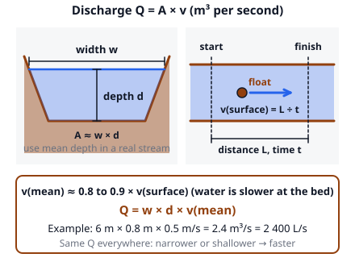
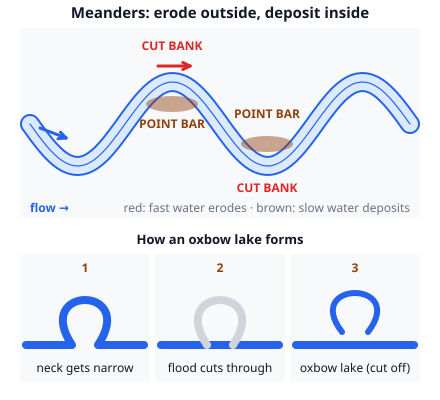

# 🟫 Freshwater  ·  `earth.hydrosphere.freshwater`
> 📅 Study date: Thu 5 Nov · ⏱️ ~12 min read · 📋 Syllabus: Discharge calculations, Erosional and depositional features

## 🏊 Start with filling the pool
Fill a 25 m × 10 m pool, 2 m deep, with a garden hose that delivers 0.3 liters per second, and you will wait about 19 days. Now picture a river with a flow of 100 cubic meters per second: it would fill the same pool in 5 seconds. That "how much water passes each second" number is the river's **discharge**. This page shows how to measure it, then how the moving water carves valleys and builds land.

## 🖼️ Big picture

## 💡 Core ideas
1. **How much fresh water is there?** About 96.5 % of Earth's water is salty ocean water. Only about 2.5 % is fresh, and of that fresh water about **69 % is ice**, about **30 % is groundwater** and only about **1 %** is everything else: lakes, soil moisture, swamps and rivers. Rivers alone hold only about 0.006 % of the fresh water, but they are the fastest-moving part of the cycle.
2. **Discharge.** **Discharge Q** is the volume of water passing a point per second, in **m³/s**. **Q = A × v**, the cross-section area times the mean speed. For a channel of width **w** and mean depth **d**, A = w × d, so **Q = w × d × v**. Quick unit check: 1 m³/s = 1000 liters per second. To measure it: find w and d with a tape and a stick; time a **float** over a known distance L to get the *surface* speed, v = L ÷ t; the **mean** speed is smaller (water drags on the bed), about **0.8 to 0.9 × the surface speed**.
3. **Continuity.** If no water joins or leaves, Q is the same all along the stream: **A₁ v₁ = A₂ v₂**. Where the channel gets **narrower or shallower** the water must go **faster**; where it widens, it slows down. A **hydrograph** plots discharge against time during a storm: a **rising limb**, a **peak**, then a **falling (recession) limb**; the **lag time** is the delay between the rain peak and the discharge peak. Paved cities send water to the river fast: a **higher peak** and a **shorter lag time**, so more floods.
4. **What a stream carries.** The **load** can be **dissolved**, **suspended** (fine silt and clay) or **bed load** (sand and gravel that bounce or roll). Fast water has more **capacity** (total load) and more **competence** (the biggest piece it can move). When the water slows, it **drops** its load, biggest pieces first. Sand is the easiest size to pick up; clay needs a *faster* flow to start moving because its grains stick together.
5. **Erosional features (mostly upstream, where it is steep).** **V-shaped valleys**, **rapids**, **potholes** (circular pits drilled by swirling pebbles) and **waterfalls** (water falls over a hard rock layer, digs a plunge pool and cuts the fall back upstream, leaving a **gorge**). **Depositional features (mostly downstream).** **Floodplains**, **natural levees** (low ridges beside the river, built when floods drop the coarsest sediment first, right next to the channel), **point bars**, **oxbow lakes**, **alluvial fans** (where a steep stream leaves the mountains and slows suddenly) and **deltas** (where a river enters a still body of water, like the sea or a lake, and drops its load). Rivers with lots of sediment and changing flow split into a **braided** pattern.
6. **Meanders.** The fastest water swings to the **outside** of a bend, so the outer bank is eroded (the **cut bank**, steep). On the **inside** the water is slow, so it drops sand and builds a **point bar**. The bend grows and moves downstream. Eventually a flood can cut through the narrow neck and the river takes the shortcut. The old loop is cut off as an **oxbow lake**.

> 🚿 **Analogy:** a river is like a garden hose where you press your thumb on the end: the opening gets smaller, so the water comes out faster. **The difference:** with a hose the extra speed comes from pressure; in a river it is just that the same volume per second has to squeeze through a smaller cross-section (continuity), and gravity is what keeps it moving.

## 🧮 HUSO-style examples

**Example 1.** To measure a stream, a student finds it is 12 m wide with a mean depth of 1.5 m. A float travels 20 m in 16 s. The mean speed is 0.85 × the surface speed. What is the discharge?

(A) 14.4 m³/s  (B) 19.1 m³/s  (C) 22.5 m³/s  (D) 15.3 m³/s  (E) 1.9 m³/s

Steps:
1. Surface speed: 20 m ÷ 16 s = **1.25 m/s**.
2. Mean speed: 0.85 × 1.25 = **1.0625 m/s**.
3. Area: 12 × 1.5 = **18 m²**.
4. Q = A × v = 18 × 1.0625 = **19.1 m³/s**. **Answer: (B).**
5. Traps: (C) 22.5 uses the surface speed and skips the 0.85 factor. (A) 14.4 uses 16 ÷ 20 for the speed. (D) 15.3 uses 0.85 *as* the speed. (E) 1.9 is a decimal slip.

**Example 2.** A stream is 20 m wide and 2 m deep, flowing at 0.5 m/s. Downstream it narrows to 8 m wide and deepens to 2.5 m. No water joins or leaves. How fast does it flow there?

(A) 0.4 m/s  (B) 0.5 m/s  (C) 1.0 m/s  (D) 1.25 m/s  (E) 2.5 m/s

Steps:
1. Upstream discharge: 20 × 2 × 0.5 = **20 m³/s**.
2. Downstream area: 8 × 2.5 = **20 m²**.
3. v = Q ÷ A = 20 ÷ 20 = **1.0 m/s**. **Answer: (C).** The speed doubled.
4. Traps: (D) 1.25 m/s changes only the width and ignores the depth. (A) 0.4 m/s scales by the depths the wrong way round (0.5 × 2 ÷ 2.5) and ignores the width. (B) 0.5 m/s forgets that the cross-section changed.

## ⚠️ Common traps
- **Units.** Discharge is **m³/s**. A river of 2.4 m³/s carries 2400 liters every second.
- **Surface speed vs. mean speed.** The float gives the *surface* speed, which is bigger than the mean.
- **Narrower means faster only if Q stays the same.** Continuity needs no water added or lost.
- **Cut bank vs. point bar.** Outside of the bend: fast, steep, eroding. Inside: slow, shallow, depositing.
- **Deltas vs. alluvial fans.** A delta builds where a river meets standing water. An alluvial fan builds where a steep stream meets a flat plain.
- **"Big floods bring only water."** Fast floods also carry huge loads of sediment and build levees and floodplains.

## ✏️ Redraw from memory
Close the page and draw in 5 minutes:
- [ ] A channel cross-section with w, d, v and the formula Q = w × d × v.
- [ ] A top view of a float experiment with the start line, the finish line and the distance L.
- [ ] A meandering river from above with the cut banks, the point bars and arrows for fast and slow water.
- [ ] The three steps that cut off a meander and leave an oxbow lake.
- [ ] A hydrograph with the rising limb, the peak, the recession and the lag time.

Compare with the page and mark what you missed in red.

## 🎥 Watch / try
- [How much water flow in a river? (How to calculate stream discharge)](https://www.youtube.com/watch?v=HXNSq7h3R7I) — Headwaters Science Center · 5:37 · follow the steps for width, depth and speed
- [River Landforms - Waterfalls, Meanders, Oxbow Lakes, Levees & More](https://www.youtube.com/watch?v=gDnGumb5NrY) — Keducate · 3:24 · match each landform to erosion or deposition
- [Why Do Rivers Curve?](https://www.youtube.com/watch?v=8a3r-cG8Wic) — MinuteEarth · 2:39 · why a bend keeps growing

## ✅ Check your understanding (5 questions)
Do these without looking at the material. You are **READY** if you get at least 4 of 5 right.

**1.** 🏊 A stream has a discharge of 2.5 m³/s. About how long would it take to fill a pool that is 25 m long, 10 m wide and 2 m deep?

(A) 0.005 s  (B) 20 s  (C) 200 s  (D) 500 s  (E) 1250 s

**2.** On a meander, a point bar builds up on the

(A) outside of the bend, where the water is fast.  (B) outside of the bend, where the water is deep.  (C) straight sections only.  (D) inside of the bend, where the water is fast.  (E) inside of the bend, where the water is slow.

**3.** A delta forms where

(A) a river enters a lake or sea, slows down and drops its load.  (B) a river leaves the mountains and speeds up.  (C) a river flows over a hard rock layer.  (D) a meander is cut off from the river.  (E) a river picks up its biggest load.

**4.** Compared with the same storm over farmland, a storm over a paved city will make the river's hydrograph show

(A) a lower peak and a longer lag time.  (B) the same peak and the same lag time.  (C) no peak at all.  (D) a higher peak and a shorter lag time.  (E) a flat line.

**5.** A stream is 10 m wide, 1.5 m deep and flows at 0.8 m/s. Further downstream the channel is 12 m wide and 2 m deep, with no water added or lost. What is the speed there?

(A) 0.4 m/s  (B) 0.5 m/s  (C) 0.8 m/s  (D) 1.0 m/s  (E) 1.6 m/s

Answer key & explanations

1. **(C) 200 s.** Volume = 25 × 10 × 2 = 500 m³. Time = volume ÷ discharge = 500 ÷ 2.5 = 200 s (3 min 20 s). (A) 0.005 s divides the other way. (B) 20 s divides by 25. (D) 500 s ignores the rate. (E) 1250 s multiplies.
2. **(E).** Slow water can't carry its sand, so it drops it on the inside of the bend. The fast, deep water on the outside erodes the cut bank. (A) and (B) describe the cut bank.
3. **(A).** The river's speed drops when it meets still water, so the sediment settles in a fan-shaped delta. (B) is wrong twice: where a river leaves the mountains it *slows* down, and that makes an alluvial fan, not a delta.
4. **(D).** Pavement stops infiltration, so water runs straight into the river: more water arrives sooner. That means a higher peak and a shorter lag time, and a higher risk of floods.
5. **(B) 0.5 m/s.** Upstream: Q = 10 × 1.5 × 0.8 = 12 m³/s. Downstream: A = 12 × 2 = 24 m², so v = 12 ÷ 24 = 0.5 m/s. The channel got bigger, so the water slows. (C) forgets the change. (E) 1.6 is double instead of half.

