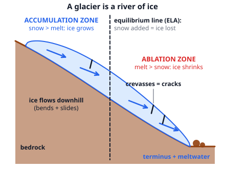
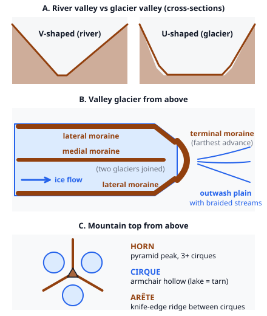

# 🟫 Glaciers  ·  `earth.hydrosphere.glaciers`
> 📅 Study date: Sun 1 Nov · ⏱️ ~12 min read · 📋 Syllabus: Formation, Erosional and depositional features

## 🎮 Start with an icy map
Think of a snowy, frozen map like Icebox in Valorant: smooth white ground, walls of ice, cold corridors. A real glacier is also a place made of ice, but it is not frozen in place. It is a **slow river of ice** that creeps downhill and carves the land as it goes. A round lasts a couple of minutes, but a glacier needs years to move a few hundred meters. This page shows how snow turns into that ice, how the ice moves, and the landscape it leaves behind.

## 🖼️ Big picture

## 💡 Core ideas
1. **Formation.** A glacier is a large, long-lived mass of ice that **flows**. It starts as snow: fresh snow is only about **0.1 g/cm³** (mostly air). Over a year or more new snow buries it, squeezes it and it recrystallizes into **firn** (granular old snow, about 0.4 to 0.8 g/cm³). Deeper, the air pockets close off and it becomes **glacier ice** (about **0.9 g/cm³**; pure ice is 0.917). It takes years in a warm, wet place and centuries in the cold, dry interior of Antarctica. A glacier can only form where **more snow falls in winter than melts in summer**, year after year.
2. **Kinds of glaciers.** **Valley (alpine) glaciers** flow down mountain valleys. **Ice caps** cover a high area. **Ice sheets** are continent-sized (more than 50 000 km²): Greenland and Antarctica. **Ice shelves** are sheets that float out over the sea and break off (**calve**) as icebergs. About 69 % of Earth's fresh water is locked in glacier ice, and about 90 % of that ice is in Antarctica. If all of it melted, the sea level would rise by about 65 m. (Floating ice like sea ice and ice shelves does not raise the sea when it melts; ice on land does.)
3. **Mass balance.** The **accumulation zone** is the upper part where snow adds more than melts. The **ablation zone** is the lower part where melting (and sublimation and calving) removes more than it gains. The line between them is the **equilibrium line** (ELA). Add up the whole glacier over a year: net gain means the glacier **advances**, net loss means the **terminus** (the front end) **retreats**. Even a retreating glacier still flows downhill: the front just melts faster than the ice arrives.
4. **How ice moves.** Gravity pulls it. The ice **deforms** (crystals slip past each other, like slow putty) and, when the bottom is wet, it also **slides** over the rock. It moves fastest at the surface in the middle and slowest along the bed and the sides, like a river. The top 50 m or so is brittle and cracks into **crevasses** where the ice bends or speeds up. Typical speeds are from a few meters to a few hundred meters per year.
5. **Erosion: carving.** Ice **plucks** blocks off the rock (meltwater freezes into cracks and the glacier tears the block away) and **abrades** it (rocks frozen into the ice scrape like sandpaper, leaving **striations** and fine "rock flour"). The landforms: a **cirque** (an armchair-shaped hollow at the head; a lake in it is a **tarn**); an **arête** (a knife-edge ridge between two cirques); a **horn** (a pyramid peak left when three or more cirques cut a mountain, like the Matterhorn); a **U-shaped valley** (wide, flat-floored, steep-sided, unlike the **V-shaped** valley of a river); a **hanging valley** (a side valley left high above the main one, with a waterfall); and a **fjord** (a U-shaped valley flooded by the sea).
6. **Deposition: dumping.** **Till** is what the ice drops directly: an **unsorted, unlayered** mix from clay to boulders. Ridges of till are **moraines**: **lateral** (along the sides), **medial** (down the middle where two glaciers join), **terminal** (at the farthest advance) and **ground** (a thin sheet). Meltwater washes and **sorts** material into layers: **outwash** (spread over an **outwash plain** by braided streams), **eskers** (long, winding ridges of sand and gravel from a stream under the ice), **kames** (mounds), **kettle lakes** (pits left when a buried block of ice melts) and **varves** (yearly layers in glacial lakes). **Drumlins** are oval, streamlined hills of till: the blunt, steep end faces **up-glacier** and the tail tapers down-glacier. **Erratics** are boulders of a different rock type carried far from home.

> 🧊 **Analogy:** the glacier is a conveyor belt that makes ice at the top and loses it at the bottom. The belt (the flow) keeps moving no matter what. **The difference:** a real belt has a fixed length, but a glacier's front moves forward or back depending on how the snow gained at the top compares with the ice lost at the bottom.

## 🧮 HUSO-style examples

**Example 1.** A valley glacier is 8 km long and its ice moves at about 100 m per year all the way along. About how long does a piece of ice need to travel from the head of the glacier to the terminus?

(A) 0.8 years  (B) 8 years  (C) 80 years  (D) 800 years  (E) 8000 years

Steps:
1. Convert: 8 km = 8000 m.
2. Time = distance ÷ speed = 8000 m ÷ 100 m/yr = **80 years**. **Answer: (C).**
3. So snow that falls at the head today comes out at the front about 80 years later. Glaciers keep old snow for a long time.
4. Traps: the other options are off by powers of ten, a slip between kilometers and meters (1 km = 1000 m). For example (D) 800 years treats 8 km as 80 000 m.

**Example 2.** On a map you find an oval hill about 1 km long made of unsorted clay, sand and boulders. One end is steep and blunt, the other tapers into a long gentle slope. The steep end points north. Which landform is it and which way did the ice flow?

(A) an esker, flowing south  (B) a drumlin, flowing south  (C) a drumlin, flowing north  (D) a kame, flowing north  (E) a kettle, flowing south

Steps:
1. Unsorted material means **till**, so it was dropped by ice directly, not by meltwater. That rules out esker, kame and kettle (all meltwater features or holes).
2. A streamlined oval hill of till is a **drumlin**.
3. The blunt, steep end faces **up-glacier**, so the ice came *from* the north and flowed toward the south. **Answer: (B).**
4. Trap: (C) reverses the direction: the steep end is the side the ice hit first.

## ⚠️ Common traps
- **"The glacier moved back, so the ice flows uphill."** No: the ice always flows downhill. The *front* retreats when melting beats arrival.
- **Till vs outwash.** Till = unsorted, unlayered, dropped by ice. Outwash = sorted, layered, moved by meltwater.
- **V vs U.** Rivers cut V-shaped valleys; glaciers make wide U-shaped valleys.
- **Sea level.** Melting sea ice or an ice shelf does not raise the sea. Melting land ice does.
- **Accumulation zone means "more snow", not "snow only".** In the accumulation zone some snow still melts; there is just more gain than loss.
- **Moraine names.** Lateral = side, medial = middle (two glaciers joined), terminal = end.

## ✏️ Redraw from memory
Close the page and draw in 5 minutes:
- [ ] A side view of a valley glacier with the accumulation zone, ablation zone, equilibrium line and terminus labeled.
- [ ] The three steps of formation with rough densities: snow, firn, glacier ice.
- [ ] A cross-section of a V-valley next to a U-valley.
- [ ] A map view of a glacier with lateral, medial and terminal moraines and the outwash plain beyond.
- [ ] A horn with three cirques and the arêtes between them.

Compare with the page and mark what you missed in red.

## 🎥 Watch / try
- [All About Glaciers for Kids: How Glaciers Form and Erode to Create Landforms](https://www.youtube.com/watch?v=PbYXiJsF5mw) — Free School · 4:00 · watch how snow becomes ice and what the ice carves
- [Glacial Processes & Glacial Landforms | GCSE GEOGRAPHY](https://www.youtube.com/watch?v=ELzc_B4YxWc) — No Waffle GCSE · 7:10 · match each landform to a picture
- [Glacial mass balance](https://www.youtube.com/watch?v=ZnSfO7Fxvdw) — Josh Galster · 4:21 · how accumulation and ablation decide whether a glacier grows

## ✅ Check your understanding (5 questions)
Do these without looking at the material. You are **READY** if you get at least 4 of 5 right.

**1.** Which is the correct order in which glacier ice forms?

(A) firn → snow → glacier ice  (B) snow → firn → glacier ice  (C) snow → glacier ice → firn  (D) glacier ice → firn → snow  (E) firn → glacier ice → snow

**2.** Which deposit is unsorted and unlayered, with pieces from clay to boulders?

(A) outwash  (B) esker sand  (C) beach sand  (D) glacial till  (E) river alluvium

**3.** 🎮 On an icy map, a corridor is a smooth trench with steep walls and a flat floor, shaped like the letter U. Which natural process most likely carved a real valley with this shape?

(A) A glacier  (B) A fast river  (C) Wind  (D) An earthquake  (E) Ocean waves

**4.** A sharp, pyramid-shaped peak like the Matterhorn forms where

(A) a volcano erupts again and again.  (B) a river bends back and forth.  (C) one cirque cuts into the side of a mountain.  (D) two glaciers join and make a medial moraine.  (E) three or more glaciers cut cirques into the sides of the same mountain.

**5.** In one year a glacier gains 2.4 m of snow (water equivalent) and loses 2.9 m by melting. What is its net balance for the year?

(A) +5.3 m  (B) +0.5 m  (C) −0.5 m  (D) −5.3 m  (E) 0.0 m

Answer key & explanations

1. **(B).** Fresh snow is buried and squeezed into firn, and firn is squeezed further into glacier ice as the air pockets close.
2. **(D) glacial till.** Ice carries everything at once and drops it without sorting. Outwash (A) and esker sand (B) were moved by meltwater, which sorts and layers the material. Beach sand and river alluvium are also sorted by moving water.
3. **(A) a glacier.** Ice fills the whole valley and erodes the floor and the sides equally, giving a wide U shape. A river cuts down into its bed, making a V. **The difference:** the game corridor is just a map shape, but the U shape is a real clue that a glacier was there.
4. **(E) a horn.** Three or more cirques cut back into a mountain from different sides, leaving a pointed pyramid. (D) is wrong: a medial moraine is a stripe of rock on a glacier.
5. **(C) −0.5 m.** Net balance = gain − loss = 2.4 − 2.9 = −0.5 m. A negative balance over many years makes the glacier shrink and the terminus retreat. (B) swaps the sign. (A) and (D) add the numbers.

