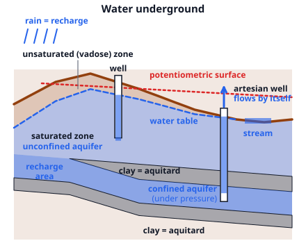
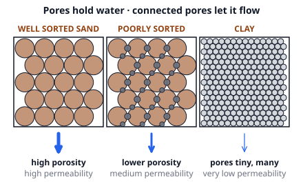

# 🟫 Groundwater  ·  `earth.hydrosphere.groundwater`
> 📅 Study date: Tue 3 Nov · ⏱️ ~12 min read · 📋 Syllabus: Aquifers, Water table, Porosity and permeability

## 🍳 Start with a coffee filter
Pour hot water over coffee grounds in a paper filter. The water soaks into the tiny gaps between the grains, then drips through to the cup. Coarse grounds let it run fast. Powder-fine grounds clog the filter and it drips for ages. The ground under your feet is a giant coffee filter: rain soaks into the gaps in soil and rock, and then it creeps downhill underground. The gaps are called **pores**. **The difference:** underground water is not a river in a tunnel (except in some caves). It is water filling the pores of rock, like water in a soaked sponge.

## 🖼️ Big picture

## 💡 Core ideas
1. **Two zones.** Rain **infiltrates** (soaks in). In the upper **unsaturated (vadose) zone** the pores hold both air and water. Lower down, in the **saturated zone**, *every* pore is full of water. The top of the saturated zone is the **water table**. Groundwater is about **30 %** of Earth's fresh water, far more than all lakes and rivers together.
2. **The water table.** It is a smoothed copy of the land surface: **higher under hills, lower under valleys**. Where it reaches the surface you find **springs, streams, lakes and wetlands**. It **rises** after heavy rain (recharge) and **falls** in a drought or when people pump. A well gives water only if it goes deeper than the water table. Groundwater moves from high water level to low water level, **slowly** (centimeters to a few meters per day).
3. **Porosity.** **Porosity** is the share of a material that is empty space: **porosity (%) = volume of pores ÷ total volume × 100**. Typical values: sand and gravel 25 to 40 %, silt 35 to 50 %, **clay 40 to 70 %**, sandstone 5 to 30 %, solid granite about 1 %. Well-sorted grains (all about the same size) leave more space than poorly sorted ones, where small grains fill the gaps between big ones. For equal spheres the size of the grains does not matter at all: only how they are packed.
4. **Permeability.** **Permeability** tells how easily water *flows through* a material. It needs pores that are **big and connected**. Gravel and coarse sand are very permeable. **Clay** has lots of pore space but the pores are tiny, so water clings to the grains and barely moves: **high porosity, very low permeability**. **Darcy's law**: the flow (volume per area per time) is **q = K × i**, where **K** is the *hydraulic conductivity* (a measure of permeability, in m/day) and **i = Δh ÷ L** is the *hydraulic gradient* (drop in water level per distance). The water in the pores moves faster than q, at **v = q ÷ n** (n = porosity as a decimal).
5. **Aquifers.** An **aquifer** is rock or sediment that holds and passes enough water to supply wells (sand, gravel, sandstone, fractured rock, limestone). An **aquitard** is a layer that blocks water (clay, shale). An **unconfined aquifer** is open to the surface: its top is the water table, and the rain above recharges it directly. A **confined aquifer** is sandwiched between two aquitards, so its water is **under pressure**. It is refilled where the layer reaches the surface (the **recharge area**). The **potentiometric surface** is the height the water would climb to in a well. If it is **above the ground**, an **artesian well** flows without pumping.
6. **Using it up.** Pumping drops the water level around a well in a **cone of depression**. Too much pumping drops the whole water table, dries up wells and springs, and makes the ground **sink** (subsidence, as in Jakarta). Near the coast, fresh water floats on top of heavier salt water, and pumping lets the **salt water intrude** into the wells. For every **1 m** the fresh water table is above sea level, fresh water reaches about **40 m below** sea level (**Ghyben–Herzberg** rule). **Karst** is a landscape on limestone: slightly acidic rain dissolves the rock into caves, **sinkholes** and big springs.

> ☕ **Analogy:** an aquifer is like a bed of coffee grounds that is still wet: the gaps hold water, and the water moves slowly through the gaps. **The difference:** a coffee filter drains empty, but an aquifer below the water table stays full and is slowly refilled by rain. The water table is the water *surface inside* the bed.

## 🧮 HUSO-style examples

**Example 1.** A dry rock sample has a volume of 200 cm³ and a mass of 500 g. It is soaked in water until all its pores are full, and then it has a mass of 550 g (water: 1 g per cm³). What is its porosity?

(A) 9.1 %  (B) 10 %  (C) 25 %  (D) 50 %  (E) 275 %

Steps:
1. The extra mass is the water in the pores: 550 − 500 = 50 g.
2. 50 g of water is 50 cm³, so the pores hold 50 cm³.
3. Porosity = 50 ÷ 200 = 0.25 = **25 %**. **Answer: (C).**
4. Traps: (B) 10 % divides by the dry mass (50 ÷ 500) and (A) 9.1 % by the wet mass (50 ÷ 550), but porosity compares *volumes* (50 cm³ against 200 cm³). (D) 50 % uses the 50 g as a percentage. (E) 275 % divides 550 by 200.

**Example 2.** Two wells, A and B, are 200 m apart in a sand aquifer. The water level is 52.0 m above sea level in A and 50.0 m in B. The hydraulic conductivity is K = 5 m/day and the porosity is 25 % (0.25). A pollutant dissolved in the water leaks at well A. About how long until the water carrying it reaches well B?

(A) 40 days  (B) 16 000 days  (C) 1000 days  (D) 4000 days  (E) 0.2 days

Steps:
1. Hydraulic gradient: i = Δh ÷ L = (52.0 − 50.0) ÷ 200 = **0.01**. Water flows from A (higher level) to B.
2. Darcy flux: q = K i = 5 × 0.01 = **0.05 m/day**.
3. The water in the pores moves faster: v = q ÷ n = 0.05 ÷ 0.25 = **0.2 m/day**.
4. Time = 200 m ÷ 0.2 m/day = **1000 days** (about 2.7 years). **Answer: (C).**
5. Traps: (D) 4000 days forgets the porosity (200 ÷ 0.05). (A) 40 days uses K alone (200 ÷ 5). (B) 16 000 days multiplies by n instead of dividing. (E) 0.2 days reads the speed 0.2 m/day as a time.

## ⚠️ Common traps
- **Porosity ≠ permeability.** Clay has high porosity and very low permeability. A rock can hold a lot of water and still give none to a well.
- **"Underground rivers."** Most groundwater seeps through pores; it does not run in tunnels (only in karst).
- **Water table vs. potentiometric surface.** The water table is the top of an *unconfined* aquifer. The potentiometric surface is an imaginary level for a *confined* one.
- **Grain size and porosity.** For equally sized grains, big and small ones have the same porosity. Sorting changes porosity; size changes permeability.
- **Darcy speed vs. real speed.** q is a flux. The water in the pores is faster by the factor 1 ÷ n.
- **Over-pumping near the coast.** It lets *salt* water into the wells.

## ✏️ Redraw from memory
Close the page and draw in 5 minutes:
- [ ] A cross-section with the ground surface, the water table (higher under a hill), the unsaturated zone and the saturated zone.
- [ ] An unconfined aquifer and a confined aquifer between two clay layers, labeled.
- [ ] The recharge area for the confined aquifer and an artesian well that flows by itself, with the potentiometric surface drawn above the ground.
- [ ] A spring or a stream where the water table meets the surface.
- [ ] Three small boxes of grains: well sorted, poorly sorted and clay, with the words high / low porosity and permeability.

Compare with the page and mark what you missed in red.

## 🎥 Watch / try
- [What is Groundwater and the Water Table?](https://www.youtube.com/watch?v=xoeDCxjBnVs) — Ruppert Rocks Geology · 2:48 · look at where the water table meets the land
- [The Fundamentals of Porosity and Permeability](https://www.youtube.com/watch?v=JjEmxgr0TR8) — Michigan Geological Survey · 5:34 · hear why the two are not the same
- [What Is Groundwater?](https://www.youtube.com/watch?v=oNWAerr_xEE) — KQED QUEST · 5:11 · see how people use aquifers

## ✅ Check your understanding (5 questions)
Do these without looking at the material. You are **READY** if you get at least 4 of 5 right.

**1.** Which sediment has high porosity but very low permeability?

(A) gravel  (B) coarse sand  (C) well-sorted sand  (D) clay  (E) fractured limestone

**2.** An artesian well flows without a pump because

(A) the water is under pressure and the potentiometric surface is above the ground.  (B) the water table is below the bottom of the well.  (C) the well is dug into an unconfined aquifer.  (D) water is always lighter than rock.  (E) the Sun heats the water underground.

**3.** In a region with an unconfined aquifer, farmers pump water heavily from one well. What happens to the water table next to that well?

(A) It rises in a mound around the well.  (B) It does not change, because pumping only removes water from the unsaturated zone.  (C) It sinks in a cone shape around the well.  (D) The aquifer turns into an aquitard.  (E) The potentiometric surface rises above the ground.

**4.** 🍳 A 2.0 L bowl is filled to the top with dry rice. You slowly pour in water until the rice is just covered, which takes 0.8 L. What is the porosity of the rice bed?

(A) 29 %  (B) 60 %  (C) 80 %  (D) 250 %  (E) 40 %

**5.** On a small coral island the fresh-water table is 2 m above sea level. About how far below sea level does the fresh water reach before it meets salt water?

(A) 2 m  (B) 80 m  (C) 40 m  (D) 20 m  (E) 200 m

Answer key & explanations

1. **(D) clay.** Clay is 40 to 70 % empty space, but the pores are tiny and not well connected, so water hardly moves. Gravel (A) and coarse sand (B, C) are both porous and permeable. (E) fractured limestone can carry water fast through its cracks.
2. **(A).** A confined aquifer is under pressure from the water uphill. Where the potentiometric surface is higher than the ground, the water rises up the well and flows out. (B) would be a dry well.
3. **(C) a cone of depression.** Water is removed faster than it can flow back in, so the level drops most next to the well. (E) is wrong: the potentiometric surface is for confined aquifers, and pumping lowers it too.
4. **(E) 40 %.** The pores hold 0.8 L, the whole bed is 2.0 L, so 0.8 ÷ 2.0 = 0.4 = 40 %. (A) 29 % divides by 2.8 L (bowl plus water). (B) 60 % is the share of solid rice (1.2 ÷ 2.0). (C) 80 % reads 0.8 as a percent. (D) 250 % divides the wrong way round.
5. **(B) 80 m.** The Ghyben–Herzberg rule says fresh water extends about 40 times the height of the water table below sea level: 40 × 2 m = 80 m. (C) 40 m is just the ratio. (A) 2 m forgets the rule. (D) 20 m divides instead of multiplies. (E) 200 m uses a ratio of 100.

